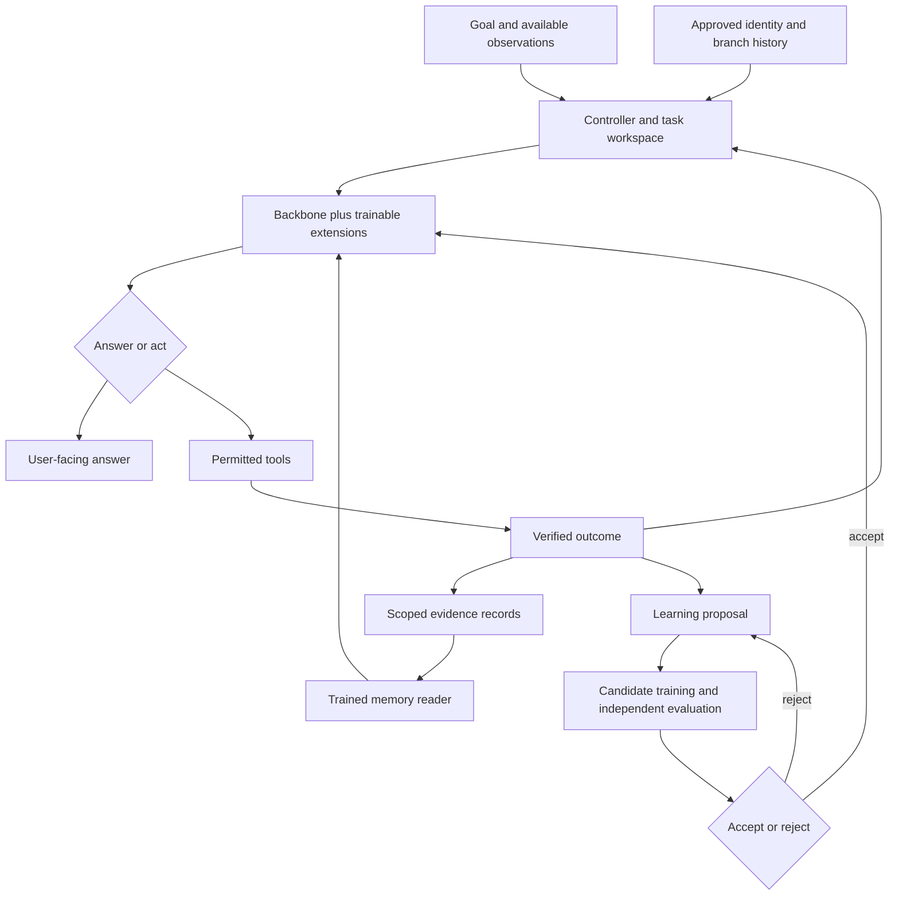
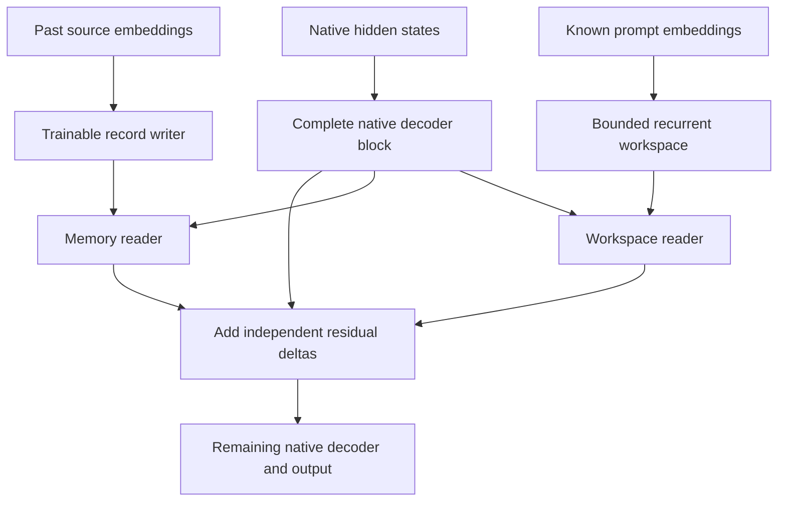
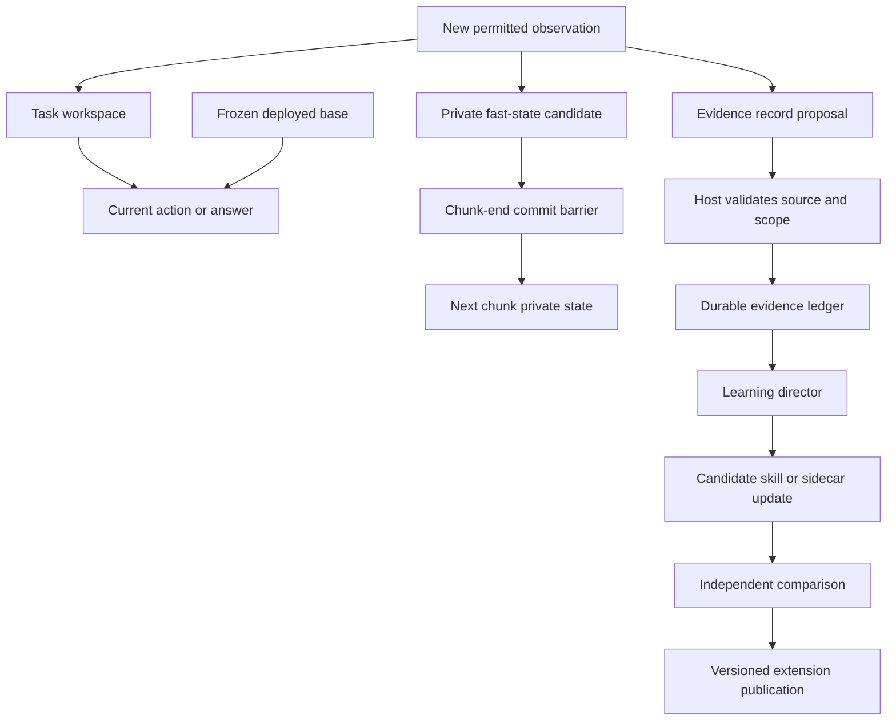
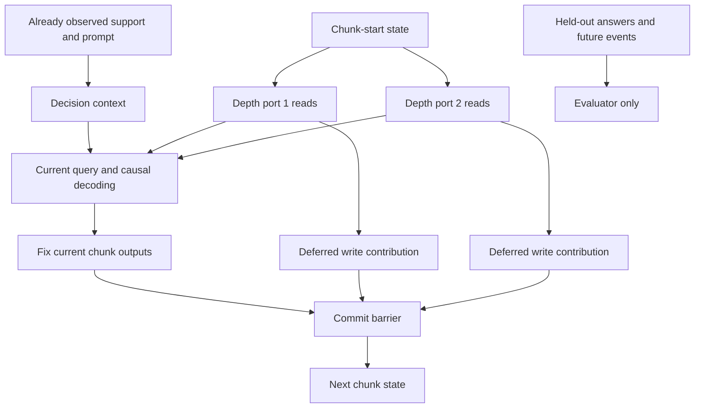
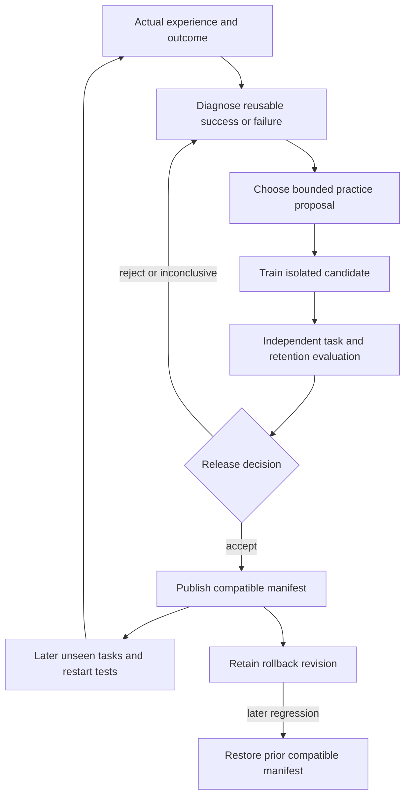
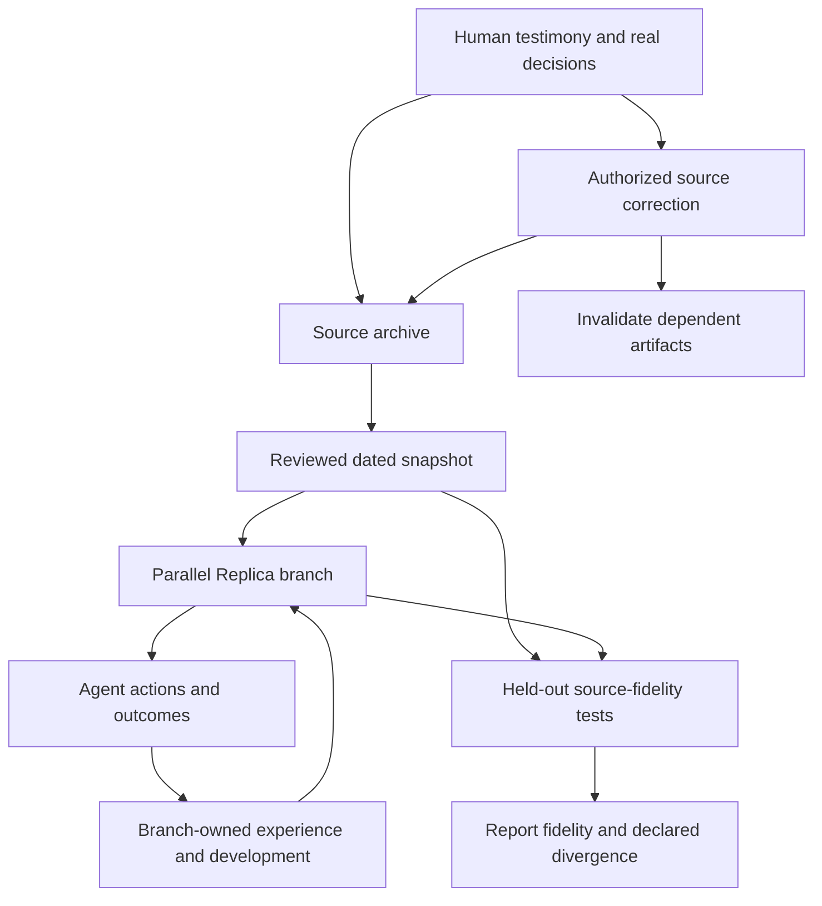
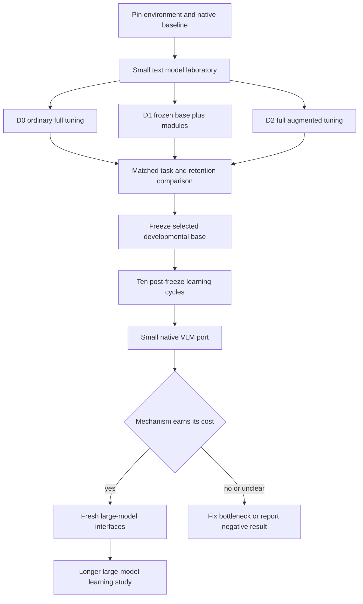
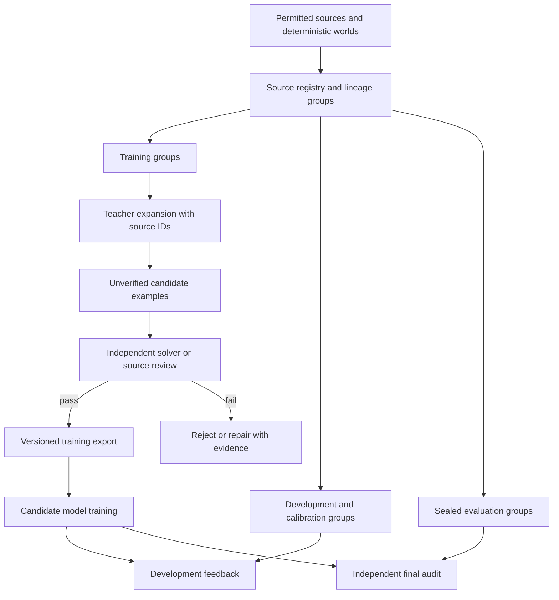

# 07 - Architecture diagrams

**Current component diagrams:** [architecture v1 catalog](../diagrams/architecture_v1/README.md)
contains rendered SVGs and editable Mermaid for the full
[research design](architecture/README.md). It covers the two backbones, memory
ports, persistent stores, shared core, action/learning loops and Replica.
The original eight-page atlas below remains preserved as the earlier framework.

**All diagrams describe proposed research architecture. Shipped CPU contract tests do not establish model-quality improvement.**

[Download the eight-page vector atlas](../diagrams/Replica_R3_Architecture_Atlas.pdf). Every diagram is also available as SVG, PNG and editable Mermaid source. The PDF/SVG layouts show implementation-status colors; Mermaid prioritizes relationships.

## Complete system

[SVG](../diagrams/01_full_system.svg) | [PNG](../diagrams/01_full_system.png) | [Mermaid source](../diagrams/01_full_system.mmd)

## Native decoder integration

[SVG](../diagrams/02_native_llama_integration.svg) | [PNG](../diagrams/02_native_llama_integration.png) | [Mermaid source](../diagrams/02_native_llama_integration.mmd)

## Separate state and update timescales

[SVG](../diagrams/03_memory_timescales.svg) | [PNG](../diagrams/03_memory_timescales.png) | [Mermaid source](../diagrams/03_memory_timescales.mmd)

## Causal support and shared fast-state barrier

[SVG](../diagrams/04_causal_support_query.svg) | [PNG](../diagrams/04_causal_support_query.png) | [Mermaid source](../diagrams/04_causal_support_query.mmd)

## Autonomous learning and promotion

[SVG](../diagrams/05_autonomous_learning_loop.svg) | [PNG](../diagrams/05_autonomous_learning_loop.png) | [Mermaid source](../diagrams/05_autonomous_learning_loop.mmd)

## Source and parallel Replica identity

[SVG](../diagrams/06_replica_identity_lineage.svg) | [PNG](../diagrams/06_replica_identity_lineage.png) | [Mermaid source](../diagrams/06_replica_identity_lineage.mmd)

## Two-stage experimental progression

[SVG](../diagrams/07_two_stage_roadmap.svg) | [PNG](../diagrams/07_two_stage_roadmap.png) | [Mermaid source](../diagrams/07_two_stage_roadmap.mmd)

## Source lineage before generation

[SVG](../diagrams/08_dataset_pipeline.svg) | [PNG](../diagrams/08_dataset_pipeline.png) | [Mermaid source](../diagrams/08_dataset_pipeline.mmd)

## Reading the evidence correctly

The native Llama integration, memory primitives and trusted-process publication utilities have numerical/software tests. The complete learned controller, autonomous neural curriculum, VLM port and larger-model transfer remain proposed integration work. The source/prompt boundary excludes future target tokens from inputs; training may still use later target labels through the declared loss.
