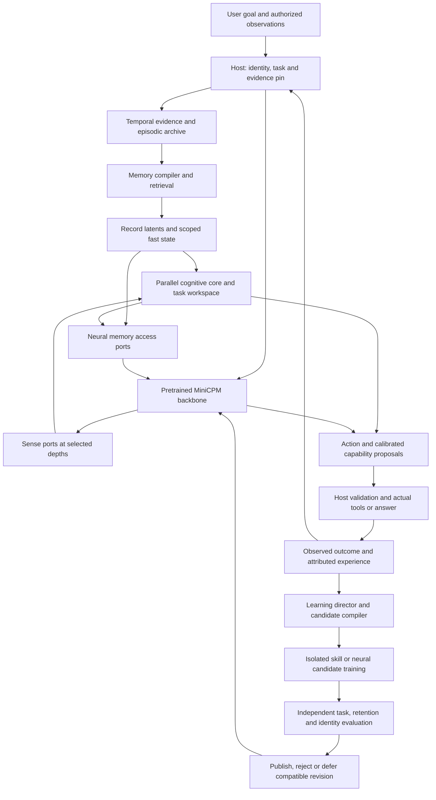
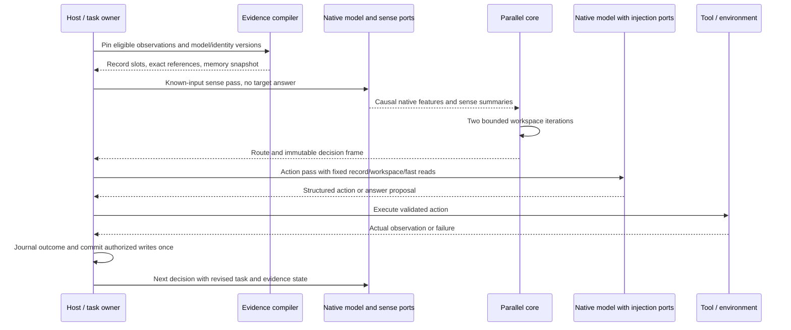
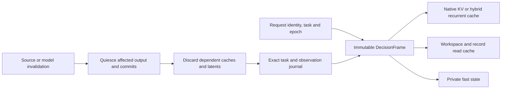
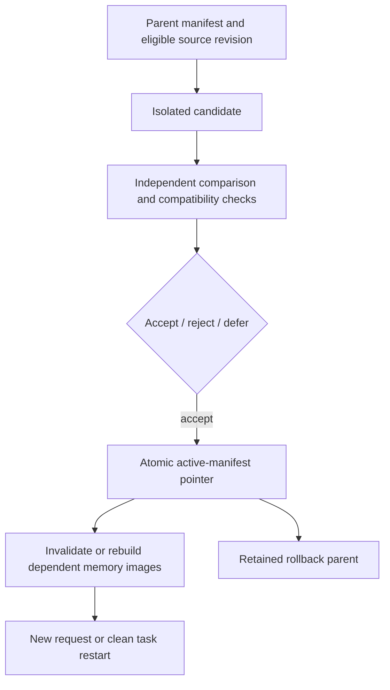

# The integrated Replica architecture

**Implementation reconciliation — 25 October 2026:** R1–R4 passed at `757ace1`.
The repair prerequisites described below are satisfied; isolated MiniCPM5 V0 is
next and remains natively unqualified. Reuse the recorded 140 integrated tests
and 1,372-test +21-subtest source-export result in
[repair qualification](../../reports/memory_contract_repairs_20261025/qualification.json). This maintenance inspected that evidence without rerunning
native work. The dated design and historical results below retain their scope.

**Implementation reconciliation: 25 October 2026, reviewed HEAD `7c7018e`.**
This is the target architecture with substantial native text/runtime components
implemented. Narrow native results do not yet establish useful persistent
neural learning or personal fidelity. Use the
[current research plan](15_Research_Crosscheck_and_Backbone_Plan.md) and
[loop-agent instructions](16_Loop_Agent_Instructions.md) for current repair,
MiniCPM5 V0, vision, visual-memory and RSI order, with Spark preparation now. The [design index](README.md) and model-specific
[backbone contract](02_Backbone_Integration.md) retain the full design.

MiniCPM5 remains the baseline. Repair caller-context/schedule verification and
representation-preserving rebuild first, then add
a pretrained visual encoder and a newly trained MiniCPM5 projector. Qualify
visual alignment/instructions before visual memory and verified RSI. MiniCPM-V
is an optional pretrained reference/teacher. Prepare official Spark FP8/BF16
now; qualify its native adapter and new connector later under independent gates. See [the visual plan](18_MiniCPM5_Vision_Training_and_Continual_Learning.md).
Model, memory and learning-policy changes keep independent controls. The full
[system design](19_Integrated_Memory_Learning_and_RSI_Design.md) connects memory,
runtime compilation, personality, vision and bounded learning.

## 1. The decision this design makes

Build on the pretrained MiniCPM models. Preserve their language, attention and
vision machinery, and train additional memory access ports and a parallel
cognitive core to cooperate with those representations. Full augmented tuning
of the small models is the development instrument; training a replacement
foundation model from random initialization is outside this design.

The complete system contains three cooperating parts:

1. **Native model and neural extensions:** native decoder, depth-specific sense
   projections, memory readers, shared cognitive core, fast associative state,
   residual injectors, action and capability heads.
2. **Persistent runtime:** temporal evidence, exact task state, retrieval,
   source-bound memory compilation, tools, identity branches, cache ownership
   and event transactions.
3. **Learning system:** experience selection, training-data and skill compilation,
   isolated candidate optimization, independent evaluation and publication.

Each part is necessary. A database alone does not supply trained memory use;
neural memory alone does not preserve exact provenance; a planner alone does not
improve its future behavior. The intended product connects all three.

The feedback arrows describe decision-to-decision operation. They do not create
a cyclic PyTorch graph inside one native decoder pass. Section 4 defines the
execution order precisely.

## 2. Component inventory and implementation boundary

Every component has a detailed mechanism and block diagram in this package.
“Existing” means a reusable foundation; it does not assert a complete production
implementation or learned capability. The machine-readable inventory is
[architecture_design_v1.json](../../configs/architecture_design_v1.json).
Current implementation/training/evaluation state is separate in
[architecture_implementation_status_v1.json](../../configs/architecture_implementation_status_v1.json).

| ID | Component and design idea | Integration and use | Current boundary / detailed design |
|---|---|---|---|
| C01 | Native backbone adapter: preserve pretrained computation and expose explicit ports | MiniCPM5 text and new visual-input interface; optional hybrid VLM reference and later Spark | Text multi-port adapter exists; visual retrofit remains unqualified; [backbone design](02_Backbone_Integration.md) |
| C02 | Sense and residual access ports: learned projections connect native and memory spaces | Sense known observations; read record, fast and workspace state into native blocks | Independent memory/workspace/fast readers at 13/27 and sense at 13/27/41 implemented; useful gain open; [port design](02_Backbone_Integration.md) |
| C03 | Evidence and episode store: retain exact source, temporal and ownership information | Supplies eligible records, actual outcomes and replay lineage | Temporal ledger, eligibility, corrections and task observations implemented; coordinated compiler transactions open; [memory design](03_Memory_and_Runtime_Compilation.md) |
| C04 | Record encoder and latent store: reusable per-record representations | Encode source-only chunks; cache only compatible inference payloads | Contextual per-record writer, versioned latents and opt-in pointer/context paths exist; novel-value/cross-template utility unresolved; [memory design](03_Memory_and_Runtime_Compilation.md) |
| C05 | Retrieval router and pager: learn usefulness within host-permitted candidates | Hybrid search, learned rerank, explicit exact-text fetch and cost accounting | Lexical/native-dense retrieval, learned reranker and exact fetch exist; lexical remains default; general learned routing open; [memory design](03_Memory_and_Runtime_Compilation.md) |
| C06 | Fast neural memory: adapt bounded associative state from observed history | Multi-depth readers share an owner-scoped state and a commit schedule | Host lifecycle/native readers and differentiable single-page writers exist; both learned candidates 0/8 held-out; multi-chunk useful learning open; [fast-memory reference](10_Fast_Memory_Reference.md) |
| C07 | Conditional lookup memory: reserve sparse capacity for repeated patterns | Separate Engram-inspired branch, independent from personal evidence | Planned and unimplemented; static pattern lookup plus dynamic routing requires separate evidence; [research plan](15_Research_Crosscheck_and_Backbone_Plan.md) |
| C08 | Task graph and neural workspace: exact commitments plus compressed working state | Maintain goal, subgoals, unresolved evidence, hypotheses and next action | Exact journal/eight-slot workspace implemented; narrow mixed completion and 12/12 copied-case restart checks; [current resumption](../experiments/20261023_Resumption_Record.md) |
| C09 | Shared cognitive core: bounded comparison and revision | Sense → route → recurrent workspace → inject/action; multiple ports share the core | Core/readers/controls implemented; tiny 2/2 versus 1/2 controls do not establish recurrent benefit; [research plan](15_Research_Crosscheck_and_Backbone_Plan.md) |
| C10 | Action executor and outcome verifier: bind proposed actions to real results | Retrieve, ask, verify, tool, revise, answer, stop | Tools/verifier/restart implemented; mixed completion passes, free-form negative; historical ranking needs corrected-menu evaluation; [current resumption](../experiments/20261023_Resumption_Record.md) |
| C11 | Capability and value-of-information model: predict usefulness empirically | Predict success and benefit of another read, question, tool or compute step | Diagnostic fit on 18 outcomes; uncalibrated/unpublished and no success authority; [head results](../experiments/20261023_E3_Success_Head_Results.md) |
| C12 | Runtime compiler and skill catalog: convert experience into reusable artifacts | Context packs, latent pages, fast-state images, procedures and candidate datasets | Typed artifacts, procedure execution and opt-in neural consumers exist; coordinated durable compiler remains open; [artifact contracts](11_Runtime_Artifacts.md) |
| C13 | Learning director: select worthwhile bounded changes | Choose memory operation, practice, replay, skill or neural update | Deterministic director, runtime adapter and checked-proposal gate exist; 5 accepted/8 rejected-deferred below 10/10 minimum; learned selection open; [research plan](15_Research_Crosscheck_and_Backbone_Plan.md) |
| C14 | Candidate trainer and evaluator: update declared parameters and measure later behavior | D0/D1/D2 development, then parent-bound sidecar/skill candidates | Native trainers/restart and isolated procedure/neural candidates exist; integrated longitudinal gain open; [build plan](05_Implementation_Sequence.md) |
| C15 | Manifest, checkpoint and publication service: activate compatible revisions | Atomic model/memory/compiler versions, rollback and source invalidation | Single-writer atomic manifest publication and ancestor rollback exist; complete payload binding and cross-store recovery open; [artifact contracts](11_Runtime_Artifacts.md) |
| C16 | Replica identity service: source history and branch development stay attributable | Mode-specific context, conditional values and held-out personal decisions | Optional native reader attached after workspace; persistent contracts and fictional scorer exist; encoder/training/authentic fidelity open; [identity interface](09_Replica_Identity_Interface.md) |
| C17 | Request scheduler and cache manager: explicit ownership of all live state | Serialize initial GPU work; pin epoch, native caches and memory state per request | Request frames, single-job admission, pre-admission invalidation and host cache exist; native KV reuse pending; [research plan](15_Research_Crosscheck_and_Backbone_Plan.md) |
| C18 | Multimodal ingress and memory writer: retain visual grounding | Native image processor → vision merger → text core, with source/frame lineage | Separate V4.7 port planned; local weights and native multimodal qualification pending; [backbone design](02_Backbone_Integration.md) |

## 3. Concrete first configuration

These are the original connected-system design allocations. The text core,
record ports and host fast-state geometry are implemented with bounded native
engineering evidence; they are not selected hyperparameters or proof of useful
learned memory. M2's new memory geometry is a separate measured candidate.
The historical 64-wide, four-slot, last-layer adapter remains a reference arm.

| Quantity | First connected text configuration |
|---|---|
| Native source | Existing sealed MiniCPM5-2B; 42 blocks, width 2048 |
| Injection ports | Zero-based blocks 13 and 27; observer at 41 |
| Shared core | Width 256, eight workspace slots, two tied recurrent iterations |
| Record memory | Up to 16 selected source-span units, four 256-wide slots per unit |
| Fast memory reference | Four heads of 64 × 64 FP32 state; one shared state group across ports |
| Read branches | Record memory, workspace and fast memory have separate gates/null paths |
| Native generation | One frozen decision frame; source/goal changes require a new boundary |
| Ownership | One GPU model job initially; request-local state even when serialized |
| Initial dtype/optimizer | Measured MPS FP32 path; experimental Muon 8-bit plus declared auxiliary AdamW |

The core, access-port weights and fast-state matrices are different objects.
Outer optimization learns how to store, query and act; an inner update changes
only the current session/branch memory state. Static parameters do not silently
become a global optimizer state at inference.

## 4. Acyclic neural execution and memory access

The reference implementation uses an explicit two-pass decision. It costs extra
prefill work, which must be counted. It gives a clear initial causal boundary
before attempting a more efficient pipelined schedule.

**Initial retrieval.** The host selects eligible source spans from the known
query/task, compiles their compatible slots and pins the bank. This is distinct
from an additional access action later proposed by the core.

**Sense pass.** Encode the known prompt, task summary and eligible observations
using the pinned base with new injections disabled. Capture bounded summaries
at the declared depths. The core receives prior task/workspace state explicitly.
Keep this pass causal; pool only the known prefix. Source-only record encoding is a
separate operation and cannot include the query's target answer.

**Core.** Project native summaries to width 256. Cross-attend workspace slots
to selected memory slots and task features; update the shared recurrent core
twice. Produce route proposals, value/capability estimates and an immutable
`DecisionFrame`. A request to retrieve new records returns to the host and
starts another decision; it does not mutate memory inside a decoder layer.

**Action pass.** Re-prefill the permitted input with the fixed frame and decode
the action/answer. At each selected complete native block:

\[
h'_l=B_l(h_l),\qquad
h_{l+1}=h'_l+g^M_l O^M_l r^M_l+g^W_l O^W_l r^W_l+g^A_l O^A_l r^A_l.
\]

Here each `r` is a query-dependent read from the fixed record, workspace or fast
snapshot. Each output projection starts at zero; upstream projections and gates
remain trainable and nonzero where needed. There is no second addition of the
incoming native residual. The core's sense input never includes a teacher-forced
answer suffix; causal decoder queries may see preceding answer tokens normally.

**Commit.** Generate proposed fast writes from permitted observation chunks,
using one chunk-start snapshot across depths. Aggregate and commit once after
the chunk/decision barrier. Repeated prefill, checkpoint recomputation and
generation retries cannot repeat a write. Generated plans are branch proposals;
only actual observed outcomes are admitted as environment facts. Training can
differentiate through functional inner updates over bounded observation/query
sequences; production inference detaches state at the declared boundary.

Later single-pass optimizations must preserve these visible semantics. Existing
uncached generation establishes a reference, not a permanent throughput design.

## 5. Request and cache ownership

`RequestContext` owns the task/branch ID, evidence epoch, identity mode, frame,
native cache, visual position state, workspace, fast state, counters and pending
writes. A module-level mutable `_context` is insufficient for a reusable service.
Native VLM recurrent/conv caches and position deltas are included, even if their
upstream implementation stores a field on the model object.

The scheduler initially admits one MPS native job at a time. The interface still
requires distinct request ownership so later batching cannot mix identities.
Cache keys bind producer versions, observation cutoff, source eligibility and
the frame revision. A new tool result, source correction, branch switch or
published writer invalidates the affected prefill. Restart restores the exact
task graph and rebuilds compatible latent state; hidden tensors are optional
accelerators, not the only copy of the task.

## 6. Compatibility, publication and storage

The active manifest binds base revision, tokenizer/processor, backbone adapter,
port map, writer/reader/core/fast-update parameters, action/calibration/director
versions, memory schema, identity snapshot, skill catalog and host policy.
Compatible dimensions alone do not authorize an old latent payload. Rebuild
when its feature producer changes, or use a separately validated migration.

Keep one immutable source model. Candidate directories contain unique changed
weights/optimizer state or references to already stored identical bytes,
depending on whether original parameters changed. A D2 full-tuned backbone is
genuinely new storage; it cannot be represented as an unchanged base reference.
Model payloads stay outside Git. Small manifests, profiles and result summaries
are committed. Completed experiments retain selected resumable states and useful
negatives, with an explicit retirement list for superseded payloads.

## 7. How the system is used

For a technical task, the core maintains the requested outcome and outstanding
constraints, retrieves earlier source-backed work, asks for a decisive missing
constraint, invokes a real test, and revises its plan after the observed failure.
The compiler records a reusable procedure with preconditions and evidence. A
later learning cycle may train the relevant memory or skill parameters, then
compare the candidate on new instances and old capabilities. A later task must
benefit from the accepted artifact for the self-improvement claim to hold.

For Replica, the same engine receives an approved source snapshot and mode.
It retrieves relevant experiences, cultural context, knowledge and conditional
priorities; represents uncertainty; and makes a source-attributed prediction or
a branch-owned decision. An agent's new experience can improve its skills and
branch conclusions while the source person's biography remains independently
versioned. Fidelity, factual correctness, strategy learning and writing style
are evaluated separately.

## 8. Decisions versus open research

Chosen for implementation: pretrained retrofit; explicit multi-port adapter;
parallel shared core; per-record memory; exact task/identity state; bounded fast
state; real action/outcome loop; compiler and candidate-learning boundaries.

Still empirical: best port placement/width, how much history compact memory can
retain, whether nonlinear Titans-style fast memory or GDN-2 beats the linear
reference, benefit of shared versus private state, Engram lookup benefit, degree
of full co-adaptation required, and effective autonomous practice selection.
The [implementation sequence](05_Implementation_Sequence.md) makes these
questions bounded comparisons inside the connected system.
