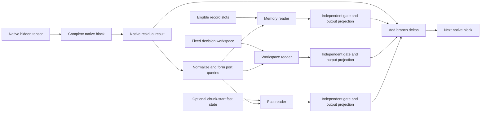
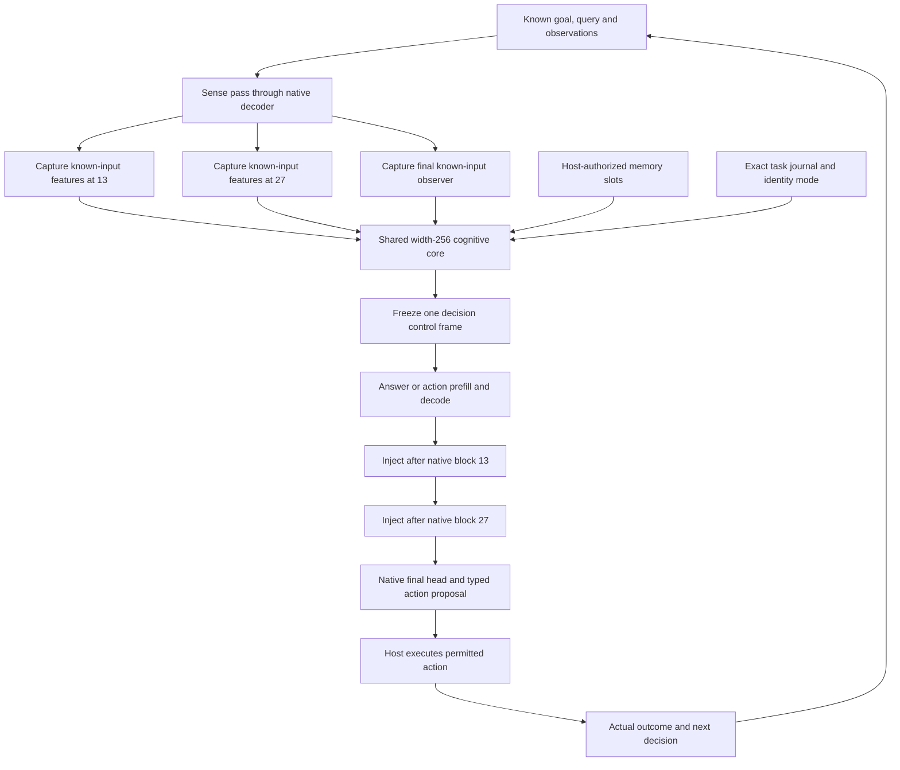
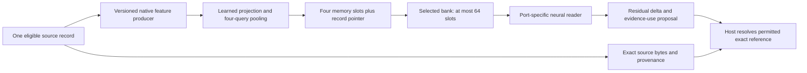
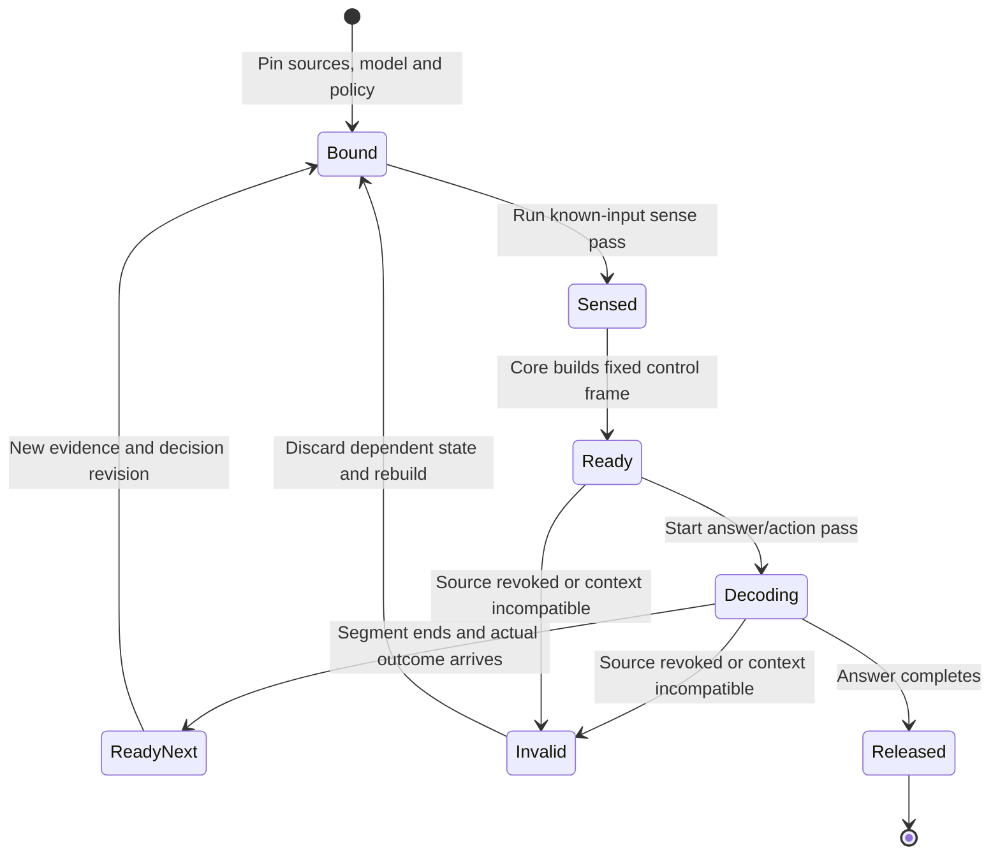
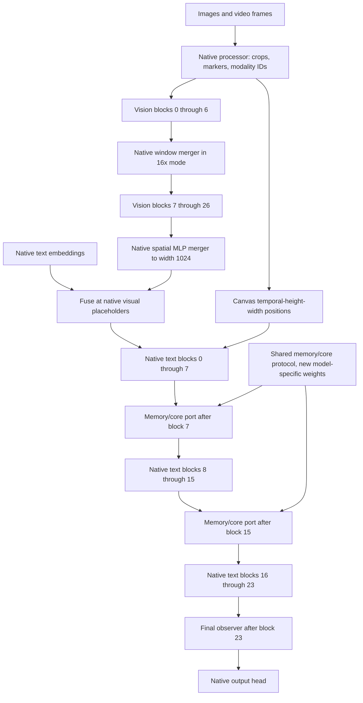

# Backbone integration: native models with a parallel cognitive core

**Design review: 23 October 2026 UTC / 22 October America/Chicago. Status: proposed implementation specification.** This document specifies the backbone-facing part of the system in [System Design](../01_System_Design.md) and the [cognitive contracts](../experiments/20261022_Cognitive_Contracts.md). It preserves the measured starter as a reference while designing the complete interface. No model was trained, executed or downloaded for this review; public configuration/code and the existing local checkpoint header were inspected.

**Current status reconciliation, 24 October 2026:** the native MiniCPM5
multi-port adapter, request frames, two-pass core/task path and optional fast/
identity readers now exist. Useful learned memory and native VLM execution
remain unqualified. Caller-bound verification, schedule audits and representation-preserving
rebuild precede the isolated MiniCPM5 visual retrofit in [document 18](18_MiniCPM5_Vision_Training_and_Continual_Learning.md).
Follow [the research plan](15_Research_Crosscheck_and_Backbone_Plan.md)
and [loop instructions](16_Loop_Agent_Instructions.md); the design contracts
below remain requirements, not a claim that every described path is missing.

The [Spark FP8/BF16 plan](20_Spark_X2_6_FP8_Preparation_Plan.md) records official
source pins and a dedicated width-2560 adapter/connector path. Preparation starts
now; native transfer follows reusable interfaces and independent backend gates.
FP8 storage and Muon int8 momentum do not establish supported FP8 backward kernels.

## 1. Reuse pretrained capability, introduce a learned interface

The design retains pretrained language understanding, tokenization, native attention, feed-forward layers and output vocabulary. New components learn how to turn authorized experience into useful internal state, how to read that state while reasoning, and when to act or learn. Development may co-adapt existing weights; routine deployed learning starts from a versioned, frozen developmental base.

The baseline is **MiniCPM5-2B with existing memory/core ports**. After repair, the first vision-development target adds a pretrained encoder and a new MiniCPM5 projector. **MiniCPM-V-4.7-1B is an optional pretrained reference/teacher with a separate native adapter**; its decoder and alignment are not interchangeable with MiniCPM5. Spark FP8/BF16 preparation starts now; native integration has separate later gates. Transfer schemas, protocols and evaluation methods; train model-specific projections and requalify native state.

| Evidence | Verified backbone fact | Consequence for this design |
|---|---|---|
| [Pinned MiniCPM5 configuration](https://huggingface.co/openbmb/MiniCPM5-2B/blob/f97400052a43d642bbc6e9975e2397e3ae6a6b52/config.json) | Native `LlamaForCausalLM`; 42 layers; width 2048; FFN 6144; 16 query heads, 2 KV heads, head width 128 | Wrap complete native blocks; preserve native layer indices and grouped-query attention |
| Same configuration | Vocabulary 130560; untied embedding/head; RoPE theta 5000000; configured maximum 131072 positions | Vocabulary and position behavior stay native; advertised context length is not a measured local capacity |
| [Pinned MiniCPM-V configuration](https://huggingface.co/openbmb/MiniCPM-V-4.7-1B/blob/379f120c2ff3588e6e06559ec6b9ec15cc05114e/config.json) | `MiniCPMV4_7ForConditionalGeneration`; text `qwen3_5_text`; 24 layers, width 1024, FFN 3584 | Implement a distinct hybrid-decoder port; a Llama-only adapter cannot load this model |
| Same configuration | Repeating 3 linear / 1 full-attention blocks; full attention 8 query heads, 2 KV heads, width 256; vocabulary 248094; untied embedding/head | Native full-attention indices are 3, 7, 11, 15, 19, 23; projection shapes differ from MiniCPM5 |
| Same configuration | Linear attention: 16 key/value heads, width 128, convolution kernel 4; 262144 positions; partial rotary fraction 0.25 | Recurrent and convolution state must accompany attention KV state |
| Same configuration | Vision: 27 layers, width 1152, FFN 4304, 16 heads, patch size 14; canvas M-RoPE; default 16× downsampling | Preserve the vision tower, spatial merging, image/video boundaries and native multimodal positions |

The local MiniCPM5 safetensors header contains **2,516,756,480 parameters in 381 tensors**. “2B” is the model name, not an exact allocation budget. Its BF16 weight file is 5,033,557,096 bytes; a full FP32 parameter copy alone is approximately 9.38 GiB. These are local inventory/arithmetic results, not a new runtime measurement. Exact VLM parameter inventory remains unverified because its weights were not acquired.

### Spark preparation: official FP8 and independent BF16 control

MiniCPM5 remains the required baseline. Prepare the official Spark FP8 source,
BF16 control, metadata inventory and backend matrix now under
[document 20](20_Spark_X2_6_FP8_Preparation_Plan.md). Native qualification follows
repaired contracts and reusable V0 interfaces, not completion of RSI. Preserve
Spark's `spark2_5` attention, head gates, tied storage, caches and reasoning
mode under a dedicated adapter. Its width-2560 connector and memory projections
must be trained separately; test visual-prefix visibility beyond its 512-token
sliding window and in full-attention blocks.

Current Muon int8 quantizes momentum while trainable weights/gradients remain
FP32. Official compressed-tensors FP8 storage and dynamic activation quantization
require supported forward/backward kernels; top-level BF16 dtype is not a tensor
inventory. An explicitly dequantized FP8 derivative differs from the official
BF16 checkpoint. Inference, input gradients, named updates, export/reload and
residency need separate evidence. The 50 GiB stop is not a fit guarantee.

### New MiniCPM5 visual-input interface

The current adapter accepts token IDs and embeds them directly. Add a versioned
visual observation and fused-prefix contract across adapter, session, sense/
decision frames, training and generation. Use a frozen pretrained encoder and a
trainable projector to width 2048; retain spatial patch/layout information.
Bind image bytes, source scope, crop, processor and producer identities.

Preserve masks, positions and the known prefix across sense/action/generation.
Exclude visual/prompt positions from response loss, keep labels/future frames
outside sensing and preserve input gradients through the frozen decoder to the
projector. Cache only frozen producer outputs. First prove text-only bypass
parity, real image dependence, gradients and export/reload; then train alignment
and declared instruction adapters with text retention. Keep memory/core/identity
injections disabled during initial independent visual qualification.

The pretrained MiniCPM-V topology below applies only to that separate model.
Do not copy its width-1024 connector, canvas M-RoPE or hybrid caches into the
MiniCPM5 width-2048 Llama path. See document 18 for training stages and controls.

## 2. The backbone port is a complete-block boundary

For native block `l`, preserve both native residual sublayers before introducing any new branch:

\[
u_l=\operatorname{NativeBlock}_l(h_l;\mathrm{native\ masks,positions,cache}),
\qquad h_{l+1}=u_l+\sum_{b\in\{M,W,F\}}g_{l,b}\odot O_{l,b}\,R_{l,b}(N_l(u_l),C_b).
\]

`M` is eligible record memory, `W` is the decision workspace, and `F` is an optional private fast-memory snapshot. `R` returns a projected read, `O` returns it to the native hidden width, and `g` is a bounded branch gate. The initial implementation enables M/W and reserves a separate F interface. Native recurrent attention in the VLM is not this added F memory.

Initialize each final branch projection to zero and upstream factors normally; initialize gates so they allow a nonzero gradient into that projection. Zeroing both gates and projections can create a dead product. At initialization and with an explicit bypass, the wrapper must reproduce the associated native revision. After full co-adaptation, bypass restores the adapted base path, not the original pretrained weights.

An all-masked or empty memory bank returns an exact zero memory delta. Workspace and fast-memory availability are independent. The model may learn that a record is unhelpful; it may not change whether the record is eligible. Gating measures contribution to computation, not the truth or authorization of a claim.

## 3. MiniCPM5 port map and executable scheduling

Proposed first integration: **memory/core width 256, 8 workspace slots, 2 tied core iterations, at most 16 records × 4 slots per record**. This is a concrete engineering starting point, not a measured optimum. Preserve the qualified width-64, four-slot, last-block setup as the legacy control.

| Native location, zero-based | Proposed role | Why this location |
|---|---|---|
| `model.layers[13]` output | Sense known input; first memory/workspace injection | Leaves 28 native blocks to use the injected information |
| `model.layers[27]` output | Sense known input; second memory/workspace injection | Leaves 14 native blocks for higher-level integration |
| `model.layers[41]` output | Output observer and action/calibration features | Observe final representation; no retroactive modification of earlier ports |
| Block 41 only, legacy wrapper | Preserved comparison | Isolates the effect of replacing the small terminal sidecar with the proposed architecture |

These indices carry forward the documented R2 13/27 proposal; they are not selected by the prior tiny experiments. Compare 27-only, 13/27, and the last-only reference with declared parameter and compute controls. The design can be implemented before a port location earns a quality claim.

**Reference schedule:** first run a sense pass over known input with new injection disabled; form the core state; freeze the control frame; then run the answer/action pass with the two injection ports. Sense features contain no teacher-forced answer suffix or future observations. The core can request additional retrieval; the host obtains it and starts a new bounded decision, rather than performing database I/O from inside a decoder layer.

This schedule removes the apparent cycle in a diagram where late hidden states control earlier blocks. It adds a real native pass whose cost must be counted. It also avoids pretending that “parallel” means zero latency: the core is a separate computation path, while some dependencies serialize execution. Independent record encoding/retrieval can overlap where ownership permits.

The decision control frame stays fixed throughout one emitted answer/action segment. Output-side observations enter the **next** decision. Later same-pass scheduling may use only already available shallow/token-causal features; it needs a distinct state machine and cached-versus-uncached qualification. A whole-chunk late-layer summary cannot control earlier predictions in that same chunk.

## 4. Native memory encoder and tensor access contract

The production writer should encode **each record separately** with a contextual feature producer, then pool four width-256 slots per record. A proposed text producer uses the native prefix through block 13, with augmentation disabled, on a bounded, already-observed source span; the learned writer projects and pools its contextual hidden features. Start with 128-token source chunks, retaining chunk offsets and exact references. Longer records are explicitly chunked before encoding; truncation must never silently erase decisive spans. The existing input-embedding-only writer remains a cheaper control. A frozen producer permits cached features; co-adaptation changes those features and requires recomputation.

| Interface | Shape / metadata | Required behavior |
|---|---|---|
| `SenseTensor` | `[B,T_known,h]`; port ID, producer hash, token mask and cutoff | Only declared known positions are pooled; no hidden evaluator values |
| `RecordPayload` | `[B,R,4,256]`; valid `[B,R,4]`; exact source IDs/hashes and scope | Slots preserve record identity; missing/deleted record gives no valid slots |
| `MemoryBank` | `[B,R×4,256]`, `R≤16` | Per-record metadata survives flattening; retrieval order is explicit |
| `Workspace` | `[B,8,256]` plus exact task/goal/subgoal/evidence references | Rebuilt at decision boundaries; hypotheses remain hypotheses |
| `PortRead` | Query `[B,T,h]`, bank `[B,S,256]`, delta `[B,T,h]` | No change to native sequence length; finite delta and independent null path |
| `InjectFrame` | Decision ID, evidence pin, identity mode, versioned banks/core, permitted ports | Immutable during an answer segment and through its training backward |
| `NativeState` | Model-specific cache objects and position state | Never treat all native caches as interchangeable `[K,V]` lists |

The payload key includes record revision/hash, observation cutoff, subject/branch/purpose, tokenizer/processor, model feature producer, writer weights, layer/slot layout, dtype and evidence/permission revision. Shape equality alone is insufficient compatibility. Exact code, numbers, dates and autobiographical claims retain source references; compressed slots are not their sole authority.

For a cold bank of 16 source chunks with 128 tokens each, a 14-layer producer processes up to 2048 source-token positions before answering; a later 256-token budget doubles that work. A multi-chunk record consumes multiple selection units unless a separately designed hierarchical writer combines them. That cost may dominate the small port read. Record caches amortize it only while their producer, writer, source and permission versions remain valid. Report cold/warm latency separately; do not hide encoder cost in a preprocessing exclusion. Full co-adaptation also retains or recomputes record/sense activations through backward, so small slot tensors do not imply a small training memory footprint.

## 5. Request state, cache and gradient ownership

The architecture path now uses request-owned frames and scoped bindings; preserve that ownership rather than reusing the starter's model-global `_context` as a concurrency design. The complete cache-facing contract is an explicit request-owned `RequestContext`. A context contains its control frame, memory payload references, native attention/recurrent/position state, optional fast state, budget and revocation epoch. Model parameters are shared read-only during inference; mutable request tensors are not shared between requests.

Cache reuse requires the same native model, port weights, control frame, prefix, positions and evidence pin. In particular, the unaugmented sense-pass cache cannot be reused as the augmented answer-pass cache: injected earlier representations change downstream cache entries. Begin with fresh re-prefill; optimize reuse only where equivalence is demonstrated.

Training owns the same immutable context through forward, activation-checkpoint recomputation and backward. Do not append evidence, update fast state, publish parameters or release payload tensors during that interval. A replayed block reads the same frame. Serialize private fast-state writes after the completed observation chunk; all participating depth ports read one chunk-start snapshot.

| Regime | Backpropagation and parameter ownership |
|---|---|
| Modules-only | Original parameters frozen; writer/core/readers/heads trainable. Detached frozen record/sense features are allowed, but frozen downstream native blocks must retain autograd so loss reaches injected deltas |
| Full augmented | All declared original text tensors plus named new tensors trainable; sense/record producer features are recomputed in the graph. Detaching this producer is a separately labelled approximation |
| Deployed frozen base | No mutation of the active base; request-local fast updates are separate from optimizer updates; candidate parameter changes publish only as a new compatible manifest |
| Future VLM | Separate explicit scopes for text, vision, merger and new modules; “full VLM tuning” must include all declared native components, not silently freeze the visual path |

Muon 8-bit remains the project's candidate optimizer for qualified matrix groups; its use does not imply quantized model activations or an 8-bit backbone. Nonmatrix/embedding/head treatment remains explicit in the existing optimizer registry. New gate, recurrent-state and normalization tensors need named ownership; the fast-state inner rule is not the global Muon optimizer.

## 6. MiniCPM-V 4.7 needs its own adapter

The [native VLM implementation](https://github.com/huggingface/transformers/blob/6b6792ff3b1a434913dc59659d4461acc9c3a51a/src/transformers/models/minicpmv4_7/modeling_minicpmv4_7.py) applies a window-attention merger after vision block 6, then a spatial MLP merger into text width. Default 16× mode performs two 2×2 spatial reductions; 4× skips the intermediate window merger. This route is not the older MiniCPM-V learned-query resampler. Preserve the actual implementation rather than porting an earlier series diagram.

The diagram shows the default 16× visual path; 4× bypasses the window merger while retaining all native vision blocks. Ports **7 and 15**, with observer **23**, are the proposed VLM depth mapping: complete full-attention boundaries near one-third and two-thirds depth. They are engineering choices to test, not a claim of semantic equivalence to text blocks 13/27. Do not insert a new memory module into the native vision merger in the first VLM port.

The [Qwen3.5 implementation](https://github.com/huggingface/transformers/blob/6b6792ff3b1a434913dc59659d4461acc9c3a51a/src/transformers/models/qwen3_5/modeling_qwen3_5.py) uses Gated DeltaNet for linear-attention blocks and gated grouped-query attention for full-attention blocks. Full-attention query projection width is not simply hidden width: its query/output gate doubles the projected query channels. Wrap the complete decoder layer, preserving the native norm, token mixer, residual and FFN sequence.

The recurrent state is `[B,16,128,128]` per linear block, accompanied by convolution history. Full-attention blocks retain ordinary sequence-growing KV. These caches are native inference state; they do not provide an authenticated episodic record, personal history or a cross-session learning protocol.

Canvas M-RoPE assigns temporal/height/width coordinates to image thumbnails, slices and video frames. The native processor's modality IDs, patch grids, markers and downsampling mode must reach the native model together. Generation may add a text-position row to the three coordinate rows; preserve the pinned runtime's interface rather than flattening it to 1-D positions. [Native processor](https://github.com/huggingface/transformers/blob/6b6792ff3b1a434913dc59659d4461acc9c3a51a/src/transformers/models/minicpmv4_7/processing_minicpmv4_7.py).

The inspected VLM stores `rope_deltas` on its model object. Initial qualification must serialize requests and explicitly reset this state between them. A concurrent implementation needs a request-owned position-state bridge and interleaved-request parity tests; replacing sidecar `_context` alone does not isolate native VLM state. Revocation clears affected KV, recurrent, convolution, position and added memory/core state together.

A visual memory payload binds frame/image content hash, observation time, crop coordinates, native processor/vision/merger versions and source permissions. Keep a permitted exact visual reference for review. Video frames after the decision cutoff cannot be encoded merely because a full clip was supplied to the dataset loader.

For the optional pretrained MiniCPM-V reference, stage training as native visual
parity → new visual-memory interfaces with the
existing vision/text path frozen → verified visual reasoning → separately
justified selective or full co-adaptation. Remove the original image before
delayed memory queries; include actual/wrong/no-image, caption-only, shuffled
memory, correction/restart and text-retention controls. Preserve disjoint scenes,
documents and sessions, and re-encode after changing the feature producer.
Later Spark work first qualifies its native text path, then trains a new visual
connector under the proven MiniCPM5 data/evaluation contract; do not transplant
MiniCPM5 or MiniCPM-V projector weights.
MiniCPM-V-4.7-35B-A3B is a later teacher/inference/transfer option with separate
resource qualification; active experts do not make its full weight set fit the
local training budget. Detailed training scopes and gates are in document 15.

## 7. Parameter, compute and state budgets

The following is **arithmetic for the proposed bridge skeleton**, not a measured inventory or speed promise. Let native width `h=2048`, interface width `d=256`, two active ports, two independent readers per port, 64 record slots and 8 workspace slots. Each reader uses Q/O projections across `h↔d` and K/V projections within `d`. The core uses one tied block with self-attention, cross-attention and a width-4d FFN, iterated twice.

| Added component | Formula | Approximate parameters |
|---|---|---:|
| Two sense projections | `2hd` | 1,048,576 |
| Memory/workspace readers at two ports | `4(2hd+2d²)` | 4,718,592 |
| One tied core block | `16d²` | 1,048,576 |
| Writer projection, pooling attention, four queries | `hd+4d²+4d` | 787,456 |
| Eight learned workspace queries | `8d` | 2,048 |
| **Skeleton subtotal** | Sum above | **7,605,248** |
| Optional two fast-read projection pairs | `4hd` | +2,097,152 |

Biases, norms, branch gates, block-41 observer, route/action/calibration/director heads, identity encoders and any Engram table are excluded. They must appear in the eventual actual parameter audit. The subtotal occupies about 29.01 MiB in FP32 parameters; gradients and optimizer state add to it. Two core iterations reuse parameters but still consume twice the core compute. Wider sparse lookup tables must have their own residency budget.

With bank K/V precomputed for a fixed frame, the two M/W port reads add roughly **4.27 million multiply-accumulates per generated token**, excluding normalization/gates. Native MiniCPM5 linear projections and output head contribute roughly **2.25 billion MACs/token**, before attention products. This suggests small matrix overhead from the readers; it does not establish wall-clock speed. The extra sense pass, record encoding, small-kernel launches and training activations can dominate.

At batch one, 64×256 FP32 record slots occupy **64 KiB**, and 8×256 workspace slots **8 KiB**. The reference four-head fast state uses four 64×64 FP32 matrices, occupying **64 KiB** total; optional momentum adds another 64 KiB. A fully coupled 256×256 state would be a distinct 256 KiB variant, not the reference allocation. Lineage, indexes, exact source content, projected K/V, autograd graphs and temporary buffers are additional.

Native FP32 text KV is approximately **84 KiB per cached token** across 42 blocks, or **42 MiB at 512 tokens**. VLM full-attention KV is approximately **24 KiB/token**, plus about **18 MiB** of FP32 recurrent matrices across its 18 linear blocks and approximately **1.69 MiB** of four-position convolution state. These are shape estimates, not allocator peaks; cache implementation/dtype can change them.

The M2 Ultra GPU remains the initial execution backend. CPU host work handles records and scheduling; native model computation must not silently fall back to CPU. Neural Engine use is an independent export/operator qualification, not enabled by adding these Python modules. Bounded native MPS core/reader engineering has since been measured; it does not qualify useful memory learning or VLM kernels. CUDA on RTX PRO 4000 Blackwell SFF receives a separate memory, kernel and optimizer qualification against the same contracts.

## 8. Implementation boundary and acceptance

The table preserves the original migration map; several replacements are now
implemented. Check the current status registry before recreating them.

| Existing component | Reusable evidence | Original replacement/extension target |
|---|---|---|
| [LlamaMemoryAdapter](../../src/replica_lab/model_adapter.py) | Complete-block residual convention, original/new parameter registry, null parity and owned-backward concept | Port registry, request-owned context, separate sense schedule, multi-port core and later cache ABI |
| [Neural primitives](../../src/replica_lab/neural.py) | Basic pooling/read/null-mask/recurrent-slot contracts | Contextual per-record payloads, typed shared core, action/calibration heads and versioned producers |
| [Native architecture study](../stages/03_Native_Architecture_Study.md) | Scope/capacity/resume and small memorization evidence | Useful memory, plan continuation, evidence-sensitive decisions, retained pretrained ability and costs |
| Current last-block generation | Fixed-context uncached reference | Two-pass actual-model action loop; subsequent cached and concurrent parity |

The first four links of the original text slice—native port manifest, contextual record payloads, two-pass shared core and actual proposal/host outcome feedback—now exist. Reuse them and follow M0–M7 for useful adaptive memory, shared-depth controls and the candidate learning path. Keep the original pretrained template and selected historical checkpoints. New component exports reference their parent base hash; do not make repeated full base copies for every module experiment.

Acceptance must establish null parity, independent branch sensitivity, future-token exclusion, evidence-change sensitivity, per-record provenance, gradients through both native passes, correct restart/re-prefill, revoked-source invalidation, and an actual model-driven action followed by an observed outcome. Meaningful end-to-end tasks must accompany numerical contracts. A fixed-answer microbenchmark is a diagnostic, not the architecture's product definition.

The VLM adapter follows after the text interfaces stabilize: native visual no-op parity, image/video position integrity, full and recurrent cache replay, no cross-request position leakage, separate text/vision/merger scope, then the same memory/core behavior tests with visual evidence. Do not claim VLM support from a text-only Qwen forward.

## 9. Source pins and remaining uncertainty

The [research source manifest](../../reports/architecture_research_20261023/backbone_sources.json) records retrieval timestamps and SHA-256 hashes for public metadata/code. MiniCPM5 remains pinned to local source revision `f97400052a43d642bbc6e9975e2397e3ae6a6b52`; VLM metadata was inspected at `379f120c2ff3588e6e06559ec6b9ec15cc05114e`. The official implementation inspected is Transformers commit `6b6792ff3b1a434913dc59659d4461acc9c3a51a`; installed runtime is 5.20.2, with separately recorded file hashes. Model config version strings are metadata, not proof of runtime compatibility.

Unresolved implementation questions are the best port depth, useful core capacity, cold-encoder cost, native VLM MPS operator support/backward stability, efficient two-pass training, and how much base co-adaptation the interface needs. The specification makes those questions executable without assuming the corresponding results. Larger MiniCPM-family models may use different text blocks, MoE routing and hidden widths; reuse contracts and independently trained interfaces only after inspecting each exact backbone.
