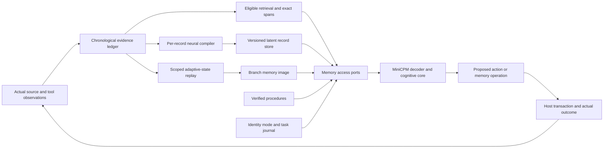
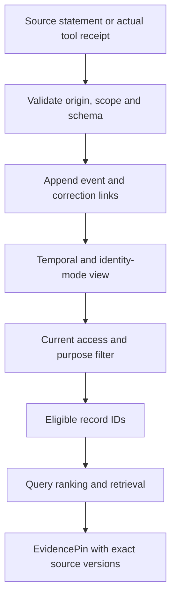
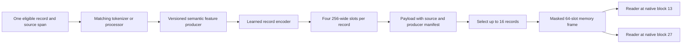
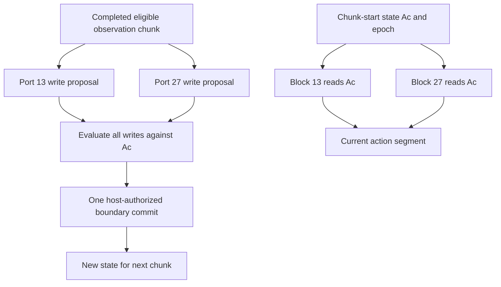
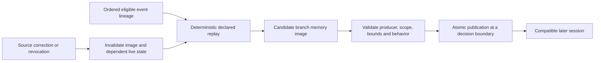
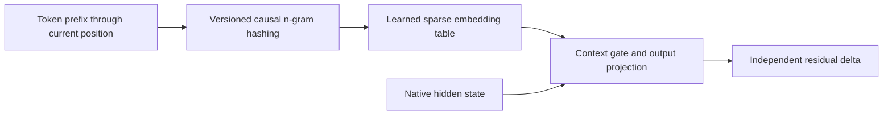
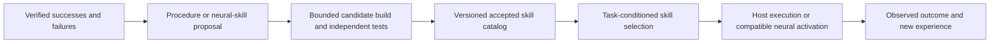
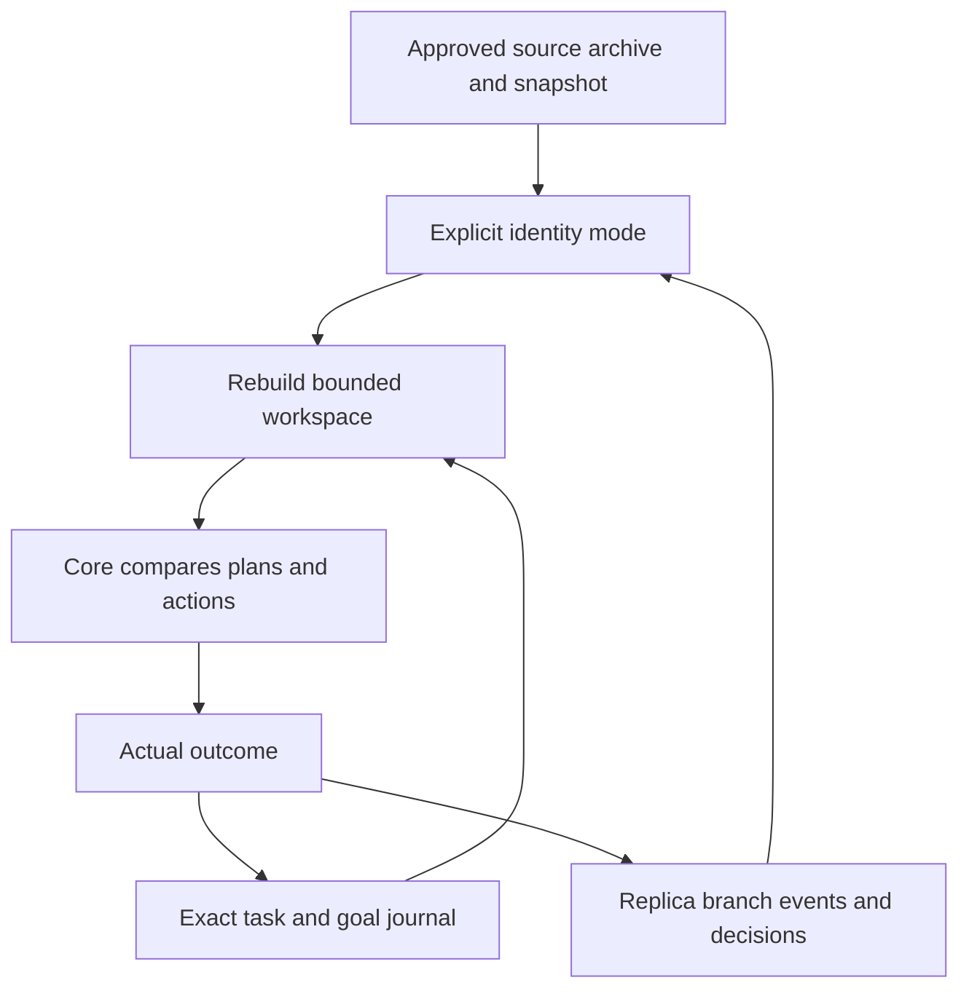
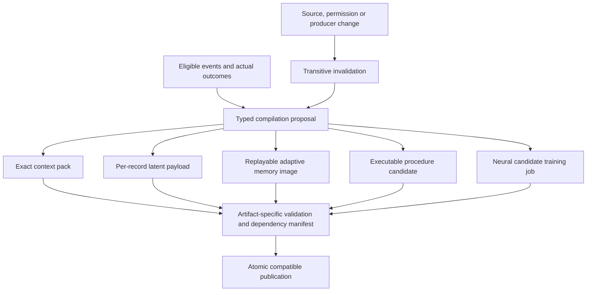
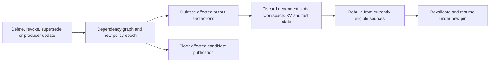

# Memory architecture and runtime compilation

**Design proposal, reviewed 23 October 2026 UTC / 22 October America/Chicago.** This chapter develops the [existing system design](../01_System_Design.md), [R2 implementation contracts](../../reference/r2/02_Architecture_and_Implementation_Contracts.md), and [cognitive contracts](../experiments/20261022_Cognitive_Contracts.md). It specifies the intended system; current `memory.py` and `neural.py` establish only smaller primitives. No new model execution, model acquisition or training is reported here.

## 1. Research findings and the design decision

Two different projects use similar names. **MemTensor's MemT-1.0** is the relevant example of modifying a pretrained model with native memory. **Yanwei Yue et al.'s Mem-T** learns an agent's database operations. Both inform this design, at different boundaries. The earlier R3 references covered the latter and did not establish the former.

| Primary work | Mechanism and evidence boundary | Application here |
|---|---|---|
| [MemT-1.0 v2](https://arxiv.org/html/2610.26825v2) | Adds dynamic memory and trainable projections/gates to prepared backbones; stable Gated DeltaNet-2 updates and Mixture-of-Storage increase memory capability. Reports 34B training tokens across its pipeline; backbone weights are frozen during memory training. | Strong precedent for a pretrained retrofit, separate store/read phases and later-loss credit to earlier writes. Its scale and results do not establish inexpensive MiniCPM adaptation. |
| [Mem-T v2](https://arxiv.org/abs/2601.23014v2) | Hierarchical working/factual/experiential/raw database; MoT-GRPO provides credit for construction and retrieval decisions. | Learned admission/retrieval policy and trajectories. This is a host-side memory-management policy, distinct from a native memory matrix. |
| [Titans v1](https://arxiv.org/html/2501.00663v1) | Neural associative memory with gradient-based updates, momentum, forgetting, and alternative combinations with attention. | Investigate nonlinear adaptive memory after the linear reference. Surprise is an update signal, not proof that a statement is true or important. |
| [TTT v1](https://arxiv.org/html/2407.04620v1) | Learns a small model as recurrent state through a self-supervised inner objective; outer training learns useful representations and update behavior. | Separate private fast state from trained global parameters and retain credit through earlier observed chunks. |
| [uTTT v1](https://arxiv.org/html/2610.05484v1) | Shares fast state across depths. Its aggregated schedule reads one chunk-start state and combines writes after the chunk. | Shared ownership can support later cross-depth reuse; compare with private state at matched total state and compute. |
| [Engram v2](https://arxiv.org/html/2601.07372v2) | Sparse hashed n-gram lookup with contextual gating provides learned static capacity. | Optional vocabulary/pattern memory branch. It does not provide an editable autobiographical evidence archive. |
| [Nested Learning / HOPE v1](https://arxiv.org/html/2512.24695v1) | Optimization levels and context flows operate at different frequencies. Its pretrained Llama adaptation study reports 15B continued-pretraining tokens. | Explicit update timescales and owned losses; adapting a pretrained model is possible in principle, but this is not evidence of a cheap drop-in module. |

The proposed system combines **exact evidence, learned record access, scoped adaptive state, procedures, and identity/task state**. These stores solve different problems. A compact neural state provides associative access; exact records retain dates, quotations, identifiers, corrections and attribution. The model must be able to use memory inside its decoder, while the host retains ownership of records, access checks, transactions and publication.

## 2. State types, dimensions and ownership

Reference proposal: MiniCPM5 hidden width `D=2048`; memory/core width `M=256`; at most `R=16` retrieved records with `K=4` slots each; workspace `S=8` slots and two core iterations. Two read/injection ports follow complete native blocks 13 and 27; block 41 supplies an observer. These are proposed replacements for the small last-block experiment, not already qualified configurations.

| Component | Input → output | Owner and persistence | Learning/update cadence |
|---|---|---|---|
| Evidence ledger | Authorized observation → immutable event plus scoped current/historical views | Host, subject and branch; durable | Transaction; no gradient |
| Retrieval service | Query, mode, cutoff, permissions → selected IDs and exact spans | Host validates; policy ranks only eligible candidates | Decision boundary; ranker trained on declared development trajectories |
| Record compiler | One record's known tokens/features `[BR,T,D]` → `[B,R,K,M]` plus masks | Writer parameters global/versioned; payload belongs to record | Offline/candidate training; compile or rebuild after admission/producer change |
| Decoder reader | Hidden `[B,N,D]`, slots `[B,RK,M]` → delta `[B,N,D]` | Port-specific projection/gate parameters; read-only segment context | Every selected decoder block; answer/action outer loss |
| Fast associative state | Completed observation keys/values `[B,H,T,64]` → next `A[B,H,64,64]` | Host session/branch owner; `H=4` reference heads | One functional update at a chunk barrier |
| Workspace | Known sense features, goal, evidence references → `W[B,8,256]` | Task-local; reconstruct from journal | Two iterations at each decision; held fixed during its action segment |
| Procedure catalog | Verified experience → typed procedure/neural skill candidate | Branch catalog and publication service | Completed-task learning cycle; independent evaluation |
| Identity state | Approved source versions and branch lineage → mode-conditioned priorities | Human source authority or delegated branch scope | Explicit versioned transaction; separate source/replica updates |

The 64 retrieved slots occupy **65,536 bytes per batch row in FP32**; eight workspace slots occupy 8,192 bytes. Four `64×64` FP32 fast matrices occupy 65,536 bytes; a momentum variant adds the same amount. These are payload arithmetic only. They exclude projections, source tokens, KV cache, gradients, optimizer state, activations, journals and indexes. Sharing across ports must not silently allocate one state copy per layer.

## 3. Chronological evidence and eligibility

Design idea: store what happened and who supplied it before deciding what a model should remember. Each event carries `event_id`, subject, branch, actor, source identity, source hash/span, event time, observation time, admission time, kind, confidence/status, permission/purpose, and correction/supersession links. Separate a source's reported belief from an independently verified fact. Generated hypotheses and simulations remain typed proposals.

Observation time determines what the agent could have known at a decision. Event time may be earlier; a late correction cannot leak into an earlier decision's training inputs. Current permissions still apply to historical views. Superseded evidence may be returned only as an explicitly dated historical assertion under an appropriate mode; a deleted correction must not revive an obsolete claim.

Retrieval supports exact ID/span, lexical, embedding and relation/time filters. A learned query policy may choose among these routes and ask for more evidence. It cannot broaden its scope. An `EvidencePin` binds selected source versions, cutoff, current policy epoch, identity mode, producer versions and decision ID. Empty permitted evidence is an explicit empty result, not permission to search another subject's data.

Use: a Replica can distinguish “the source preferred this in 2020,” “the source later revised that preference,” and “this branch tried another strategy.” Ranking improves access without merging their authorship. The current SQLite record prototype needs richer temporal fields, graph dependencies, retrieval and source admission before it implements this service.

## 4. Persistent record latents and memory access ports

Design idea: compile each admitted record independently into bounded latent chunks; preserve their exact source identity through selection and fusion. The existing four-slot pooling of an entire retrieved set cannot provide per-record invalidation or stable record caching.

Initial feature producer: a declared native hidden-state tap from a separate source-only pass, with no current answer suffix. Compare it with the current embedding writer. Each record encodes its timestamp, attribution and kind as inputs or typed embeddings; the authoritative values remain metadata. Long records split into individually addressable spans; the record budget counts chunks explicitly rather than silently multiplying capacity.

For each port, `Q = Wq(Norm(h_native))`; cross-attention reads masked slot keys/values and returns `delta = gate(h_native, W) * Wo(read)`. Add this delta to the **complete native block result** once. A separate fast-state reader and workspace reader have independent gates and output projections. Initialize final output projections to zero, with upstream factors nonzero; an empty branch returns exact zero after training as well.

The host supplies source eligibility and record masks before the forward pass. Read ports do not query a database, perform side effects, or commit state. An `AccessProposal` from the route policy specifies requested source route, bounded count and intended use; the host produces the next memory frame at a decision boundary. Readers may learn source selection within that frame, but attention weights alone are not a trustworthy citation or evidence verification.

Payload identity includes source/span hash, observation cutoff, subject/branch/purpose, base/feature-tap hash, tokenizer/processor, writer hash, dimensions/dtype, position convention and encoding schema. A matching tensor shape is insufficient. During full co-adaptation, recompute native features and writer slots in the training graph. In D1, cached features from a pinned frozen native producer may be detached, while the writer still runs in the graph. Cached post-writer slots cannot train the writer; they are valid only when that writer is frozen. After publishing a writer/backbone revision, invalidate and recompile dependent payloads from still-permitted records.

Outer losses: answer/action cross-entropy, evidence-selection supervision where independently available, and optional same-information teacher distillation. The teacher may see exact eligible history and the preceding response prefix; it must not receive future observations or the target token as input. Teacher targets never enter student `SenseFrame`, record latents or fast writes. Removing duplicated source text is a separately measured compression stage.

## 5. Private adaptive state and shared-depth commits

Design idea: retain useful associations from recent observed experience inside a small adaptive module, while making ownership and causality explicit. Start with the existing functional linear reference, connected to learned keys/values/queries and native ports. It is a reference for adaptation, not a reproduction of Titans, uTTT or MemT-1.0.

For normalized observed keys, use `Linner(Ac)=sum ||k Ac-v||²/(2N)`, then `A_next = Ac - clipped(eta * grad(Linner) + decay * Ac)`. Pool write gradients from all participating ports at the **same** `Ac`; normalize by the declared valid token/port count. Empty writes leave values unchanged. Learned step size, momentum, nonlinear memory, stable GDN-2 and expert routing are separate variants with separate state/compute accounting.

No port may read another port's current-chunk write. Otherwise a deeper layer can expose later teacher-forced tokens to earlier predictions. Activation-checkpoint replay can recompute proposals, but only an idempotent host transaction commits them once. A shared matrix means shared depth within **one owner**, never shared users, branches, batch rows or unrelated requests. Packed sequence boundaries reset all associated buffers.

Reference execution uses a known-input sense pass, bounded cognitive update, immutable `DecisionFrame`, and an action pass. Read-only sense/action passes use the pinned snapshot. Actual observations are admitted and written at the next boundary; generated answers are stored only as attributed agent events and never automatically as verified source facts. Record whether previous agent text is allowed into any later memory update; the first causal qualification uses observed source/tool content only.

Runtime updates detach completed state to bound history. Offline outer training may retain a declared number of observation transitions so later task losses train earlier write projections; truncated horizons are part of the experiment. Fast state and optional momentum are not parameters in the long-lived Muon optimizer. Muon 8-bit applies to declared eligible global trainable matrices; its training-state quantization does not make online adaptive memory free or automatically safe to quantize.

## 6. Persistent branch memory image

The complete target includes **sustained native memory across authorized sessions**, not only a request cache. The first connected qualification can reset per session; promotion to persistence requires a replayable `BranchMemoryImage` with explicit ownership and retention. This resolves the tension between durable personal development and cross-session contamination.

Image metadata: owner/subject/branch, identity mode/version, permitted purposes, source IDs/hashes in update order, policy epoch, base/writer/reader/update-rule hashes, state schema, head/shape/dtype, cursor, update count, numerical-health summary, expiry and predecessor hash. Persist every recurrent buffer required to reproduce the update, not only the visible matrix. The exact goal journal is independent and survives a fast-state reset when its own sources remain eligible.

Proposed starting bounds are one image per branch and mode, 4,096 admitted event chunks per image, at most 256 tokens per chunk, a 30-day expiry, and a 1 MiB tensor-plus-metadata quota excluding the separately inventoried lineage index. These are capacity proposals, not measured limits. At a bound, create a new image by replaying a bounded selected lineage; retain exact older permitted evidence for retrieval. Never hide unbounded lineage behind a fixed-size tensor claim.

No in-place “subtract this record” promise is made for a nonlinear or recurrent memory. A correction, revocation or producer change rebuilds from allowed ordered sources, or resets to empty if those sources are unavailable. A latent memory image has no authority to preserve information after source permission expires. Cross-device reload first requires tolerance and behavior qualification; bitwise repeatability is not assumed.

## 7. Static pattern memory, skills and identity/task memory

### Static lookup branch

An optional Engram-inspired branch maps causal token n-grams through fixed hashes into learned embeddings, then uses a contextual gate and residual output. Freeze its table between candidate publications. Exact names and identifiers stay in the ledger; hash collisions and learned blending prevent the table from being an authoritative personal archive.

Inputs are `[B,N]` token IDs; output is `[B,N,D]`. Host owns tokenizer/hash/table versions; the outer answer/action loss updates declared table/projection parameters in a candidate. Table size, collisions, bytes touched and end-to-end latency are explicit controls. M2 unified memory avoids a discrete PCIe copy but still has bandwidth/allocation costs. Do not import an enormous pretrained-table design into the first implementation budget.

### Procedure and skill memory

Store reusable procedures as typed algorithms with preconditions, input/output schemas, source experience IDs, permitted tools, tests, expected failure modes and versioned dependencies. A neural skill is a distinct artifact with parent model compatibility and measured scope. Retrieval chooses a procedure; the host checks preconditions; actual execution supplies a result. A textual success story does not authorize execution or establish reusable competence.

The [Voyager authors' work](https://arxiv.org/abs/2305.16291v2) motivates executable reuse; it does not establish neural adaptation in this project. Train skill selection from actual outcomes on new inputs. Procedure-library improvement, latent retrieval improvement and parameter improvement must each have an attributable comparison.

### Identity and task memory

Identity state contains approved conditional priorities, cultural context, experiences, relationships, uncertainties and dated revisions. Task state contains goal/constraints, evidence pointers, subgoals, hypotheses, candidate actions and remaining budget. The cognitive core reads both as typed conditioning plus learned slots; neither is reduced to a single personality vector.

Modes remain `source_snapshot`, `source_current`, `parallel_replica`, and `assistant_for_source`. Source statements and branch conclusions keep separate authorship. Source fidelity and world correctness have separate losses; reproducing a mistaken historical belief must not train the verifier to accept it as fact. Foundational identity changes use the existing authority contract; routine branch skill learning uses delegated policy. This memory chapter supplies inputs to the cognition/Replica design, not an invented personal biography.

## 8. Runtime compilation and re-compilation

“Runtime compilation” means transforming eligible observations and verified experience into versioned artifacts that reduce later work. It does not mean `torch.compile`, JIT kernel generation, arbitrary code execution, or editing live backbone weights. Hardware graph compilation is a separate performance choice.

| Artifact | Build input and output | Validation and use |
|---|---|---|
| `ContextPack` | Eligible source spans → bounded exact prompt material and references | Cutoff/attribution/byte checks; immediate decision conditioning |
| `RecordLatent` | One source span + feature producer/writer → slots and mask | Source/version binding and task-use validation; memory reader input |
| `BranchMemoryImage` | Ordered eligible chunks + update rule → adaptive state/buffers | Replay, isolation, bounds and producer compatibility; later native reads |
| `ProcedureCandidate` | Verified traces + typed operation grammar → bounded executable routine | Separate runtime sandbox, unseen input tests, tool scope and failure semantics |
| `NeuralCandidate` | Declared development practice/replay → named component weights | Candidate/parent evaluation, retention, resource and identity gates; published manifest |

A compiler request names its parents, transformation version, budget, destination and expected validation. It cannot self-certify. Compilation of approved evidence into a cache needs compatibility/causality checks; publishing a newly trained policy or procedure additionally needs behavioral evidence. Failed/rejected outputs remain labelled diagnostic artifacts and cannot be silently promoted.

Repeated useful experience can progress through exact retrieval → procedure reuse → trained access/skill. This is a proposed consolidation policy, not a mandatory loss of source detail. Schedule cheap context construction at a decision, record encoding after admission, image updates after observed chunks, and candidate training only at bounded completed-cycle boundaries. Keep a deployed backbone fixed during that epoch; development revisions create a new lineage and migration.

## 9. Deletion, invalidation and migration

The dependency graph must cover records → spans/indexes → latent payloads/images → practice examples → trained candidates → system manifests. Check current eligibility before outward actions and publication; a previously valid pin does not override revocation. Rebuild the entire affected live context, including native KV/recurrent caches, instead of updating only the database. Source deletions, corrections and expired permissions propagate transitively.

Cache eviction is not neural unlearning. If revoked evidence trained a neural candidate, prevent further use/publication of that candidate until rebuilt from an eligible parent or a separately qualified removal method. Existing outputs, retained backups and OS pages have separate lifecycle accounting. Do not claim that tombstoning a record proves erasure from every derived representation.

## 10. Implementation sequence and acceptance evidence

Implement the connected memory path in coherent increments: ledger/eligibility/retrieval → per-record compiler and two native read ports → real action/outcome journal → private adaptive state → scoped persisted image → procedure/candidate consolidation. Static lookup, nonlinear memory, GDN-2/MoS and multi-rate HOPE-like variants follow as independently costed alternatives. These component increments map to existing S2/S3/S4/S5 stages; they do not declare those gates passed.

Acceptance evidence must show changed behavior on new episodes when relevant records change, correct source/time/mode attribution, appropriate missing-information requests, reuse after restart, and loss of access after deletion. Architecture comparisons retain a full-text-memory baseline and ordinary full tuning so gains can be attributed to the new components. Report useful recall and procedural transfer separately from tiny memorization, grammar compliance and unit-test totals.

Counterfactual checks include wrong-subject evidence, removed decisive evidence, irrelevant distractors, corrections arriving after the cutoff, future answer tokens, two ports writing in one chunk, packed session boundaries, interrupted commits, stale producer versions and revoked sources in a saved image. Agent judges can assess open-ended semantics and usefulness with a declared rubric; exact lineage, state ownership and transaction properties still need machine-checkable evidence.

## 11. Pinned implementation evidence and adoption limits

Source metadata and SHA-256 file identities are recorded in [the research manifest](../../reports/architecture_research_20261023/memory_sources.json). Repository source was reviewed as text or pinned for later audit; it was not imported or executed. No weights were downloaded. Research facts above are distinct from the proposed dimensions, boundaries and policies in this chapter.

| Repository at inspected revision | Available route and limit |
|---|---|
| [MemTensor/MemT-1.0 — e75c13d](https://github.com/MemTensor/MemT-1.0/tree/e75c13d090a6a9d34b29146d901bd84323185f24) | SGLang inference and state snapshots; documented Linux/CUDA server. Its original software has PolyForm Noncommercial terms; model assets have separate terms. Reuse ideas with an original MiniCPM implementation unless code adoption is separately reviewed. |
| [yanweiyue/Mem-T — 8c22720](https://github.com/yanweiyue/Mem-T/tree/8c2272028f74c2b841aa0fbdf0d324c9d01f6914) | Inference/memory-operation code and linked 4B checkpoint; README still lists the training script as forthcoming. |
| [Zefan-Cai/uTTT — cef82bb](https://github.com/Zefan-Cai/uTTT/tree/cef82bb6a7db2fae818dc7278edae051e2c926ff) | Shared MoE language-model route released; shared dense language-model route not yet released. Its CUDA-oriented stack does not qualify MPS. |
| [deepseek-ai/Engram — fb7f84a](https://github.com/deepseek-ai/Engram/tree/fb7f84a21f91223715394a33a1dc24bbfb7f788e) | Standalone data-flow demonstration mocks standard backbone components. This is not a complete pretrained MiniCPM adapter. |
| [test-time-training/ttt-lm-pytorch — cd831db](https://github.com/test-time-training/ttt-lm-pytorch/tree/cd831db10c8c9a0f6340f02da5613316a8a92b67) | Official model/tutorial implementation; authors recommend their JAX route for efficient reported training. |

The inspected Titans and HOPE papers support mechanisms; this review did not establish an official complete training release suitable for this Mac. All proposed model computation uses the qualified GPU route as the starting backend; host storage and orchestration remain ordinary host operations. External CUDA performance, native-memory benchmark gains and large-scale training recipes are not local cost estimates.
