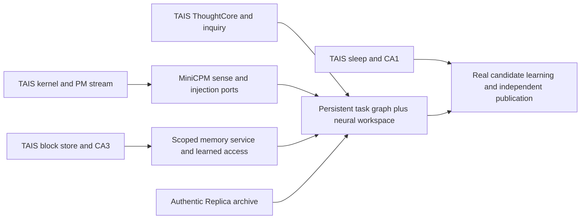
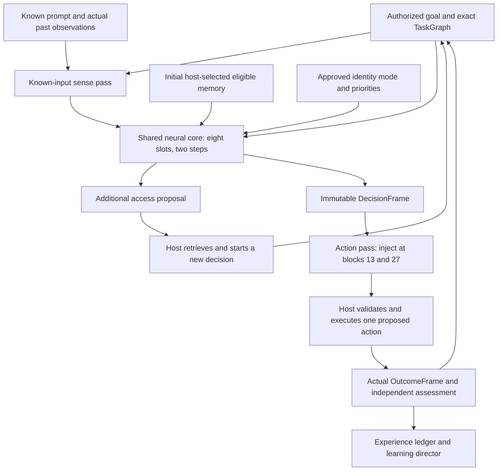
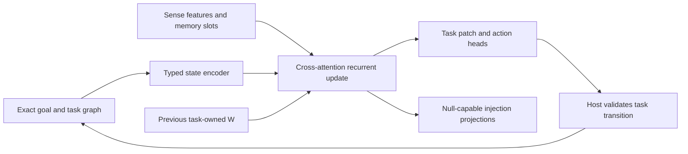
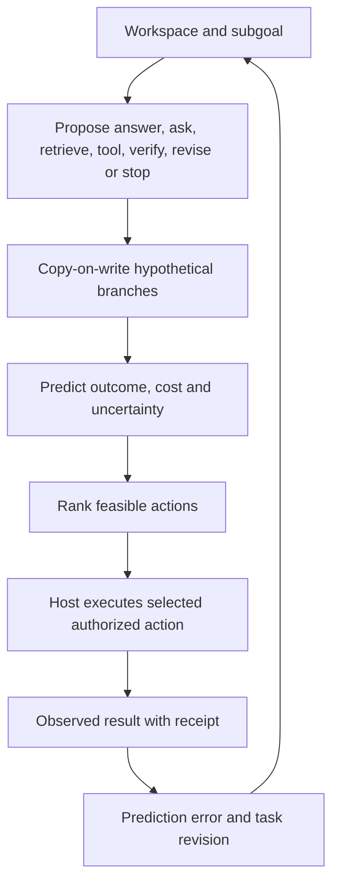
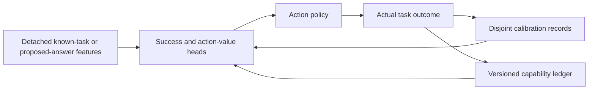
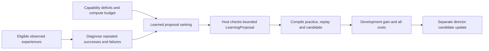
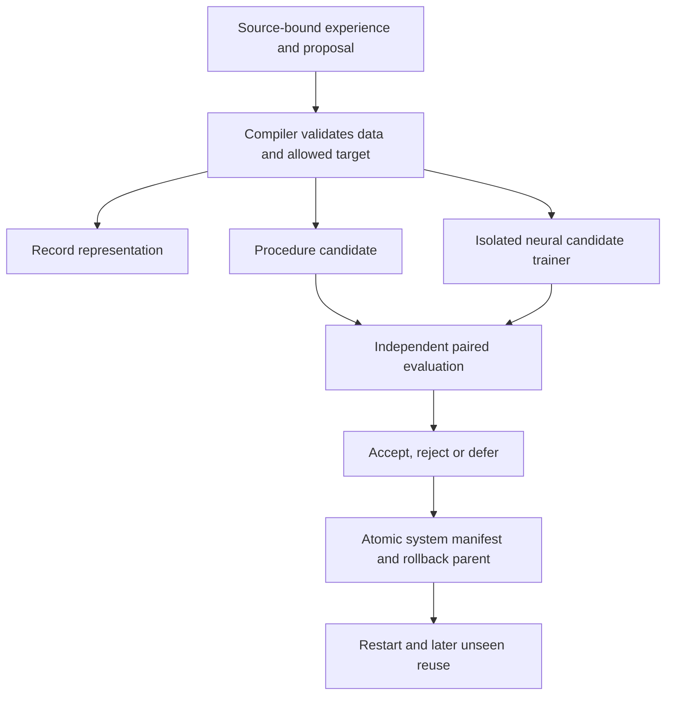
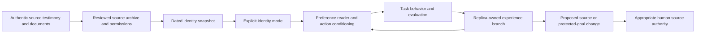

# Semi-cognition, runtime learning and the Replica interface

**Design revision: 23 October 2026 UTC / 22 October 2026 America/Chicago. Status: proposed construction specification.**

This chapter restores the full goal in [R2](../../reference/r2/01_Full_Chain_Framework_and_Reevaluation.md) and the [system design](../01_System_Design.md): a modified pretrained model that maintains goals, obtains and uses evidence, evaluates outcomes, learns useful procedures and develops a separately attributed Replica history. The earlier tiny experiments qualify parts of the implementation; they are not the architecture. This research revision changes no model weights and reports no new cognitive capability.

## 1. Recovered TAIS lineage and decisions

The user identified the actual upstream project, [BaiTian6641/TAIS-Obisian](https://github.com/BaiTian6641/TAIS-Obisian). Its inspected HEAD is **`85c134e857299431d1504636115d273a3de48bf2`**, committed **31 July 2026, 12:00:06 −05:00**. This supersedes the earlier bounded web search that did not identify a public project. A filtered, no-checkout clone supplied selected Markdown/Python blobs for reading; upstream code, tests and checkpoints were not executed. [The source inventory](../../reports/architecture_research_20261023/tais_learning_sources.json) records exact paths, hashes, review scope and limitations.

| Upstream component, at that commit | What the inspected implementation contains | Decision for this retrofit |
|---|---|---|
| [TAIS kernel](https://github.com/BaiTian6641/TAIS-Obisian/blob/85c134e857299431d1504636115d273a3de48bf2/src/tais_obsidian/model/tais_kernel.py) | Trainable KAL, HRL indexer and sparse DG projection; `sense`, `route`, `inject`; distinct vector and addressable payload classes | Preserve the three interfaces and distinct payload meanings; add MiniCPM-specific complete-block ports and versioned frames |
| [CA3 retrieval](https://github.com/BaiTian6641/TAIS-Obisian/blob/85c134e857299431d1504636115d273a3de48bf2/src/tais_obsidian/runtime/ca3_ppr.py) | Personalized PageRank over a supplied adjacency graph | Candidate expansion only; a graph walk does not establish a causal plan or the truth of a claim |
| [Pager](https://github.com/BaiTian6641/TAIS-Obisian/blob/85c134e857299431d1504636115d273a3de48bf2/src/tais_obsidian/runtime/pager.py) | Page-table/block-store fetch, namespace comparison, use counts; fallback can compare caller namespace to itself | Require authoritative producer and source manifests; remove the self-certifying fallback in the new design |
| [Memory layer](https://github.com/BaiTian6641/TAIS-Obisian/blob/85c134e857299431d1504636115d273a3de48bf2/src/tais_obsidian/model/memlayer.py) | Learned keys/values with dense all-slot scoring and top-k; mutable delta-state buffer; product-key factorization deferred | Keep learned lookup distinct from private fast state; explicit state inputs/outputs prevent sharing session mutations |
| [ThoughtCore integration](https://github.com/BaiTian6641/TAIS-Obisian/blob/85c134e857299431d1504636115d273a3de48bf2/src/tais_obsidian/model/thought_core_integration.py) | Group-history MLP, tick RoPE, bounded iteration and zero-initialized gate; optional call before final normalization in `model.py` | Recover the real neural-core intent; begin with ordinary trained recurrence and measure temporal-history alternatives separately |
| [Reasoning loop](https://github.com/BaiTian6641/TAIS-Obisian/blob/85c134e857299431d1504636115d273a3de48bf2/src/tais_obsidian/model/reasoning_loop.py) | Tick orchestration; mean-pooled glimpse, optional absent routing and norm-based mock certainty remain | Replace these interface placeholders with learned attention, actual retrieval and outcome-calibrated heads |
| [Inquiry executor](https://github.com/BaiTian6641/TAIS-Obisian/blob/85c134e857299431d1504636115d273a3de48bf2/src/tais_obsidian/model/inquiry_executor.py) | Injected ask/tool callbacks, versioned block writes, similarity-based cross-check; default embedding fallback is random hash based | Keep observed acquisition and lineage; use actual tool receipts and independently assessed evidence rather than similarity as factual verification |
| [CA1 gate](https://github.com/BaiTian6641/TAIS-Obisian/blob/85c134e857299431d1504636115d273a3de48bf2/src/tais_obsidian/runtime/ca1_gate.py) and [sleep consolidator](https://github.com/BaiTian6641/TAIS-Obisian/blob/85c134e857299431d1504636115d273a3de48bf2/src/tais_obsidian/sleep/consolidator.py) | Record eligibility, practice scheduling, bounded re-verification and promotion decisions; this consolidator does not perform a neural optimizer update | Split record admission, replay selection and actual candidate training into separate transactions; retrieval popularity never makes a fact true |

The upstream [core integration note](https://github.com/BaiTian6641/TAIS-Obisian/blob/85c134e857299431d1504636115d273a3de48bf2/docs/memories/thought-core-backbone-integration.md) reports trained two-hop chain accuracy **0.828 → 0.906**; its [extended validation note](https://github.com/BaiTian6641/TAIS-Obisian/blob/85c134e857299431d1504636115d273a3de48bf2/docs/memories/extended-validation-ca1-manifold.md) reports failures on novel-word recall and narrow teaching-distribution transfer. These are **upstream author reports**, not independently reproduced MiniCPM results. Some earlier upstream status notes predate the optional backbone integration; source code at the pin takes precedence for code-presence claims. No LICENSE file was found in the inspected tree; this deliverable studies the design and does not import its implementation.

## 2. Research that changes the construction

The following mechanisms occupy different places in the system; combining their names does not constitute an implementation.

| Primary evidence | Mechanism retained | Integration boundary |
|---|---|---|
| [Mem-T v2](https://arxiv.org/html/2601.23014v2) | Learned formation, evolution and iterative retrieval over working, factual, experiential and raw memories; operation-tree credit and hindsight attribution | Train memory-operation policies first from checked trajectories. Its ground-truth evidence reward is training-only. Mem-T is not a published MiniCPM residual-port design. The [official repository](https://github.com/yanweiyue/Mem-T) still lists training scripts as forthcoming |
| [SEAL v2](https://arxiv.org/html/2506.10943v2) | Generated adaptation data/directives, actual inner fine-tuning and later task performance as learning signal | Implement a bounded proposal compiler and isolated trainer. Count rejected candidates and adaptation cost; generated explanations alone are not learning |
| [Voyager](https://voyager.minedojo.org/) | Feedback-driven executable skills and automatic curriculum with a black-box language model | Keep a procedure-library baseline. This can improve the composed system without demonstrating a neural parameter gain |
| [Nested Learning / HOPE v1](https://arxiv.org/html/2512.24695v1) | Different optimization levels have distinct context flows and update frequencies | Declare owned state and losses for each timescale. The paper's pretrained Llama adaptation uses 15B continual-pretraining tokens; it does not establish a cheap retrofit |
| [Kadavath et al. v4](https://arxiv.org/abs/2207.05221v4) | Distinguishes correctness of a proposed answer from prior probability of knowing; transfer calibration remains difficult | Train task-success and action-value heads on actual local outcomes; recalibrate after model/interface changes |
| [Huang et al. v2](https://arxiv.org/abs/2310.01798v2) | Intrinsic self-correction can fail or degrade reasoning without external feedback | Critique proposes a diagnosis; actual outcomes and independent assessment determine whether a correction helped |
| [CTM v4](https://arxiv.org/abs/2505.05522v4) and [Coconut v4](https://arxiv.org/abs/2412.06769v4) | Temporal neuron histories/synchronization versus feedback of continuous hidden states | Later alternatives to the reference recurrent core, with matched compute. Tick RoPE is not CTM synchronization; a slot core is not a Coconut reproduction |

Titans, uTTT and Engram belong to the memory design alongside this chapter: fast adaptation, shared adaptive-state ownership and sparse learned lookup respectively. Their presence does not replace the action policy, task journal, evidence authority, learning director or Replica protocol. The complete composition remains this project's research hypothesis.

## 3. Connected operating architecture

**Reference design choice:** shared core width **256**, **eight latent slots**, **two recurrent steps per decision**; MiniCPM5 native blocks **13 and 27** expose read/injection ports, while block **41** supplies an observer feature. These are initial engineering choices, not measured optimal settings. The existing last-block 64-wide fixture remains a historical qualification, not the target configuration.

The reference schedule deliberately uses two passes. The host first selects an initial eligible bank from the known query/task and pins its sources. A known-input pass runs with new injections disabled and reads only the prompt and permitted past observations; it produces sense features. The core reads those features, prior task/workspace state and the selected bank. If it requests additional retrieval, the host obtains that evidence and starts a new decision with a new pin and sense pass. Otherwise it prepares one immutable DecisionFrame. A separate action pass re-prefills the known input, applies that frame at both injection ports, and emits an action or answer. This creates an acyclic dependency graph: a late-layer sense feature never feeds an earlier position in the same teacher-forced pass. The sense-pass KV is not reused as an action-pass KV.

The host commits storage/tool effects between decisions. Neural forwards return proposals and tensors without I/O, so activation recomputation cannot duplicate an action. Each answer segment uses one pinned frame; an actual new observation, task revision or invalidation starts a new decision. This costs extra prefill and must be measured; caching/overlap is a later equivalent implementation, not assumed speedup.

## 4. Components C08/C09 — exact task state and latent cognitive workspace

**Idea and use.** Preserve goals and unfinished obligations across turns/restarts while giving the backbone a trained state for combining evidence and alternatives. `TaskGraph` is exact structured state; `W` is its task-owned, approximate neural workspace. Neither replaces the other.

| Interface | Required content |
|---|---|
| Input `SenseFrame` | Decision/task/goal revision; known observation IDs; port features; evidence pin; identity/policy/model versions; remaining budget |
| Exact `TaskGraph` | Goal and success condition; constraints; subgoal DAG; observed events; claims with known/inferred/unknown status; evidence edges; attempted actions; open obligations |
| Neural `W: [batch,8,256]` | Role-conditioned slots initially allocated to goal, constraints, two evidence groups, two hypotheses, next action and uncertainty; role labels are inductive bias, not semantic guarantees |
| Output `DecisionFrame` | Port-compatible memory banks and core state; proposed task patch; bounded candidate actions; predicted outcomes; uncertainty and dependency lineage |

The reference update is `W[k+1] = CoreBlock(W[k], sense + memory + task + identity)`. One tied block contains slot self-attention, cross-attention to the typed inputs, and a width-4d feed-forward network, with normalized gated residuals and availability masks. This is the 16d² core skeleton budget in the backbone chapter; norms and gates are additional. The same parameters perform both iterations. A GRU update is a later matched alternative, not an extra default module. Per-port readers use the fixed workspace and each native token query to produce deltas; the frame does not store one universal token delta. Zero-initialize only final injection projections so null-parity and initial output gradients can both hold. The exact native residual already belongs to the wrapped complete block.

The host owns goal authority and graph commits; the task owns `W`; `phi_core` owns learned recurrence. A model may propose a subgoal, revise an inferred claim or complete a tool-confirmed obligation within the delegated goal. It cannot silently replace the authorized goal with an easier one. On restart, replay permitted exact state and rebuild `W`; optional serialized latent state is only a compatible optimization. Scope/revocation changes discard dependent KV, workspace and fast state before re-prefill.

**Training and acceptance.** Supervise task/action transitions from actual successful and failed trajectories, answer grounding, evidence pointers and subgoal progress. Mask future outcomes and target suffixes from sense inputs. Compare no core, feed-forward equal-parameter core and recurrent core under matched total inference compute. Measure interrupted-task completion, distractor resistance, evidence interventions and recovery after restart; a geometrically attractive latent trajectory is not a success criterion.

## 5. Components C09/C10 — planning, simulation and action control

**Idea and use.** The core compares a small set of actions and predicts consequences before paying for actual execution. Initial bounded planning proposes at most three alternatives, each with at most two predicted transitions. These limits are design defaults, to be profiled; they are not a benchmark claim.

Every predicted transition has `status=hypothetical`, parent state, proposed action, assumed evidence and uncertainty. Prediction never manufactures a successful receipt, advances an observed time cutoff or writes an autobiographical event. A real tool result may confirm or contradict the prediction. Model-generated text is a proposal even when it resembles a tool response.

`ActionProposal` contains an action kind, argument schema, goal/subgoal ID, source/receipt references, idempotency key and budget estimate. The host validates current authority, evidence eligibility and budget, executes the declared tool, and returns `OutcomeFrame(actual_observation_ids, result_or_error, verifier, spent_budget)`. A denied or failed action remains visible to the next decision. The existing [host action contract](../experiments/20261022_Host_Action_Contract.md) provides a narrow receipt/restart foundation; it does not implement this learned planner.

**Training and acceptance.** Begin with supervised action selection and argument prediction, then train the outcome head from real transitions. Bound simulated horizons until prediction error is measured. Evaluate conditional clarification, changing a plan after failed tools, stopping when further action has negative value, and completion under fixed budgets. Disable simulation in a matched control to establish whether its extra computation earns task benefit.

## 6. Component C11 — capability model and self-evaluation

**Idea and use.** Estimate what this version of the system can accomplish in the present conditions, then choose whether to answer, acquire evidence or spend more computation. Confidence is an empirical prediction, not authority to declare success.

Maintain separate outputs: `p_success(task, system_version, evidence_mode, budget)`, `p_correct(proposed_answer)` and estimated incremental value/cost of each allowed next action. Train the first two with binary outcomes and a proper scoring loss; train action value using counterfactual rollout comparisons or logged interventions with their collection policy. Unchosen-action value is missing unless measured, not automatically zero.

The host capability ledger stores task family, version, permitted tool/evidence configuration, attempts, failures, uncertainty interval and known failure modes. Historical statistics under another model are prior information rather than fresh calibration. Initially detach backbone features while fitting monitor heads; after co-adaptation, freeze the candidate and refit calibration on its own disjoint calibration role. Runtime feedback logs labels; it does not silently optimize a globally shared head in an active request. The answer-correctness head consumes an actually generated candidate and its observer features; the task-success head uses known task/evidence features before answering. Gold answers are never supplied as runtime monitor inputs or added to the sense pass.

**Acceptance.** Report Brier score, reliability curves, risk/coverage, action benefit per cost, and shift performance. Include complete tasks that invite over-abstention and missing-information tasks that reward useful inquiry. The current v2 result, four correct `UNKNOWN` responses and eight missed complete answers, explicitly fails useful capability awareness despite clean one-line formatting. No norm-of-state or next-token score substitutes for correctness calibration.

## 7. Component C13 — experience diagnosis and learned learning director

**Idea and use.** At a completed task boundary, decide which reusable deficiency is worth improving and what kind of update can address it. The director learns a selection policy over a finite catalog before attempting open-ended proposal generation.

`LearningProposal` binds source event IDs, diagnosed deficiency, target family, chosen record/procedure/neural update, exact adaptable parameter names, parent system hash, permitted generator, training/replay manifests, maximum tokens/steps/verifier calls, optimizer, reward role and intended independent evaluation. A proposal may select “no update.” Source permission is checked again at compilation and publication.

Start with three useful catalog actions: improve missing-evidence/action policy, improve memory selection/reader grounding, or acquire a reusable verified procedure. The learned director receives actual prior outcomes and training-role material; promotion labels and final audit questions are excluded. Fixed/random proposal schedules and replay-matched controls determine whether learning the selector helps beyond simply training more.

**Training.** Supervised ranking of checked proposals is the first objective; a contextual bandit follows only when reward is reliable. A declared development reward can be `gain - retention_penalty - lambda * total_cost`. Cost includes generation, teacher/verifier calls, replay, gradients, evaluation and rejected candidates. Keep director/calibration versions fixed during each candidate comparison; a director update is its own separately evaluated candidate at a completed-cycle boundary.

**Ownership and autonomy.** `phi_director` can select allowed practice and update targets; it cannot change evaluator rules, resource authority or protected identity goals. Ordinary authorized learning cycles run without human confirmation at every step. Human source edits and protected foundational identity changes retain their distinct review authority. The target is an operating autonomous loop, not a human repeatedly choosing every exercise.

## 8. Components C12/C14/C15 — runtime compilation and candidate learning

“Runtime compilation” means converting permitted experience into a reusable, typed artifact with lineage. It does not mean that saving a summary changes model weights, or that `torch.compile` creates knowledge.

| Compiler output | How it works and is used | Training and ownership |
|---|---|---|
| Record payload | Encode an admitted source into searchable keys and compatible neural slots; exact source remains retrievable | Writer/reader trained offline or as candidates; runtime encoding publishes only a representation version |
| Executable procedure | Extract a parameterized plan or bounded program from verified traces; attach preconditions, outputs, dependencies and failure tests | Procedure is sandboxed and evaluated on unseen inputs; no claim of neural improvement |
| Neural skill/interface candidate | Build source-grounded practice plus replay and run actual optimizer updates in an isolated candidate | Explicit `phi_writer/reader/core/action/calibration/director` or skill-adapter registry; full/selective original parameters only in named development arms |

The neural trainer reuses the immutable local MiniCPM source and selected parent rather than saving another base copy. Before training, emit a registry of trainable names, byte estimates and planned optimizer groups. Muon 8-bit is the chosen optimizer experiment for eligible matrices; preserve documented exceptions for embeddings, heads and other parameter types. A frozen developmental backbone remains fixed during ordinary deployment epochs. During small-model development, full co-adaptation of original weights and new components remains an explicit arm because interface learning may require it.

The compiled candidate has a parent, source lineage, optimizer/update receipts, actual changed-tensor audit and restart manifest. If the writer or backbone changes, invalidate dependent neural memories, caches and calibration; re-encode from still-permitted sources. Publication swaps a complete compatible manifest, not isolated unchecked files. Concurrent parent changes force reevaluation; rejected candidates do not replace the active model. Keep selected weights and small reports under the existing storage policy.

**Acceptance.** Demonstrate one actual learned change that improves unseen cases after restart, plus deliberate bad-candidate rejection and rollback. Separate record acquisition, procedural gains, neural gains and learned selection gains. Independent evaluator budgets, grouped comparisons and final audit exposure remain outside the director. The current [publication implementation](../../src/replica_lab/learning.py) is a single-writer reference; production requires interprocess locking, durable transaction recovery and artifact-byte verification.

## 9. Component C16 — Replica source, identity and branch development

**Idea and use.** The Replica project provides authentic source material and its interpretation; this engine supplies memory, action and learning. Represent the person's experiences, knowledge, cultural context and conditional priorities as attributed evidence and decisions, rather than reducing the person to style or a demographic label. Preserve uncertainty, tensions and changes over time.

`SourceEpisode` stores original spans, dates, situation, available options/information, chosen action, reasons, costs/tradeoffs, cultural/language context when supplied, exceptions, later reflections and allowed uses. `PrincipleHypothesis` links an inferred conditional priority to supporting and contradicting episodes; it stays an inference until source review. `IdentitySnapshot` binds approved records and unresolved questions. `ReplicaEvent` identifies agent-owned experiences; it cannot become a human autobiographical event.

| Runtime mode | Interpretation and output |
|---|---|
| `source_snapshot` | Predict the dated person's choice/belief with the knowledge available then; attribute uncertain or mistaken beliefs |
| `source_current` | Use the latest approved source views; agent inference cannot silently update the source |
| `parallel_replica` | Begin from an approved source snapshot and develop its own attributed experiences and conclusions |
| `assistant_for_source` | Recommend using authorized preferences and current evidence; separate source belief, world assessment and advice |

The identity reader attends to approved, contextual preference records and supplies its own null-capable branch to the workspace/action policy. Facts and identity retain separate channels: a preference can rank valid plans without turning a failed technical test into success. Voice/style adaptation is optional and separately measured. Full personal conditioning should combine experience-level decision supervision with general replay; a few anecdotes cannot justify a universal priority vector.

**Training and acceptance.** Split complete decision/topic families before expansion. Compare generic, approved-summary and archive-retrieval baselines with neural conditioning. Assess choice/ranking, decisive information requests, counterfactual sensitivity, rationale fit, factual provenance, temporal fidelity, technical correctness and separately style. Source review evaluates personal fit; executable outcomes evaluate technical correctness. [Self-report-grounded agent research v3](https://arxiv.org/abs/2411.10109v3) supports held-out behavioral comparison and a human test-retest reference; task agreement is not a percentage of a person.

A source correction or newly adopted source view creates a dated human-authorized revision. Ordinary branch skill learning and nonfoundational conclusions may proceed under delegation; protected foundational goals need the existing explicit review path. Deletion revokes source eligibility and invalidates derived candidates; removing a database row does not establish erasure of trained influence. The [Replica protocol](../05_Replica_Protocol.md) remains authoritative. No authentic biography is fabricated for the architecture build.

## 10. How the components operate together

Consider an authorized task to recommend a project plan using an approved conditional preference: “favor recoverability when the deadline permits.” This is a **fictional design example**, not a statement about the user.

1. The host resolves task, source scope, explicit identity mode, system manifest and budget. The task graph records the goal and a missing deadline constraint.
2. Known-input sensing and permitted memory access supply relevant technical evidence and the dated preference, with its exceptions, to separate neural readers.
3. The core maintains the unresolved constraint, compares asking versus assuming a deadline, and proposes a targeted clarification when its value exceeds the cost.
4. After the actual answer, it predicts outcomes of two feasible plans, selects one, executes an authorized test and revises the plan if that test fails. Hypothetical success never satisfies the goal.
5. The final response distinguishes measured results, recommendation and source-priority attribution. The ledger records the agent's actual episode and verifier results.
6. A repeated recovery failure may trigger a bounded procedure or neural-skill proposal. Compile eligible practice and replay, train a real candidate, evaluate against its parent and publish or reject under the delegated rule.
7. After restart, a different project tests whether the acquired strategy transfers. Human-source history stays intact while the Replica branch records its own experience.

This single vertical use case exercises the intended architecture. Development work should connect these components, then expand task diversity; another isolated answer-format fixture cannot substitute for that integration.

## 11. Construction mapping and evidence needed

| Existing plan stage | Concrete implementation output | Evidence that advances the system |
|---|---|---|
| S2 native architecture study | Two-pass adapter, two memory ports, shared 256-wide workspace, explicit training registry | Real source-grounded answer/action behavior; full-tuning and equal-information controls; causality/gradient/export checks accompany the implementation |
| S3.1 operating loop | Exact task graph, richer host actions, real MiniCPM proposals, actual observations and persistent task reconstruction | An interrupted multistep task resumes and changes plan after real failure |
| S3.2 control/calibration | Trained action/outcome heads and versioned capability ledger | Better completion/clarification/verification choices at matched cost; calibrated errors on unseen cases |
| S3.3 candidates | Source-bound compiler, actual neural update, independent evaluation and atomic publisher | Improvement on new instances after restart; rejected bad candidate and valid rollback |
| S3.4–S3.5 director/longitudinal | Learned practice selector and chronological T0/T1/T2/T3 runs | Gain over records-only and fixed/replay-matched learning, with all costs, failures and retention reported |
| R0–R4 Replica | Authentic intake, dated modes, preference reader and branch lineage | Conditional decision fidelity and attributable development; no fabricated human history |

The independent early S3.1 integration track may use a pinned original/baseline after S1.1 while S2 develops the neural modules. Full selected-system qualification still binds S2.5; stage identifiers and dependencies are preserved. Use this permission to build the real connected loop, not to label symbolic stubs as learned behavior.

## 12. Open design decisions with bounded resolution

- **Can latent recurrence improve evidence use?** Compare the connected core with feed-forward and no-core arms; choose on held-out task benefit and cost, not on the visual shape of hidden-state projections.
- **Does the action interface require backbone co-adaptation?** Compare modules-only and full-development training with the same tasks, evidence and update budget; keep the original pretrained reference intact.
- **How much simulation is useful?** Begin with short, explicitly hypothetical branches and measure prediction error before expanding depth or adding a learned world model.
- **Which updates should continue after freezing?** Qualify one extension or skill target at a time under the same manifest/publisher; multi-rate fast memories and director updates have distinct state lifecycles.
- **Can the Replica remain faithful while developing?** Measure source-current and parallel-branch behavior separately against dated evidence and attributable experience. Legitimate divergence is recorded, not repaired by rewriting the human source.
