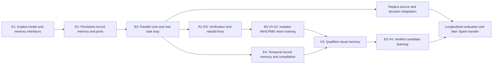

# Build the connected architecture

**Implementation reconciliation — 25 October 2026:** R1–R4 passed at `757ace1`.
The repair prerequisites described below are satisfied; isolated MiniCPM5 V0 is
next and remains natively unqualified. Reuse the recorded 140 integrated tests
and 1,372-test +21-subtest source-export result in
[repair qualification](../../reports/memory_contract_repairs_20261025/qualification.json). This maintenance inspected that evidence without rerunning
native work. The dated design and historical results below retain their scope.

**Current review: 25 October 2026, HEAD `7c7018e`.** The active order is
**R1 caller-bound contexts, R2 exact route/update schedules, R3 representation-
preserving rebuild → isolated MiniCPM5 V0 → V1/V2 fine-tuning → qualified visual
memory → bounded RSI**. Spark FP8/BF16 preparation and dataset intake proceed
independently now. Native Spark follows reusable interfaces and its own backend
gates; it does not require completing RSI and does not block MiniCPM5.

Follow [recovery](17_Memory_Reliability_Recovery.md),
[vision](18_MiniCPM5_Vision_Training_and_Continual_Learning.md),
[integrated design](19_Integrated_Memory_Learning_and_RSI_Design.md),
[Spark](20_Spark_X2_6_FP8_Preparation_Plan.md) and
[the loop prompt](16_Loop_Agent_Instructions.md). E1–E6/M0–M7 below are component
maps, not instructions to repeat finished packages.

The latest writer-only v5 candidate remains rejected, with zero factual memory.
Exact retrieval answers all 128 facts but its reference bundle fails broader
gates. Source packaging, direct span tamper checks and original route counters
are repaired; narrower scope/route/rebuild defects remain. The completed v5
package permits isolated V0 after those repairs, with memory/core/identity off.
It does not qualify learned memory or integrated RSI.

## 1. What changes in the work plan

The engineering objective is a useful connected MiniCPM5 memory/core/runtime
system; substantial wiring already exists. Repeating the same sixteen
short-answer cases is not the main workstream. Preserve their failures and use them as narrow regressions
where relevant. Qualify inference settings and output grammars inside the actual
interface being built, with task-appropriate budgets and preserved raw outputs.

The existing 33 stage IDs and scientific dependencies remain recognizable.
The packages below are implementation increments mapped onto those stages;
they are not 33 new gates. S1.5 controls admission of training data and numeric
experiment budgets, S2.4 controls fair architecture claims, and S2.5 controls
selection of the later frozen deployment base. None prevents building the
proposed memory ports, runtime or core now.

Data/source admission and evaluation design proceed alongside E1–E4. A connected
build can have an untrained component; its status must say so. A learned-capability
milestone requires trained behavior on new tasks, not a larger unit-test count.

## 2. Code migration rather than another parallel prototype

The following is the original **component/path map**. Several packages and
entry points now exist; inspect the actual tree and current status before
creating or moving code. Reuse production entry points and keep historical
experiment code reproducible until a deliberate compatibility migration.

| Area | Proposed package / primary classes | Existing foundation to reuse |
|---|---|---|
| Model ABI | `src/replica_lab/architecture/backbone.py`: `BackboneAdapter`, `PortSpec`, `RequestContext` | Source lock checks, native name mapping and scope registries |
| Native ports | `architecture/minicpm5.py`, later `architecture/minicpmv47.py`: explicit complete-block wrappers | `model_adapter.py` null-path and gradient contracts |
| Neural bridge | `architecture/ports.py`, `core.py`, `heads.py`: `SensePort`, `MemoryAccessPort`, `CognitiveCore` | Reader and workspace numerical primitives |
| Memory | `memory_system/ledger.py`, `index.py`, `writer.py`, `fast.py`, `compiler.py` | `memory.py`, source-bound episodes, functional `LinearFastMemory` |
| Task runtime | `runtime/session.py`, `task_graph.py`, `actions.py`, `journal.py` | Host receipt/epoch rules and explicit outcome provenance |
| Learning | `learner/proposals.py`, `datasets.py`, `candidates.py`, `director.py` | Native trainer, optimizer, checkpointing, candidate registry |
| Replica | `replica/identity.py`, `decisions.py`, `lineage.py` | Existing modes, source/branch records and interview protocol |
| Entry points | `scripts/run_replica_session.py`, `train_replica_architecture.py` | Current source reuse, exclusive MPS execution and profiling helpers |

Do not import the unfinished `runtime_pilot.py` draft as an implicit dependency.
Review it separately if useful and preserve its current bytes. Do not copy the
TAIS custom decoder wholesale: its code is an idea/implementation reference,
while this project adapts native pretrained models. Source terms and attribution
must be resolved before incorporating upstream code; this pass imports none.

## 3. E1 — Explicit backbone, request and manifest interfaces

**Map:** S1.1, S2.1 and early S3.1. **Result:** one model wrapper used by training,
prefill, generation and restart, with explicit ownership rather than global
sidecar context.

- Implement typed `PortSpec`, `EvidencePin`, `DecisionFrame`, `RequestContext`,
  `MemoryRead`, `PendingWrite`, `TaskGraph` and `ComponentManifest` interfaces.
- Load the existing sealed local source. Preserve native parameter names,
  original layer indices, positions, masks and cache implementation.
- Expose separate `encode_observations`, `sense`, `forward_with_frame`,
  `generate_action` and `commit_observation` operations. Persisting state is a
  host transaction, never a side effect of `forward` or recomputed backward.
- Implement independent bypass paths for every branch. Verify nonzero branch
  sensitivity as well as initial null parity; a permanently zero branch is not
  successful integration.
- Produce one architecture manifest with exact module inventory, dimensions,
  trainable scope and source revision. Checkpoint references reuse original
  bytes rather than replicating a source snapshot into every run.

**Acceptance:** native logits agree at initialization; declared branch parameters
receive gradients; source-only sensing excludes targets; two request contexts
cannot share cached state; save/load preserves a nonzero branch. Perform one
bounded MPS integration check after the software interfaces work, using the
existing guard. No repeated baseline wording search is required to close E1.

## 4. E2 — Record memory that the model actually reads

**Map:** S1.1/S1.2, S2.1–S2.3. **Result:** a source record becomes an independently
versioned latent payload, is retrieved and read through two real native ports.

- Admit exact temporal records with source spans, event/observation times,
  correction chains, owner/purpose and authenticity status.
- Implement lexical/dense candidate retrieval and a learned reranker over
  eligible candidates. The host filters eligibility before model selection.
- Contextually encode source-only chunks; initially bound a source chunk to
  128 native tokens and preserve overflow as additional chunks, not silent
  truncation. Pool four slots per selected record/chunk under the documented
  record aggregation rule. Name the actual payload unit in the manifest.
- Integrate ports 13/27 with a shared memory representation and independent
  projection/gating per depth. Keep 41 as observer, plus the old last-only arm.
- Recompute native features when their producer is trainable. D1 may cache
  compatible frozen native features, but must run the trainable writer in the
  graph; cached post-writer slots require a frozen writer. Exact strings,
  citations and code use a host fetch route.

**Acceptance:** swapping a relevant record changes the generated decision;
irrelevant, stale and unauthorized records do not. A correction survives
restart and invalidates dependent cached representations. Demonstrate both an
exact-text fallback and a read from record slots without the full historical
text repeated in the query. Compare the latter as a compression/access test
separately from equal-information training.

## 5. E3 — A parallel cognitive core in the operating loop

**Map:** early S3.1, S3.2, S2.1–S2.3. **Result:** real neural proposals execute a
task, receive real feedback and resume a changed plan after restart.

- Implement the reference known-input sense pass → two-step shared core →
  immutable frame → native action pass. Count both passes and source encoding.
- Couple eight latent workspace slots to an exact task graph containing goals,
  subgoals, constraints, evidence, hypotheses, actual outcomes and next action.
- Train actions with distinct consequences: answer, ask, retrieve, verify,
  invoke an allowed tool, revise and stop. Preserve malformed/failed proposals.
- Add empirical capability heads. A sigmoid of a hidden-state norm is not a
  calibrated success probability. Train on actual results; calibrate on separate
  data and evaluate selective risk, missing-information choice and tool cost.
- Connect the existing receipt and epoch boundary to real model output. Use
  more than a symbolic XOR fixture: begin with a bounded stateful technical task
  containing an actual failing test, a repair, an external observation and a
  resumable goal. The task remains safe and local but exercises the real paths.

**Acceptance:** a model-selected action obtains a real observation; the core
revises a plan in response; restart restores the unfinished task rather than
just the prompt; a failed or revoked tool result cannot authorize success. A
memory/core-disabled control and a compute-matched extra-inference control
establish what the added core contributes after it is trained.

## 6. E4 — Neural state, consolidation and runtime compilation

**Map:** S2.4 controlled extensions, S3.1/S3.3, optional-memory substages.
**Result:** observed history changes a bounded neural memory that influences a
later query, with replayable persistence and controlled invalidation.

- Preserve the existing functional linear baseline and negative single-page
  writer experiments. M2 adds distinct head writes, functional multi-chunk
  training, delayed-use supervision and a bounded SGDN-2-inspired candidate.
  Establish useful single-path behavior before increasing coupling.
- M3 then defines one chunk-start snapshot, one deferred commit and a tested
  reducer for shared-depth proposals. Compare shared/private state with the
  same update engine, equal information and declared state/compute budgets.
- Nonlinear Titans-style memory is a separately costed engine, not a label
  for the existing linear state. Do not change retrieval, core, decoder
  settings and memory rule together in the first comparison.
- M1 reuses existing `ContextPack`, `RecordLatents`, `BranchMemoryImage`,
  `ProcedureArtifact` and `NeuralCandidate` contracts in one thin executable
  compiler path. Extend payload binding, recovery and coordinated publication
  where missing; preserve existing procedure execution and atomic rollback.
- Persist branch memory only with bounded lineage, replay cursor, size/update
  limits and expiry. Rebuild from eligible records after a source change; do not
  promise exact subtraction of an old contribution from nonlinear memory.
- Introduce an Engram-inspired lookup branch only as a separate capacity/latency
  experiment. Keep vocabulary/tokenizer identity stable in the first build;
  source-bound concept aliases do not require changing token IDs.

**Acceptance:** later queries use earlier observation-only writes; reset, shuffled
write and disabled-read interventions identify the memory path's contribution.
Retries/recomputation cannot double-write. Memory images restore only under the
same compatible producer; source revocation causes rebuild before reuse. Report
interference, long-history saturation and exact-recall failures as well as gains.

## 7. E5 — Actual learning, selection and publication

**Map:** S1.4/S1.5, S2.4/S2.5, S3.3 onward. **Result:** a source-backed experience
produces a real parameter or procedure change that helps on later unseen work.

Training is staged, with all costs counted:

| Stage | Parameters / objective | Why it is needed |
|---|---|---|
| Interface alignment | D1: writer, ports, core and action heads; base frozen but downstream autograd retained | Learn to communicate with existing representations |
| Development co-adaptation | D2: all original text parameters and new modules; matched D0 ordinary full tuning | Determine whether integration requires backbone adaptation and adds value |
| Temporal-memory training | Bounded observation-write/query-read sequences, optional teacher distribution matching | Make later losses teach storage/use; prevent target input leakage |
| Action/calibration training | Tool/ask/revise outcomes, source sensitivity and retention | Learn useful control instead of grammar-only compliance |
| Deployment learning | Frozen selected base; named skill/sidecar/director candidates | Improve selected behavior without silently replacing the deployed foundation |

Use supervised trajectories and verified candidate ranking first. Add learned
practice selection only after the candidate loop produces measurable outcomes.
Self-evaluation proposes an update; the independent evaluator determines whether
it improved behavior. SEAL-style self-edit data is input to a real candidate
trainer, not evidence of improvement by itself.

For data, the existing 2,000-target release is exposed development infrastructure.
Build a fresh, source-separated task suite with chronological records, actual
tools, missing information, transfer of procedures and independent retention
cases. Admitting a small purpose-built release does not require waiting for
every public dataset in the 20k proposal. Each used source, budget and role must
still be declared under S1.5; quarantined public sources remain excluded.

Compare B0/B1 and D0/D1/D2 with equal eligible information. Separately compare
full-text history against compact memory with source-fetch costs included. Use
task accuracy, evidence sensitivity, real tool success, uncertainty calibration,
transfer, retention, identity fidelity and total cost. A semantic subagent can
judge open responses under a frozen rubric, with raw reasoning and blind packet
provenance; deterministic tool outcomes remain independent evidence.

**Acceptance:** accepted candidates improve later new instances under declared
regression bounds; damaging candidates are rejected; inconclusive candidates
defer; rollback and restart preserve the parent contract. Ten-cycle T0/T1/T2/T3
comparisons then test whether learned selection outperforms fixed practice.

## 8. E6 — MiniCPM5 vision, visual memory and later transfer

**Map:** V0–V3 developmental visual work, qualified S4 claims and later model
transfer. Preserve existing scientific dependencies for selected-system claims;
a native-development prototype is not a selected deployment result.

Extend the current MiniCPM5 adapter/session/frame ABI with a versioned visual
observation and fused prefix. Pin one pretrained visual encoder/processor and
train a new width-2048 projector. Keep all unrelated memory/core/identity
injections disabled during interface/alignment qualification. Mask visual and
prompt positions from loss, preserve positions and image layout across sense/
action/generation, and retain input gradients through the frozen decoder.

Follow [document 18](18_MiniCPM5_Vision_Training_and_Continual_Learning.md): V0
interface/bypass/reload checks, V1 projector-only alignment, V2 declared visual
instruction/reasoning tuning with text replay, then V3 delayed visual memory.
Require correct/wrong/no/shuffled image, caption/OCR-only, held-out asset-family
and text-retention controls. Visual memory adds image removal, multiple later
queries, correction, unaffected facts and fresh-process continuation. V4/M5
verified RSI follows these quality gates and the independent candidate lifecycle.

MiniCPM-V-4.7-1B is a separate optional pretrained reference/teacher. Preserve
its native window/spatial mergers, processor, Qwen3.5 hybrid recurrence and
multimodal positions under its own adapter; its connector is not MiniCPM5's.
Spark FP8/BF16 preparation proceeds now; native transfer later needs text
qualification, a new connector/adapters and
re-encoded model-specific memories. Transfer methods, data and lineage rather
than text-model tensor weights. Distinguish projector-only, adapter, full_text
and full_vlm scopes through actual named gradients and changed tensors.

## 9. Resource and progress discipline

On this Mac, native inference/training uses MPS with CPU fallback disabled;
host storage, source processing and small software checks use the CPU. The
Neural Engine requires a separate supported deployment path. The current
Muon 8-bit implementation quantizes momentum, while weights/gradients remain
FP32 and auxiliary AdamW state remains FP32.

The active driver guard default is now 50 GiB, with unchanged 512 MiB swap-growth
and 15% host-free checks. Historical explicit 40 GiB protocols remain unchanged;
fresh 50 GiB studies need new matching protocol/code pins. No fit is inferred
from a source checkpoint's BF16/FP8 dtype or the increased stop threshold.

Prior D2 driver peaks near 30 GiB at 512 tokens apply to the small old adapter.
The new contextual writer, two passes and inner-loop differentiation introduce
new activation/work costs. Profile them explicitly before selecting sequence
length, source count and temporal unroll. Compact fast state does not imply
cheap training. Future 24 GB Blackwell full-scope training still needs an admitted
residency/offload or dtype solution; a model-family name does not establish fit.

Each package ends with one connected demonstration, a concise failure analysis,
declared trained/untrained status, a selected checkpoint policy and a focused
commit. Unit tests protect the new causal/state boundaries; they do not become
the project milestone. E1/E2 source-to-port and E3 task paths already exist.
The next work is the clean-source/context/scorer and diagnosed memory recovery
in document 17, followed by the gated vision/learning sequence in document 18. Corrected M0a measurements and the exposed M2/M3 mechanics are
preserved results; do not repeat them as prerequisites already satisfied.
