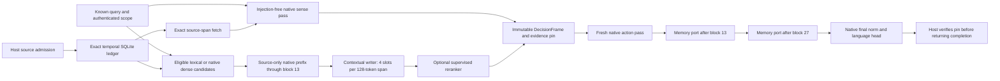

# E1/E2 implementation and native qualification

23 October 2026 UTC / 22 October America/Chicago. This increment implements the
first two packages of the [build sequence](05_Implementation_Sequence.md).
The pre-run revision records software construction and the fixed qualification
protocol. Native results are added after execution; test counts alone do not
establish useful model memory.

## Connected implementation



`architecture/minicpm5.py` calls the original native layers in their original
order. It retains attention, masks, rotary positions, layer indices, final norm,
head and original parameter names. Two independent width-256 cross-attention
readers add residual deltas after complete blocks 13 and 27. Their output
projections start at zero. Observer 41 exposes a known-input summary; no E3 core
or recurrent task policy has been substituted for it.

The typed interfaces are `PortSpec`, `EvidencePin`, `SourceSpan`, `MemoryRead`,
`SenseFrame`, `DecisionFrame`, `InjectFrame`, `RequestContext`, `PendingWrite`,
`TaskGraph` and `ComponentManifest`. `TaskGraph` currently carries exact state;
learned transitions and a durable action journal are E3. Host persistence is
`MemorySession.commit_observation`, outside all neural forward/backward calls.

One request owns one bank. It has at most 16 selected units × four slots; a unit
is one source span of at most 128 native tokens. Long records become additional
spans with exact character/token offsets and hashes. Candidate processing is
bounded to 64 units and fails explicitly on overflow; selecting 16 from an
encoded larger candidate set is distinct from truncating a source. Record
pooling never crosses source boundaries.

## Ownership, causality and cache rules

- The known-input sense pass never receives teacher-forced response labels.
  Training masks the complete known prefix. Generation starts a fresh action
  prefill and re-prefills without a KV cache on each token. This reference favors
  explicit ownership; cached decoding and batching remain unqualified.
- Frames bind source/ledger epoch, subject, branch, purpose, observation cutoff,
  optional source snapshot, manifest, tensor versions and producer identity.
  Parameter, buffer, device, dtype, storage and native-config changes invalidate
  an existing frame. These checks guard trusted application use; malicious
  `.data` writes and process memory tampering are outside the contract.
- `training_request` retains the frame until backward finishes, then releases
  tensor references. Perform `optimizer.step()` **after** leaving that context.
  Backward also checks the frame before checkpoint recomputation. No filesystem
  writes or record commits occur inside a neural forward.
- D1 can reuse unchanged native prefix features; its writer runs in the graph
  on every training example. D2 recomputes source features with gradients.
  Persistent inference slots require the unchanged sealed original and bind
  exact source spans, scope, epoch, native/tokenizer manifest and writer bytes.
  A correction/revocation invalidates dependent files before reuse.
- The ledger retains correction history, prevents revoked corrections from
  reviving superseded assertions, and requires explicit host source authority.
  Authenticity labels are declarations, not automatic verification. Scope
  isolation is inside a trusted host, not an operating-system security boundary.
- Exact fetch rechecks current eligibility, epoch and content hash. Deleting
  local live payloads is not a promise to erase backups or trained weights.

## What receives training

Answer cross-entropy trains the contextual writer and both memory readers in
D1; D2 additionally exposes all original text parameters. A zero output
projection opens on the first update; earlier branch factors receive useful
answer gradients after that projection becomes nonzero. The optimizer routes
eligible matrices to the existing portable Muon 8-bit momentum implementation
and embeddings/slot queries/nonmatrix parameters to FP32 AdamW.

Hard candidate ordering has no derivative. `MemorySession.ranking_loss` therefore
has a separate preferred-record objective. With `train_sense=True`, it also
trains the first query sensor. In ordinary E1/E2 answer training, sense snapshots
are computed without retaining an unused second native gradient graph. Upper
sense ports are exposed and gradient-tested but await E3 supervision. No answer
loss or random score is described as a trained cognitive controller.

The current dense baseline averages native source-prefix features of eligible
records. It is deterministic candidate retrieval, not a validated embedding
model. Learned retrieval quality needs a later source-separated study.

## Run and storage contracts

The shared loader reads `checkpoints/minicpm5_source`, verifies its complete
existing seal, checks revision `f97400052a43d642bbc6e9975e2397e3ae6a6b52`, and
requires the actual 2,516,756,480 parameters / 381 original tensors. All model
operations run FP32 on MPS with CPU fallback and downloads disabled. It uses
`runs/.D2_mps_worker.lock`, shared with earlier native jobs.

Use the existing watchdog, whose default legacy trainer remains unchanged.
The new entry-point allowlist includes `qualify_architecture.py` and
`run_replica_session.py`. New native loaders require the watchdog marker.

```sh
.venv/bin/python scripts/run_capacity_preflight.py \
  --entry-point qualify_architecture.py \
  --report reports/e1_e2_native_20261023.guard.json \
  -- --device mps --output runs/e1_e2_native_20261023
```

The guard retains 40 GiB driver allocation, 512 MiB sustained system swap growth,
15% minimum system free memory, and stale-telemetry stops. Memory counters are
sampled and can miss transients. MPS driver and process RSS overlap and must not
be added. Profiling covers source verification/loading, source encoding,
sensing, backward, optimization, generation and extension reload.

The [fixed qualification protocol](../../configs/e1_e2_qualification_v1.json)
predeclares four balanced synthetic examples, 32 D1 updates with Muon 8-bit,
four separate ranking updates, D1/D2 backward wiring probes, raw generation,
source interventions and restart. There is no D2 optimizer step or full-base
checkpoint in this increment. All four examples are exposed development data;
they support an integration/compression diagnostic, not a generalization claim.

Only one final extension weight file is exported. It references the sealed base
and stores no native weights even temporarily. It is a weight export, **not** a
training-resume checkpoint: optimizer and RNG state are intentionally absent.
All weights, local databases and latent caches remain ignored by Git. Historical
selected checkpoints and failed results are preserved.

## Persistent runtime entry point

Use `scripts/run_replica_session.py` behind the same guard with a fresh report
output and a persistent ledger. For example, after the extension exists:

```sh
.venv/bin/python scripts/run_capacity_preflight.py \
  --entry-point run_replica_session.py \
  --report reports/my_session.guard.json \
  -- --device mps --output runs/my_session \
  --ledger private/replica/records.sqlite \
  --extension runs/e1_e2_native_20261023/selected_extension \
  --query 'What is the approved release label for project Aster?' \
  --subject example --branch main --purpose project_assistance --as-of 10
```

Import exact `MemoryRecord` JSON objects with `--records path.jsonl`; source
archive writes require `--authorize-source-records`. This flag expresses host
admission authority, not verified truth. The CLI never turns its generated
response into authentic personal testimony. Optional `--dense`, `--rerank`
(requires an extension) and `--exact-text` select the implemented access routes.
Without an extension, memory output projections are zero and the report names
that untrained state. It preserves raw completion text/IDs, source pins, exact
citations, component/implementation identities, memory telemetry and failures.

## Next package

E3 connects these interfaces to the shared recurrent core, eight workspace slots,
exact task journal and real action/outcome loop. E4 adds temporal neural state
and compiled artifacts; E5 adds independent candidate evaluation and promotion.
None is claimed by this E1/E2 implementation. The legacy last-layer adapter and
its recorded negatives remain reproducible, and `runtime_pilot.py` is untouched.

## Native attempt 1 and boundary fix

Commit `9601399` ran the fixed protocol on MPS. All initial wiring checks passed,
and after 32 D1 updates the four latent-only generations were exactly correct.
The run then failed during the first separate ranking backward: a loss hook
called host SQLite verification from an MPS autograd worker thread. CPU unit
backward had not exposed that scheduling difference. No final extension had yet
been exported; the trained in-process state was lost on exit.

The fix makes the hook verify tensor/model frame ownership only. Host epoch and
scope verification remains immediately before and after backward. A regression
test forbids host storage access from the ranking hook. The focused affected
suite passes 60 tests. Attempt 2 repeats the **same** source, seed, cases, update
counts, optimizer/rates and generation protocol in a fresh directory. This is
a code-correctness rerun, not a new hyperparameter selection. Both attempts and
all consumed updates are retained in the final accounting. See the
[preserved failure analysis](../../reports/e1_e2_native_attempt01_20261023/analysis.json).
