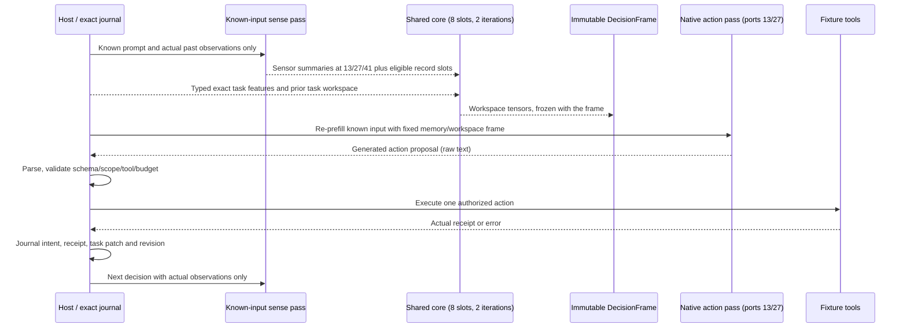

# E3 — shared cognitive core, exact task journal and real action loop

Implementation specification, 23 October 2026 UTC. This document is the shared
interface contract for the E3 build. Status and measured results are added after
the bounded native experiment; nothing here claims trained capability.

## 1. Reference schedule

Teacher-forced answers, future observations, gold outcomes and evaluator
expected values never enter the sense pass, task features or core construction.
The evaluator's assertions may be observed only through a real tool execution.

## 2. Neural contracts (implemented in `src/replica_lab/architecture/`)

`CoreSpec` (in `contracts.py`) declares `width=256`, `slots=8`, `steps=2`,
`heads=4`, `task_features=24`, `ffn_hidden=1024` (four-width tied core FFN) and
`control_hidden=340` (matched feed-forward control); `width` must equal the
record memory width. `CoreState` owns `workspace [1,8,256]`, `valid [1,8]`,
`task_features [1,24]`, producer identity, exact task digest, journal revision,
iteration count and implementation name; it is immutable by tensor stamp and
`detached()` is the only inference-boundary copy.

`ComponentManifest.core` is optional. Core-less manifests keep the exact E1/E2
dictionary and digest. A core manifest adds the validated `CoreSpec`.

`DecisionFrame` gains `core: CoreState | None` and
`enabled_branches: tuple[str, ...]`. Branches are a distinct nonempty subset of
`('memory', 'workspace')`; enabling `workspace` requires a core. Memory and
workspace readers are separate modules with separate gates and zero-initialized
final projections. `enabled_ports` still controls which native depths inject.

`CognitiveCore` uses one tied block for both iterations:

- initial workspace = eight learned slot queries plus the task-owned previous
  workspace (zero when absent);
- slot self-attention with a validity mask;
- cross-attention over sense summaries, memory slots and two encoded task
  tokens, distinguished by learned type embeddings;
- normalized gated feed-forward (pre-norm, residual, sigmoid gate per sublayer);
- two iterations with identical parameters, no hidden-state detach between them.

Inputs are separately maskable (`sense`, `memory`, `task`) for controls. The
previous workspace is task-owned: the host passes its own prior state, detached
at inference, never another task's or a live graph.

`FeedForwardCore` is the matched control: one gated feed-forward mapping from
pooled sense/memory features plus task features to eight workspace slots, with a
parameter count within 5% of `CognitiveCore` and the same output contract.

`TaskSuccessHead` consumes a detached `[task_features, pooled workspace]` vector
and returns one logit. It is a prediction monitor only; it never authorizes a
success claim, and it is not described as calibrated unless a separate
calibration role exists.

Feature layout (`task_features`, host-computed from the exact journal, bounded to
[0, 1] unless noted): revision/32, open obligations/8, constraints/8, claims by
status (known, inferred, unknown, hypothetical)/8, evidence/8, subgoals total/8,
subgoals done/8, actions by state (proposed, attempted, completed, denied,
failed)/8, outcomes/8, decisions used fraction, tool calls used fraction, token
budget used fraction, last outcome flags (failed, denied, completed), success
condition count/4, remaining budget fraction. Twenty-four values, always actual
state, never a model claim.

Adapter additions (`MiniCPM5Adapter`):

- `core`, `ff_core`, `workspace_ports` (13/27), `task_head` when the manifest has
  a core; new names are included in `new_named_parameters()` and optimizer groups;
- `build_core_state(sense, memory, task_features, *, previous=None,
  enabled_inputs=('sense','memory','task'), implementation='recurrent')` returns
  a `CoreState` whose producer binds base, sensors, writer, core and reader
  tensors;
- `make_frame(..., core=None, enabled_branches=None)`: core frames default to
  `('memory','workspace')`, core-less frames to `('memory',)`;
- `forward_with_frame` adds the memory delta and the workspace delta
  independently after complete blocks 13 and 27;
- `predict_success(core_state)` returns a detached logit and never a task fact.

`MemorySession.prepare(..., task_features=None, previous_core=None,
core_impl='recurrent', enabled_inputs=(...), enabled_branches=None,
train_core=False)` builds the frame. With `training and (train_sense or
train_core)` the sense pass retains autograd so sensors, core and workspace
readers receive the action loss. With `training=False` all state is built under
`no_grad`; previous workspaces are detached by the caller. Frames are released
at the end of each decision; no graph spans decisions.

Extension format `replica.minicpm5.extensions.v2` stores exactly the current new
tensor inventory plus a component map. Loading the E2 v1 parent requires
`accept_parent_v1=True`; the parent manifest must equal the current shared
manifest (all fields except `core`), the receipt inventory must equal exactly the
E1/E2 component tensor set with matching shape/dtype, and new E3 tensors keep
fresh initialization. Unknown/missing v2 keys are rejected.

## 3. Exact task state (implemented in `src/replica_lab/runtime/`)

`task_graph.py` owns frozen, hashable `ExactTaskState`:

- authorized goal (immutable through the whole task) and independently
  checkable `SuccessCondition`s;
- `Constraint`s and a subgoal DAG;
- claims with `known | inferred | unknown | hypothetical` status, evidence
  references and unresolved `Obligation`s;
- action records with `proposed | attempted | completed | denied | failed`
  states, actual `OutcomeRecord`s with receipts, task revisions and `Budget`.

`TaskPatch` operations are `add_claim`, `revise_claim`, `add_subgoal`,
`add_obligation`, `satisfy_obligation`, `add_evidence`, `set_subgoal_state`,
`note`. `apply_patch(state, patch, verifier)` is the only commit path. It denies:
goal replacement or success-condition edits by a model; `known` claims without
a host evidence reference; obligation completion without a host-verified
receipt; budget or binding edits; edits by an unauthorized author. Denials are
returned as typed results and recorded, never silently dropped.

`journal.py` is a SQLite append-only hash-chained journal bound on open to
`task_id`, subject, branch, purpose, source epoch, goal digest and
model/component versions. It stores decision records (prompt hash/count, generated
token ids, frame/workspace stamps), action intents, outcomes, patches, revisions
and budget deltas. `load()` reconstructs the exact state and pending intents.
Recovery reconciles pending intents by idempotency key and observable effect
(write target content hash; read-only tools are safe to re-run only when no
receipt exists). Completed actions with matching content are not executed again.

`workspace_store.py` persists `workspace [1,8,256]` + valid + producer +
task digest + revision in safetensors with a JSON sidecar. A missing, stale or
incompatible payload is discarded and rebuilt; the exact journal remains the only
required copy of the task.

## 4. Actions and tools

`ActionProposal` kinds are exactly `retrieve`, `read`, `invoke_tool`, `verify`,
`revise`, `answer`, `stop`, `ask`, each with a strict argument schema, goal /
subgoal binding, source or receipt references, idempotency key and budget
estimate. `parse_action_proposal(text, allowed_tools=...)` extracts exactly one
JSON object from the model's raw output; malformed output becomes a `denied`
outcome with the raw bytes preserved. The host assigns action and idempotency
IDs; the model never supplies authority fields.

`OutcomeFrame` always carries `actual=True`, the action ID, `completed |
denied | failed | pending_input`, observation IDs, a typed result, spent budget
and an optional host receipt. Model text such as "test passed" is never a
receipt. Only `tools.verify_success()` may satisfy a success condition.

`FixtureWorkspace` tools for the connected task:

| Tool | Arguments | Authority |
|---|---|---|
| `read_file` | `{"path": str}` | Any file under the case root, read-only, 16 KiB |
| `write_file` | `{"path": str, "content": str}` | Only under `workspace/`, 8 KiB, regular files, no symlinks/`..` |
| `run_test` | `{}` | Fixed evaluator command, cwd = case root, 30 s, bounded output, real exit code |

`verify_success()` runs the same evaluator command through a separate host path;
it is not exposed as a writable tool. Evaluator tests and expected values live
outside `workspace/` and outside model write authority.

## 5. Fixtures

`fixtures/e3/cases/<case_id>/` contains `case.json` (task goal, success
condition, allowed tools, role, variant metadata, reference repair for the host
validator only), `workspace/` (model-writable configuration/program) and
`evaluator/test_*.py` (read-only independent check). Train, dev, held-out and
interrupted roles are declared per case; held-out cases are not used for
alignment or control tuning. Every case starts failing and the reference repair
makes the evaluator pass; the validator proves both before native execution and
reports leakage checks (expected value absent from the prompt/workspace, evaluator
unreachable by `write_file`).

## 6. Controls

Runtime `mode` values: `full`, `core_disabled` (memory only, no workspace
branch), `workspace_zero` (core computed, workspace zeroed before the readers),
`workspace_shuffled` (another task's stored workspace with matching producer),
`ff_core` (matched feed-forward core trained under the same declared budget) and
`extra_inference` (one additional known-input sense pass, workspace branch
disabled). Each records decisions, tokens, tool calls, wall time, malformed
actions and outcomes. Engineering acceptance is separate from learned benefit;
inconclusive controls remain reported as such.

## 7. Hardware and evidence rules

Native execution is MPS FP32 with CPU fallback disabled, one job behind the
existing lock and capacity guard (40 GiB driver, 512 MiB sustained swap growth,
15% free memory). The sealed source is reused; only extension tensors are saved.
Storage work stays outside forward/backward hooks, and MPS backward hooks remain
free of SQLite access. Raw prompts, completion IDs/text, tool receipts, frames,
journal events and failure traces are retained.

## 8. Measured status (23 October 2026 UTC)

The bounded native qualification is complete. **Engineering acceptance passes**
for null parity, validated E1/E2 migration, independent reader influence,
gradients through sensors/core/workspace readers, exact-journal reconstruction,
stale-workspace rejection, typed-action validation, actual tool receipts,
independent success authority, extension-only export and preserved original
parameters. **Learned task completion is negative** on the exposed fixture
family: 0/8 model-driven episodes completed, the full-core arm repeated `read`,
and the workspace-zero arm wrote an invalid repair. The success head was not
trained because all eight actual outcomes were negative. See the
[native results](../experiments/20261023_E3_Native_Results.md) for raw traces,
attempt history, controls, restart evidence and costs.

The implementation therefore establishes the E3 wiring and persistence
contracts, not a useful cognitive controller or a task-capable action policy.
A future narrower repair tool or additional held-out cases would be a separate
preregistered arm; this result must not be retuned against the same held-out
fixtures.

## 9. E2 handoff for E3 integration

The 23 October E2 follow-up found that lexical/dense held-out retrieval is
usable (recall@1 0.75, recall@4 1.00) but the learned reranker is worse
(0.50) and all slot-reading arms fail novel-value answers (0/6 held-out;
oracle 0/4). Exact source text answered 3/3 in the diagnostic, and swapped
slots produced the same old answers as correct slots. The bottleneck is the
record writer/reader encoding, not eligibility, retrieval availability, prompt
format or the decoder. Keep the E3 parent extension unchanged, keep reranking
opt-in, prefer exact text for novel-value precision, and do not attribute E2
slot failures to the E3 core. The largest actually qualified memory capacity is
16 units / 2,043 source tokens / 256 prompt tokens / 8 generated tokens, plus a
modules-only 16-unit backward at 12.51 GiB peak driver. See the
[E2 results](../experiments/20261023_E2_Retrieval_and_Capacity_Results.md).

## 10. Narrower `set_constant` arm (negative)

A second predeclared family replaced full-file repair with a bounded
`set_constant` tool (one numeric literal; other settings preserved) and used
fresh source groups. All engineering checks passed. Teacher-forced loss fell to
0.015, but held-out execution was **0/7**: the full and feed-forward arms
repeated `read`, while core-disabled/extra-inference produced malformed
proposals. The model never selected the repair, so the failure is action
selection/representation, not tool validation or argument syntax. This matches
the earlier `write_file` read attractor. Do not run another near-identical
action arm; the set_constant tool remains implemented but is not promoted. See
[set_constant results](../experiments/20261023_E3_Set_Constant_Results.md).
