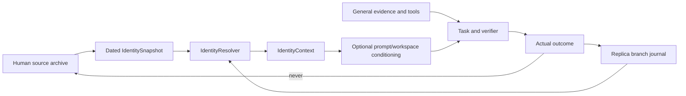

# Replica identity interface (C16), null path and evaluation plan

23 October 2026 UTC. Status: **software contracts implemented; no authentic
personal source, trained identity conditioning or fidelity result exists.**
This chapter implements the identity boundary requested by the Replica protocol
and keeps it optional. All examples/tests use explicitly fictional subjects.

## 1. Ownership boundary

The source archive is human-authored, reviewed and dated. A snapshot is an
approved selection of source episodes, approved conditional principle
hypotheses and unresolved questions. A Replica branch records agent-owned
experiences and skills. Branch events are never written into the human archive,
and identity text is never evidence for a verifier or authority to declare a
task successful.

## 2. Implemented contracts

| Contract | Location | Behavior |
|---|---|---|
| `SourceEpisode` | `replica/identity.py` | Attributed text/decision, observation/event time, source hash, kind, authenticity, permitted uses, supersession and uncertainty |
| `PrincipleHypothesis` | same | Conditional priority with exceptions, supporting/contradicting episodes and proposed/approved/revoked status; approval requires support |
| `IdentitySnapshot` | same | Versioned dated episode/hash list, approved principles, unresolved questions, permitted uses and digest |
| `IdentityContext` | same | Resolved mode, snapshot, branch, purpose, cutoff, evidence IDs, bounded summary and producer versions; `null()` is the disabled path |
| `IdentityManifest` | same | Subject/snapshot/digest/schema/producer compatibility check |
| `ReplicaBranchState` | same | Parallel-branch experiences and skills, separate from source; incompatible branch/snapshot rejected |
| `IdentityArchive` / `IdentityResolver` | same | Host archive, approved snapshot construction, cutoff/correction filtering and revocation invalidation |
| `render_identity_context` | same | Bounded prompt section; null/empty produces no text and never changes success authority |
| `IdentityReader` | `replica/reader.py` | Optional independently gated residual reader attached after core workspace construction; zero-initialized output, exact zero when disabled/empty/all-masked; untrained |
| Runtime integration | `runtime/loop.py` | Optional `TaskRuntime(identity=...)` adds the approved context to the prompt; default `None` is byte-identical to the previous prompt |

Modes are enforced: `source_snapshot`, `source_current`,
`parallel_replica`, `assistant_for_source`. Source modes force branch
`source`; `parallel_replica` requires a branch state bound to the same subject
and snapshot. `assistant_for_source` uses approved source context without
claiming to be the person. A missing/disabled context is explicit null.

Corrections are temporal: a correction observed before the cutoff excludes its
parent; a later correction does not leak backward into an earlier view.
Revoking an episode invalidates any snapshot containing it; resolving a revoked
snapshot raises. The archive does not claim neural erasure after training.

## 3. Conditioning boundary

The optional `IdentityReader` now has a declared `IdentitySpec` in the component
manifest and is attached **after** the shared core workspace, before the native
workspace ports read it. It has independent parameters, a zero final projection
and an explicit `identity_enabled` gate. A `CoreState` binds the identity context
digest; workspace persistence and session/loop copies preserve that binding.
Identity-bearing extensions use `replica.minicpm5.extensions.v3`; the selected
core-only E3 extension remains v2 and unchanged.

Null parity, disable parity, all-masked slots, nonzero influence, workspace-store
binding and v3 export/reload are tested with tiny offline tensors. No authentic
identity slots or learned slot encoder exist yet; the reader is **untrained** and
no personal conditioning or native capability is claimed. The connected prompt
section remains the established host-facing conditioning path; optional tensor
slots can pass through the session/proposer, but no trained source-to-slot
pipeline is qualified. Identity may influence priorities or
information requests only after a separate trained candidate and evaluation; it
cannot rewrite source facts, satisfy a failed verifier, override permissions or
replace the authorized task goal.

## 4. Evaluation protocol (not executed)

`configs/replica_identity_eval_v1.json` declares the future comparison:
generic baseline, approved-summary baseline, archive-retrieval baseline and
optional neural conditioning, with the same eligible information. Complete
decision/topic families are held out before variants are generated. Metrics are
kept separate: factual provenance, conditional choice/ranking, useful
clarification, counterfactual sensitivity, temporal fidelity, unknown handling,
technical correctness, style and attributable branch divergence. Human source
review assesses personal fit; executable verifiers assess technical outcomes.
No authentic personal data is bundled; the archive, training and human review
remain external dependencies. A “percentage replica” is not a valid metric.

## 5. Tests and limits

`tests/test_replica_identity.py` covers cutoff/supersession, null context,
source/branch isolation, branch-state mismatch, revocation, manifest
compatibility, zero-init reader parity/independence and optional prompt
inclusion. No native model, personal data, identity training or fidelity
evaluation is claimed. The status registry marks C16 as implemented contracts
and an attached, untrained workspace reader. Attachment/null/export tests do
not establish useful conditioning.

## Persistent host store (23 October 2026 UTC)

`IdentityStore` now persists the host-owned source archive: attributed episodes,
approved principles, dated snapshots, revocation history and branch-owned
experience. The file is canonical JSON with a SHA256 body digest, atomic replace
and mode `0600`; loading rejects changed bytes, unknown formats, subject
mismatches and active snapshots that reference absent/unapproved material.
Revoked snapshots remain as history but cannot resolve.

Branch experience is stored in the same private file but remains a separate
ownership domain. It never becomes source testimony. The runtime still accepts
only an explicitly resolved `IdentityContext`; identity remains optional, null
by default and has no verifier or task-success authority. Native workspace-reader
attachment exists; a trained approved-source slot encoder and authentic personal
conditioning remain unqualified.
Authentic source material is still an external dependency; no personal data is
bundled in Git.

## Next integration work

Follow the parallel identity track in the
[revised construction plan](15_Research_Crosscheck_and_Backbone_Plan.md#7-personality-and-semi-cognitive-integration).
Connect approved source slots and identity context consistently through decision
binding, persistence and replay. Compare generic, approved-summary,
archive-retrieval and neural-conditioning paths with equal eligible information.
Separate conditional choices and exceptions from facts and optional style.
Fictional cases can qualify these interfaces while authentic records are absent;
they cannot qualify personal fidelity. This track starts alongside M1–M3 and
does not wait for Engram or multi-rate consolidation.
