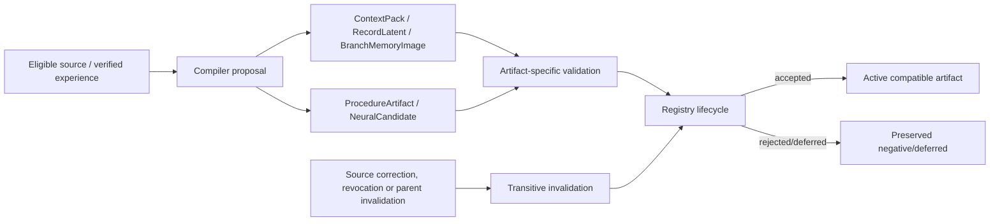

# Typed runtime artifacts and lifecycle registry

23 October 2026 UTC, reconciled at `377718e`. Status: **typed metadata and
dependency-aware registry implemented; procedure execution, isolated neural
candidate experiments and single-writer publication/rollback also exist.**
The remaining gap is a coordinated durable compiler/trainer/publisher used by
the continuing task loop, with complete payload, eligibility and recovery checks.

## 1. Artifact types

| Artifact | Meaning | Lifecycle |
|---|---|---|
| `ContextPack` | Bounded exact approved source text + evidence/source hashes and cutoff | built → active → invalidated/expired |
| `RecordLatent` | Metadata reference to one per-span writer payload | built → active → invalidated/expired |
| `BranchMemoryImage` | Metadata reference to one scoped fast-state image, chunk/cursor/lineage | built → active → invalidated/expired |
| `ProcedureArtifact` | Typed procedure steps, preconditions, source events and independent tests | proposed → validated → accepted/rejected/deferred → revoked |
| `NeuralCandidate` | Parent manifest, changed parameter names, weights hash, training scope/optimizer, evaluation state | proposed → validated → accepted/rejected/deferred → revoked |

No artifact class executes a tool, loads a model or certifies itself. Payload
bytes live outside the metadata; source hashes and payload hashes bind them.
Procedure steps and parameter lists remain declarations in these classes.
Separate host code executes the bounded `RepairProcedure`; experiment drivers
train/evaluate neural candidates. Registry metadata alone does neither.

## 2. Registry semantics

`ArtifactRegistry` stores immutable artifacts and indexes source/parent
dependencies. Adding requires unique IDs, existing parents and explicit source
IDs. Transitions are kind-specific: view artifacts cannot be “accepted” like
candidates; accepted candidates can only be revoked; invalid/expired view
artifacts cannot be read through `payload`. Source revocation marks dependent
views `invalidated` and proposed/validated candidates `rejected`; accepted
candidates become `revoked` when their parent is invalidated. Invalidation
propagates to children. This is metadata invalidation, not neural unlearning.
`save` writes a catalog digest manifest for review; it is not a full artifact
store. `learning.ManifestRegistry` already performs accepted-candidate/parent
checks, atomic file replacement and ancestor rollback. It is a single-writer
reference, not a coordinated transaction across payload storage, source epochs,
the artifact catalog and running requests. Complete byte hashing, publication
locking/current eligibility and interrupted-publication recovery remain work.

## 3. Tests and limits

`tests/test_runtime_artifacts.py` covers distinct view/candidate transitions,
illegal transitions, expiry, source/parent cascade, payload rejection, strict
hashes and unbacked procedure/candidate rejection. Subsequent evidence includes
[procedure execution/publication/rollback](../experiments/20261023_E5_Procedure_Results.md),
[opt-in reranker acceptance](../experiments/20261023_E5_Neural_Candidate_Results.md)
and [pointer publication/rollback](../experiments/20261023_E2_Pointer_Publication_Results.md).
The procedure passed 3/3 held-out plus dev. Reranker top-1 improved 0.25→0.50
against its parent but remained below lexical 0.75; no default neural model was
promoted by that result. These narrow components do not establish a general
runtime learning service or broad neural task/retention gain.

Start M1 with one real payload/consumer, reuse these components, and connect
M5's actual training/evaluation loop. Follow the
[revised plan](15_Research_Crosscheck_and_Backbone_Plan.md) for producer/source
binding, transitively invalidated training descendants, recovery and later-task
evidence. Historical raw reports remain unchanged.
