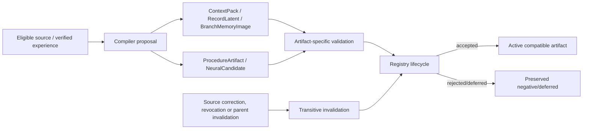

# Typed runtime artifacts and lifecycle registry

23 October 2026 UTC. Status: **metadata contracts and dependency-aware
registry implemented and unit-tested; no artifact execution, candidate
training, independent promotion or rollback service yet.** This is the E4
compilation boundary and the E5 publication seam, not a learning result.

## 1. Artifact types

| Artifact | Meaning | Lifecycle |
|---|---|---|
| `ContextPack` | Bounded exact approved source text + evidence/source hashes and cutoff | built → active → invalidated/expired |
| `RecordLatent` | Metadata reference to one per-span writer payload | built → active → invalidated/expired |
| `BranchMemoryImage` | Metadata reference to one scoped fast-state image, chunk/cursor/lineage | built → active → invalidated/expired |
| `ProcedureArtifact` | Typed procedure steps, preconditions, source events and independent tests | proposed → validated → accepted/rejected/deferred → revoked |
| `NeuralCandidate` | Parent manifest, changed parameter names, weights hash, training scope/optimizer, evaluation state | proposed → validated → accepted/rejected/deferred → revoked |

No artifact class executes a tool, loads a model or certifies itself. Payload
bytes live outside the metadata; source hashes and payload hashes bind them.
Procedure steps and candidate parameter lists are declarations for a later host
executor/trainer.

## 2. Registry semantics

`ArtifactRegistry` stores immutable artifacts and indexes source/parent
dependencies. Adding requires unique IDs, existing parents and explicit source
IDs. Transitions are kind-specific: view artifacts cannot be “accepted” like
candidates; accepted candidates can only be revoked; invalid/expired view
artifacts cannot be read through `payload`. Source revocation marks dependent
views `invalidated` and proposed/validated candidates `rejected`; accepted
candidates become `revoked` when their parent is invalidated. Invalidation
propagates to children. This is metadata invalidation, not neural unlearning.
`save` writes a catalog digest manifest for review; it is not a full artifact
store. A durable transactional publisher remains E5 work.

## 3. Tests and limits

`tests/test_runtime_artifacts.py` covers distinct view/candidate transitions,
illegal transitions, expiry, source/parent cascade, payload rejection, strict
hashes and unbacked procedure/candidate rejection. Artifact payloads are not
trained, and no candidate was accepted as a capability improvement. The next
step is a bounded E5 candidate: real source-bound data, declared trainable
parameters/optimizer, isolated training, independent task/retention evaluation,
then accept/reject/defer and rollback against a parent manifest.
