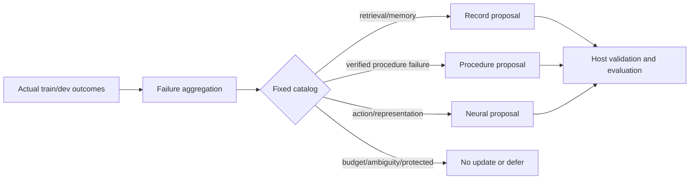

# C13 — experience diagnosis and bounded learning director

**Status: deterministic baseline implemented and tested; learned ranking policy
not trained or evaluated.**

The director runs at a completed-task boundary. It consumes `OutcomeSummary`
records from ordinary `train`/`development` roles, aggregates actual failures by
class, and emits at most one host-validated `LearningProposal`. It can also return
`deferred` or `no_update`. Audit/final-evaluation roles are rejected at the
outcome boundary; a data manifest naming audit/gold is refused.

## Policy baseline

The current selector is deliberately **not learned**:

| Repeated failure class | Proposed target | Preconditions |
|---|---|---|
| `retrieval`, `memory` | `record` (`memory-selection`) | repeated actual failures |
| `procedure` | `procedure` (`repair-config`) | repeated failures and verified tool receipts |
| `action`, `representation`, `answer` | `neural` (`action-policy`) | at least 8 attempts in the baseline budget |
| `insufficient_budget`, `implementation`, `evaluation_ambiguity` | no update | classifier is not a learning target |
| no repeated failure | no update | no proposal |

Every proposal binds source event IDs, parent manifest, data manifest, cost,
attempt/failure counts, optimizer (or `none`), and an independent grouped
evaluation plan. The director cannot publish, execute tools, change evaluator
rules, goals or identity, or exceed its declared proposal/cost budget. A
model-written success sentence is not a receipt; procedure proposals require
actual verified receipts.

A learned ranking policy, contextual bandit, chronological T0–T3 comparison and
director-specific candidate update remain future work. No learned-director
benefit is claimed.

## Tests

`tests/test_learning_director.py` covers the catalog mappings, procedure receipt
requirement, neural label threshold, cost deferral, audit exclusion, invalid
roles/evidence, and absence of publish/execute APIs. These are interface and
policy tests, not capability or optimization results.

## Outcome-to-proposal cycle adapter

`runtime/learning_cycle.py` connects an actual completed runtime summary to the
director. It extracts only observed counters and trace facts, classifies the
failure, builds one bounded `OutcomeSummary`, and delegates proposal selection.
A successful episode returns `no_update`; malformed actions, repeated reads and
false success claims map to the action-policy catalog; a failure with verified
receipts can map to a procedure proposal. It has no publish, execute or goal
authority and does not read evaluator gold.

`tests/test_learning_cycle.py` covers success/no-update, repeated-read and
malformed mapping, procedure proposal, low-label deferral and the summary
adapter. This is an integration boundary, not a trained or calibrated director.

## Actual-outcome audit

`configs/c13_director_audit_v1.json` maps six historical outcome summaries
(the original free-form action family, large family, DAgger, partial restart,
accepted procedure and retrieval failure) through the deterministic director.
The audit produced:

- accepted procedure → `no_update`;
- large action family (9 attempts) → neural proposal;
- retrieval failure → record proposal;
- smaller action/DAgger/restart outcomes → defer (neural labels insufficient).

This is a **policy audit**, not learned-selector accuracy or a capability
result. It confirms the intended no-update/proposal/defer behavior on actual
counters and preserves the distinction between a proposal and a trained update.
`tests/test_c13_director_audit.py` covers the success and neural-threshold paths.

## Checked-proposal sufficiency gate

`configs/c13_checked_proposals_v1.json` records 13 actual candidate comparisons
from reported experiments (procedure, retrieval, pointer, reader, fast memory,
copy, cross-rerank, action families, answer ranking and D2). It contains no
synthetic labels. The declared minimum for a learned selector is 8 independent
source groups and at least 10 accepted and 10 rejected/deferred proposals.

Current counts are **13 groups, 5 accepted, 8 rejected/deferred**, so the gate
returns `defer_insufficient_checked_proposals`. No selector weights were trained
and nothing was published. This is a data-sufficiency decision, not a failed
optimization experiment.
