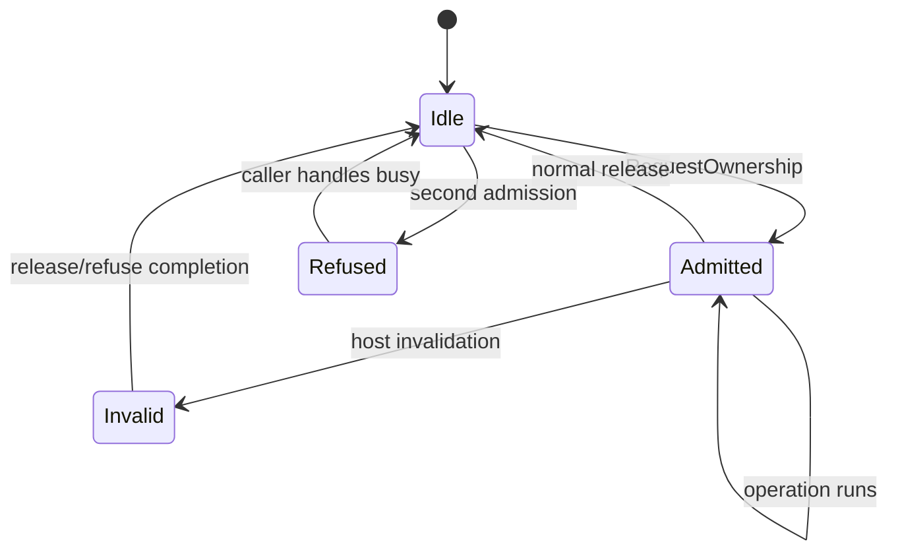

# C17 — request admission and ownership

**Status: single-job admission implemented and tested; native cache reuse
remains unsupported.**

`RequestScheduler` admits exactly one operation at a time. Each admission gets an
immutable `RequestOwnership` binding request, task digest, revision, evidence
epoch, branch, producer and optional identity digest. The lease is explicit:
normal exit releases it; host invalidation marks it invalid, and the admission
context refuses completion. A second thread/request receives `SchedulerBusy`
rather than sharing mutable state.

The scheduler does **not** create a native KV/recurrent cache, reuse a sense-pass
cache for an augmented pass, run tools or mutate parameters. The reference
adapter still re-prefills. `RequestContext` already owns its immutable frame and
selection; the scheduler adds the admission boundary needed before a future
batching/cache implementation.

## Tests and limits

`tests/test_request_scheduler.py` covers non-reentrant admission, cross-thread
refusal, explicit invalidation, release, and ownership identity binding. No
native job is scheduled by a production service yet; every existing native
script remains serialized by the exclusive worker lock. Cache keys and
equivalence remain future work.

## Bounded cache manager

`src/replica_lab/runtime/cache.py` adds a bounded in-process `OwnedCache` for
host payloads. A `CacheKey` binds producer, writer, tokenizer, record/span hashes,
subject, branch, purpose, cutoff, revision and optional identity digest. Only an
exact key matches; equal shapes or a matching producer are insufficient.
Eviction is deterministic oldest-first under entry/byte bounds. Source
invalidation removes matching entries.

This is **not** native KV/recurrent reuse. The reference adapter still
re-prefills, and no cached model tensor is exposed. The manager is a contract for
future typed artifacts, not evidence of cache speedup or semantic equivalence.
`tests/test_cache_manager.py` covers exact-hit/mismatch, bounds, source
invalidation, collision handling and clearing.
