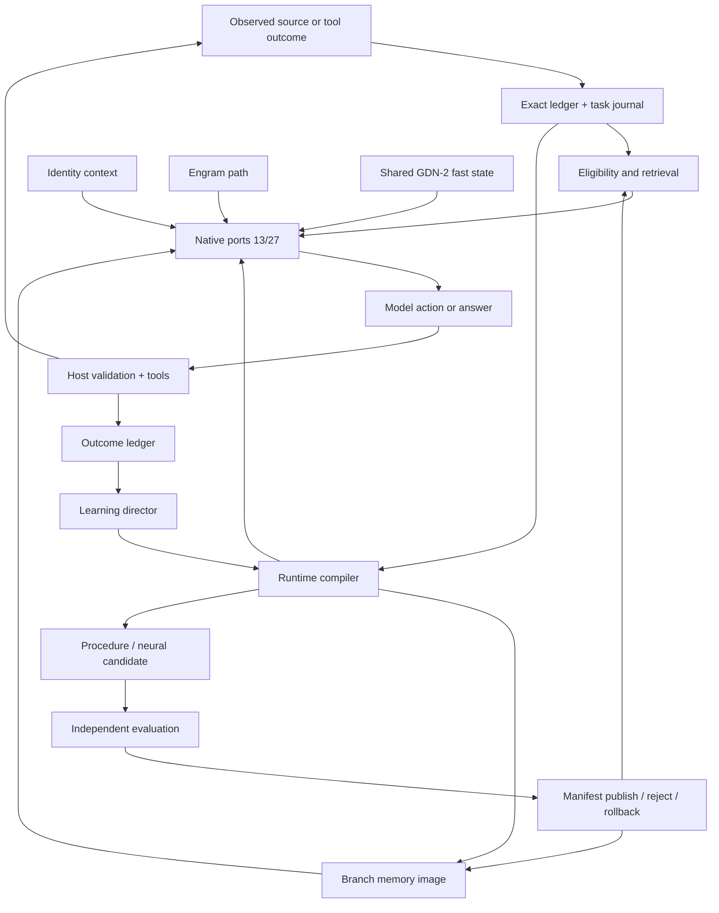

# Research cross-check and backbone modification plan

**Status: design review plus defect corrections, 23 October 2026 UTC.** This
document reconciles the current implementation with the primary memory,
test-time-training and continual-learning papers cited by the project. It then
specifies the smallest backbone changes needed for dynamic memory, runtime
compilation, bounded self-evolution and an optional personality path on
MiniCPM5-2B and MiniCPM-V-4.7-1B.

This review did not train a new native model or reproduce any paper. The current
full suite is **1211 passed / 21 subtests** in **147.24 s** after the three
defect-regression tests were added. No native job was active. The protected `src/replica_lab/runtime_pilot.py` draft remains untracked
and unmodified.

**Bottom line:** the project has a strong host/runtime control plane and a
measured read-side sidecar. It does not yet have a memory-native backbone.
Titans, uTTT, MemT-1.0, HOPE, Engram, Mem-T and Gated DeltaNet-2 are not
reproduced. The engineering infrastructure is ahead of the learned capabilities,
and the next work should be a native memory block with a learned writer and
shared-depth commits, not another free-form action-prompt experiment.

## 1. Current implementation: what is actually real

| Layer | Evidence |
|---|---|
| Exact task state | `TaskGraph`, `TaskJournal`, claims/obligations/subgoals, typed actions, receipts, restart and stale-state rejection |
| Native text coupling | MiniCPM5 adapter with complete-block ports at 13/27 and observer 41; independent memory/workspace/fast read branches |
| Shared workspace | Width-256, eight-slot, two-iteration `CognitiveCore` with self-attention, cross-attention, gated FFN and previous-workspace input |
| Record memory | Per-record spans and slots, contextual writer, opt-in native readers; novel-value answer transfer remains 0/16 |
| Fast memory | Host-owned `LinearFastMemory`; staged observation writes, one chunk commit, image save/load, invalidation and bounded replay; native fast readers are read-only |
| Action loop | Real tools, independent evaluator, fresh-process restart; candidate ranking 17/17 (15/15 held-out) on repair menus; free-form selection negative |
| Compilation | Typed artifact metadata and lifecycle registry; no compiler, executor, neural-candidate trainer or integrated publisher |
| Learning | Deterministic director, actual-outcome audit, procedure candidate, opt-in reranker; no learned selector and no accepted neural candidate improving unseen tasks |
| Identity | Versioned source/snapshot/mode/branch contracts, persistent store, optional zero-init reader, fictional fidelity harness; no authentic data or trained conditioning |
| VLM | Not implemented; MiniCPM-V-4.7-1B weights are not local |

The native capacity result is **4096 units at 30.59 GiB** for the tested workload.
The 8192-unit probe reached **48.08 GiB** and was stopped by the guard. The
pre-correction inference harness retained avoidable autograd tensors in the
writer/sense path; that 8192 number is a real boundary for the old harness but
does not establish the limit of correctly configured inference. The harness now
runs those producers under `torch.no_grad()`; a corrected remeasurement is
pending, so 4096 remains the selected tested maximum.

## 2. Research cross-check

| Work | Mechanism established by the paper | Current code | Gap |
|---|---|---|---|
| [Titans](https://arxiv.org/abs/2501.00663) | Deep neural long-term memory trained at test time; surprise is the input gradient; momentum and adaptive forgetting; persistent task memory; memory as context, gate or layer | `LinearFastMemory` is a linear L2 delta rule with fixed learning rate, decay and norm clipping. The native fast port is read-only. No deep memory, momentum, persistent memory tokens or three integration modes | Partial concept only; closer to a simplified TTT/DeltaNet baseline than Titans |
| [uTTT](https://arxiv.org/abs/2610.05484) | All layers read/write one shared fast-weight state; chunk-start reads; aggregated writes at a chunk boundary; cross-depth routes; outer task loss backpropagates through earlier writes | Workspace is shared across ports 13/27. `update_shared_chunk` can aggregate writes against one start state. Native fast ports are read-only; no write ports or cross-depth gradient path | Host primitive exists; the uTTT path does not |
| [MemT-1.0](https://arxiv.org/abs/2610.26825) | Per-layer native memory block; Gated DeltaNet-2 stable token update; erase/write gates and channel decay; multi-channel state; Mixture-of-Storage; 34B-token pipeline | `FastWriteEncoder` exists in the adapter surface, but the connected runtime bridge uses a deterministic encoder. Fast state is host-owned linear memory. No per-layer block, GDN-2 gates, MoS or comparable training | Not memory-native |
| [Nested Learning / HOPE](https://arxiv.org/abs/2512.24695) | Model as nested optimizers with distinct context flows/frequencies; continuum memory system; self-modifying update rule; HOPE combines self-referential Titans and CMS. The paper's Llama adaptation uses 15B continual-pretraining tokens | Two tied core iterations; one global Muon/AdamW path; fixed fast-memory update; no multi-frequency levels | Missing. Two iterations of one block are not CMS |
| [Engram](https://arxiv.org/abs/2601.07372) | Static conditional lookup: causal n-gram hashing to an O(1) learned table, contextual gate, sparse capacity; U-shaped allocation against MoE; 27B scale | C07 is unimplemented | Absent. Engram is static lookup, not online episodic memory |
| [Mem-T](https://arxiv.org/abs/2601.23014) | Autonomous memory agent over hierarchical working/factual/experiential/raw stores; learned construction/retrieval; MoT-GRPO densifies delayed rewards | Exact ledger, journal, typed artifacts, deterministic director and procedure candidate. No learned memory-operation policy or operation-tree credit | Host structure partial; learned memory policy absent |
| [Gated DeltaNet-2](https://arxiv.org/abs/2605.22791) | Separates channel-wise erase and write gates; adaptive forgetting/decay; stable delta-rule update; efficient chunkwise training | Fixed scalar learning rate and decay; no per-channel erase/write gates | Missing update rule |
| [MiniCPM5-2B](https://huggingface.co/openbmb/MiniCPM5-2B) | 2.52B total / 1.98B non-embedding Llama decoder; 42 layers; width 2048; GQA 16/2 | Local sealed source and adapter | Correct base; memory is a sidecar |
| [MiniCPM-V 4.7](https://huggingface.co/openbmb/MiniCPM-V-4.7-1B) | 1B variant: SigLIP vision encoder with window merger + Qwen3.5 text core; 24 layers, width 1024, 3 linear / 1 full attention; canvas M-RoPE | Adapter absent; weights absent | Must be a separate native adapter |

The terminology correction matters: **HOPE is the architecture presented in the
Nested Learning paper**, not a separate drop-in module. **Engram is a static
lookup path**; a dynamic router over static Engram shards is not the same as an
online-updated Engram table.

## 3. Missing capabilities and priority

### P0 — required before claiming a memory-native system

1. **Learned native memory writes.** The current runtime has read-only native
   memory/fast ports. `FastWriteEncoder` is not the qualified writer. Add a
   GDN-2-lite block with learned Q/K/V, channel-wise erase/write gates, decay,
   stable delta update and an output gate.
2. **Shared-depth fast state.** Both ports should read one chunk-start state and
   contribute writes to one commit. Compare with private state at equal total
   state and compute.
3. **Actual runtime compilation.** Compile typed payloads, not only metadata:
   `ContextPack`, `RecordLatent`, `BranchMemoryImage`, `ProcedureArtifact` and
   `NeuralCandidate`. Add payload validation, atomic publication, rollback and
   transitive invalidation.
4. **Action policy with a reliable representation.** Keep the host-enumerated
   candidate menu and extend it with typed argument heads. Free-form JSON action
   selection remains negative; do not rerun the same arm.
5. **Measured core/workspace contribution.** The mixed family completed 4/4 with
   and without the action-kind head; the head was rejected. Core controls were
   2/2 vs 1/2 each on n=2. Do not claim recurrent-core benefit from these.

### P1 — next architecture layer

6. **Static Engram path.** Causal n-gram hash, top-k table rows, contextual gate,
   zero-init residual, table frozen between candidate publications. Start small;
   measure collisions, bytes touched and latency.
7. **Multi-rate CMS / HOPE-lite.** Fast per-chunk state, medium task/branch
   procedures and workspace gates, slow candidate parameters. Learn only
   step-size/forget gates first.
8. **Dynamic capacity routing.** MemT-style memory experts or a learned router
   over memory routes, only after the single-state path and Engram path are
   separately measured.
9. **Identity conditioning.** Attach `IdentityContext` to the decision frame
   with a separate gate; no fact or verifier authority.

### P2 — later dependencies

10. Native KV/recurrent cache equivalence (C17 currently re-prefills).
11. MiniCPM-V 4.7 adapter, native visual state and visual memory.
12. Calibrated success/action-value heads. The diagnostic pooled head is not
    calibrated or published.

## 4. Target architecture

The native decoder remains the backbone. New memory is a parallel residual
branch with its own gate, provenance and null path. It does not replace native
attention or the native MLP.

## 5. MiniCPM5-2B modification plan

Local facts: 42 layers, width 2048, FFN 6144, 16 query heads, 2 KV heads, head
width 128, vocabulary 130560, BF16 weights 5.03 GB. Ports 13/27, observer 41.

### M0 — Preserve the current measurement baseline
Keep the sealed source, E3 extension, exact journal, tools, verifier and restart
tests. Do not replace native attention or MLP blocks in the first wave.

### M1 — GDN-2-lite native memory block
At blocks 13 and 27, after the complete native block result:

- state `M ∈ R[H, dk, dv]`, start `H=4`, `dk=dv=128`;
- learned Q/K/V projections from the native pre-attention hidden state;
- L2-normalized queries and keys;
- channel-wise erase gate `β`, write gate `ω`, decay `λ`;
- stable update `M ← (I − β k kᵀ) · diag(λ) · M + β k (ω ⊙ v)ᵀ`;
- read `qM / sqrt(dk)`, RMSNorm, output gate, bounded SiLU;
- zero-init final residual projection and an independent branch gate;
- only observed source/tool bytes may be written; never generated text.

The state itself is small: `4×128×128 = 65,536` values, about 256 KiB FP32.
Projections dominate the parameter cost. Start with **one shared state across
13/27** and a **private-state control**.

Acceptance: null parity, independent branch influence, chunk-start consistency,
no future-token leak, delayed-use gain over zero/shuffled/disabled, correction
and restart reset.

### M2 — Learned writer and shared-depth commit
Train `FastWriteEncoder` on actual observations. Both ports read one chunk-start
snapshot; both write proposals are aggregated into one host-authorized commit.
Pass outer task loss through earlier writes for a bounded horizon. Compare
shared versus private state at equal total state and compute.

### M3 — Static Engram path
Causal 2/3-gram hashing, top-k table rows, contextual gate, residual. Start with
`2^16` rows × 128/256 width, freeze table between candidates, sparse optimizer.
Exact names, dates, numbers and citations remain in the ledger. Measure collision
rate, bytes touched, cold/warm latency and additive benefit over record memory.

### M4 — Runtime compiler and candidate loop
Implement payload builders and executors for `ContextPack`, `RecordLatent`,
`BranchMemoryImage`, `ProcedureArtifact` and `NeuralCandidate`. Add independent
evaluation, atomic publication, rollback and transitive invalidation. Then run:

`actual outcome → director proposal → source-bound practice → isolated candidate
→ independent held-out evaluation → publish/reject/defer → restart → later task`

The deterministic director remains until the checked-proposal gate reaches
10 accepted / 10 rejected. Current count: 5 accepted / 8 rejected.

### M5 — CMS / HOPE-lite
Introduce explicit frequencies: fast per-chunk state, medium task/branch gates
and procedures, slow candidate parameters. Learn only `η` and `α` first. Compare
one/two/three rates and fixed/learned update rules. A full HOPE reproduction is
an architecture-scale pretraining project, not a local wrapper.

### M6 — Identity/personality
Add `IdentityContext` to `DecisionFrame` with mode, cutoff, purpose, snapshot
digest and evidence IDs. Feed approved slots to a separate reader with its own
gate. Identity may rank valid actions or request clarification; it cannot rewrite
facts, satisfy a failed verifier or change the protected goal. Use fictional
decision families first; authentic data and human review remain required.

## 6. MiniCPM-V 4.7 plan

Verified config: 24 text layers, width 1024; **3 linear-attention / 1 full-attention**
repeating blocks; full-attention indices 3, 7, 11, 15, 19, 23; linear state
`[B,16,128,128]` plus convolution history; vision tower 27 layers, width 1152;
16× downsample; canvas M-RoPE; vocabulary 248094.

Do **not** insert a second GDN-2 memory into every linear block. The VLM already
has native Gated DeltaNet linear attention; duplicating it would confound
attribution and risk state corruption.

Proposed route:

- ports after full-attention boundaries **7 and 15**, observer **23**;
- memory width 128 initially, then 256 only with measured benefit;
- preserve native recurrent, convolution, full-attention KV and M-RoPE state;
- make `rope_deltas` request-owned and reset between requests;
- leave the vision tower and merger unchanged in the first adapter;
- add cross-modal record latents after fusion: image/video hash, crop, frame time,
  processor/vision/merger versions and exact visual reference;
- add Engram only on the text side after fusion;
- apply personality conditioning after fusion, on text/action tokens only.

Phases:

1. Text memory block trained and measured on MiniCPM5; transfer method, not
   weights.
2. VLM adapter with zero-init outputs and text-only parity.
3. Image/video position and cache parity.
4. Visual delayed-use and source-correction tests.
5. Cross-request isolation and state reset.
6. Visual memory evaluation; captions alone are not visual memory.

VLM weights are not local; the adapter remains blocked until they are available.

## 7. Personality and semi-cognitive integration

The host loop is stronger than the model policy. Preserve the exact task graph,
typed actions, receipts and verifier. The practical semi-cognitive interface is:

1. host enumerates a bounded authorized action menu;
2. model ranks actions and supplies typed arguments;
3. host validates authority, schema and budget;
4. host executes and records a receipt;
5. model sees the actual outcome and may revise the plan;
6. only the independent verifier declares success.

This is not a free-form policy. Candidate-generation rules, scores, chosen index
and random controls must be logged. Identity is a separate branch: conditional
priorities can change ranking or clarification, not facts or verification.
Fictional contract tests come first; authentic fidelity requires permitted data
and human review.

## 8. Acceptance gates

| Area | Required evidence |
|---|---|
| Native memory | Null parity; independent branch effect; delayed use > zero/shuffled/disabled; correction/revocation; restart; no future/generated writes |
| Shared depth | Shared vs private at equal state/compute; cross-depth write ablation; chunk-start consistency; no same-chunk leakage |
| Engram | Additive gain over record memory; collision/bytes/latency; frozen table between candidates; no fact authority |
| Compiler | Payload/source hashes; atomic publish; rollback; transitive invalidation; changed-tensor audit |
| Self-evolution | Real parameter update; improvement on unseen cases; retention; bad-candidate rejection; restart; cost |
| Action | Completion; plan change after real failure; zero false success; malformed actions; restart |
| Identity | Null mode; mode/cutoff; source/branch isolation; no verifier override; provenance vs preference ranking; human review |
| VLM | Text/vision parity; M-RoPE; recurrent/conv/KV state; cross-request isolation; visual delayed use |
| Resources | Peak driver, swap, free memory, tokens, tool calls, latency, artifact bytes; 40 GiB / 512 MiB / 15% guards |

## 9. Defects corrected in this package

1. **Capacity inference autograd retention.** `scripts/run_e2_capacity.py` now
   wraps record-writer and sense producers in `inference_call()`, which executes
   under `torch.no_grad()`. The old 8192-unit boundary is preserved as historical
   evidence, but correctly configured inference must be remeasured before using
   it as a model limit.
2. **Constant candidates omitted from action menus.** `candidate_actions.py` now
   parses host-read numeric strings (rejecting booleans and non-finite values)
   into menu values. The `set_train_retry_01` fixture now exposes
   `BACKOFF_SECONDS=0.4`, `REQUEST_TIMEOUT_MS=1200`, and `RETRY_ATTEMPTS=2`
   instead of zero constant candidates. Model behavior with the added candidates
   is not yet measured.
3. **Pre-admission invalidation was ineffective.** `RequestScheduler` now records
   revoked request IDs independently of generation and refuses admission before
   any operation runs. A regression test covers `invalidate()` before `admit()`.
4. **Status reconciliation.** The implementation registry, execution state and
   resumption record are corrected to the current suite, capacity evidence,
   C11/C13 states and the 16-unit retrieval versus 4096-unit capacity distinction.

## 10. Limits and do-not-do list

- Do not stack Titans, uTTT, MemT, HOPE and Engram in one arm.
- Do not cite MemT's 34B or HOPE's 15B training budgets as local plans.
- Do not repeat free-form E3 action arms; constrained decoding, DAgger, large
  supervision, action guards and full-backbone D2 all failed.
- Do not use full-backbone training to rescue the action interface; bf16 D2
  completed 8 updates at 39.10 GiB and still scored 0/6.
- Do not call an online-updated table Engram.
- Do not use generated text as a fast-memory write.
- Do not report hidden-state norms as calibrated confidence.
- Do not claim personality fidelity without authentic permitted data and human
  review.
- Do not describe a sidecar port as a reproduction of HOPE, MemT-1.0, Titans or
  uTTT.

## 11. Sources checked

- [Titans: Learning to Memorize at Test Time](https://arxiv.org/abs/2501.00663)
- [Universal Test-Time Training](https://arxiv.org/abs/2610.05484)
- [MemT-1.0: Towards Memory-Native Evolution](https://arxiv.org/abs/2610.26825)
- [Nested Learning: The Illusion of Deep Learning Architectures](https://arxiv.org/abs/2512.24695)
- [Google Research: Introducing Nested Learning](https://research.google/blog/introducing-nested-learning-a-new-ml-paradigm-for-continual-learning/)
- [Conditional Memory via Scalable Lookup (Engram)](https://arxiv.org/abs/2601.07372)
- [Mem-T: Densifying Rewards for Long-Horizon Memory Agents](https://arxiv.org/abs/2601.23014)
- [Gated DeltaNet-2](https://arxiv.org/abs/2605.22791)
- [MiniCPM5-2B model card](https://huggingface.co/openbmb/MiniCPM5-2B)
- [MiniCPM-V 4.7 1B model card](https://huggingface.co/openbmb/MiniCPM-V-4.7-1B)
- [Transformers MiniCPM-V 4.7 documentation](https://huggingface.co/docs/transformers/main/model_doc/minicpmv4_7)
- Local: [memory and runtime compilation](03_Memory_and_Runtime_Compilation.md),
  [fast memory](10_Fast_Memory_Reference.md),
  [typed artifacts](11_Runtime_Artifacts.md),
  [learning director](13_Learning_Director.md),
  [E2 capacity results](../experiments/20261023_E2_Retrieval_and_Capacity_Results.md),
  [E3 native results](../experiments/20261023_E3_Native_Results.md).
