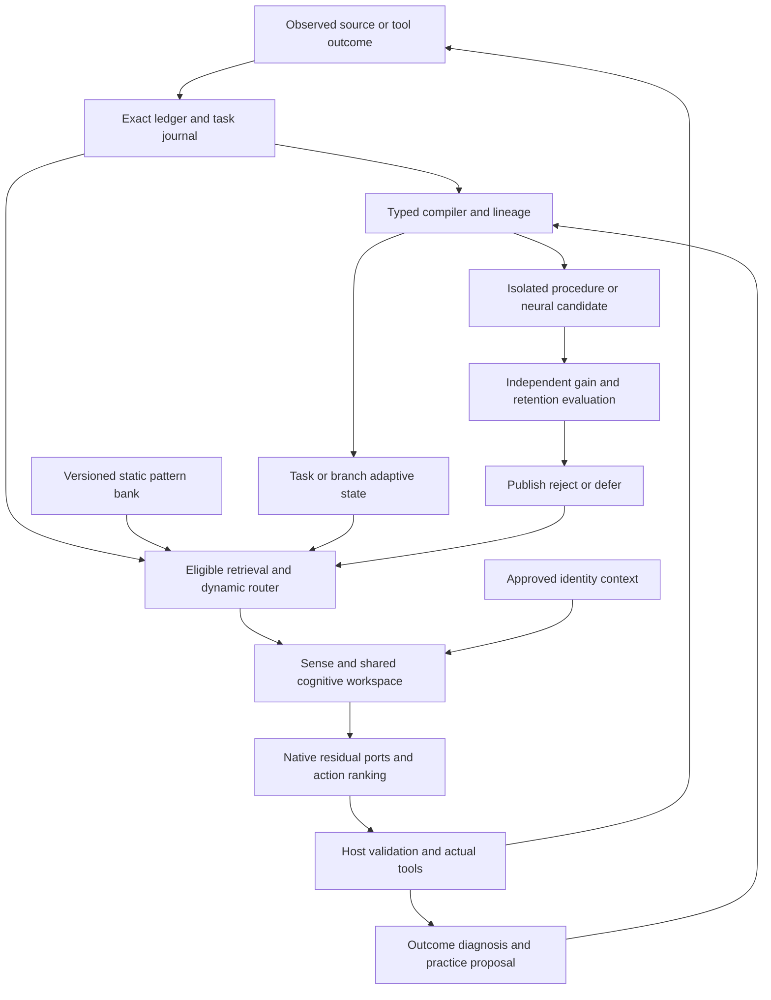

# Research cross-check and backbone modification plan

**Implementation reconciliation — 25 October 2026:** R1–R4 passed at `757ace1`.
The repair prerequisites described below are satisfied; isolated MiniCPM5 V0 is
next and remains natively unqualified. Reuse the recorded 140 integrated tests
and 1,372-test +21-subtest source-export result in
[repair qualification](../../reports/memory_contract_repairs_20261025/qualification.json). This maintenance inspected that evidence without rerunning
native work. The dated design and historical results below retain their scope.

**Research baseline: 23 October 2026; code review: 24 October, HEAD `7c7018e`; plan updated 25 October.**
MiniCPM5 remains the baseline. The active order is **remaining verification and
memory rebuild fixes → isolated MiniCPM5 V0 → V1/V2 visual fine-tuning → qualified
visual memory → bounded RSI**. Prepare official Spark FP8/BF16 sources, backend
capabilities and datasets now; native Spark integration follows reusable
interfaces and its own gates, not a requirement to finish RSI first.

The detailed current contracts are [recovery](17_Memory_Reliability_Recovery.md),
[vision](18_MiniCPM5_Vision_Training_and_Continual_Learning.md),
[integrated design](19_Integrated_Memory_Learning_and_RSI_Design.md),
[Spark FP8/BF16](20_Spark_X2_6_FP8_Preparation_Plan.md) and
[data curriculum](../08_Dataset_Acquisition_and_Curriculum.md).
Use [the loop prompt](16_Loop_Agent_Instructions.md) for execution. This revision
updates plans and descriptive metadata; it implements no fixes or new training.

## Immediate priority after the latest review

The v5 fact-binding writer repair is complete and rejected. Required source
files are now tracked; changed-span checking, route accounting and prospective
reference gates were repaired. Do not repeat those original defects as current.
The review verified source/data reproducibility, 49 focused tests and independent
rescoring of 1,920 saved rows. The recorded 1,311-test /21-subtest full clean-export
pass is separate experiment evidence, not a new review full-suite run.

Three remaining repairs precede native V0: bind exact contexts to the caller's
scope/query and canonical route; require the complete unique seeded update/case
schedule; preserve raw versus fact-binding representation through rebuild and
snapshot identity. Reproductions and exit tests are in document 17.

The completed rejected v5 package permits isolated V0 after those fixes, with
memory/core/identity disabled. Continue fresh storage/addressing/readout probes
independently, using copy/pointer controls only when values are recoverable.
Unresolved memory quality still blocks dependent learned visual memory and RSI.

## 1. Current implementation and evidence

| Area | Current status and limit |
|---|---|
| Native backbone/runtime | MiniCPM5 adapter, request frames, core/workspace, exact ledger, bounded tools and narrow procedure lifecycle exist |
| v5 writer-only D1 | 48 updates /192 cases, 14 changed tensors /5,251,072 parameters; original base/readers/gates frozen |
| Learned memory quality | Fast and disabled both 56/192, with 0/64 facts, 0/16 corrections and 0/48 unaffected facts; reject |
| Exact reference | Selective 184/192, full 176/192; selective gets all 128 facts but reference still rejects on general/nonregression gates |
| Persistence | 32 authenticated memory snapshots and 7/7 recorded restart answers; mechanical success, not useful-memory or crash-durability proof |
| Verification | Source package and initial payload check repaired; caller scope/canonical route, update-sequence and rebuild-representation defects remain |
| Retention/data | 16 distinct evaluation questions and four counterfactual families per evaluation split; broad retention still unqualified |
| Vision/RSI/identity | MiniCPM5 vision and accepted neural RSI unqualified; identity reader exists but is untrained and authentic fidelity unmeasured |
| Spark/data preparation | Official FP8/BF16 metadata pinned; 34 external dataset sources catalogued, 22 pinned; no weights/assets acquired or newly admitted |

See the [v5 result](../experiments/20261024_Memory_Reliability_Writer_Binding_Results.md)
and [canonical verdict](../../reports/memory_reliability_v5_scorer_fix_eval02/verdict_final.json).
Earlier reader-only, E4, M3 and M4 rejections remain historical negative evidence.

### Backbone roles and promotion rule

| Role | Model and decision |
|---|---|
| Primary baseline | Sealed MiniCPM5-2B; 42 layers, width 2048; first text-to-vision retrofit |
| Planned Spark adaptation base | Official [Spark-X2.6-4B-FP8](https://huggingface.co/XHToken/Spark-X2.6-4B-FP8), pinned in document 20; no local training qualification |
| Precision/quality control | Official [Spark-X2.6-4B BF16](https://huggingface.co/XHToken/Spark-X2.6-4B); independent checkpoint, not a dequantized FP8 derivative |
| Pretrained visual reference | MiniCPM-V-4.7-1B; separate hybrid adapter/processor, not a transferable MiniCPM5 projector |
| Larger optional reference | MiniCPM-V-4.7-35B-A3B, separately qualified/costed; active parameters do not determine full residency |

Promote a backbone or extension only after independent gain, retention and cost
checks against the matched base and strongest practical control. Keep the 50 GiB
native guard, one exclusive MPS worker and host checks. Muon int8 momentum does
not imply int8 parameter/gradient storage or an FP8-capable training backend.

## 2. Primary-source cross-check

| Work | Relevant mechanism | Construction consequence |
|---|---|---|
| [TTT v4](https://arxiv.org/abs/2407.04620v4), [Titans v1](https://arxiv.org/html/2501.00663v1) | Learned associative updates; Titans adds deep memory, momentum and adaptive forgetting. Its update differentiates associative loss with respect to memory parameters | Keep the linear baseline; study learned coefficients/deep memory separately |
| [uTTT v1](https://arxiv.org/html/2610.05484v1) | Shared fast weights, chunk-start reads, combined gradient updates and historical cross-depth gradient paths | Sharing workspace is insufficient; define state ownership, reduction and differentiable history |
| [MemT-1.0 v2](https://arxiv.org/html/2610.26825v2) | Native gated state, SGDN-2 and explicit memory training | Study update and supervision separately; closing the backbone-preparation/native-memory improvement loop remains future work in the paper |
| [Gated DeltaNet-2 v1](https://arxiv.org/html/2605.22791v1) | Separate channel-wise erase/write controls and recurrent/chunkwise implementations | Distinguish GDN-2 from symmetrized SGDN-2; CUDA kernels do not establish MPS support |
| [Nested Learning / HOPE v1](https://arxiv.org/html/2512.24695v1) | Optimization levels with distinct context flows/frequencies; self-referential memory plus CMS | Define parameter sets, losses, buffers and transfer. A scheduler or two core iterations is not CMS |
| [Engram v2](https://arxiv.org/html/2601.07372v2) | Deterministic multi-head n-gram hashing into learned tables with contextual gating | Static pattern path plus a separate dynamic router/episodic overlay; not learned top-k row retrieval |
| [Mem-T v2](https://arxiv.org/html/2601.23014v2) | Learned construction/retrieval over hierarchical stores and operation-tree credit | Applies to memory-operation policy/director; distinct from MemT-1.0 |
| [MAC v2](https://arxiv.org/abs/2403.04317v2), [LongMem](https://arxiv.org/abs/2306.07174) | Learned document modulation or decoupled encoder/reader adaptation | Retain writer/reader and exact-context comparisons; local negatives do not rule out every sidecar |
| [SEAL v2](https://arxiv.org/abs/2506.10943v2), [Voyager v2](https://arxiv.org/abs/2305.16291v2) | Actual candidate adaptation versus executable skill growth without backbone tuning | Measure neural and procedure-library improvement separately |
| [STaR v2](https://arxiv.org/abs/2203.14465v2), [Absolute Zero v3](https://arxiv.org/abs/2505.03335v3) | Correctness-filtered reasoning bootstrapping; generated tasks with executable verification | Start from independently checked practice; answer correctness alone does not validate every rationale step |
| [Darwin Gödel Machine v3](https://arxiv.org/abs/2505.22954v3) | Evaluated changes to an agent's software implementation | Keep code/architecture proposals separate from weight adaptation, with sandboxed candidates and fixed external gates |
| [CTM v4](https://arxiv.org/abs/2505.05522v4), [Coconut v4](https://arxiv.org/abs/2412.06769v4) | Temporal neuron processing/synchronization versus continuous hidden-state feedback | Later controlled alternatives; neither is reproduced by current slots |

HOPE is an architecture in Nested Learning. Mem-T and MemT-1.0 are different
works. Their composition is this project's hypothesis. External training budgets
and benchmark gains are not local budget estimates or acceptance thresholds.
Pin code/model revisions before adoption; the links identify reviewed paper versions. The
[current uTTT author release](https://github.com/Zefan-Cai/uTTT) includes dense
and MoE implementations; earlier descriptions of a limited release are historical.
Our two-port SGDN-2 path is still not a reproduction. The integrated design in
document 19 separates paper mechanisms from our dynamic routing, persistent
source authority and bounded improvement hypotheses.

## 3. Revised construction order

| Priority | Current work | Exit evidence |
|---|---|---|
| 1 | R1 caller-bound contexts, R2 exact update schedule, R3 representation rebuild | Adversarial consumer/schedule/rebuild tests and reproducible source |
| 2 | Isolated MiniCPM5 V0, then V1/V2 | Native interface, projector alignment, grounded instructions and text retention |
| Independent | Fresh memory storage/addressing/readout diagnosis | Discriminating probes; one justified repair, preserving quality failures |
| 3 | V3 visual memory | Qualified perception/memory, useful delayed recall, correction and restart |
| 4 | V4/M5 bounded RSI | Verified candidate updates, unseen later-task gain, retention and rollback |
| Preparation now | Spark S0 and eligible data manifests | Official FP8/BF16 pins, backend matrix, terms/split/asset audit |
| Native transfer later | Spark S1–S3 | Stable reusable interface, native text/training qualification, new connector and measured quality/cost |

The rejected v5 package is complete; do not require another blind memory arm
before isolated V0. Exact visual retrieval is an independently evaluated baseline.
Learned V3 and V4 retain prerequisite quality gates. Spark native work has no
RSI-success dependency and does not block MiniCPM5. Optional mechanisms and
identity work retain their own evidence/source requirements.

The following M labels identify component studies, **not the current run order**:

| Package | Component scope | Exit evidence before dependent expansion |
|---|---|---|
| M0 | M0a corrected MiniCPM5 baselines; M0b Spark FP8/BF16 preparation and later qualification | Versioned capacity/menu results; challenger parity, measured residency and matched native quality |
| M1 | Fresh chronological episodes and thin compiler | Verified observation → typed payload → restart → source correction; existing procedure/publisher reused |
| M2 | New MiniCPM5 memory layer: single insertion, then two private ports | Delayed-use gain over zero/shuffled/disabled on unseen associations |
| M3 | Shared-depth study | Matched private/shared state and compute, historical gradients, defined reducer |
| M4 | Static Engram and dynamic routing | Incremental utility, collisions/interference/latency and correction behavior |
| M5 | Bounded RSI: verified practice, candidate updates, then learned selection | Independent reasoning/memory gain and retention, rejection/rollback, later-task reuse and T0–T3 cycles |
| M6 | Learned multi-rate consolidation/CMS | Benefit over simpler schedules at disclosed total cost |
| M7 | MiniCPM5 V0–V4 vision retrofit; optional separate MiniCPM-V reference | Fused-prefix/gradient parity, trained image dependence, visual memory and retention; RSI claims also satisfy M5 |

Identity contracts, source intake and evidence-only baselines proceed alongside
M1–M3. Calibrate capability/action-value estimates before using them to control
routing, inquiry or learning expenditure. Deterministic policies remain usable
while learned replacements are unqualified.

M1's thin procedure lifecycle already works; reuse it. Visual-interface inspection
and tiny contract work can accompany repair, but native V0 follows R1–R3. Spark
S0 preparation proceeds now; native qualification follows reusable interfaces
and backend gates, without an RSI-success dependency. Retain separate plain/
visual/memory arms when either backbone gains a new component.

## 4. Target composition and ownership



| State | Owner/update boundary | Persistence |
|---|---|---|
| Exact records/task journal | Host admission and actual observations | Dated source/branch lineage, corrections/tombstones |
| Native attention/recurrent cache | One request and pinned decision | Disposable; recompute after incompatible changes |
| Adaptive matrix/update buffers | Declared task/branch; completed observation chunks | Compatible image, replay cursor and explicit bounds |
| Cognitive workspace | Task/decision revision | Approximate; rebuild from exact task/evidence state |
| Engram tables/component weights | Versioned model/candidate | Frozen within an accepted version |
| Identity snapshot/parallel branch | Source authority versus agent experience | Separate dated histories and explicit modes |

Generated hypotheses may be stored as hypotheses in task/branch state. They do
not become observed facts, verified outcomes or automatic write authorization.
Routing selects eligible material; it cannot grant eligibility or verification.

## 5. MiniCPM5 construction details

The sealed `openbmb/MiniCPM5-2B` is a Llama decoder: 42 layers, width 2048,
FFN 6144, GQA 16/2, head width 128, vocabulary 130560, 2,516,756,480 original
parameters. Reuse revision `f97400052a43d642bbc6e9975e2397e3ae6a6b52` and its
tokenizer/template. Ports 13/27 and observer 41 are starting choices, not optima.

### M0 — Corrected baselines and Spark FP8/BF16 qualification

Preserve the corrected MiniCPM5 capacity/menu evidence and all negative controls.
The current work queue is R1–R3 then isolated V0, not repetition of completed
M0a runs. Capacity and answer quality are distinct; a larger accepted context
allocation cannot certify useful memory or a better policy.

The [Spark plan](20_Spark_X2_6_FP8_Preparation_Plan.md) now uses official FP8
revision `0318d6f6ab070c7b5b43052db571489b2508006c` as the planned adaptation
base and official BF16 revision `66e3ae7bee54e0a523d692cb8ef841f35409807b` as
an independent control. Prepare sources and backend compatibility now. Native
qualification follows repaired contracts and reusable MiniCPM5 V0 interfaces;
there is no requirement to wait for a successful RSI study.

The actual 4B config is `spark2_5`, 36 layers, width 2560, three sliding blocks
per full-attention block and a 512-token local window. Official FP8 uses
compressed-tensors float quantization with dynamic per-token activation scales.
Its BF16 config label is not the full weight dtype inventory. Preserve head
gates, fused projections, positions, tied storage and template/thinking mode.
Use a dedicated adapter and new width-2560 visual/memory projections.

Measure native inference first, then real input gradients, named optimizer
updates and fresh-process export/reload. Official MLX inference is not MPS
training qualification. A dequantized FP8 derivative must be separately labelled;
it cannot recover original BF16 precision. Isolate dependencies and profile all
master/temporary/optimizer state under the unchanged 50 GiB policy. Compare
matched prompts, information, reasoning-token budgets and practical controls
before any selected-backbone change.

### M1 — Episode contract and thin compiler

Declare observation/query/distractor/correction/restart boundaries; independent
source/decision-family splits; eligible teacher inputs; supervised masks;
retention cases; training/promotion/audit roles and numeric resource budgets.
The exposed 2,000-target release is not a fresh final audit. Split new worlds and
families before expansion.

Connect one observed experience to a real typed payload and later consumer.
Reuse `ArtifactRegistry`, `RepairProcedure`, writer/image producers, isolated
candidate experiments and `ManifestRegistry`. Extend their connection to bind:

- complete payload bytes and source/span hashes, not only metadata or paths;
- parent manifest, base/tokenizer/processor/writer/update-rule versions;
- owner/mode/purpose/cutoff, evidence epoch, dependencies and expiry;
- dimensions, dtype, chunk/cursor and all required update buffers;
- validation/evaluation receipts and accept/reject/defer state.

Add current-eligibility rechecks before publication/outward actions, exclusive
publication/parent comparison, interrupted-publication recovery and transitive
invalidation through practice data and trained descendants. Reuse atomic
replacement/ancestor rollback. Rejected/inconclusive candidates preserve the
parent. Image rebuilding is not neural unlearning. Keep a bounded procedure
baseline while connecting real neural candidates.

### M2 — One learned adaptive-memory path

First qualify a single complete-block insertion, then two private insertions.
Preserve native attention/MLPs and independently gated record/workspace paths.
The new layer is a residual memory branch, not a replacement for native attention.
Version its writer, update rule, state layout and reader separately from the
backbone. Start on MiniCPM5; a qualified Spark or VLM adapter receives newly trained
projections and regenerated memories, never a blind extension-weight transplant.
Use contextual observation-only features for head-specific Q/K/V and gates.
Separate observations from teacher-forced answers: answer annotations, generated
continuations and future observations are never writes. Source features remain
differentiable when their producer trains.

Start with per-head `M ∈ R[dk,dv]`, optionally `H=4`, `dk=dv=128`. Each head has
distinct write projections. Four FP32 matrices occupy 256 KiB; parameters,
activations, replay, gradients and optimizer state need separate measurement.

**Proposed SGDN-2 reference, column-vector notation:**

```text
||k||₂ ≤ 1
β ∈ [0,1]^dk; ω ∈ [0,1]^dv; λ ≤ 0
u = sqrt(β) ⊙ k
D = diag(exp(λ))
M_next = (I − u uᵀ) D M + u (ω ⊙ v)ᵀ
read = Mᵀ q
```

This uses [MemT-1.0 Appendix C](https://arxiv.org/html/2610.26825v2#A3)'s
symmetrized erase. The earlier `β k kᵀ` expression was not that channel-wise
form. Bounded erasure does not guarantee unlimited retention under repeated
writes. Specify decay, bounded values or a state bound and measure saturation.
Use declared read normalization, a sigmoid gate and zero final residual
projection. Ordinary SiLU is not a bounded gate.

State transitions are pure functions returning tensors/proposals. Checkpoint
recomputation performs no host writes. Keep deployment snapshots detached;
a bounded training unroll carries gradients across observation chunks. Check
writer gradients after the zero output projection opens, not only at initialization.

Train later-answer/action supervision after original context removal. Compare
a full-context teacher with a memory-only-history student, following
[MemT-1.0's objective](https://arxiv.org/html/2610.26825v2#S3.SS3), using checked
targets. Include general replay/retention, a declared short multi-chunk gradient
horizon, and unseen associations. A 32–64-update screen is diagnostic, not a
sufficient training claim.

Evaluate new entity/value bindings, seen values in new combinations, changed
templates, delayed corrections and interference. Compare exact/full-text
context, linear memory, zero, shuffled and disabled paths. Lower loss or changed
logits alone does not pass. Contextual features alone already failed in E4.

### M3 — Shared-depth learning

All ports read the same committed chunk-start state. Writes remain proposals
until one completed-chunk publication. Later reads must differentiate through
earlier writes within the declared horizon. Include cross-depth gradient-cut
and per-port write/read controls, restart and future/same-chunk leakage tests.

Specify the reducer before training: uTTT's combined gradient update differs
from gated state transitions. For a project SGDN-2 prototype, a fixed convex
combination of per-port next-state proposals, each computed from the same
starting state, is an explicit candidate reducer; it is not uTTT. Compare
private/shared variants with the same engine. An aggregated-gradient engine is
a separate arm. Summed gated deltas do not inherit stability automatically.

Match total state, trainable parameters and active compute where claimed. If an
arm matches only storage, disclose this and add a compute control. Count master
accumulators, optimizer/momentum buffers, attention state and replay. Measure
long-history interference before increasing state size.

**M3 measured update (24 October 2026):** the independent verdict is
`accept_m3_ownership_interfaces`. Shared and private each scored 4/4 dev and
4/4 held-out, with matched writer/reader parameters, different per-depth
proposals and all implementation/lineage checks passing. Update 2, after the
zero projections opened, reached earlier writes at both depths; gradient-cut
removed only first-chunk gradients. Fresh processes reloaded both extensions
and images without observation encoding. Shared uses 65536 state bytes and
private 131072, so outcomes are descriptive, not capacity-normalized. Both
candidates fail the fixed retention replay 0/2 versus parent 2/2. That failure
remained unresolved when M4 ran; the ownership verdict did not qualify quality
promotion. See [M3 results](../experiments/20261024_M3_Depth_Ownership_Results.md).

**M3 repair update:** the bounded replay candidate is rejected. Fresh delayed is
6/8 and original regression 8/8, but development general remains 0/2 and final
adversarial memory 0/4 versus disabled 2/4. Seen-value is 4/4, changed-template
2/2 and novel-value 0/2. The candidate is not a parent and no original-failure
or fresh-restart check ran. M4 proceeded only as a separate mechanism comparison;
retention is not repaired. See
[repair results](../experiments/20261024_M3_Retention_Repair_Results.md).

### M4 — Engram and dynamic routing

Implement deterministic multi-head causal 2/3-gram hashes, learned tables,
contextual gates and zero-init residuals. Declare per-order/head sizes and total
budget; roughly `2^16` rows at width 128/256 is a pilot, not a paper-equivalent
configuration. Qualify optimizer/sparse-gradient behavior on MPS. Measure
collisions, bytes touched, optimizer residency and cold/warm latency.

Compare early injection with established memory ports; another backbone's early
layer result does not identify a MiniCPM optimum. Preserve exact identifiers in
the ledger. Learned top-k routing is separate from Engram's addressing rule.

The requested **dynamic Engram path** is this proposed composition:

1. Learned pattern tables frozen within each accepted version.
2. Editable episodic records/branch state with independent lineage.
3. A router over exact retrieval, adaptive state, lookup and procedures.
4. Verified consolidation into a new table/component candidate when justified.

Start with deterministic routing/cost logs. Learn read/write routing separately
after checked trajectories exist. Corrections invalidate overlays/descendants;
trained tables require a permitted rebuild or qualified removal method when
revoked data affected them. Require additive benefit over record/fast memory.

**Measured M4 static arm (v7, 24 October):** the predeclared source-LM warmup
plus delayed pattern training is **rejected**, not promoted. Direct pattern is
0/4 development and 0/8 held-out/regression; router scores remain fast-memory
scores because every delayed router row had uncovered hashes. Fast+pattern
adversarial accuracy is 0/4 versus disabled 2/4. No delayed row was fully
covered, so actually routed covered-case utility remains unmeasured. The
authenticated same-process fast-image and pattern-extension restart passes;
fresh-process restart was conditional on acceptance and was not run. An
independent CPU audit validated eight numeric collision fields per group across
51 hash-call prompts and found zero distinct-n-gram collisions in the measured
training and all-router scopes; repeated lookups are reported separately. See
[M4 results](../experiments/20261024_M4_Pattern_Results.md) and the
[final v7 verdict](../../reports/m4_static_attempt07/verdict_final.json).
Retention repair and M5 admission remain gated; the original M4 rejection is preserved.

### M5 — Candidate learning, RSI and continuing operation

Connect `actual outcome → diagnosis → eligible practice → isolated candidate →
independent evaluation → publish/reject/defer → restart → later task`.
Procedure growth and parameter changes have separate metrics. Calibrate
success/action-value estimates on disjoint outcomes before they control routing
or expenditure; they never authorize success.

Retain D0 ordinary full tuning, D1 frozen-base/new-modules and D2 full augmented
tuning with matched parents/data and declared search/compute. The eight-update
D2 action negative does not settle co-adaptation for new memory. Complete admitted
S2 comparisons and select the developmental parent before selected-system
post-freeze claims. A fixed-baseline thin loop may be built earlier under S3
preparation; its base must not silently change between cycles.

Start with fixed verified practice. C13 has 5 accepted and 8 rejected/deferred
groups against its 10/10 collection minimum. Reaching that minimum permits study
preparation, not a selector-success claim. Prefer a small ranking/bandit study
before complex RL.

Run ten chronological cycles: T0 persists nothing; T1 stores evidence; T2 uses
fixed verified replay/candidates; T3 learns selection plus candidate updates.
Include replay-matched T2, common exposure/evaluation budgets, retention,
distribution change, no-improvement periods, rejection, rollback and restart.
Count generation/verifier/training/evaluation and rejected-candidate costs.
Promotion/audit data never train the director. Separate small opt-in pilot
acceptance from default promotion; preserve independent-pair/statistical gates.

**RSI scope:** improvement must change a candidate skill, memory component,
reasoning policy or eligible parameters and improve independent later behavior.
Additional reflection text or a larger record store alone is not recursive
model improvement. Use these increasing scopes:

1. **Verified practice and candidate SFT.** Diagnose real failures; propose
   bounded tasks, data/self-edits or tool-grounded reasoning traces; verify
   outcomes with deterministic executors where possible. Train isolated named
   components with fixed replay and compare to their frozen parent. Correct
   answers do not prove a generated rationale is sound: verify executable steps
   or mark intermediate reasoning as unverified. Keep generated practice distinct
   from observed facts and authentic personality history.
2. **Learned improvement policy.** After sufficient accepted/rejected candidates,
   learn what to practice, replay or update. SEAL motivates rewarding downstream
   gain after actual adaptation. Compare against replay-matched fixed practice;
   use ranking/bandit selection before considering RL. Admit RL only after reward
   reliability, coverage, resource limits and anti-leakage checks are qualified.
3. **Later code/architecture proposals.** Propose source changes or new memory
   variants in an isolated candidate checkout/artifact. A separately controlled
   evaluator runs fixed tests and held-out tasks. Candidate code cannot rewrite
   its audit, success rules, resource guard, source permissions or protected
   identity goals, nor publish itself. Integration uses the existing review and
   publication authority. A DGM-style software gain is reported separately from
   parameter learning and from evidence of improved learning ability.

Each cycle records parent/candidate hashes, evidence cutoff, generated-data
lineage, trainable inventory, replay, verifier outcomes, later-task results,
retention, costs and accept/reject/defer. Recheck eligibility at publication;
restart must restore the accepted version, and a damaging next candidate must
roll back without contaminating the parent. Test both reasoning transfer and
memory acquisition/correction on fresh future families. Improved *ability to
learn* requires better later adaptation under matched exposure/update budgets,
not simply a rising score on rehearsed cases. No accelerating or open-ended RSI
claim follows from a successful bounded cycle.

### M6 — Learned multi-rate consolidation

After simple-loop evidence, compare one/two/three learned levels. Declare each
level's parameters, initialization, context stream, loss, accumulation, update
frequency, buffers, reset/persistence and transfer to slower levels. Begin with
fixed versus learned step-size/forget coefficients on matched workloads. Naming
fast matrices, procedures and a training schedule does not implement CMS. A
HOPE reproduction remains a separate research scope.

## 6. M7 — MiniCPM5 vision retrofit and optional MiniCPM-V reference

The first development target is now **MiniCPM5 with a pretrained visual encoder
and a new projector to width 2048**. Follow [document 18](18_MiniCPM5_Vision_Training_and_Continual_Learning.md)
for V0 fused-input/position/mask/gradient qualification, V1 projector-only
alignment, V2 declared adapter/LoRA instruction and verified reasoning training,
V3 persistent visual memory and V4 bounded RSI. Keep the encoder frozen initially
and all unrelated injections disabled during visual bring-up. A frozen decoder
must retain input gradients to train the projector. Cache only frozen features
with full image/processor/producer provenance.

Use correct/wrong/no/shuffled images, caption/OCR-only controls, held-out scenes/
documents and broad text retention. Image removal, incremental correction and
fresh-process continuation qualify visual memory separately from perception.
MiniCPM-V cannot supply a drop-in MiniCPM5 projector; Spark later needs another
new connector and model-specific adapter. The detailed native MiniCPM-V design
below applies only to the optional pretrained reference/teacher arm.

### Separate pretrained MiniCPM-V-4.7-1B arm

The [official config](https://huggingface.co/openbmb/MiniCPM-V-4.7-1B/blob/379f120c2ff3588e6e06559ec6b9ec15cc05114e/config.json)
has a 24-layer, width-1024 Qwen3.5 text core: three linear layers per full-attention
layer, at full-attention indices 3/7/11/15/19/23. Vision is 27 layers, width 1152.
Preserve merger/processor, 16× downsample, canvas M-RoPE and vocabulary 248094.
Seal model, processor and implementation revisions before native execution.

Use a separate adapter. Initial ports 7/15 and observer 23, memory width 128,
are hypotheses. Preserve recurrent/convolution state, attention KV and
request-specific `rope_deltas`. Native linear state is not an autobiographical
database. Keep added memory separately owned; do not overwrite native state or
duplicate an extra engine in every linear block.

Qualify native text/image generation, zero-init parity, image/video positions,
cache equivalence, isolation and reset before training memory. Transfer methods
and contracts, retrain projections and re-encode sources; MiniCPM5 extension
weights are incompatible. Use an available correct native implementation before
optimizing kernels.

Visual payloads bind image/video bytes, crop/frame/time and producer versions.
Compare actual-image, wrong-image, no-image and caption-only controls, chronology,
correction and text retention. Distinguish `full_text` from `full_vlm`. Initially
condition text/actions on identity after fusion. Weights are not local; continue
independent text work while that dependency is unresolved.

For this optional pretrained MiniCPM-V arm, stage its own visual training after native parity:

1. **Frozen native vision/text reference:** qualify actual image-conditioned
   outputs, processor expansion and positions before adding memory. Do not
   substitute captions for the image arm.
2. **Visual-memory alignment:** freeze the existing tower/mergers initially;
   train the new visual writer, memory readers and selected action interfaces on
   eligible image/frame observations. Later queries receive memory after the
   original visual context is removed. Keep frame times, spatial references and
   corrections in the exact ledger.
3. **Verified visual reasoning:** use object/region relations, OCR/document
   evidence, temporal changes and tool-verifiable tasks with disjoint scenes,
   documents and sessions. Score final outcomes and evidence dependence; only
   independently checked intermediate steps become reasoning targets. Include
   wrong-image, no-image, caption-only, shuffled-memory and text-retention arms.
4. **Selective co-adaptation if justified:** declare merger/last-vision-block/
   text trainable groups and verify their gradients; label this partial tuning.
   `full_vlm` requires every declared native visual/text group and a newly
   measured budget. Changes to the visual producer invalidate cached features
   and require re-encoding. Integrate visual candidates into M5 only after these
   controls pass.

MiniCPM-V-4.7-35B-A3B may supply a separately costed teacher or inference reference
once its backend and resource plan qualify. Teacher generations are proposals
requiring verification and split controls; they cannot see the final audit.
Its active-expert designation does not authorize local full-model training.

## 7. Personality and semi-cognitive integration

Archive, snapshots, modes, branch isolation, prompt renderer, native workspace
reader and fictional scorer exist. Extend approved source → slot encoder →
identity read/context → decision binding → workspace/action ranking. Bind
subject/mode/snapshot/purpose/cutoff/evidence through persistence and replay.
The native reader remains untrained; attachment is not fidelity evidence.

Keep conditional priorities, exceptions, evidence and uncertainty separate from
facts and style. Compare generic, approved-summary, archive-retrieval and neural
conditioning with equal information. Hold out complete decision/topic families
before expansion. Measure choice, clarification, counterfactual sensitivity,
temporal fidelity, unknown handling, competence, style and attributable branch
divergence separately. Authentic data and source-person review are required;
fictional tests do not substitute for them.

[Interview-grounded simulations](https://arxiv.org/abs/2411.10109v3) motivate
source-based behavioral evaluation and test-retest comparison;
[persona vectors](https://www.anthropic.com/research/persona-vectors) concern
selected traits, not whole-person reconstruction. Human source history and
agent-owned skills/experience remain distinct; protected goals cannot silently
change through a skill update.

Preserve sense → core → immutable decision → action → actual outcome. Exact
task state owns goals/obligations; approximate workspace combines evidence,
hypotheses and priorities. Additional retrieval starts a new pinned decision.
Sense KV is not action KV. Train ranking/typed arguments with actual branching
outcomes, deterministic/no-core/feed-forward/extra-inference controls. Add deeper
recurrence, CTM or Coconut only if justified. Norms and self-reports are not
calibrated success probabilities.

## 8. Acceptance and first complete milestone

| Area | Required evidence |
|---|---|
| Spark challenger | Pinned official FP8 plus BF16 control, dedicated adapter and supported precision path; parity and real update/reload; matched plain/augmented controls; measured memory/cost; no regression before promotion |
| Memory | Null parity; later loss reaches earlier writes; unseen bindings; zero/shuffle/disable; correction, saturation and restart |
| Shared depth | Defined reducer; chunk-start reads; one commit; cross-depth intervention; honest state/compute accounting |
| Routing/Engram | Additive utility; collision/interference/latency; immutable version; eligibility |
| Compiler | Real payload/consumer; hashes and parent/source checks; recovery, invalidation and rollback |
| Learning/RSI | Actual parameter/procedure change; verified practice; unseen later-task and later-adaptation gain; fixed audit, retention, rejection and complete costs |
| Action/core | Plan change after failure; completion; malformed/false-success rates; benefit beyond simpler controls |
| Identity | Null/mode/cutoff; source/branch attribution; conditional choices; authentic review for fidelity |
| MiniCPM5 vision | Fused-prefix/mask/position and gradient contracts; image-dependent alignment/instructions; text retention; visual-memory correction/restart |
| Pretrained VLM reference | Separate native processor/position/recurrent/conv/KV parity; verified teacher outputs and disclosed cost |
| Resources | Actual tokens/state bytes, driver memory, swap delta, free memory, time and tool/verifier cost |

First demonstrate: observe an unseen association → use it after context removal
→ restart → handle a dated correction → compile/reuse a verified repair on an
unseen later task. Inject a bad candidate and demonstrate rejection/rollback.
Use fictional priorities for integration tests and authentic approved evidence
only when supplied. This bounded milestone does not complete long-horizon or
personal-fidelity goals.

## 9. Operational and evidence rules

- Reuse the locked environment and sealed original. Native jobs use MPS without
  CPU fallback and one exclusive worker. The user-authorized default is now
  **50 GiB = 53,687,091,200 bytes** (about 53.7 decimal GB), using the existing
  GiB convention. Training and generation wrappers derive this from
  `CapacityPolicy`; a sampled value at or above it stops the job. Sustained
  512 MiB swap growth and 15% minimum host-free checks remain, with three
  consecutive host samples; insufficient initial host-free memory blocks launch.
  Host pressure can therefore stop below 50 GiB. No allocator/OS limit is changed.
- Historical protocols and reports retain their explicit 40 GiB policy. For new
  50 GiB work, version the protocol and bind the guard's actual policy, current
  code hashes and fresh output paths. Do not reuse a pinned 40 GiB launcher as a
  50 GiB experiment or relabel the old 48.08 GiB stop as a pass. Never raise a
  limit further to rescue an arm; sampled guards are not an OOM guarantee.
- Preserve D0/D1/D2 optimizer membership and changed-tensor reports. Keep frozen
  downstream computation differentiable where new modules need it. Defaults
  remain unchanged until their promotion gates pass.
- Do not repeat failed objectives unchanged, stack all mechanisms in one arm,
  infer capability from tests/loss, or silently relabel partial tuning as full.
- Protect `src/replica_lab/runtime_pilot.py`, source/selected weights and negative
  evidence. Use unique run directories; no unrelated cleanup, routine downloads,
  remote pushes or external publication.
- After each package, record commands, pins, raw reports, measured scope,
  negatives and next action. Historical experiment reports retain their results.

Code `6e8ec34` previously fixed inference retention, numeric-string menus and
invalidation-before-admission. This revision changes documentation and execution
priority only; it does not implement the newly identified defects, train vision
or add native results. The existing 50 GiB executable policy is unchanged.
Current entry points: [execution state](../../execution_state.md),
[continuation](../../AGENT_CONTINUE.md),
[status registry](../../configs/architecture_implementation_status_v1.json),
[resumption](../experiments/20261023_Resumption_Record.md).
