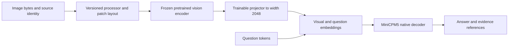

# MiniCPM5 vision training, visual memory and bounded improvement

**Implementation reconciliation — 25 October 2026:** R1–R4 passed at `757ace1`.
The repair prerequisites are satisfied. The isolated visual prefix is implemented
through `VisionFeatureService`, the native adapter, frames and `MemorySession`.
Eighty-two focused tests pass; an actual CPU smoke loads the sealed source,
tokenizes the response and runs its official PIL processor on a pinned asset.
See [V0 CPU admission](../../reports/vision_v0_20261025/cpu_admission.json).
Native MPS inference, backward and fresh-process reload are independently accepted
as interface-only. See [V0 qualification](../../reports/vision_v0_20261025/qualification.json);
the projector is untrained and this establishes no useful visual perception.

**Plan revision: 25 October 2026, following the review of `7c7018e`.**
The following sections define the staged implementation and experiment policy.
The V0 native interface is qualified; trained perception, accepted neural memory
and integrated RSI remain separate unpassed gates.
MiniCPM5 remains the baseline. The active order is completed
verification/rebuild repairs → isolated MiniCPM5 V0 → visual fine-tuning → qualified visual memory → bounded RSI. Spark FP8/BF16
metadata/backend preparation and dataset curation proceed independently now.
Use [recovery gates](17_Memory_Reliability_Recovery.md)
and the [execution prompt](16_Loop_Agent_Instructions.md).

## 1. Admission and model roles

Complete document 17's caller-bound context verification, complete route audits
and representation-preserving rebuild fixes before native V0. The completed
rejected v5 writer experiment satisfies the prior measured-repair-package
requirement; another blind memory-training arm is not required. Keep all memory,
identity and core injections disabled for V0. Unresolved learned-memory quality
still blocks dependent learned visual-memory and integrated RSI promotion.

The [integrated design](19_Integrated_Memory_Learning_and_RSI_Design.md) defines
memory/learning ownership, and the [data plan](../08_Dataset_Acquisition_and_Curriculum.md)
defines eligible sources, split rules and bounded tranches. Nothing in these
plans admits a dataset or launches training automatically.

| Role | Decision |
|---|---|
| Primary text and vision-retrofit baseline | Sealed MiniCPM5-2B; add a separately trained visual interface |
| Initial visual encoder | Selected `google/siglip2-base-patch16-224@75de2d55ec2d0b4efc50b3e9ad70dba96a7b2fa2`; Apache-2.0, official PIL processor, 196 spatial patches; MPS qualification pending |
| Pretrained multimodal reference or teacher | MiniCPM-V-4.7-1B, only after its separate native adapter/processor qualification |
| Text and vision challenger | Official Spark-X2.6-4B-FP8 adaptation base with independent official BF16 control; preparation now, native qualification later |
| Larger optional reference | MiniCPM-V-4.7-35B-A3B, separately qualified and costed; not a local full-training assumption |

MiniCPM5's sealed source is a 42-layer Llama decoder of width 2048, with
2,516,756,480 original parameters. MiniCPM-V-4.7-1B instead has a width-1024
Qwen3.5 hybrid text core and its own vision mergers, processor and canvas M-RoPE.
Its pretrained connector is not aligned to MiniCPM5. Reuse methods and verified
data, not model-specific projection weights or native cache implementations.

## 2. Proposed visual interface

Start with one image, fixed preprocessing and a measured visual-token bound.
Retain spatial patch features. A pooled classification embedding or an image
filename in the prompt is not the intended visual input. A small MLP connector
is the first alignment hypothesis; resamplers, aggressive compression, dynamic
resolution, video and cross-attention insertions are later separate comparisons.

`MiniCPM5Adapter._native` now fuses projected spatial patches before the existing
text embeddings, with joint masks/positions and text-aligned response logits.
`MemorySession.prepare`, `SenseFrame`, `DecisionFrame`, training and generation
bind one immutable task/source/crop/layout-owned `VisualInput`. Decoder parameters
are frozen without disabling its input-gradient path. The CPU patch cache is
producer-bound; request-owned features transfer to the decoder device.

| Boundary | Required change and evidence |
|---|---|
| Visual observation | Bind bytes/hash, source/owner/purpose, observation time, dimensions, crop coordinates, patch layout and processor/encoder revisions |
| Fused prefix | Define image placement, visual/text masks, sequence positions and length accounting; preserve the vocabulary unless a token addition is separately declared |
| Sense and action | Bind the same immutable visual payload and layout in both passes; exclude labels, answer suffixes and future frames from sensing |
| Training | Mask image/prompt positions from response loss; audit exactly which projector/adapter/encoder/base tensors receive gradients and change |
| Frozen components | Freeze parameter updates while preserving input gradients through the decoder to the projector; `no_grad()` over that decoder would break alignment training |
| Feature cache | Cache only frozen producer outputs; bind image, crop, preprocessing, producer revision, dtype and layout; invalidate after producer changes |
| Generation | Reuse request-owned image features; preserve fused prefix across generated tokens; separately qualify any new KV-cache optimization |
| Export/reload | Bind base, encoder, processor, connector, trainable scope and source hashes; reproduce visual outputs in a fresh process |

Native text-only parity is an interface qualification before training, and a
bypass check when all added branches/adapters are disabled. After instruction
tuning, evaluate text retention independently; do not assert bitwise equality
to the original base while trained language adapters remain enabled.

The executable [V0 protocol](../../configs/minicpm5_vision_v0_qualification_v3.json)
pins 83 implementation/environment files and the source/data artifacts. It selects
backward-only qualification: six FP32 projector tensors / 5,772,800 parameters,
zero optimizer updates, empty memory and disabled core/identity/ports. The
1,500,804,926-byte official source includes unused text-tower tensors; runtime
loads only the 92,884,224-parameter vision component. Source metadata corrections
retain their parents and change no weight or processor payload bytes.

`.venv-vision` adds only locked Pillow 12.0.0 while reusing the intact sealed
baseline environment. Native work must retain the exclusive worker, fallback=0
and the 50 GiB / 512 MiB swap-growth / 15%-free, three-sample guard. V0 compares
correct/wrong/no-image first-token logits, exact text bypass and a fresh-process
strict extension reload. It establishes no perception-quality result.

## 3. Staged fine-tuning

The V labels below identify work packages, not replacements for existing
scientific S-stage IDs. Preserve S1 data admission, fair S2 comparisons and
selected-base gates for the claims to which they apply. A developmental vision
prototype can precede selected-system deployment qualification.

| Package | Trainable scope | Entry and exit evidence |
|---|---|---|
| V0: interface qualification | Tiny/offline contract models, then a declared native smoke scope | R1–R3 repaired and verified; completed v5 rejection retained; masks, positions, input gradients, bypass parity, isolation and export/reload work |
| V1: visual alignment | Projector only; encoder and MiniCPM5 frozen | V0 passes; answer loss learns image/text alignment on eligible paired examples and image-dependent held-out evaluation improves over controls |
| V2: visual instructions and reasoning | Projector plus an explicitly named small language adapter/LoRA scope if justified; encoder initially frozen | V1 demonstrates usable perception; grounding, OCR/relations, missing evidence and text retention pass declared numeric gates |
| V3: visual persistent memory | Visual writer/readers; accepted visual producer initially frozen | V2 and the chosen memory path are qualified; image removal, multiple later queries, correction, unaffected-fact retention and fresh-process continuation demonstrate useful memory |
| V4: bounded visual RSI | One isolated, named candidate scope at a time | Reliable perception/memory and independent evaluators exist; verified practice improves unseen later tasks without unacceptable retention loss |

The first [V1 protocol](../../configs/minicpm5_vision_v1_projector_alignment_v2.json)
is a projector-only 128-update, 512-example arm over 64 complete owned worlds.
Sixty-four evaluation cases span 32 disjoint worlds from the same procedural
source family; they are not broad photographic/source-family coverage. All
six controls and numeric accuracy/control-margin/retention gates are pinned.
The initial text baseline is measured before training on the same 32 protected
prompts, then compared independently after updates. Source/data/code pins and
actual token bounds are in [CPU admission](../../reports/vision_v1_20261025/cpu_admission.json).
Caption-only receives oracle scene metadata explicitly; it is not ordinary
training/sensing input. V1 remains unrun at this preregistration.

The measured arm subsequently completes and is
[independently rejected](../../reports/vision_v1_20261025/qualification.json):
correct image18/64, wrong20/64, shuffled15/64, no-image22/64, oracle caption60/64,
empty OCR15/64. Text retention is22/32 before/after with exact token parity, below
the75% absolute floor. Six projector tensors change; frozen components do not.
V2 is not admitted. Falling loss does not override these failed quality gates.

The second [wide V1 protocol](../../configs/minicpm5_vision_v1_projector_wide_v1.json)
tests only a 4096-wide connector with fresh seeded initialization and the same
data, schedule, controls and gates. Fresh initialization still requires accepted
V0 and identical immutable encoder/processor/source identity; a width change is
not permission to change the visual producer. V1 qualification now also requires
a zero-update fresh process whose evaluation and retention generations match the
primary run bitwise. The [measured result](../experiments/20261025_MiniCPM5_Vision_V1_Wide_Results.md)
passes engineering and reload but is independently rejected: correct image
21/64, wrong 12/64, shuffled 15/64, no-image 22/64, oracle caption 60/64 and
empty OCR 15/64, with text retention unchanged at 22/32. V2 remains unadmitted.

The [balanced image-dependence diagnostic](../experiments/20261025_Vision_Dependence_Results.md)
now supports incremental frozen-feature information on paired procedural dev and
untouched final holdouts: primary 71/120 and 75/120 versus question-only 36/120
and shuffled 50/120 and 46/120, with positive world-clustered lower bounds.
Spatial leads the result; this is not uniform five-task or real-image competence
and does not reverse either V1 rejection. Before another training arm, localize
memory failure on matched episodes and use the admitted 30-root external caption
corpus plus a separate untouched procedural audit split. Any curriculum must
still show fresh-world visual gains, controls, abstention, retention and reload.

For V1, use eligible image-caption/grounding pairs and response-only supervised
loss. For V2, use visual questions, instruction following, spatial relations,
document/OCR tasks and checked reasoning examples with text replay. Teacher
outputs are proposals, not ground truth. Begin with supervised learning; reward
learning is a later hypothesis after reward reliability is measured.

Declare optimizer membership and trainable scope explicitly. Projector-only
training is a frozen-base module experiment. Projector plus LoRA is adapter
tuning, not full D2. Full augmented training must include all declared original
parameters; `full_vlm` must additionally name its visual groups. Do not silently
freeze groups to fit a claimed full-scope run.

A small pilot qualifies the path and tests a hypothesis; it does not establish
that a few dozen updates can produce broad visual competence. Decide numeric
quality, regression, token, step, wall-time and memory bounds before outcomes.
Increase data/compute only after the measured failure mode justifies it.

## 4. Data, controls and retention

Split complete image/scene/document/session families before crops, questions,
synthetic variations or teacher expansion. Derived examples inherit their source
split. Training, development, calibration, promotion and final audit remain
distinct. Exposed evaluation images cannot become fresh audit evidence.

Use paired scenes differing in one decisive attribute, independent distractors,
absent information, varied layouts and unseen combinations. Evaluate real image
tensors against wrong-image, shuffled-image and no-image controls. Caption-only
and OCR-text-only are separate baselines; an oracle caption containing the gold
answer must be labelled an information upper bound, not equal information.

Measure grounded answer correctness, region/evidence attribution, image
dependence, abstention, spatial/OCR performance and latency. Validate each scorer
against changed pixels, wrong assets, missing/duplicate rows, incorrect gold,
cached-score tampering and inconsistent token decoding. An independent answer
verifier must not depend on the candidate's own confidence or self-rating.

Broaden text retention beyond the v4 generator's 16 distinct evaluation
questions (the earlier fixture had four arithmetic questions). Include instruction following, factual questions, reasoning, code or
tool outcomes, missing information and existing memory tasks. Report unique
questions and independent families, not only repeated-case totals; cluster
uncertainty by family and preserve predeclared critical-regression limits.

## 5. Visual memory and runtime compilation

Qualify exact visual-source retrieval separately before a learned visual memory
claim. This baseline may store the permitted original image/region plus checked
annotations and provenance; generated captions/OCR retain their prediction and
verification status. A content hash authenticates bytes, not semantic truth.

The learned V3 episode is: observe image/regions → commit observation-only
state → remove original visual context → answer several later questions → save
and reload without re-encoding old observations → append a dated correction →
answer corrected and unaffected questions → fresh-process continuation.

Compare full visual context, exact source retrieval, learned state, zero state,
shuffled state, last observation and disabled reads. Fix image/feature access
rules per arm. Fetching the original image during a memory-only query must be
logged as retrieval and cannot count as compressed-state-only recall.

Keep exact records authoritative and neural state derived. Bind image/region
hashes, timestamps, entity relationships, source scope, producer versions,
correction chains, counters and lineage. Rebuild affected state after revocation
or producer changes. Invalidating a cache is not neural unlearning. Atomic
publication plus tested restart is not a power-loss durability claim; qualify
that separately if required.

Reuse the existing artifact registry, procedure compiler, source invalidation,
manifest publication and rollback. Add real visual payload consumers and
transitive dependencies, including training examples and candidate descendants.
Static Engram may later cache useful discrete patterns or procedures; continuous
patch features are not automatically compatible with its n-gram addressing.

## 6. Bounded RSI and semi-cognitive integration

After V3 and relevant text-memory/retention gates, run one complete candidate
cycle before a longitudinal campaign:

1. Collect actual failures from training-eligible tasks and preserve evidence.
2. Propose a bounded correction/practice set or verified skill.
3. Verify with source annotations, executable synthetic scenes, document truth,
   tool outcomes or reviewed labels. Check intermediate steps before using them
   as reasoning targets; a correct final answer does not certify the rationale.
4. Train one isolated named candidate with retention replay and a fixed budget.
5. Evaluate untouched families, image dependence, memory correction and text
   retention against the parent and best practical reference.
6. Accept/reject/defer under fixed rules; publish only eligible compatible
   artifacts, test bad-candidate rejection/rollback and restart the accepted state.
7. Measure later reuse and later adaptation under matched exposure/update cost.

Next use M5's ten chronological T0/T1/T2/T3 controls: no persistence, evidence
only, fixed verified learning, and learned selection plus learning. Match replay
and count generation, teachers, verification, rejected candidates and training.
C13's 10/10 collection threshold gates a learned selector, not fixed-practice
plumbing; crossing it does not itself prove selection quality. RL and changes
to code/architecture follow separately qualified rewards and external evaluators.
The candidate cannot rewrite its audit, promotion rules or resource guard.

Keep observation-time state updates, occasional adapter training and slower
consolidation as distinct operations. Multi-rate/CMS claims require explicit
objectives, parameter sets, buffers and measured transfer, not timers alone.
One successful cycle is not evidence of accelerating or unbounded RSI.

The workspace may learn when to inspect a crop, use OCR, retrieve, ask or abstain.
Compare against deterministic/no-core/feed-forward and compute-matched controls.
Identity may condition priorities/presentation after visual fusion; it cannot
rewrite visual facts or authorize a successful verdict. Approved source history,
agent experience and generated practice retain separate lineage. Authentic
personality fidelity still requires permitted sources and human evaluation.

## 7. Spark preparation and resources

Follow the [official FP8/BF16 plan](20_Spark_X2_6_FP8_Preparation_Plan.md).
Prepare source pins, code review, precision/backend capabilities and shared data
now. Native Spark qualification follows the remaining fixes and reusable V0
interfaces, not an RSI-success dependency. A blocked optional Spark backend never
delays MiniCPM5 work.

First qualify unmodified FP8 and official BF16 behavior, then input gradients,
real updates and fresh-process export/reload. FP8 storage, activation quantization
and Muon int8 momentum are distinct. An explicit dequantized FP8 derivative is a
separate artifact, not the original BF16 checkpoint or recovered precision.

A dedicated `spark2_5` adapter must preserve its sliding/full attention, head
gates, fused projections, tied storage and caches. Train a new width-2560
connector; test image-prefix visibility beyond the 512-token local window.
Reuse accepted encoder/processor/data contracts, not MiniCPM5 projection weights
or serialized states. Re-encode eligible sources under the new producer. Pin
thinking mode and compare matched information, token budgets and measured cost.
MLX inference does not qualify this PyTorch/MPS training path; isolate incompatible
dependencies without replacing MiniCPM5's lock.

The existing Mac policy remains one exclusive MPS worker, CPU fallback disabled,
50 GiB sampled driver stop, 512 MiB sustained swap-growth and 15% minimum
host-free limits. Native encoder/decoder computation must qualify on that path;
CPU remains appropriate for loading/preprocessing and tiny contract tests.
Profile actual image/patch/text lengths and activations before choosing a run.
The previous 11.00 GiB text-memory peak is not a multimodal fit measurement.

Current Muon int8 quantizes momentum; trainable weights/gradients and auxiliary
AdamW state are FP32. BF16 source/autocast is not BF16 residency. FP8 inference
does not establish FP8 training. Frozen-encoder feature caching and a small
projector/adapter scope are initial cost controls; each residency or optimizer
change needs its own tests. The 50 GiB threshold is a stop policy, not an OOM
guarantee or permission to alter a historical protocol.

## 8. Primary sources and evidence boundary

- [LLaVA training](https://github.com/haotian-liu/LLaVA#train): visual alignment
  followed by instruction tuning; its training scale is not a local cost estimate.
- [BLIP-2](https://arxiv.org/abs/2301.12597): a trained bridge can connect frozen
  visual/language components; a Q-Former is an alternative, not required initially.
- [SigLIP 2](https://arxiv.org/abs/2502.14786): pretrained visual features and VLM
  transfer motivate encoder selection; no local encoder is yet qualified.
- [MiniCPM-V configuration](https://huggingface.co/openbmb/MiniCPM-V-4.7-1B/blob/379f120c2ff3588e6e06559ec6b9ec15cc05114e/config.json):
  native topology differs from MiniCPM5; pretrained alignment is model-specific.
- [STaR](https://arxiv.org/abs/2203.14465) and
  [RLAIF-V](https://arxiv.org/abs/2405.17220): checked reasoning bootstrapping and
  visual feedback learning motivate bounded candidates, not self-certified truth.
- [Spark release](https://github.com/XHToken/Spark-X2.6) and
  [official MLX implementation](https://github.com/XHToken/Spark-MLX-LLM): source
  and inference references; this repository's training path remains unqualified.

These sources were consulted in the 24 October review. Seal exact model/code/
processor revisions before adoption. The combined architecture, dimensions of
new modules, training budgets and acceptance thresholds remain project hypotheses.
