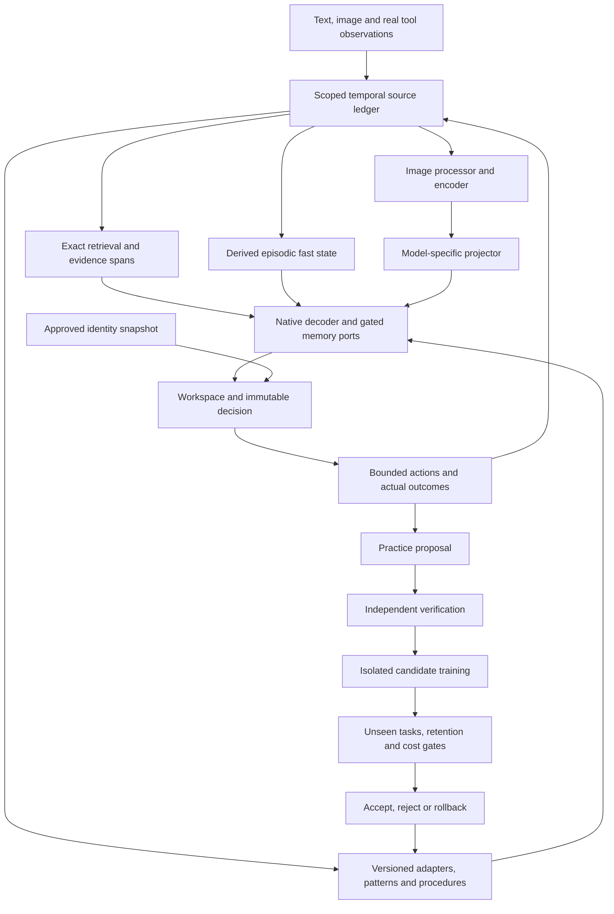

# Integrated memory, learning, vision and bounded RSI design

**Implementation reconciliation — 25 October 2026:** R1–R4 passed at `757ace1`.
The repair prerequisites are satisfied. Isolated native V0 is independently
accepted as interface-only: six projector gradients, zero updates, bitwise
fresh-process logits. Projector-only V1 has a pinned 512-row/128-update protocol.
The rejected v5 writer is not promoted. Exact visual-source retrieval and a
sandbox procedure publication/rejection/rollback cycle have separate CPU
engineering qualification; neither is learned visual memory or neural RSI.

**Contract reconciliation — 26 October 2026:**
[document 22](22_State_Mechanism_and_RSI_Contracts.md) now owns the canonical
per-state matrix (owner, read/write timing, update equation, loss, gradient path,
reset, persistence, cost and version key), the primary-source/deviation audit for
Titans, uTTT, HOPE, MemT/Mem-T and selective plasticity, the routing-versus-
compilation admission gates and the bounded RSI gate sequence. This document
keeps the integrated plan and its evidence boundary. The dispositions are
unchanged: `native04` remains rejected at 110/240 with zero optimizer updates
(`restart04` passes reload parity), the current vision-stage audit remains
rejected at 6/24 with caption F1 zero, Spark remains preparation-only with native
FP8 blocked, and no Titans/uTTT/HOPE/MemT/selective-plasticity mechanism has been
trained. No mechanism is promoted by this revision.

**Design revision: 25 October 2026. Reviewed implementation: `7c7018e`.**
This remains a proposed system and qualification plan, not a record of new training.
The active implementation order is now
[Spark persistent learning and tiered memory](28_Spark_Persistent_Learner_and_Tiered_Memory.md).
MiniCPM is a historical/mechanism control. Native multimodal training is
deferred, while the internal spine remains permanent. The older studies below
retain their dated evidence and are not competing current orders.

The active sequence is **portable verification and honest source/backend
binding → tiered clusters and contextual readout engineering → competent
native context baseline and direct-CE P1 learner → future-task-trained local
writes → measured P4/P16/P32/P64 expansion and chronological retention →
multi-clock learning or bounded RSI**. Capacity planning and bounded storage
implementation proceed now. Training a larger bank is separately qualified.
Approved identity, task state and measured capabilities remain distinct.
The tiny CPU fixture's 0/12 result is not a Spark capability diagnosis.
Spark FP8/BF16/derivative identities remain distinct.

### Independently exercised engineering controls

| Control | Actual evidence | Excluded claim |
|---|---|---|
| [MiniCPM5 V0](../../reports/vision_v0_20261025/qualification.json) | Frozen-decoder input gradients, correct/wrong/no-image generation, exact fresh-process reload | Useful perception or learned memory |
| [Exact visual sources](../../reports/exact_visual_source_20261025/qualification.json) | 36 original assets across 12 worlds, one renderer family; delayed authenticated retrieval, reload without re-encoding, unaffected reference, ancestor/descendant revocation | Factual memory-only recall or learned V3; correction is metadata/crop/owner lineage only |
| [Bounded procedure cycle](../../reports/bounded_rsi_20261025/qualification.json) | Real practice, independent verification, rejected candidate, sandbox publication, authenticated ancestor rollback and deterministic replay | Neural updates, learning-policy improvement, integrated or accelerating RSI |

The source-retrieval and procedure smokes use explicitly hashed source bundles;
they are not described as preregistered neural experiments. Candidate bindings,
base/identity metadata and archived rollback contents are authenticated by the
host. Current perception-quality, useful-memory, correction and retention pins
do not admit neural promotion. No longitudinal campaign has started.


| Detailed contract | Purpose |
|---|---|
| [Recovery](17_Memory_Reliability_Recovery.md) | Current defects, reproductions and repair acceptance |
| [Loop instructions](16_Loop_Agent_Instructions.md) | Ordered implementation prompt and handoff |
| [MiniCPM5 vision](18_MiniCPM5_Vision_Training_and_Continual_Learning.md) | V0–V4 interfaces, training and controls |
| [Spark preparation](20_Spark_X2_6_FP8_Preparation_Plan.md) | Official FP8 adaptation base, BF16 control and backend qualifications |
| [Data acquisition and curriculum](../08_Dataset_Acquisition_and_Curriculum.md) | Source catalog, admission, splits and bounded curriculum |
| [Research cross-check](15_Research_Crosscheck_and_Backbone_Plan.md) | Existing component history and research distinctions |

## 1. Outcome and present limits

The intended system should learn from verified experience, remember changing
facts across restarts, perceive images, improve later task performance and keep
an attributable personality history. Each is a separate claim. A model that
changes its output after a memory write has not necessarily remembered the fact;
a system that saves wrong answers has not demonstrated reliable memory.

The latest writer-only D1 arm made 48 updates over 192 scheduled cases. Exactly
14 writer tensors changed; the original model, readers and gates were frozen.
Fast and disabled both answer 56/192 correctly, including **0/128 factual cases**.
Selective exact context answers all 128 factual cases and 184/192 overall;
full context answers 176/192. The reference still fails its declared general and
nonregression gates. Preserve these decisions and use the exact path as a
practical comparison, without calling it universally qualified.

The review independently reran 49 focused tests and the CPU scorer over 1,920
saved answers, verified 27 implementation pins and byte-identical regeneration
of the v4 data/manifest. It inspected 32 authenticated memory snapshots and seven
recorded restart answers. The larger 1,311-test result is existing experiment
evidence, not another full-suite run performed by the review.

Three defects still take priority: contexts must bind the caller's scope and
canonical route; route audits must reject duplicate/missing update indices;
rebuild must preserve the fact-binding representation. See document 17 for
specific reproductions. None is evidence that the saved native outputs were
maliciously altered.

## 2. Connected architecture and ownership



The ledger owns evidence and eligibility. The decoder owns predictions. The
workspace owns provisional hypotheses and current task state. The compiler owns
derived artifacts. An external evaluator owns promotion decisions. A candidate
cannot make itself authoritative by writing a more confident explanation.

Keep source evidence, teacher output, generated practice, agent experience and
approved identity facts distinct. Every derivative records its parents. New
retrieval or a new crop creates a new pinned decision rather than changing the
evidence behind an existing decision. The per-state owner, read/write timing,
update equation, loss, gradient path, reset, persistence, cost and version key
for the stable backbone, identity/personality, trained memory machinery, mutable
episodic/fast state, persistent learning, task state and external sensors are
specified in [document 22](22_State_Mechanism_and_RSI_Contracts.md).

Reuse the current adapter/session/frame, ledger, fast-memory service, compiler,
candidate registry, publisher and identity interfaces. This design extends those
paths; it does not authorize another disconnected model demonstration.

## 3. Memory hierarchy and update rules

| State | Authority and purpose | Proposed update rule | Required evidence |
|---|---|---|---|
| Exact temporal ledger | Attributed observations, corrections, source scope and dates | Append observations; supersede/revoke explicitly; preserve history | Caller-bound eligibility, exact spans, correction and branch isolation |
| Record slots and retrieval indexes | Derived access to eligible evidence | Rebuild affected records after producer/source changes | Retrieval quality versus lexical/exact controls; source binding |
| Episodic neural fast state | Compressed associations for delayed questions | Bounded observation writes; deployment reads do not train themselves | Multiple queries per state, useful novel-value recall, correction and restart |
| Engram-style pattern lookup | Stable token patterns and acquired reusable associations | Versioned offline construction or independently accepted update | Acquired-knowledge tests, collision/coverage audit and disabled/shuffled controls |
| Procedure library | Verified reusable executable behavior | Publish evaluated candidates transactionally | Unseen-task execution, rejection and rollback |
| Workspace and core | Goals, partial plans, hypotheses, uncertainty | Request/task-owned bounded recurrence | Actual task gain versus no-core, feed-forward and matched-compute controls |
| Slow adapters/model parameters | Generalized perception, reasoning or read/write skills | Isolated training with replay and independent promotion | Held-out gain, text retention, resource and provenance checks |
| Identity snapshot | Approved source history and permitted representation of a subject | Explicit source/version approval; agent experience stays separate | Source fidelity, purpose/cutoff binding and human evaluation |

These are different state types, not interchangeable caches. Native attention
KV state is a sequence acceleration artifact, not the persistent source ledger
or evidence of learned episodic memory. A warm cache does not count as learning.
The exact reset, persistence and version-key rules for each row are in
[document 22 §2](22_State_Mechanism_and_RSI_Contracts.md); clearing a state is
only interpretable when its class is named.

The initial learned path retains the existing MiniCPM5 ports at layers 13/27 and
the declared state ownership. Compare shared and private state only at matched
state bytes, write count and inference/training cost. Do not silently multiply
capacity by copying a shared matrix into nominally separate heads.

### Native memory-layer contract

Keep the native complete decoder block intact. At an admitted port, project its
normalized hidden state into a memory query, read the pinned request-owned state,
project the result back to the backbone width and add a bounded gated residual:

```text
u = native_block(h, native_mask, positions, cache)
q = query_projection(normalize(u))
r = memory_read(q, pinned_fast_state_or_record_slots)
h_next = u + gate(u, eligible_route) * output_projection(r)
```

This is a conceptual interface, not a replacement equation for the current
SGDN-2 implementation. Writes occur from permitted observations at an explicit
barrier; do not update state merely by rereading a question or generation token.
Training may retain a declared functional cross-chunk gradient horizon, while
deployment snapshots are detached and immutable during a decision.

The existing diagnostic state has four 64-by-64 matrices: 16,384 scalars, or
65,536 logical FP32 payload bytes before metadata, momentum, snapshots or
autograd storage. A private state at each of two ports doubles that payload;
it is not a capacity-matched shared-state comparison. Record actual allocated
bytes separately. The original decoder width is 2048 for MiniCPM5 and 2560 for
the planned Spark adapter; read/write projections are producer-specific.

Start new residual outputs at zero or an explicitly tested neutral setting,
without zeroing every factor and preventing useful gradients. Prove disabled
parity, finite input gradients, exact optimizer membership and changed tensors.
For each new memory study freeze or train writer, query/read projections, gates,
base and state-update coefficients explicitly. Add one selected mechanism at a
time. A larger state, more ports or nonlinear memory is earned by a diagnosed
capacity/readout limitation, not by attaching another research name.

Before another writer recipe, diagnose three interfaces separately:

1. **Storage:** does the state encode the observed entity–attribute–value
   association? Probe novel values and counterfactual worlds with the same keys.
2. **Addressing:** does changing only the question select the relevant stored
   association? Test first/last-value and query-only shortcuts.
3. **Readout:** if a source-derived diagnostic probe can recover a value, can the
   decoder use it? Compare an explicit copy/pointer control only at that point.

Oracle probes may use associations extracted from observations, never evaluation
answers secretly written into deployment state. Their outputs are labelled
diagnostics. A positive probe supports the next experiment; it does not qualify
the deployed reader. New neural objectives may combine response supervision,
observed-association reconstruction and selective-write/retention terms, but
choose and ablate one mechanism first, with weights and masks fixed before runs.

## 4. Dynamic routing and runtime compilation

The proposed dynamic path is a bounded router over exact records, episodic state,
stable pattern lookup and verified procedures. Record the query, eligible source
epoch, selected path, retrieved IDs, state/producer versions, coverage, fallback
and cost. Initially use explicit, auditable rules. Learn routing only after
reliable outcomes and a matched fixed-router comparison exist.

**Routing and compilation are different operations.** Routing selects among
paths that already exist for one decision and emits a route audit; it creates no
reusable artifact. Compilation produces a reusable artifact with a declared
input contract, lineage and consumer (exact-context bundle, feature cache,
record slots, fast-state snapshot, pattern index, procedure or trained adapter);
it does not choose its own route. A compiled artifact may later be one of the
router's choices. Neither operation is learning, and a valid manifest proves
provenance only. The detailed contract is in
[document 22 §4](22_State_Mechanism_and_RSI_Contracts.md).

A compiled path may replace an eager path only after all of the following:

1. **Eager-reference parity.** The compiled path reproduces the eager reference
   on a preregistered fixture set within declared tolerances, including masks,
   positions, dtypes, KV behavior, batching and sampling, deterministically
   across restart and request order.
2. **Cache invalidation.** A source correction, revocation, producer,
   representation, scope or state-revision change invalidates the artifact and
   every dependent cache. Stale artifacts are rejected, and interrupted
   publication preserves the last valid revision.
3. **Rollback.** An atomic active pointer can disable the compiled path and
   restore the eager path byte-identically; it cannot become the only path to a
   capability.
4. **Measured benefit.** At matched quality, a preregistered latency, throughput,
   memory or cost improvement on a defined workload, with compile/warmup and
   transport charged. Parameter counts and analytical ledgers do not qualify.

A learned router adds a behavioral gate: it must be compared with an explicit
fixed router on the same eligible evidence and budget, with a route audit,
coverage/fallback and abstention behavior, no evaluation-label leakage and
either a quality gain or a cost gain at equal quality on held-out families. A
learned router is **not** admitted by manifest validation, by successful
training or because it is bundled in a compiled artifact. No compiled path or
learned router is currently admitted; the default remains the eager path with
explicit rules, and the existing publisher is a single-writer reference rather
than a durable cross-store transaction.

An Engram n-gram table is not the authority for a recently corrected personal
fact. Resolve such facts against current eligible evidence. Do not treat hashes
of continuous visual patch vectors as token n-grams; visual region/record keys
need their own typed representation and evaluation.

Runtime compilation means producing a reusable artifact with a declared input
contract and consumer. It does not require generating or executing new code on
every observation. Candidate artifact types are exact-context bundles, feature
caches, record slots, fast-state snapshots, pattern indexes, procedures and
trained adapters.

Every manifest must bind:

- Payload digest, artifact type/schema and parent candidate.
- Source IDs, scope, revision, eligibility epoch and observation cutoff.
- Representation name/version; tokenizer, encoder, processor and projector pins.
- Base/model code, dtype/quantization, normalization, tensor shape and layout.
- Builder/optimizer configuration where applicable, dependencies and validation.
- Publication generation, consumer compatibility and rollback ancestor.

Use a single-writer publication transaction with complete payload verification,
an atomic active pointer and recovery of interrupted candidates. Test interruption
between payload, catalog and active-manifest operations. Existing narrow atomic
publication is useful groundwork; cross-store and power-loss durability remain
claims needing their own fault tests.

An unchanged eligible source set under an unchanged producer and representation
must rebuild identically within the declared deterministic contract. Corrections
rebuild the correct historical/current view according to the protocol. Revocation
invalidates derived state and descendants; it does not prove that previously
trained model parameters have forgotten the source. Quarantine affected trained
candidates pending a separately evaluated retraining/unlearning policy.

## 5. Vision enhancement and reasoning

MiniCPM5 V0 starts with one pinned pretrained encoder, spatial patch features and
a new projector to width 2048. Preserve native decoder positions, attention and
vocabulary. All memory, core and identity injections are disabled for this first
qualification. The optional MiniCPM-V model is a separately qualified reference,
not a source of interchangeable projector weights.

V0 verifies actual tensor consumption, masks, fused-prefix identity, gradient flow
to the connector, disabled-path text parity, request isolation and fresh-process
reload. A frozen decoder must still propagate input gradients to the projector.
V0 contract fixtures can run on CPU; a native qualification must execute the real
MPS path with fallback disabled and the shared resource guard.

V1 trains only the projector. V2 introduces a declared small language-adapter
scope if justified, then visual instructions, grounding, OCR and verified
reasoning with text replay. Measure correct/wrong/no/shuffled-image controls and
OCR-text/caption baselines. A correct answer on a language-biased question does
not demonstrate visual use. See document 18 for all training contracts.

Reasoning examples should include evidence references, executable arithmetic or
scene-graph checks where available, and explicit absent-evidence cases. Keep
teacher rationales as unverified proposals until their steps are checked. Avoid
training on confident unsupported visual descriptions. Report task correctness,
evidence quality, calibration and compute separately from rationale length.

V3 first establishes exact visual-source retrieval. Learned visual memory then
requires accepted perception and an accepted memory path: observe → remove image
→ answer multiple delayed questions → save/reload without old-image re-encoding
→ append a correction → verify changed and unaffected facts. Preserve image,
region, crop and producer lineage. Retrieving the old image is a useful retrieval
control, not memory-only success.

## 6. Self-learning and bounded recursive improvement

Use four distinct terms: an observation write updates episodic state; practice
creates candidate training data; candidate training changes parameters or a
procedure; RSI changes how later learning is selected or performed. None alone
implies the others.

The first learning cycle is:

1. Record an actual failure and eligible source evidence.
2. Propose a small practice set tied to a specific skill and budget.
3. Verify labels/results independently; reject unsupported examples.
4. Train one isolated candidate scope with explicit retention replay.
5. Evaluate unseen families, corrections, unrelated retention and cost against
   its parent and the strongest practical exact-retrieval/fixed-policy control.
6. Accept, reject or defer using preregistered numeric rules; publish only after
   manifest checks. Restart, reuse on later tasks and exercise rollback.

Begin with supervised verified practice. Prepare deterministic proposal and
verification plumbing before capability gates if useful; do not promote neural
learning before the relevant memory, perception and retention gates pass. C13's
10 accepted/10 rejected evidence threshold admits a learned-selector study, not
an automatic success claim or a ban on deterministic practice.

After a successful cycle, compare ten chronological cycles:

| Arm | Persistent evidence | Candidate learning | Selection policy |
|---|---|---|---|
| T0 | None beyond current task | None | Fixed task policy |
| T1 | Eligible exact evidence | None | Fixed retrieval policy |
| T2 | Same permitted evidence | Verified candidate updates | Fixed practice/update schedule |
| T3 | Same permitted evidence | Same allowed update scopes | Learned practice/update selection |

Match exposure, replay and budgets. Count generation, teachers, verification,
training, rejected candidates, evaluation and wall time. Include distribution
changes, bad candidates, no-improvement periods and rollback. T3 must improve
later adaptation relative to T2 at comparable cost; merely improving relative
to T0 does not establish a better learning algorithm.

### Bounded RSI gates

An observation write, practice generation, candidate fine-tuning, replay, a
larger procedure/skill library, longer reflection, more stored records or higher
confidence are **not** recursive improvement. The ladder is observation write →
verified practice → actual candidate update → consolidation → learning-policy
improvement → RSI. A gate is passed only by the named evidence; the full
protocol, including reset classes and reporting, is in
[document 22 §5](22_State_Mechanism_and_RSI_Contracts.md).

| Gate | Required evidence | Rejection condition |
|---|---|---|
| RS0 independently verified practice | Practice tied to an actual failure and eligible evidence; labels/results checked outside the candidate | Self-certified labels or unverified teacher text treated as knowledge |
| RS1 actual candidate updates | One isolated scope; nonzero optimizer steps, named/changed tensors, finite gradients, exact optimizer membership | Zero-update/no-op candidate or hidden parameter scope |
| RS2 causal update effect | Reset/revert of the update removes the claimed effect; wrong-world/shuffled-feedback controls do not reproduce it | Effect survives reset or appears without the update |
| RS3 unseen later-task gain | Preregistered rule, held-out families and new instances, paired confidence interval, matched T0–T3 exposure/replay/compute, retention and cost | Gain only on development instances, the current task or versus T0 |
| RS4 successive cycles | At least two successive qualified policy revisions on fresh families against frozen-policy and equal-cumulative-compute controls; task state reset between worlds | One accepted update or repeated fine-tuning of the same policy |
| RS5 reset ablations | Reset task state only versus reset policy/identity only; reset the declared learned substrate; wrong-world and shuffled-feedback arms | One unspecified “memory reset” or a result that cannot separate task state from conditioning |
| RS6 rollback and audit | Authenticated ancestor, atomic restore, deterministic replay, independent evaluator, candidate cannot alter verifier/rules/guards/identity goals | Unauthenticated rollback or candidate-controlled promotion |

RS3 is the first gate that can support a capability claim; only repeated RS4
passes with fresh families and matched cumulative cost can support a bounded RSI
claim. The current status is RS0 host plumbing only: the bounded procedure-cycle
smoke exercised real practice, independent verification, rejection, sandbox
publication and rollback, while `native04` records zero optimizer updates. No
neural candidate update, later-task gain, successive policy revision or reset
series exists.

Multi-rate consolidation is later work. Give each level its own state, objective,
update context and measured frequency, and compare with an equal-budget fixed
schedule. Different timers alone do not reproduce Nested Learning. Code and
architecture proposals are a further isolated track: candidates cannot change
their own audit data, verifier, promotion rules, guards, permissions or protected
identity goals. One accepted update is not accelerating or unbounded RSI.

## 7. Personality and semi-cognitive integration

Retain the existing source modes and identity reader. Approved identity history
may guide values, priorities and expression; it must not override source truth,
eligibility or independent evaluation. Public persona datasets are method data,
not the real user's biography. Agent-generated experiences do not become human
memories. Dated changes keep their historical context instead of rewriting it.

Evaluate generic behavior, equal-information prompt summary, exact archive
retrieval and trained identity reader on reserved decision families. Authentic
fidelity needs permitted source material and human judgment; fictional contracts
establish engineering only. Missing identity material does not block V0.

### Behavioral stability, correction and reset separation

Personality is a **behavioral contract**, not a claim about subjective state: the
stable, source-grounded conditioning of priorities, expression, clarification and
refusal, plus a declared behavioral policy. Functional appraisal is a bounded
control state. Neither implies feeling or consciousness, and a model self-report
is not an observation or a fact.

Use reserved decision families with equal eligible information for:
paraphrase/order stability; irrelevant-context and long-context stability; dated
correction sensitivity with untouched-fact retention; source/branch authorship
separation; null/disabled-identity parity; counterfactual preference and exception
handling; fact-versus-style separation; adversarial fabricated-identity injection;
and delayed test–retest. Stubborn repetition, sycophantic reversal under pressure,
refusal to accept a valid correction and invented biography all fail. Report
choice agreement, evidence attribution, correction uptake, unrelated retention
and calibration separately; never collapse them into one “fidelity” score.

The reset series must manipulate two axes on the same families. **E1** resets task
state only (workspace, task graph and task KV) while retaining identity and
declared policy; task accuracy should return to baseline without task leakage.
**E2** resets identity/policy to null while retaining task state; task performance
should persist and the identity-conditioned difference from E1 should disappear.
**E3** resets both as the floor. The E1−E2 contrast measures dependence on
conditioning rather than on task memory; a single unspecified “memory reset”
cannot locate behavior. If a learning-policy revision is under test, name it
explicitly rather than folding it into personality.

The external-sensor and UAP boundary is **read-only with respect to canonical
state**. A sensor packet is available no earlier than its acquisition end plus
encoder delay; observer egress cannot mutate hidden state or memory and leaves
deterministic outputs bitwise unchanged; action egress uses a separate clock with
units, frame, validity and deadline handling; feedback returns as a new
observation. No layer consumes a result produced later in the same pass, and
teacher forcing uses the same availability masks. See
[document 22 §6](22_State_Mechanism_and_RSI_Contracts.md).

The core should integrate perception, evidence, task state and uncertainty into
an immutable decision, followed by a bounded action and real outcome. Calibrate
success/uncertainty heads before they control tool calls or learning expenditure.
Compare no-core, feed-forward and compute-matched alternatives before expanding
recurrence. An internal narrative is not an independent observation.

## 8. Research guidance and limits

The table separates the **published mechanism** from **this project's deviation**
and its implementation status. Paper results are author-reported, not
reproduced locally; source inspections were static. **No row is trained or
quality-qualified.** “Design-only” means specified but unimplemented (no
candidate artifact exists); “unrun” means no local execution. The full audit is
in [document 22 §3](22_State_Mechanism_and_RSI_Contracts.md).

| Primary source | Exact published mechanism (narrow) | Project deviation and status |
|---|---|---|
| [Titans](https://arxiv.org/html/2501.00663v1) | Neural long-term memory updated at test time by gradient on an associative objective, with momentum, adaptive forgetting and several attention combinations | We keep a bounded linear delta-rule control and the separate SGDN-2 primitive; no deep memory, momentum, or faithful inner/outer schedule. `design-only`; `unrun` |
| [Nested Learning / HOPE](https://arxiv.org/html/2512.24695v1) | Interacting optimization levels with distinct context flows/frequencies, CMS and self-referential modules; ~15B-token Llama adaptation | We separate state lifetimes and objectives. A scheduler, two core iterations or several timers is not CMS/HOPE; no cross-level credit or self-referential derivation. `design-only`; `unrun` |
| [uTTT](https://arxiv.org/html/2610.05484v1), [author code](https://github.com/Zefan-Cai/uTTT) | Shared fast weights across depths; chunk-start reads; one combined gradient update; historical cross-depth outer gradients; routed/private controls | Two ports may share state only at matched bytes/write count/cost. M3 averages state proposals and is not this optimizer; no shared-depth schedule. `design-only`; `unrun` |
| [MemT-1.0 v2](https://arxiv.org/html/2610.26825v2), [author code](https://github.com/MemTensor/MemT-1.0) | Selected-layer memory attention; fixed hyper-memory projections/gates; local per-trajectory matrices; SGDN-2; **dense** Mixture-of-Storage; ~34B training tokens | Post-block residual ports remain the baseline; pre-output attention is a separate versioned candidate. Separate read/write routers and top-two sparse execution are our extension; dense MoS is the faithful control. `design-only`; `unrun` |
| [Mem-T v2](https://arxiv.org/html/2601.23014v2) | Learned memory-operation policy over hierarchical working/factual/experiential/raw stores with operation-tree credit; distinct from MemT-1.0 | Deterministic director first; a learned selector only after fixed-policy learning works. No operation-policy training; author training scripts still listed as forthcoming. `design-only`; `unrun` |
| Selective plasticity: [ANML](https://arxiv.org/pdf/2002.09571v2), [Backpropamine](https://arxiv.org/html/2002.10585v1) | ANML meta-learns a gate fixed at meta-test and updates only the final prediction layer; Backpropamine learns plasticity coefficients over Hebbian traces with eligibility traces | We specify a plasticity gate over a declared `F/P` subset, compared with fixed/sparse/random gates at equal update budgets. Neither protocol is implemented, and classification/RL evidence is not language or open-world evidence. `design-only`; `unrun` |
| [Engram](https://arxiv.org/html/2601.07372v2) | Deterministic hashed n-gram tables with contextual gating and causal convolution; static sparse capacity | “Dynamic Engram” is native editable associative memory, not the paper. `PatternAccessPort` implements causal hashed n-grams, not the full architecture; visual patch hashes are not token n-grams. `implemented control`, no quality claim |
| [LLaVA](https://arxiv.org/abs/2304.08485) | Alignment followed by visual instruction tuning | MiniCPM5-specific projector, retention and persistent visual memory; V0 interface-only, current vision-stage quality rejected, V2 unrun. |
| [SEAL](https://arxiv.org/abs/2506.10943) | Learning to propose adaptation material, evaluated after actual inner adaptation | Externally verified, bounded selection with retained capabilities; proposal plumbing only, no neural RSI. |
| [STaR](https://arxiv.org/abs/2203.14465), [Absolute Zero](https://arxiv.org/abs/2505.03335) | Iterative reasoning practice and verifiable generated tasks | Transfer to grounded multimodal tasks without self-certifying labels; only host-side practice/verification contracts exist. |

No combination of paper names establishes the complete system. The integration,
ownership, rejection and evaluation contracts above are project design choices.
Upstream benchmark gains and training budgets are not local acceptance values.
Adding a mechanism named in this table does not authorize training or imply that
the mechanism is implemented.

## 9. Work packages and resource gates

| Order | Concrete output | Exit or disposition |
|---|---|---|
| R1 | Caller-bound exact-context contract at the actual consumer | Foreign scope, forged abstention and disabled-route contexts reject |
| R2 | Complete deterministic route/update audit | Missing, duplicate, reordered and substituted updates/cases reject |
| R3 | Versioned representation-preserving rebuild | Unchanged rebuild parity; correction/revocation and reload tests pass |
| R4 | Reproducible source bundle and consistent handoff | New pins, meaningful clean-export tests; historical evidence unchanged |
| V0 | Isolated MiniCPM5 visual interface | Native bypass, input gradients, masks, isolation and reload qualified |
| V1–V2 | Alignment then visual instruction candidates | Independent visual gain and text retention; reject or scale based on measured evidence |
| M probe | Fresh storage/addressing/readout diagnosis | A discriminating result; one targeted repair if justified, separate from V0 |
| V3 | Exact visual retrieval then learned visual memory | Useful delayed recall, correction, unaffected retention and restart |
| V4 | Verified candidate cycle, then T0–T3 study | Later-task gains, retention, cost and rollback; no automatic promotion |
| S0 preparation | Spark source/precision/backend plan and data portability | Pinned metadata; native FP8 remains blocked and unsupported capabilities stay explicit |
| S1–S3 later | Spark native parity, training capability, then vision/memory transfer | Independent qualification; neither depends on completing RSI nor blocks MiniCPM5 |
| C1–C5 | Compiled-path parity, invalidation, rollback and measured benefit; learned-router comparison | Admit only the path that passes all gates; eager path remains the default |
| RS0–RS6 | Verified practice, actual candidate updates, unseen later-task gain, successive cycles, reset series and rollback | No capability claim before RS3; bounded RSI only after repeated RS4 with fresh families |

Use one exclusive MPS worker, fallback disabled, sampled driver stop at
53,687,091,200 bytes, sustained 512 MiB swap growth and 15% minimum free memory
over three host samples. Keep initial admission checks and historical policies.
The guard is not a promised usable allocation or a disk-storage limit.

Measure encoder, visual/text tokens, activations, trainable tensors, optimizer,
fast state, caches and temporary copies separately. New training, if any, routes
through `NativeFusedAdamW` — native `torch.optim.AdamW(fused=True)` with strict
FP32 ownership, finite-gradient and resume checks, and no eager/custom fallback.
Archived Muon arms remain historical observations and are not a new comparison
target. Parameter precision does not make gradients or optimizer moments low
precision. FP8 weights do not establish a supported training kernel. Larger
models and full-scope tuning require separate capacity evidence, never an
inferred fit from active-parameter count.

Every package reports implemented/tested/trained/evaluated/unrun status, exact
pins, independent units, controls, failed gates, resource cost and the next
discriminating action. Preserve negative results. Promote only the artifact and
scope that actually passed; a rejected experiment may still complete its work
package and allow an independent isolated package to proceed.
