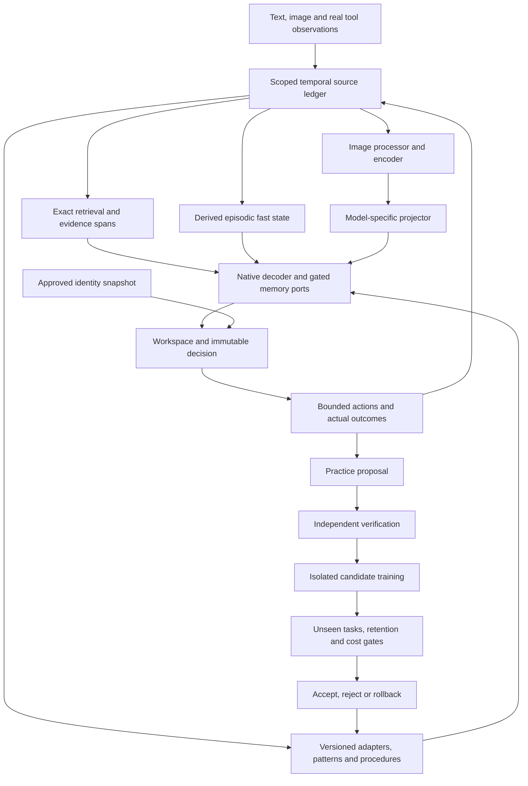

# Integrated memory, learning, vision and bounded RSI design

**Design revision: 25 October 2026. Reviewed implementation: `7c7018e`.**
This is a proposed system and qualification plan, not a record of new training.
MiniCPM5 remains the baseline; the native memory guard remains **50 GiB**.
The completed v5 writer experiment is rejected. Its mechanical persistence
passes do not establish useful learned memory. No visual or neural RSI candidate
has been qualified by this revision.

The immediate sequence is **remaining verification and representation-preserving
memory rebuild fixes → isolated MiniCPM5 V0 → V1/V2 visual fine-tuning → qualified
visual memory → bounded RSI**. Spark FP8/BF16 source and backend preparation,
dataset curation and memory diagnosis can proceed independently. Another blind
memory-training attempt is not a prerequisite for isolated V0.

| Detailed contract | Purpose |
|---|---|
| [Recovery](17_Memory_Reliability_Recovery.md) | Current defects, reproductions and repair acceptance |
| [Loop instructions](16_Loop_Agent_Instructions.md) | Ordered implementation prompt and handoff |
| [MiniCPM5 vision](18_MiniCPM5_Vision_Training_and_Continual_Learning.md) | V0–V4 interfaces, training and controls |
| [Spark preparation](20_Spark_X2_6_FP8_Preparation_Plan.md) | Official FP8 adaptation base, BF16 control and backend qualifications |
| [Data acquisition and curriculum](../08_Dataset_Acquisition_and_Curriculum.md) | Source catalog, admission, splits and bounded curriculum |
| [Research cross-check](15_Research_Crosscheck_and_Backbone_Plan.md) | Existing component history and research distinctions |

## 1. Outcome and present limits

The intended system should learn from verified experience, remember changing
facts across restarts, perceive images, improve later task performance and keep
an attributable personality history. Each is a separate claim. A model that
changes its output after a memory write has not necessarily remembered the fact;
a system that saves wrong answers has not demonstrated reliable memory.

The latest writer-only D1 arm made 48 updates over 192 scheduled cases. Exactly
14 writer tensors changed; the original model, readers and gates were frozen.
Fast and disabled both answer 56/192 correctly, including **0/128 factual cases**.
Selective exact context answers all 128 factual cases and 184/192 overall;
full context answers 176/192. The reference still fails its declared general and
nonregression gates. Preserve these decisions and use the exact path as a
practical comparison, without calling it universally qualified.

The review independently reran 49 focused tests and the CPU scorer over 1,920
saved answers, verified 27 implementation pins and byte-identical regeneration
of the v4 data/manifest. It inspected 32 authenticated memory snapshots and seven
recorded restart answers. The larger 1,311-test result is existing experiment
evidence, not another full-suite run performed by the review.

Three defects still take priority: contexts must bind the caller's scope and
canonical route; route audits must reject duplicate/missing update indices;
rebuild must preserve the fact-binding representation. See document 17 for
specific reproductions. None is evidence that the saved native outputs were
maliciously altered.

## 2. Connected architecture and ownership



The ledger owns evidence and eligibility. The decoder owns predictions. The
workspace owns provisional hypotheses and current task state. The compiler owns
derived artifacts. An external evaluator owns promotion decisions. A candidate
cannot make itself authoritative by writing a more confident explanation.

Keep source evidence, teacher output, generated practice, agent experience and
approved identity facts distinct. Every derivative records its parents. New
retrieval or a new crop creates a new pinned decision rather than changing the
evidence behind an existing decision.

Reuse the current adapter/session/frame, ledger, fast-memory service, compiler,
candidate registry, publisher and identity interfaces. This design extends those
paths; it does not authorize another disconnected model demonstration.

## 3. Memory hierarchy and update rules

| State | Authority and purpose | Proposed update rule | Required evidence |
|---|---|---|---|
| Exact temporal ledger | Attributed observations, corrections, source scope and dates | Append observations; supersede/revoke explicitly; preserve history | Caller-bound eligibility, exact spans, correction and branch isolation |
| Record slots and retrieval indexes | Derived access to eligible evidence | Rebuild affected records after producer/source changes | Retrieval quality versus lexical/exact controls; source binding |
| Episodic neural fast state | Compressed associations for delayed questions | Bounded observation writes; deployment reads do not train themselves | Multiple queries per state, useful novel-value recall, correction and restart |
| Engram-style pattern lookup | Stable token patterns and acquired reusable associations | Versioned offline construction or independently accepted update | Acquired-knowledge tests, collision/coverage audit and disabled/shuffled controls |
| Procedure library | Verified reusable executable behavior | Publish evaluated candidates transactionally | Unseen-task execution, rejection and rollback |
| Workspace and core | Goals, partial plans, hypotheses, uncertainty | Request/task-owned bounded recurrence | Actual task gain versus no-core, feed-forward and matched-compute controls |
| Slow adapters/model parameters | Generalized perception, reasoning or read/write skills | Isolated training with replay and independent promotion | Held-out gain, text retention, resource and provenance checks |
| Identity snapshot | Approved source history and permitted representation of a subject | Explicit source/version approval; agent experience stays separate | Source fidelity, purpose/cutoff binding and human evaluation |

These are different state types, not interchangeable caches. Native attention
KV state is a sequence acceleration artifact, not the persistent source ledger
or evidence of learned episodic memory. A warm cache does not count as learning.

The initial learned path retains the existing MiniCPM5 ports at layers 13/27 and
the declared state ownership. Compare shared and private state only at matched
state bytes, write count and inference/training cost. Do not silently multiply
capacity by copying a shared matrix into nominally separate heads.

### Native memory-layer contract

Keep the native complete decoder block intact. At an admitted port, project its
normalized hidden state into a memory query, read the pinned request-owned state,
project the result back to the backbone width and add a bounded gated residual:

```text
u = native_block(h, native_mask, positions, cache)
q = query_projection(normalize(u))
r = memory_read(q, pinned_fast_state_or_record_slots)
h_next = u + gate(u, eligible_route) * output_projection(r)
```

This is a conceptual interface, not a replacement equation for the current
SGDN-2 implementation. Writes occur from permitted observations at an explicit
barrier; do not update state merely by rereading a question or generation token.
Training may retain a declared functional cross-chunk gradient horizon, while
deployment snapshots are detached and immutable during a decision.

The existing diagnostic state has four 64-by-64 matrices: 16,384 scalars, or
65,536 logical FP32 payload bytes before metadata, momentum, snapshots or
autograd storage. A private state at each of two ports doubles that payload;
it is not a capacity-matched shared-state comparison. Record actual allocated
bytes separately. The original decoder width is 2048 for MiniCPM5 and 2560 for
the planned Spark adapter; read/write projections are producer-specific.

Start new residual outputs at zero or an explicitly tested neutral setting,
without zeroing every factor and preventing useful gradients. Prove disabled
parity, finite input gradients, exact optimizer membership and changed tensors.
For each new memory study freeze or train writer, query/read projections, gates,
base and state-update coefficients explicitly. Add one selected mechanism at a
time. A larger state, more ports or nonlinear memory is earned by a diagnosed
capacity/readout limitation, not by attaching another research name.

Before another writer recipe, diagnose three interfaces separately:

1. **Storage:** does the state encode the observed entity–attribute–value
   association? Probe novel values and counterfactual worlds with the same keys.
2. **Addressing:** does changing only the question select the relevant stored
   association? Test first/last-value and query-only shortcuts.
3. **Readout:** if a source-derived diagnostic probe can recover a value, can the
   decoder use it? Compare an explicit copy/pointer control only at that point.

Oracle probes may use associations extracted from observations, never evaluation
answers secretly written into deployment state. Their outputs are labelled
diagnostics. A positive probe supports the next experiment; it does not qualify
the deployed reader. New neural objectives may combine response supervision,
observed-association reconstruction and selective-write/retention terms, but
choose and ablate one mechanism first, with weights and masks fixed before runs.

## 4. Dynamic Engram paths and runtime compilation

The proposed dynamic path is a bounded router over exact records, episodic state,
stable pattern lookup and verified procedures. Record the query, eligible source
epoch, selected path, retrieved IDs, state/producer versions, coverage, fallback
and cost. Initially use explicit, auditable rules. Learn routing only after
reliable outcomes and a matched fixed-router comparison exist.

An Engram n-gram table is not the authority for a recently corrected personal
fact. Resolve such facts against current eligible evidence. Do not treat hashes
of continuous visual patch vectors as token n-grams; visual region/record keys
need their own typed representation and evaluation.

Runtime compilation means producing a reusable artifact with a declared input
contract and consumer. It does not require generating or executing new code on
every observation. Candidate artifact types are exact-context bundles, feature
caches, record slots, fast-state snapshots, pattern indexes, procedures and
trained adapters.

Every manifest must bind:

- Payload digest, artifact type/schema and parent candidate.
- Source IDs, scope, revision, eligibility epoch and observation cutoff.
- Representation name/version; tokenizer, encoder, processor and projector pins.
- Base/model code, dtype/quantization, normalization, tensor shape and layout.
- Builder/optimizer configuration where applicable, dependencies and validation.
- Publication generation, consumer compatibility and rollback ancestor.

Use a single-writer publication transaction with complete payload verification,
an atomic active pointer and recovery of interrupted candidates. Test interruption
between payload, catalog and active-manifest operations. Existing narrow atomic
publication is useful groundwork; cross-store and power-loss durability remain
claims needing their own fault tests.

An unchanged eligible source set under an unchanged producer and representation
must rebuild identically within the declared deterministic contract. Corrections
rebuild the correct historical/current view according to the protocol. Revocation
invalidates derived state and descendants; it does not prove that previously
trained model parameters have forgotten the source. Quarantine affected trained
candidates pending a separately evaluated retraining/unlearning policy.

## 5. Vision enhancement and reasoning

MiniCPM5 V0 starts with one pinned pretrained encoder, spatial patch features and
a new projector to width 2048. Preserve native decoder positions, attention and
vocabulary. All memory, core and identity injections are disabled for this first
qualification. The optional MiniCPM-V model is a separately qualified reference,
not a source of interchangeable projector weights.

V0 verifies actual tensor consumption, masks, fused-prefix identity, gradient flow
to the connector, disabled-path text parity, request isolation and fresh-process
reload. A frozen decoder must still propagate input gradients to the projector.
V0 contract fixtures can run on CPU; a native qualification must execute the real
MPS path with fallback disabled and the shared resource guard.

V1 trains only the projector. V2 introduces a declared small language-adapter
scope if justified, then visual instructions, grounding, OCR and verified
reasoning with text replay. Measure correct/wrong/no/shuffled-image controls and
OCR-text/caption baselines. A correct answer on a language-biased question does
not demonstrate visual use. See document 18 for all training contracts.

Reasoning examples should include evidence references, executable arithmetic or
scene-graph checks where available, and explicit absent-evidence cases. Keep
teacher rationales as unverified proposals until their steps are checked. Avoid
training on confident unsupported visual descriptions. Report task correctness,
evidence quality, calibration and compute separately from rationale length.

V3 first establishes exact visual-source retrieval. Learned visual memory then
requires accepted perception and an accepted memory path: observe → remove image
→ answer multiple delayed questions → save/reload without old-image re-encoding
→ append a correction → verify changed and unaffected facts. Preserve image,
region, crop and producer lineage. Retrieving the old image is a useful retrieval
control, not memory-only success.

## 6. Self-learning and bounded recursive improvement

Use four distinct terms: an observation write updates episodic state; practice
creates candidate training data; candidate training changes parameters or a
procedure; RSI changes how later learning is selected or performed. None alone
implies the others.

The first learning cycle is:

1. Record an actual failure and eligible source evidence.
2. Propose a small practice set tied to a specific skill and budget.
3. Verify labels/results independently; reject unsupported examples.
4. Train one isolated candidate scope with explicit retention replay.
5. Evaluate unseen families, corrections, unrelated retention and cost against
   its parent and the strongest practical exact-retrieval/fixed-policy control.
6. Accept, reject or defer using preregistered numeric rules; publish only after
   manifest checks. Restart, reuse on later tasks and exercise rollback.

Begin with supervised verified practice. Prepare deterministic proposal and
verification plumbing before capability gates if useful; do not promote neural
learning before the relevant memory, perception and retention gates pass. C13's
10 accepted/10 rejected evidence threshold admits a learned-selector study, not
an automatic success claim or a ban on deterministic practice.

After a successful cycle, compare ten chronological cycles:

| Arm | Persistent evidence | Candidate learning | Selection policy |
|---|---|---|---|
| T0 | None beyond current task | None | Fixed task policy |
| T1 | Eligible exact evidence | None | Fixed retrieval policy |
| T2 | Same permitted evidence | Verified candidate updates | Fixed practice/update schedule |
| T3 | Same permitted evidence | Same allowed update scopes | Learned practice/update selection |

Match exposure, replay and budgets. Count generation, teachers, verification,
training, rejected candidates, evaluation and wall time. Include distribution
changes, bad candidates, no-improvement periods and rollback. T3 must improve
later adaptation relative to T2 at comparable cost; merely improving relative
to T0 does not establish a better learning algorithm.

Multi-rate consolidation is later work. Give each level its own state, objective,
update context and measured frequency, and compare with an equal-budget fixed
schedule. Different timers alone do not reproduce Nested Learning. Code and
architecture proposals are a further isolated track: candidates cannot change
their own audit data, verifier, promotion rules, guards, permissions or protected
identity goals. One accepted update is not accelerating or unbounded RSI.

## 7. Personality and semi-cognitive integration

Retain the existing source modes and identity reader. Approved identity history
may guide values, priorities and expression; it must not override source truth,
eligibility or independent evaluation. Public persona datasets are method data,
not the real user's biography. Agent-generated experiences do not become human
memories. Dated changes keep their historical context instead of rewriting it.

Evaluate generic behavior, equal-information prompt summary, exact archive
retrieval and trained identity reader on reserved decision families. Authentic
fidelity needs permitted source material and human judgment; fictional contracts
establish engineering only. Missing identity material does not block V0.

The core should integrate perception, evidence, task state and uncertainty into
an immutable decision, followed by a bounded action and real outcome. Calibrate
success/uncertainty heads before they control tool calls or learning expenditure.
Compare no-core, feed-forward and compute-matched alternatives before expanding
recurrence. An internal narrative is not an independent observation.

## 8. Research guidance and limits

| Primary source | Narrow contribution used by this design | What remains our hypothesis |
|---|---|---|
| [Titans](https://arxiv.org/abs/2501.00663) | Learning a neural memory at test time | Reliable correction, source eligibility and persistence in this native integration |
| [Nested Learning / HOPE](https://arxiv.org/abs/2512.24695) | Nested optimization contexts and multi-rate memory | Choosing useful levels and objectives after simpler paths work |
| [uTTT](https://arxiv.org/abs/2610.05484), [author code](https://github.com/Zefan-Cai/uTTT) | Shared test-time state across layers; current release includes dense and MoE implementations | Fair shared/private comparisons in MiniCPM5; our two ports are not a reproduction |
| [Engram](https://arxiv.org/abs/2601.07372v2) | Conditional lookup for stable patterns | Dynamic scoped episodic routing and visual record paths |
| [MemT-1.0](https://arxiv.org/abs/2610.26825), [author code](https://github.com/MemTensor/MemT-1.0) | Native memory processing, trainable projections and local dynamic state | Retrofitting a small frozen model with a much smaller budget; authors' large-scale training is not evidence for our pilot |
| [Mem-T](https://arxiv.org/abs/2601.23014v2) | Memory-operation policy learning | Coordinating it with native fast state; distinct work from MemT-1.0 |
| [LLaVA](https://arxiv.org/abs/2304.08485) | Alignment followed by visual instruction tuning | MiniCPM5-specific projector, retention and persistent visual memory |
| [SEAL](https://arxiv.org/abs/2506.10943) | Learning to propose adaptation material | Externally verified, bounded selection with retained capabilities |
| [STaR](https://arxiv.org/abs/2203.14465), [Absolute Zero](https://arxiv.org/abs/2505.03335) | Iterative reasoning practice and verifiable generated tasks | Transfer to grounded multimodal tasks without self-certifying labels |

No combination of paper names establishes the complete system. The integration,
ownership, rejection and evaluation contracts above are project design choices.
Upstream benchmark gains and training budgets are not local acceptance values.

## 9. Work packages and resource gates

| Order | Concrete output | Exit or disposition |
|---|---|---|
| R1 | Caller-bound exact-context contract at the actual consumer | Foreign scope, forged abstention and disabled-route contexts reject |
| R2 | Complete deterministic route/update audit | Missing, duplicate, reordered and substituted updates/cases reject |
| R3 | Versioned representation-preserving rebuild | Unchanged rebuild parity; correction/revocation and reload tests pass |
| R4 | Reproducible source bundle and consistent handoff | New pins, meaningful clean-export tests; historical evidence unchanged |
| V0 | Isolated MiniCPM5 visual interface | Native bypass, input gradients, masks, isolation and reload qualified |
| V1–V2 | Alignment then visual instruction candidates | Independent visual gain and text retention; reject or scale based on measured evidence |
| M probe | Fresh storage/addressing/readout diagnosis | A discriminating result; one targeted repair if justified, separate from V0 |
| V3 | Exact visual retrieval then learned visual memory | Useful delayed recall, correction, unaffected retention and restart |
| V4 | Verified candidate cycle, then T0–T3 study | Later-task gains, retention, cost and rollback; no automatic promotion |
| S0 now | Spark source/precision/backend plan and data portability | Pinned metadata; unsupported capabilities remain explicit |
| S1–S3 later | Spark native parity, training capability, then vision/memory transfer | Independent qualification; neither depends on completing RSI nor blocks MiniCPM5 |

Use one exclusive MPS worker, fallback disabled, sampled driver stop at
53,687,091,200 bytes, sustained 512 MiB swap growth and 15% minimum free memory
over three host samples. Keep initial admission checks and historical policies.
The guard is not a promised usable allocation or a disk-storage limit.

Measure encoder, visual/text tokens, activations, trainable tensors, optimizer,
fast state, caches and temporary copies separately. Muon int8 momentum does not
make the original parameters or gradients int8. FP8 weights do not establish a
supported training kernel. Larger models and full-scope tuning require separate
capacity evidence, never an inferred fit from active-parameter count.

Every package reports implemented/tested/trained/evaluated/unrun status, exact
pins, independent units, controls, failed gates, resource cost and the next
discriminating action. Preserve negative results. Promote only the artifact and
scope that actually passed; a rejected experiment may still complete its work
package and allow an independent isolated package to proceed.
