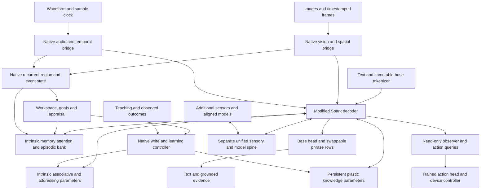

# SparkX 2.6 4B: native multimodal, memory and learning product plan

**Unified product entry point:** [version 5.1 final-product blueprint](23_SparkX_2_6_4B_Final_Product_Blueprint.md) consolidates this revision and its research companions into one architecture, learning, training, runtime and validation specification. This document preserves the revision 4.5 history. Existing state contracts and experiment admission remain authoritative for execution.

**Revision 4.5 · 26 October 2026 · Final product target; research/design, not a capability qualification or execution protocol.**

SparkX 2.6 4B is the intended finished product. Its language backbone will undergo **full fine-tuning**, with native vision, audio, memory and learning components integrated into its computation. **Full offline fine-tuning establishes multimodal perception and reasoning. Online self-learning uses those already-trained abilities to acquire knowledge and experience; it does not train the model into becoming multimodal.** MiniCPM5 is the smaller experimental platform used to reject weak mechanisms before paying for Spark training. The 35B/26B MoE options remain separate adapter-based ports; they are not prerequisites for the 4B product.

This document refines revision 3 with reusable audiovisual experience, native temporal state, paired sensory/semantic memory and additional transfer tests. Revision 4.1 added a [port-density study](../research/sparkx_port_density_20261026/Port_Density_Research_and_Plan.md): two ports are a baseline; six, nine and all-layer readers are candidates. Revision 4.2 added [dynamic memory attention and a unified module bridge](../research/sparkx_dynamic_memory_bridge_20261026/README.md). Revision 4.3 clarifies the product boundary: memory and plastic knowledge are permanent backbone components; the unified port is a separate sensory/action/model interface. Persistent learning can occur in native dynamic parameters while the stable 4B weights remain frozen during use. It also makes full offline multimodal fine-tuning a prerequisite for audiovisual self-learning. Existing experiment protocols and documents 16–20 still govern immediate execution. Nothing in this research update promotes a rejected experiment or starts training. The [frozen revision 3](../../reports/sparkx_av_experience_20261026/architecture_v3_snapshot.txt), [frozen revision 4](../../reports/sparkx_port_density_20261026/architecture_v4_snapshot.txt), [frozen revision 4.1](../../reports/sparkx_dynamic_memory_bridge_20261026/architecture_v4_1_snapshot.txt), [frozen revision 4.2](../../reports/sparkx_intrinsic_learning_spine_20261026/architecture_v4_2_snapshot.txt) and dated evidence packages remain historical records.

Current companions: [new research review](../research/sparkx_av_experience_20261026/Research_Review.md), [native experience design](../research/sparkx_av_experience_20261026/Native_Experience_Design.md), [MiniCPM validation addendum](../research/sparkx_av_experience_20261026/Validation_Addendum.md), [machine-readable v4 plan](../../configs/sparkx_2_6_4b_product_plan_v4.json), [source manifest](../../reports/sparkx_av_experience_20261026/evidence.json), and [repository observation](../../reports/sparkx_av_experience_20261026/repository_snapshot.json). Retained foundations: [prior research](../research/sparkx_2_6_product_20261025/Research_Crosscheck.md), [release gates](../research/sparkx_2_6_product_20261025/Validation_and_Release.md), and [full-training resource analysis](../research/sparkx_2_6_product_20261025/Resources_and_Full_Finetuning.md).

Revision 4.2 companions: [15-paper cross-check](../research/sparkx_dynamic_memory_bridge_20261026/Research_Review.md), [Unified Access Port design](../research/sparkx_dynamic_memory_bridge_20261026/Unified_Bridge_and_Memory_Design.md), [MiniCPM validation](../research/sparkx_dynamic_memory_bridge_20261026/MiniCPM_Validation.md), [supplementary study configuration](../../configs/sparkx_2_6_4b_dynamic_memory_bridge_study_v1.json), and [evidence/cost report](../../reports/sparkx_dynamic_memory_bridge_20261026/README.md). The v4 JSON remains the two-port baseline; the supplements describe additional research candidates.

Revision 4.3 companions: [11-paper research review](../research/sparkx_intrinsic_learning_spine_20261026/Research_Review.md), [intrinsic architecture and neural spine](../research/sparkx_intrinsic_learning_spine_20261026/Architecture_and_Spine.md), [teaching environment and MiniCPM validation](../research/sparkx_intrinsic_learning_spine_20261026/Teaching_and_Validation.md), [research configuration](../../configs/sparkx_2_6_4b_intrinsic_learning_spine_v1.json), and [evidence/resource report](../../reports/sparkx_intrinsic_learning_spine_20261026/README.md). This revision supersedes prior wording that placed intrinsic memory behind peripheral attachment, or required erasing all learned dynamic parameters to prove persistent learning. Earlier configurations remain historical controls, not the complete current product specification.

Revision 4.4 adds the [high-quality dataset strategy](../datasets/20261026_SparkX_Dataset_Plan.md), [36-family catalog with immutable Hugging Face revisions](../datasets/20261026_SparkX_Dataset_Catalog.json), [MiniCPM data and joint-learning validation curriculum](../datasets/20261026_MiniCPM_Dataset_Validation.md), and [source verification report](../../reports/sparkx_dataset_hunt_20261026/README.md). The [frozen revision 4.3](../../reports/sparkx_dataset_hunt_20261026/architecture_v4_3_snapshot.txt) preserves the previous design. This update qualifies source metadata and refines data selection; it does not admit datasets, change the runtime registry, rerun model experiments or revise their prior dispositions.

Revision 4.5 adds the [nested-learning review](../research/sparkx_nested_learning_20261026/README.md), [explicit learning contract](../research/sparkx_nested_learning_20261026/Nested_Learning_Contract.md), [MiniCPM experiment ladder and issue ledger](../research/sparkx_nested_learning_20261026/Validation_and_Open_Issues.md), and [audit report](../../reports/sparkx_nested_learning_20261026/README.md). The [frozen revision 4.4](../../reports/sparkx_nested_learning_20261026/architecture_v4_4_snapshot.txt) preserves the previous plan. This revision reconciles learning clocks, optimizer policy, meta-gradients, grounding retention and resident optimizer cost. It is a proposed native learner, not a faithful HOPE reproduction or a qualified capability. [Document 22](22_State_Mechanism_and_RSI_Contracts.md) retains authority over state ownership, transactions and RSI promotion.

## 1. Product contract and evidence boundary

The user-confirmed **4B limit applies to the language backbone**, not the sum of all encoders and state. Added module parameters have no fixed product ceiling. Their active computation, resident bytes, training/update costs and quality must be measured separately; dynamically selected or updated weights still have costs. HOPS means **HOPE / Nested Learning**. The target accepts text, images, video and audio; produces grounded text and structured evidence; learns verified new facts, vocabulary and skills; and sustains long sessions with bounded working state. Speech synthesis is a separate optional decoder, not required to understand audio.

“Native” means that modality interpretation, evidence selection, memory writing/reading, lexical selection and learned adaptation decisions belong to the model computation and saved model state. A host may decode media, enforce tensor budgets, run an optimizer, serialize state and apply independent verification. It must not secretly select the relevant object, supply the answer, caption every observation on the model's behalf, or choose the right memory using gold labels. Offline teacher models and evaluation tools are compatible with this requirement; a deployment-time semantic agent harness is not the target architecture.

Use distinct claims:

| Claim | Required behavior |
|---|---|
| Multimodal perception | Answers change correctly when relevant pixels or sound change |
| Visual reasoning | Intermediate region/event representations causally help solve spatial or temporal problems |
| Episodic memory | New information remains useful after its source and source KV are removed |
| Instructed learning | A supplied correction or rule improves later, unseen applications |
| Persistent skill learning | Designated native dynamic parameters improve new-instance performance and retain it across sessions/interference, with stable 4B weights allowed to remain frozen |
| Backbone consolidation | Separately tested transfer of learning into a new stable release |
| Learning-policy improvement | A trained selection/update policy produces more future benefit at equal total compute |
| Recursive improvement | Successive policy revisions improve the learning process itself under independent evaluation |
| Functional appraisal | Uncertainty, novelty, perceived affect and task progress modulate useful behavior |

These claims do not imply subjective feeling, consciousness, unlimited memory or unbounded self-improvement. Personality content remains pending the user's description; its interface can be designed now.

## 2. What the current repository actually establishes

Revision 3's evidence was reviewed at commit `4d2eb0236e31613462c26961a6a3d5bd9c2a0315`, reconciled through `023e8b9d4dd0dac81ebbea9d50eb65dc7b12d213`. Revision 4 adds a dated observation at `2468f16dfdf590104133efb041f30ec57e669a3a`, including concurrent uncommitted artifacts identified by hash. These reviews inspected reports and raw artifacts; they did not reproduce model runs. The [earlier follow-up](../../reports/sparkx_2_6_product_refinement_20261025/followup_snapshot.json) and [new snapshot](../../reports/sparkx_av_experience_20261026/repository_snapshot.json) preserve that distinction.

| Evidence | Verified interpretation | Planning consequence |
|---|---|---|
| [Staged vision curriculum](../experiments/20261025_Staged_Vision_Curriculum_Results.md) | AdamW dev 99/240; sealed audit 37/120, wrong image 38/120, no image 29/120; all six quality gates fail. External captions: token-F1 0 on eight cases | Repair priors, abstention, supervision and generalization before a larger training arm. Low loss and successful reload are insufficient |
| [Balanced vision dependence](../experiments/20261025_Vision_Dependence_Results.md) | Frozen regional features plus question-conditioned ridge readouts: final 75/120 versus question-only 36/120 and shuffled 46/120 | Some useful visual information exists. This is a procedural readout diagnostic, not a trained native visual reasoner or proof of a projector-only bottleneck |
| [Memory update dynamics](../experiments/20261025_Memory_Update_Dynamics.md) | Full-history exact-key readout 36/240 for both reducers; query addressing 232/240. Target-only/prefix and target-last interventions recover information | Address write-position interference with writer frozen and non-oracle policies. Increasing capacity or separating depths is not an established repair |
| [Earlier v5 memory verdict](../../reports/memory_reliability_v5_scorer_fix_eval02/verdict_final.json) | Fast and disabled both 56/192; facts/corrections fail | Useful native delayed recall remains unqualified despite repaired state contracts |
| [Full-training performance](../experiments/20261025_M2_Ultra_Full_Training_Performance.md) | All 2,516,756,480 MiniCPM parameters were trainable and all 381 original tensors changed in three-update probes. Fused AdamW averaged 8.949 s/update versus Muon8bit 23.021 s/update at 55 positions/example | Full-backbone updates are locally demonstrated on MiniCPM. This is neither a convergence comparison nor evidence that full Spark training fits |
| [Current continuation record](../../AGENT_CONTINUE.md) | Verified-learning CPU fixture inconclusive; delayed visual-memory corpus has 12 episodes, 24 images, 96 queries and CPU contracts only | No neural learning-policy, visual-memory or RSI promotion. Individual capability gates precede the joint factorial |
| [Core source](../../src/replica_lab/architecture/core.py) and [heads](../../src/replica_lab/architecture/heads.py) | Eight recurrent width-256 slots; task features currently host-derived; audit heads detach core inputs | Reuse recurrence, but add native modality/task representation learning and a separate end-to-end training path |
| [Spark preparation repair](../../reports/spark_repair_20261025/repair_record.json) | Source/preparation contracts exist; native FP8 remains blocked | Qualify Spark source/backend independently of RSI; use BF16 source as full-training reference |

The audit score is in the [sealed finalize receipt](../../reports/vision_curriculum_20261025/finalize_receipts/audit_593dc5406ebea4a09403ef597f81b513ad143025d3823ae0c3e9f45904d505d5.json), not the earlier dev-only score file. Preserve that distinction. The vision comparison used one seed per optimizer; it cannot establish that Muon alone caused the failed learning.

Commit `8ad047c` adds [authenticated historical score replay](../maintenance/20261025_Vision_Score_Replay.md); both arms retain failed learned quality. Commit `023e8b9` adds a production `adamw_fused` integration and strict resume metadata. The initial smoke reporting error described in revision 3 is historical. The newer [sustained probe](../../runs/fused_adamw_20261025/sustained01/run_report.json) completed 12 updates at 55 positions, with ten steady updates in 84.216 seconds, about 8.422 s/update. Its checkpoint-reload validation flag is false. This is a narrow performance observation, not a convergence, restart or Spark-fit qualification.

The [causal-refresh diagnostic](../../runs/memory_causal_refresh_20261026/native01/run_report.json) improves exact recall from 36/240 to **110/240**, but remains **rejected** with zero optimizer updates. Unaffected-query accuracy is 33.3% and unknown false recall 16.7%. Its causal arm is classified as cached-observation retrieval plus neural refresh. A separate [restart attempt](../../runs/memory_causal_refresh_20261026/restart01/failure_report.json) reports different fresh-process outputs. These results strengthen the case for an explicit native record-bank comparison and a restart repair; they do not establish that causal refresh solved memory.

**Revision 4.2 repository reconciliation:** the newer [restart04 report](../../runs/memory_causal_refresh_20261026/restart04/run_report.json) now passes fresh-process parity with zero old-observation encodes, after cached-vector device placement was repaired. [Native04](../../runs/memory_causal_refresh_20261026/native04/run_report.json) still rejects learned memory quality at 110/240 recall. The [vision stage final disposition](../../reports/vision_stage_diagnostic_20261026/final_disposition.json) records recovered engineering and byte-identical reload, but rejects learning: audit 6/24, all 24 audit answers `yes`, caption F1 zero. The [new source snapshot](../../reports/sparkx_dynamic_memory_bridge_20261026/repository_snapshot.json) pins this observation. The old failed attempts remain historical evidence; restart repair is no longer the outstanding quality problem.

**Revision 4.5 observation:** the newer [balanced vision train04](../experiments/20261026_Vision_Balanced_Alignment.md) performs 24 projector-only fused-AdamW updates but reaches only 3/14 train-fit and 2/18 development answers, with zero caption-following accuracy. It stops before sealed audit and receives no promotion. These results supersede any suggestion that visual quality is now solved; they do not test the proposed final full-FT scope. The [dataset validation](../../reports/sparkx_dataset_validation_20261026/validation.json) remains metadata-only. The [six-fixture tranche](../../reports/sparkx_first_tranche_20261026/tranche_receipt.json) is synthetic protocol data, not acquired real-media training readiness.

## 3. Integrated architecture

These are components of one model package. Intrinsic memory operates with the peripheral spine entirely disconnected. Initial full fine-tuning teaches the model to perceive, reason and use/update memory. During use, stable release weights stay frozen while designated memory/knowledge parameters change. The compact core is not a second language model. Reader density, memory commits, plastic-parameter updates and peripheral calls have independent schedules. The [revision 4.3 design](../research/sparkx_intrinsic_learning_spine_20261026/Architecture_and_Spine.md) defines the permanent components, ordered causal phases and separate spine contract.

### 3.1 Backbone and integration points

Retain `XHToken/Spark-X2.6-4B` at revision `66e3ae7bee54e0a523d692cb8ef841f35409807b` as the starting checkpoint. It contains **4,112,079,360 unique parameters**, 36 layers, width 2560, FFN width 10240, vocabulary 131072, tied embeddings, 16 query/4 KV heads and head dimension 256. Three sliding layers precede each full-attention layer; the sliding window is 512.

This is custom `Spark2_5`, not a Llama module-name alias. The fused QKV projection maps 2560→6144; attention output maps 4096→2560. The output uses `F.linear` with the embedding weight, so wrapping an unused `lm_head` is insufficient. Preserve attention gates, mixed full/sliding positional behavior, tied-weight identity and output calibration. Initial extension ports are zero-indexed layers 11 and 23; MiniCPM controls use 13 and 27. These placements are hypotheses, not optimized locations.

Use zero-effect initialization and extension-disabled parity. During training disable KV caching; checkpoint recomputation must not duplicate memory writes, lexical swaps or event updates. Forward returns proposed state; commit once at an explicit boundary. Re-entry, rejected optimizer steps and interrupted checkpoints must be idempotent.

In the retained compact reader baseline, project the current hidden state to a width-128 memory query, read bounded bank evidence, and combine width-256 readout/workspace vectors through a gated residual projection back to width 2560. An initial form is `h_next = h + g * W_out([memory_read, workspace_read])`, with zero-effect output initialization and a live gate, respecting validity/modality masks. The expanded candidate uses width-512 intrinsic memory readers. These readers do not require UAP attachment. Keep reading and writing separate: the observation encoder proposes keys/values and correction links, while a native selector chooses writes under the record quota. Hard selection at deployment needs a trained relaxation or explicit selection loss; it must not be substituted with answer-aware host selection. Audit the resulting projection parameters and gradients rather than treating the small bank payload as the entire module size.

The new primary candidate adds memory after the attention residual and before the block MLP, plus a parallel full-rank plastic knowledge branch. Compare it with the existing post-block residual control and a separately qualified MemT-like pre-output branch. The original attention and MLP remain present. Nine-site, late-only and shared/grouped parameter layouts need matched experiments; permanent architectural membership does not require executing every branch on every token.

The separately named `Spark-X2.6-4B-Base` exists, but its inspected card also describes post-trained weights. Do not silently substitute it or assume the name proves a raw pretrained starting point. An eventual Base-versus-current comparison needs a pinned, documented training provenance and equal data budget.

#### Reader density: six, nine and all-layer candidates

Per-layer access is feasible. Prioritize Spark read sets `[3,11,15,23,27,35]` and `[3,7,11,15,19,23,27,31,35]`, then compare an all-36-layer arm. The nine-port set follows Spark's full-attention blocks. These are research candidates, not a claim that more layers improve quality. Preserve the historical two-port arm and a two-port early-placement control; use corresponding relative-depth sets on MiniCPM.

Separate early sensory-feature additions, memory readers, full-bank retrieval, writer sources and learning targets. Share the bank and cap selected evidence at 16 records regardless of reader count. For the first controlled density study, hold sensing layers fixed and use a separately accounted native query-sensing/selection pass before the action pass. This differs from revision 4's no-extra-planning-pass baseline hypothesis. An early reader cannot use selection computed at a deeper layer later in the same pass.

Test independent, depth-group shared and factored-output readers. Zero gates alone do not save computation; actual skipped execution must be measured. More readers must not multiply memory writes, fast-state decay or online LoRA targets. See the [research and experiment design](../research/sparkx_port_density_20261026/Port_Density_Research_and_Plan.md), [supplementary study config](../../configs/sparkx_2_6_4b_port_density_study_v1.json), and [density cost ledger](../../reports/sparkx_port_density_20261026/analytical_costs.json). Revision 4's machine-readable config remains the two-port baseline.

### 3.2 Vision: perceptual tokens, visual primitives and latent reasoning

Reuse qualified `google/siglip2-base-patch16-224` revision `75de2d55ec2d0b4efc50b3e9ad70dba96a7b2fa2`: 92,884,224 encoder parameters. Initially retain all 196 patches per image to establish perception. Preserve patch coordinates, image dimensions, crop transforms, observation identity and time through the bridge. Then compare a 64-token resampler, sparse crops and an event-state compressor. Small-object and OCR quality must survive compression; a single global image vector is inadequate for the target.

Use two complementary mechanisms:

1. **Grounded primitive control.** Predict points, boxes, object references and temporal intervals alongside answer generation. Train the geometric heads and language references on the same evidence. Points suit instance counting; boxes retain extent and overlap. This has closely matched 4B precedent in [Thinking with Visual Grounding](https://arxiv.org/html/2606.16122v1). It is supervised grounding, not proof of arbitrary latent reasoning.
2. **Native visual reasoning candidate.** A small recurrent module updates region/event vectors while attending to actual visual features and memory. Feed the resulting vectors back through the backbone ports. Supervise them using region feature reconstruction, geometry, correspondence and future-event prediction, in addition to answer loss. Compare with explicit grounded reasoning and an equal-compute nonrecurrent module. [CoVT](https://arxiv.org/html/2511.19418v1) and [LVR](https://arxiv.org/html/2509.24251v1) motivate this experiment; they do not qualify this retrofit.

Start with two workspace iterations and at most 64 event/region slots. If autoregressive latent thought positions are tested, cap them at 16 in the first comparison and charge every backbone pass. Continuous tokens do not make computation free. Do not require a renderer or image generator at inference. Training-only segmentation/depth/feature teachers can supply targets; begin with existing geometry annotations before adding a large teacher stack.

A primitive contains `{observation_uid, region_uid, box_or_point, coordinate_frame, t_start, t_end, latent, confidence, representation_version}`. Relation predictions reference stable identities and carry confidence: left/right, overlap, containment, same-object, before/after and event association. The core reasons over vectors plus geometry; a host only validates ranges and resolves identified tensor slices. Predicted crop selection must remain native, with a fixed crop budget. Bounding boxes alone cannot recover unseen depth; monocular depth is relative unless grounded by additional measurements.

**Temporal reasoning is a separate capability.** Train correspondence across motion, occlusion, viewpoint and scale changes; interval ordering; identity continuity; and evidence that spans multiple frames. Use a common monotonic media clock, not frame number as elapsed time. Preserve source-resolution transforms. Test reversed order, time offsets, identity swaps, duplicated frames, dropped frames and query-relevant short events. Uniform 1 FPS sampling cannot support claims about arbitrarily fast events; allow a bounded model-selected burst or abstain when evidence is missing.

The DeepSeek report is now reviewed from two byte-identical mirrors. Its grounded-reference mechanism informs this plan; original-release provenance remains unverified. Scale, compression and reproduction limitations are documented in the [new research review](../research/sparkx_av_experience_20261026/Research_Review.md).

### 3.3 Native audio input

**Yes: add an audio encoder whose continuous outputs enter Spark directly.** Speech recognition, environmental sound, timing and prosody need different evidence. An ASR transcript is useful supervision and a mandatory baseline, but cannot be the only representation.

Compare two compact front ends before selecting one:

| Candidate | Role and limits |
|---|---|
| `openai/whisper-small` encoder only | Multilingual speech-oriented control. Analytical stored encoder size about 88.15M elements, including fixed positions; do not load its autoregressive decoder into the product |
| `marcoyang/spear-base-speech-audio-v2` | Preferred unified-audio research candidate: official metadata 93,289,476 parameters, width-512 output, about 50 Hz; English speech plus general-audio pretraining. Mandarin/multilingual transfer is not established by that pretraining |
| Whisper-base encoder only | Approximately 20.59M stored elements; lower-cost ablation if accuracy permits |
| SPEAR XLarge / AuT / dual Whisper+BEATs | Teacher or quality ceiling, not default resident components |

Pin SPEAR v2 at `7447901d44bf265b3c304cc4ccf25ca741527b6c`, Whisper-small at `973afd24965f72e36ca33b3055d56a652f456b4d`. All remain unqualified on this repository's device/backend. The SPEAR checkpoint declares `causal: false`; it is not streaming-ready simply because its config has chunk fields.

Use 16 kHz waveform input, documented frontend normalization, validity masks and exact sample offsets. First qualify short, complete clips. Then train/test chunk-aware processing with explicit lookahead and bounded acoustic context. Never expose future audio while measuring online latency or causality. Preserve overlap identity to avoid counting the same event twice.

The bridge has a content stream and a low/mid-layer acoustic stream, both derived from the same encoder. Project into Spark width through small MLPs; retain native acoustic vectors for sound events and perceived affect. Compare final-layer-only, a small selected-layer fusion and a larger all-layer fusion. [SALMONN-2](https://arxiv.org/html/2607.17079v1) and [MOSS-Audio](https://arxiv.org/html/2606.01802v1) support multi-level features, but their much larger encoders and training programs do not establish equivalent quality for a 93M tower.

Begin at 50 Hz for representation diagnostics; test grouping by five to **10 model tokens/second**. A 4-second segment then contributes 40 content tokens. Keep precise intervals and a small separate event summary so pooling does not erase a short sound or prosodic change. Lower rates are later ablations. Silence suppression is not automatically safe: pauses and breath can carry useful information.

For audiovisual input, fuse by actual time intervals and learned correspondence. Include synchronized, shifted, contradictory and missing-modality examples. The model must distinguish a sound correlated with an object from a verified causal event. Its lexical memory may bind a newly taught name to pronunciation and visual appearance; pronunciation exemplars are optional bounded records, not permanent new acoustic token IDs.

Audio understanding does not require a talker, vocoder, voice cloning or a second LLM. Those would add their own training, memory and latency qualification and are outside the initial product release.

Audio capability is established through offline full multimodal fine-tuning before online learning experiments. Compare speech/sound/music feature preservation, with MERT-95M as a music control and AF3/Music Flamingo as training precedents; see the [audio research cross-check](../research/sparkx_intrinsic_learning_spine_20261026/Research_Review.md). Preserve pitch, timbre, rhythm, prosody and actual timestamps, and test multiple feature scales before fixing a token-compression rate. Online learning may acquire a new musical concept or sound convention using these trained features; it is not the mechanism for teaching an untrained audio path to hear.

### 3.4 Semi-cognitive core and functional affect

Retain the existing eight width-256 recurrent slots as the first control. Extend their typed inputs to visual regions, audio segments, events, native memory reads and the current language goal. The current 24 host-computed task features may remain in the control, but product semantic state must be inferred from model inputs; exact counters can remain mechanical metadata.

Separate three representations:

- **Observed evidence:** what happened, where/when, source reliability and contradictions.
- **Perceived social/affective evidence:** distributions over vocal cues or listener-perceived affect, including uncertainty and competing interpretations.
- **Internal functional appraisal:** prediction error, novelty, task progress, uncertainty and expected learning value. These variables control attention, memory retention, learning effort and response style.

An “emotion simulation” can be a learned, bounded dynamical state with decay and task-conditioned updates. It should be evaluated through its useful effects and calibration, rather than a claim of subjective experience. A loud voice must not automatically mean anger; a predicted affect label must not become a durable personality fact. Explicit user corrections outrank inferred preference hypotheses. Store the acoustic evidence separately from its current interpretation.

[emotion2vec](https://arxiv.org/html/2312.15185v1) motivates frame/utterance representation supervision. Its term “online distillation” describes a training method, not proof of lifelong autonomous learning. Use a frozen teacher for offline distillation if useful; avoid an additional permanent emotion tower unless it earns its runtime cost. Assess soft-label agreement and counterfactual prosody using the [VoxEmo](https://arxiv.org/html/2603.08936v1) methodology.

Add answer/future-query and representation losses that backpropagate through the core. Preserve detached monitoring heads for independent auditing. Compare recurrence 0/1/2, a parameter-matched feed-forward control, and a compute-matched control. A successful monitor predicting the model's errors does not demonstrate improved reasoning. Personality conditioning is a separate stable input/module, with contents deferred until supplied; it should not overwrite observed facts or determine verification outcomes.

Initially update the recurrent workspace at observation/segment boundaries and when a query arrives, rather than running a full recurrent reasoning loop for every acoustic frame. Backbone ports can read the resulting state during decoding. This schedule is a compute hypothesis; compare against token-level updates only if the simpler schedule loses required information. Clock resolution, update rate and retention duration are separate quantities.

### 3.5 Dynamic Engram and long-running state

Use “dynamic Engram” as the project name for **native editable associative memory**, not as a claim that the static Engram paper already implements it. Keep distinct state types:

| State | Initial design | Update/retention contract |
|---|---|---|
| Working context | Capped KV and eight core slots | Segment-local; predictable reset/restart |
| Event/region state | Up to 64 width-256 slots | Native merge/select; stable observation lineage |
| Episodic/lexical bank | MiniCPM 1024 records; Spark 4096; key 128 and semantic value 256; paired candidate adds 2×128 visual and 2×128 audio evidence | Native write/read; revisions, deletion, uncertainty and bounded capacity; semantic-only v3 bank remains a control |
| Intrinsic fast parameters `F` | Associative matrices/nonlinear memory; earlier two-matrix arm remains a control | Learned causal update and explicitly scoped persistence; compare against bank-only |
| Adaptive addressing | Full-rank query/routing state; fixed addressing remains a control | Feedback updates between decisions; compatible stored keys and representation versions |
| Persistent knowledge `P` | Full-rank plastic MLP/expert bank inside decoder computation; earlier LoRA arm remains a control | Verified updates and replay across sessions with stable backbone frozen |
| Stable release `Theta` | Original backbone, modality components and qualified learning machinery | Full offline training; optionally a later consolidation release |
| Static Engram | Optional fixed pattern table | Offline learning; separate capacity/cost accounting |

The current frozen-writer diagnostic shows that old information can be lost through write ordering even when query addressing is strong. First compare causal refresh/retention strategies with the exact same writer, records and scoring. The diagnostic's target-last intervention knew the queried target and cannot serve as a deployment policy. Refresh must use information available at write time, declared coverage rules or the current lawful query; never future labels.

A new explicit bank control writes distinct records without repeatedly overwriting one shared fast matrix. Later compare matrix compression at matched byte budgets. Preserve an ordinary indexed-bank baseline so failures can be localized to storage, selection, representation or readout. Full memory content is not a free prompt append: native selection supplies bounded evidence to the active reader sites.

Titans/HOPE-inspired updates must specify the inner loss, update state, learning rates, decay, truncation horizon and outer objective. Separate episodic inference-time state changes from durable weight consolidation. The revised [video-SALMONN S](https://arxiv.org/html/2510.11129v2) uses one-step fast-memory updates; audio still bypasses that layer. Audiovisual fast memory remains our hypothesis. The new review distinguishes this version from the earlier v1 analysis.

A minimal optional fast-state control is `F_next = lambda * F + eta * (v - F*k) * k^T`, using normalized width-128 keys, width-256 values and bounded update/decay scalars. Train the projections and gating through later-query loss over 1–4 observation segments, then truncate between worlds. This linear delta rule is not a faithful replacement for the existing SGDN-2 implementation or full Titans. A nonlinear candidate must state its associative reconstruction loss, optimizer/momentum and state cost explicitly. Compare bank-only, fast-only and bank-plus-fast under matched budgets before combining them by default. HOPE-inspired multi-timescale modules additionally need demonstrated outer learning of useful update behavior; several scheduled update rates are insufficient.

Revision 4.2 adds distinct read and write routers sharing expert addresses, with a fixed-routing control and a feedback-adapted address transform. MemT's MoS is dense routing; proposed top-two sparse expert execution is an extension requiring separate evidence. An initial three-group/eight-expert/four-head/128×128 candidate uses 6 MiB FP32 fast matrix state before snapshots and optimizer buffers. More capacity is allowed. State changes, useful persistent learning and improvement of the learning policy remain different claims. Persistence/transfer in `F` or `P` is a valid learning target; it does not require altering the original backbone. The [current intrinsic design](../research/sparkx_intrinsic_learning_spine_20261026/Architecture_and_Spine.md) supersedes the earlier peripheral packaging.

Memory has finite information capacity. Long-running means bounded state and graceful retention/forgetting, not perfect recall of an unlimited stream. Set explicit quotas for tensor state, lexical surfaces, provenance, replay and raw evidence. The 32 MiB resident-state, 64 MiB replay and 256 MiB optional raw-source targets remain the baseline profile. Revision 4.2 introduced 64/128 MiB alternatives. Revision 4.5 adds a 256 MiB mutable-state envelope plus a separate 64 MiB replay envelope for the resident-Adam plastic-bank candidate; the smaller profiles remain controls. Each must count tensors, metadata, mutable parameters, optimizer state and snapshots. No alternative changes current run admission. Raw-media retention is optional and bounded. Missing/revoked sources must cause uncertainty or abstention, not reconstructed certainty.

### 3.6 Swappable vocabulary paired with learning

Preserve permanent tokenizer IDs and byte-level fallback. Generate **256 active phrase rows** from a compact phrase encoder; use 32 in smoke tests. Initial phrase encoder: width 256, two layers, roughly 3M matrix parameters. This size is an unproven compression of the larger encoders in DVA/DVAGen.

A lexical identity is `{lexeme_uid, canonical_bytes, representation_version}`. An active use additionally records `{stream_id, slot_index, slot_generation, mapping_hash}`. Swapping an active slot cannot redefine an old KV position, a saved memory record or an optimizer's parameter identity. Base input/output weights are shared with the backbone where appropriate, never cloned into redundant trainable tables. Permanent IDs remain immutable during full FT, although their embedding values are trainable.

Train both phrase output calibration and **atomic feedback**: an emitted phrase feeds one learned vector back as one model position. Merely printing several words from one output and then replaying every base token does not save subsequent backbone steps. Compare atomic mode against that copy-feedback control, static vocab, permanent expansion and a fixed active bank. Count candidate encoding, refresh, selection, prefill and output bytes in efficiency comparisons.

First freeze a mapping for a generation. Later allow swaps only at declared segment boundaries, encoding at most 16 fresh phrases per refresh. Pin entries used by pending inputs or backward/recomputation graphs. If all slots are pinned, fall back to base tokens. Reject phrases crossing role/control/stop boundaries. Train random slot permutations, irrelevant candidates, unseen phrase compositions and empty banks. Gold answers cannot choose candidates.

Coordinates, event IDs, modality control symbols and acoustic codebooks are not recycled lexical slots. New visual concepts and spoken names may share a stable semantic identity in memory, while their surface forms stay lexical. Store unfamiliar words with definition, pronunciation/appearance evidence and provenance; test whether the model learned meaning rather than only spelling.

Changing adapters, embeddings or memory conditioning may invalidate a prefix KV and cached phrase rows. Full-backbone consolidation requires a new representation version and rebuild/re-encoding or learned migration of stored state. A text-only retokenization is not exact atomic-state restart. Do not silently reuse old vectors after updating their encoder.

### 3.7 Learning and self-evolution

**Current concrete learning candidate:** keep `F` as a declared associative recurrence and partition the sixteen full-rank plastic experts into eight faster (`Pf`) and eight slower (`Ps`) experts. Read at most one from each pool. Update one fast expert on an eligible verified teaching transaction; consider one slow expert every sixteen such transactions. Cap the whole transaction at four inner steps. Train on chronological episodes long enough to exercise both clocks, and compare capacity- and work-matched one-clock controls. These are development hypotheses, not published optimal rates.

The [learning contract](../research/sparkx_nested_learning_20261026/Nested_Learning_Contract.md) specifies each objective, replay context, reset, optimizer state and knowledge-transfer edge. Parameter training uses `NativeFusedAdamW`. The initial `P` meta-gradient is an explicit first-order approximation; fused AdamW does not support exact differentiation through its steps. The `F` recurrence has a separately declared differentiable outer path. Future-query and old-skill losses test whether offline preparation makes later learning useful. A lower local feature loss is insufficient without behavioral transfer. Full offline multimodal training still precedes audiovisual experience learning.

Use three training regimes with different purposes:

1. **Full offline product training:** train all original Spark backbone parameters and the native multimodal components after warmup, including vision/audio encoders and spatial/temporal bridges in the joint product phase. This establishes seeing, hearing and multimodal reasoning. Learn the memory read/write and bounded adaptation procedure offline as well.
2. **Online native learning:** freeze the stable release. Update episodic records, associative parameters `F`, qualified address state `A` and slower full-rank knowledge parameters `P` from teaching and observed outcomes. Use already-qualified multimodal representations; do not use self-learning to establish multimodal competence. Start with a fixed policy and bounded local objectives, followed by a measured end-to-end adaptation comparator. LoRA remains a baseline, not a required architecture or interface.
3. **Maintenance and policy improvement:** consolidate verified experience into `P` with replay. Optional full-backbone consolidation produces a new stable release and requires representation migration. Research plastic learning-policy parameters `Psi` only after fixed-policy knowledge learning succeeds.

The [teaching specification](../research/sparkx_intrinsic_learning_spine_20261026/Teaching_and_Validation.md) distinguishes `F`-only, `P`-only and combined learning. For `P`-only evaluation, retain taught `P` and fixed `Theta`; clear records, fast/address/core state, teaching prompts/media, prototypes, source KV, read caches and active phrase rows. Compare with initial/reset/wrong-world `P`. Resetting taught `P` is a causal intervention, not the normal persistent-learning test.

Self-generated exercises or update targets require independent feedback before being treated as verified knowledge. The environment supplies teaching and outcomes; semantic writing, retrieval and adaptation belong to model computation. Charge encoding, replay, verification, rejected candidates and any gradient propagation through the frozen decoder. Frozen weights do not make end-to-end backpropagation free.

For recursive improvement, compare at least two successive qualified policy revisions against a fixed policy at equal cumulative resources on fresh task families. Better answers, retrieval or ordinary parameter learning alone do not establish an improved learning algorithm. This remains a separate research gate.

### 3.8 Reusable audiovisual experience

The [detailed native design](../research/sparkx_av_experience_20261026/Native_Experience_Design.md) connects visual primitives to temporal identities, acoustic events, memory and learning. Add a width-256 recurrent sensory bridge before the backbone, sharing the existing 64 event slots across visual tracks, sound events and transitions. It updates at declared observation boundaries; a full language-model pass for every sensory frame is not required by the proposed architecture.

Use one bounded bank with semantic and modality-specific views. A new record may preserve an object's appearance, an acoustic motif and their temporal relation, rather than only a generated caption. Write without future-query information. In the two-port baseline hypothesis, each port selects up to eight records at the last query-prefill position; cache the union of at most 16 for decoding and qualify training against that schedule. The denser study separates selection from reading as specified above. All readers share storage; an optional pair of fast matrices is also shared, not duplicated at every depth.

Train grounding, continuity, cross-modal alignment, delayed readout and verified transfer alongside answer generation. Keep actual observations separate from predicted futures. The semi-cognitive core can prioritize uncertainty or learning value, but perceived affect and confidence cannot certify a fact. Stable lexical identities connect new names to sensory evidence without changing old vocabulary slots.

Evaluate episodic recall, new-instance transfer with records available, and persistent parameter learning separately. For parameter learning, predeclare the retained substrate: taught `F` for an associative-learning test, or taught `P` for a plastic-knowledge test. Remove teaching-derived records/prototypes, lexical shortcuts, source KV and other undeclared changing state; disable further test-time updates. Keeping learned native parameters is the point of this test. A stricter test that resets all dynamic parameters evaluates consolidation into `Theta` instead. Keep experience producers stable within an online release; full offline FT requires version migration or invalidation of old representations. Deleting a record is not exact unlearning from consolidated weights.

### 3.9 Unified Access Port v2: a separate neural spine

The spine exposes typed native feature exchange for additional sensors, aligned models, read-only internal observers and continuous action heads. It is our proposed interface, not an existing standard. Intrinsic memory, knowledge learning and the core modality paths are permanent model components and do not require a peripheral to be attached.

Provide potential access sites per decoder block, with execution selected independently of memory reader density. Packets carry feature/representation identity, stream and observation IDs, units, coordinate frame, acquisition interval, causal availability, state revision and query-specific masks. Start with width-512 features and width-256 control representations. A read-only observer must not mutate hidden state or memory; exported features are not automatically an interpretable account of reasoning.

Train device/model-specific adapters into this representation. Shared tensor width does not establish semantic compatibility. Start model exchange with one-way causal feature packets; any two-way exchange needs finite, explicitly scheduled rounds. Different tokenizers, rotary positions and latent spaces prevent default raw-KV interchange. [CALM](https://arxiv.org/html/2401.02412v1) supports learned hidden-state composition; [Octo](https://arxiv.org/html/2405.12213v2) supports sensor tokenizers and passive readouts. Neither demonstrates untrained universal attachment.

Action heads receive native features and emit calibrated continuous action chunks with units, deadlines and validity intervals. Separate sensor rate, model decision rate and device control rate. [Pi0](https://www.physicalintelligence.company/download/pi0.pdf) provides an architectural precedent for action experts and cached observation context; its robot control frequency is not a full-language-model inference frequency. The [spine specification](../research/sparkx_intrinsic_learning_spine_20261026/Architecture_and_Spine.md) defines causal masks, attachment, timing and qualification. Additional peripheral adapters are trained explicitly; they are not expected to emerge through unsupervised self-learning.

## 4. Full fine-tuning and data program

The Spark-specific [official training example](https://github.com/XHToken/LlamaFactory/blob/f56888d47dc5681e15b83ddbea01adddf2050adf/examples/torch_spark2_5/example_4b_sft_args.yaml) sets `finetuning_type: full`, `use_muon: true`, and BF16. This establishes an intended full-training path, not MPS compatibility or adequate quality for our modified model.

| Phase | Trainable scope | Purpose and exit condition |
|---|---|---|
| F0: backend qualification | Short all-original-parameter probe | Unique tensor inventory, optimizer ownership, nonzero gradients where exercised, actual changes, reload and guard pass |
| F1: modality warmup | Visual/audio bridges and native evidence heads; backbone and encoders frozen | Align each modality; beat no-input/wrong-input and prior baselines on fresh data |
| F2: integrated continued training | **All 4,112,079,360 backbone parameters**, vision/audio encoders, spatial/temporal bridges, native memory machinery, core and lexical encoder | Establish multimodal perception and integration through full offline FT; learn causal memory reads/writes |
| F3: grounded reasoning and temporal learning | Same joint full offline scope; task-specific heads and intrinsic branches | Qualify spatial/temporal/AV reasoning, uncertainty, counterfactual dependence and text retention before audiovisual online learning |
| F4: learning-behavior training | Explicit offline outer training and bounded inner `F/P/A` updates; original release frozen in deployment-style evaluation | Teach acquisition of knowledge/experience through already-trained modalities; persistence, vocabulary turnover and retention |
| F5: product consolidation | Full backbone in bounded offline jobs; candidate deployment quantization separately | Independent integrated release evaluation and long-session soak |
| F6: learning-policy/recursive improvement | Explicit policy parameters and declared inner updates | Future-task gains at matched total compute, repeated on fresh families |

The final joint multimodal stages include the original language backbone and the core sensory/reasoning components. Frozen-encoder warmups or ablations remain useful but must be labeled with their actual scope; they do not replace the full multimodal training commitment. Offline teachers used only for distillation may remain frozen. Count tied weights once and include encoder/extension optimizer state. If the full scope does not fit locally, provision training resources rather than relabeling a partial update as full FT. Multimodal quality gates precede any claim about learning audiovisual experiences online.

Build data in stages: diverse image-caption/region pairs; speech/transcript and sound-event alignment; grounded spatial reasoning; timestamped video/AV relations; then episode sequences with teaching, source removal, correction, vocabulary turnover and later transfer. Mix text-only retention data from the start. Include ambiguous/absent evidence and answerable examples with balanced labels. All generated labels need provenance and sampled independent review. Split by world, image root, video, speaker, recording session and lexical family—not merely by question rows.

Suggested engineering pilot scales are 5k–20k visual examples and 10–50 hours of audio, followed by staged larger curves if held-out results justify them. These are **experiment budgets, not a claim that they suffice for final-product competence**. Plan product-data and compute commitments from measured scaling curves (for example 1×/4×/16×) and per-language/task coverage. The old 2M-token pilot cap remains a pilot limit, not the entire full-FT recipe. Do not copy a multi-trillion-token research program into a small-device feasibility claim.

A provisional full-training mix is 30% text retention, 20% image/region, 20% audio, 15% temporal/AV, 15% memory/learning episodes, measured by processed model positions. Also report unique examples, audio seconds, video frames and supervised positions. This is a starting hypothesis; development data chooses it. Evaluate component metrics separately so the aggregate loss cannot hide a failed modality.

Use an explicit objective ledger: response cross-entropy; point/box or mask geometry; cross-frame correspondence and future-event prediction; audio event/localization and optional transcript losses; listener-distribution loss where available; delayed memory-query/correction loss; mixed base/phrase sequence loss; and text/skill retention replay. Activate terms in the relevant stage, normalize by their own valid targets and tune weights on development data. For learning-policy training, the outer target is verified **future** task gain minus measured update/replay cost after an inner adaptation episode. Target labels may supervise the loss but cannot enter inference features, memory selection or the policy's pre-update state. A low aggregate objective cannot waive any component gate.

### 4.1 Dataset readiness and the first acquisition sequence

Prioritize human point/track supervision from PixMo/Molmo2; complementary sound/music labels from FSD50K and NSynth; a small LibriSpeech alignment component; and CREMA-D's original listener votes for perceived affect. Review MusicCaps and the newer AudioMCQ StrongAC subset at source level before inclusion. Clotho captions, AudioCaps, WavCaps, LongVALE and the reviewed NVIDIA audio collections have research/noncommercial restrictions; they are not automatically part of the product training lineage. A collection license or Hub badge cannot replace the rights and provenance of its component media.

Use the [dataset plan](../datasets/20261026_SparkX_Dataset_Plan.md) to select exact source subsets, then perform a bounded asset audit before scaling. Its proposed 10k visual-example and 15-hour audio pools are selection ceilings, not changes to current run caps or claims of sufficient product training. Each record must have original-media identity, annotation lineage, a byte hash after acquisition, time/geometry transforms, split group, rights disposition and measured cost. Public benchmark media and all derived questions remain outside training/replay; a different dataset name does not establish independence.

The [MiniCPM curriculum](../datasets/20261026_MiniCPM_Dataset_Validation.md) requires matched sensory substitutions, temporal controls and independent source groups before F4 learning. Fresh teaching/correction/source-removal episodes then validate memory, lexical-bank turnover and plastic-parameter transfer together. Public caption/QA data do not establish that behavior. Full offline multimodal training remains the prerequisite; online learning is not the mechanism for bootstrapping vision or audio.

## 5. Compute and long-run resource contract

Separate offline training cost, streaming encoder cost, prompt/decode cost, adaptation cost and storage. The [base analytical inventory](../../reports/sparkx_2_6_product_refinement_20261025/analytical_costs.json) and [v4 experience inventory](../../reports/sparkx_av_experience_20261026/analytical_costs.json) are not runtime measurements. The paired bank candidate uses 7 MiB of Spark tensors or 1.75 MiB on MiniCPM, versus the v3 Spark control's 3 MiB. Fixed metadata adds up to 2 MiB at 4096 records. Two Spark query/output projections alone add 3,276,800 weights, 6.25 MiB in BF16, excluding other module weights, activations and optimizers. These costs must not be hidden inside a bank-payload claim.

The [revision 4.2 ledger](../../reports/sparkx_dynamic_memory_bridge_20261026/analytical_costs.json) adds larger bridge/expert/state alternatives. Width-512 Q/K/V/O reader matrices use 54 MiB BF16 for nine Spark sites or 216 MiB for all 36, excluding other modules. A larger nine-site/16-head/256×256 fast-memory design uses 36 MiB FP32 state and, with separate full Q/K/V/O projections, 720 MiB BF16 projection weights before norms/gates. These are capacity options, not latency predictions. Keep total parameters, active operations, resident bytes and per-scope mutable state in separate accounts. Shared weights reduce storage; repeated reads and module calls still cost computation.

The [revision 4.3 ledger](../../reports/sparkx_intrinsic_learning_spine_20261026/analytical_costs.json) costs intrinsic plastic knowledge separately: sixteen full-rank width-256/hidden-1024 experts use 48 MiB FP32, with two active per site. Its illustrated live `E/F/A/P/C` state is 63.22265625 MiB; update staging brings this to at least 81.59765625 MiB, plus 64 MiB replay and omitted activations/caches. Full-bank Adam moments add 96 MiB and are required in the new resident-Adam candidate. These earlier numbers are historical lower bounds. The [revision 4.5 ledger](../../reports/sparkx_nested_learning_20261026/analytical_costs.json) includes moments and atomic update staging: about 159.60 MiB live with adaptive addressing and 190.39 MiB illustrated peak, plus 64 MiB replay and omitted backend buffers. This remains analytical, not measured fit or latency.

Spark BF16 weights are about 7.66 GiB. Original-backbone FP32 weights, gradients and two Adam moments require **61.27 GiB before activations**. The [corrected residency v2 ledger](../../reports/sparkx_residency_20261026/residency_v2.json) gives 64.385 GiB for its declared 4,320,804,612-parameter integrated inventory in all-FP32 training. A distinct BF16-storage plus FP32-master/gradient/two-moment plan is **18 bytes per parameter**, about 72.433 GiB for that inventory, not 16 bytes. These exclude activations and any further modules not in that inventory. Lower-precision/no-master alternatives in that ledger are analytical, unqualified configurations. Current new parameter training uses strict FP32 `NativeFusedAdamW`; no new Muon arm is admitted. FP8 artifact storage does not establish a training backend or resolve the 50 GiB process guard.

For local full FT, qualify the actual optimizer precision and temporary allocation, use activation checkpointing, bounded sequence length and supervised-position/chunked output loss, then profile sustained steps. Fused AdamW's MiniCPM speedup does not solve its Spark state-memory floor. If local full scope cannot pass, use a separately provisioned larger-memory training environment; retain 4B as the deployment product and full FT as the training objective.

**Cache cross-check:** Spark calls `DynamicCache(config=...)`. The inspected [Transformers 4.57.1 cache implementation](https://github.com/huggingface/transformers/blob/v4.57.1/src/transformers/cache_utils.py) selects sliding-cache layers from `layer_types`; it is incorrect to assume every layer grows unbounded simply from the class name. The nine full-attention layers still grow with context. Verify the actual installed version, cache dtype, retained lengths and prefill transients. A million-position config is not a cheap unlimited-session design.

After uncompressed controls pass, test a **16-second media window** with four sampled frames ×64 tokens, at most two extra crops ×64, 160 audio tokens, 64 event tokens and 32 clock/modality tokens: **640 new conditioning positions maximum**. This is a compression/throughput candidate, not a guarantee that four frames preserve every event. Keep an 8192-position active-context starting cap; commit selected evidence and close/rebuild segments before global KV grows indefinitely. Segment reset changes access to history and must be trained/tested as such.

Long streams require the total capture→encoder→bridge→memory→backbone path to keep up. Target sustained real-time factor ≤1 on the declared workload, bounded queue length, and no hidden backlog. For unchanged text workloads, proposed warm P95 overhead is ≤10% versus the matched backbone; multimodal cost is compared against a matched multimodal baseline. Online learning has a separate elapsed-time ledger and duty-cycle target ≤5% over the defined soak workload. These are proposed gates, not current measurements.

Preserve one MPS worker, no silent CPU fallback, the 50 GiB driver cap, sustained swap-growth cap 512 MiB and the existing host-free-memory guard. Read-only research does not relax these limits.

## 6. Validation order and product decisions

Revision 4.5 inserts the [NL0–NL7 ladder](../research/sparkx_nested_learning_20261026/Validation_and_Open_Issues.md): state/gradient contracts; source-free text learning; outer-preparation benefit; one-versus-two clocks; local-versus-behavioral learning cost; qualified multimodal learning; the eight-arm memory/vocab/plastic-learning test; and long-run/policy evaluation. Preserve evidence dependence after learning, not only answer accuracy. Vary task order and include overlapping domains so expert routing cannot masquerade as transferable knowledge. The issue ledger distinguishes specified decisions from unrun experiments and current failed prerequisites.

Follow the detailed [validation specification](../research/sparkx_2_6_product_20261025/Validation_and_Release.md), [audiovisual experience addendum](../research/sparkx_av_experience_20261026/Validation_Addendum.md), and the current [intrinsic learning/spine validation](../research/sparkx_intrinsic_learning_spine_20261026/Teaching_and_Validation.md). Earlier dynamic-module tests remain controls, with the learning-storage criteria corrected by revision 4.3. The immediate sequence is:

1. Resolve existing vision priors/abstention and memory addressing/retention quality; preserve the now-passing fresh-process memory parity and all historical rejections. Compare an explicit bank under the required protocol.
2. Qualify pure software contracts and compact audio sources/backend without making perception claims.
3. Establish and qualify multimodal perception/reasoning through full offline MiniCPM fine-tuning, alongside individual memory/vocabulary utility. Only then evaluate audiovisual knowledge acquisition through native self-learning.
4. Qualify fixed/adaptive addressing and `E/F/P` contributions, including `P`-only persistent learning with the stable backbone frozen. Run the eight-arm episodic/fast pathway × vocabulary × verified `P` learning factorial on shared fresh worlds, followed by audiovisual transfer and recurrence controls. Qualify spine attachments separately.
5. Qualify Spark source, precision and all-parameter training independently; transfer only modules supported by component evidence.
6. Perform staged full Spark training and the same causal, retention, resource and restart tests on Spark. MiniCPM success alone cannot qualify Spark.
7. Release only the capability scope that passes, with final-product coverage still the target. Continue the learning-policy/RSI research until its separate gates pass; never relabel ordinary adaptation as recursive improvement.

The larger `openbmb/MiniCPM-V-4.7-35B-A3B` and `google/gemma-4-26B-A4B-it` tracks use frozen-base, expert-aware LoRA/components with independent memory, precision and licensing checks. Active MoE parameters describe per-token work, not total resident weights. Neither track substitutes for full training of Spark or supplies evidence that its native extensions work.

The most important next decisions are empirical: whether compact audio preserves paralinguistic evidence, whether native visual state is causally useful, whether non-oracle memory policies retain old writes, and whether verified updates improve future tasks without forgetting. The design makes each question independently falsifiable before combining them.
