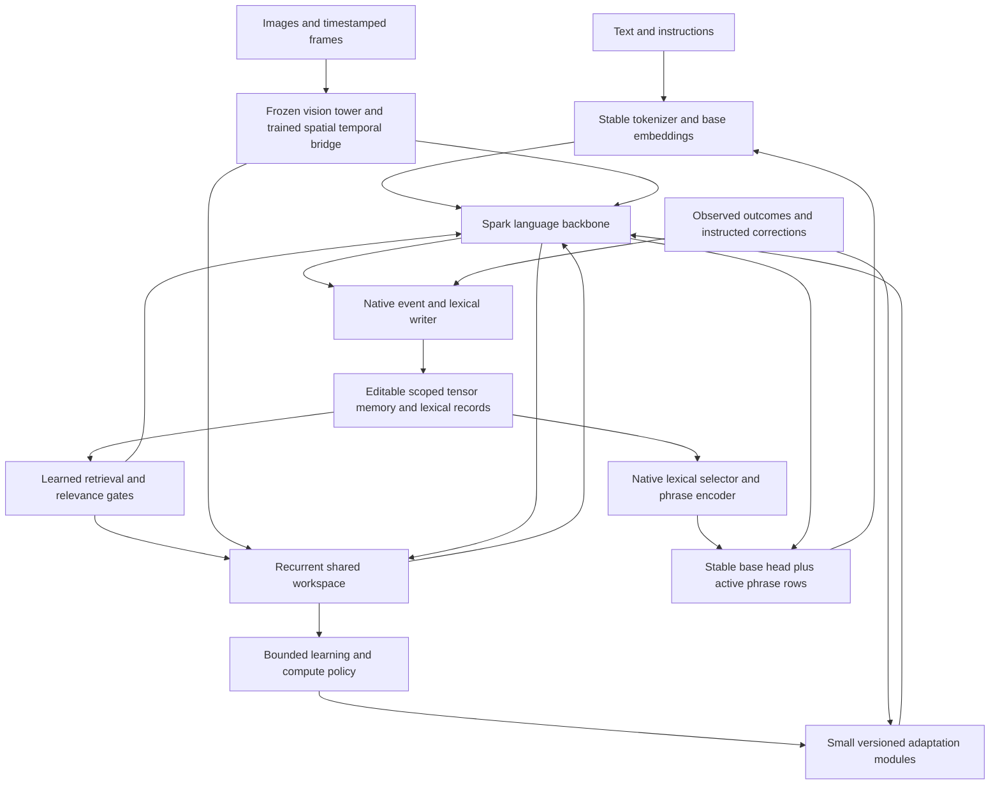

# SparkX 2.6 4B: consolidated native architecture and MiniCPM5 validation plan

**Revision 2 · 25 October 2026 · Research and implementation proposal; no training run authorized or performed by this review.**

This is the canonical architecture and validation plan. It consolidates the earlier [Spark study](../research/sparkx_2_6_4b_20261024/README.md), [Dynamic Engram study](../research/dynamic_engram_20261025/README.md) and [vocabulary/LoRA study](../research/vocabulary_lora_20261025/README.md). Those packages remain supporting research and historical snapshots. Where recommendations differ, this document takes precedence; existing execution protocols still govern actual runs until explicitly replaced.

The companion [machine-readable plan](../../configs/sparkx_2_6_4b_consolidated_plan_v2.json), [evidence manifest](../../reports/sparkx_2_6_consolidation_20261025/evidence.json), [repository snapshot](../../reports/sparkx_2_6_consolidation_20261025/repository_snapshot.json), [cost model](../../reports/sparkx_2_6_consolidation_20261025/analytical_costs.json) and [artifact validation](../../reports/sparkx_2_6_consolidation_20261025/validation.json) make assumptions and decisions inspectable. They are supporting records for this one plan, not separate architecture proposals.

## 1. Decision and scope

Build a pretrained Spark backbone with small native readers, writers and adaptation modules. Start with **an editable tensor memory bank, a bounded swappable phrase vocabulary and a small verified-update adapter**. Validate their individual and joint utility on MiniCPM5 before adding nonlinear fast weights, a learned learning controller or recursive improvement.

The user-confirmed parameter boundary is **4B for the language backbone**, with vision, memory and inter-layer components additional. “HOPS” means **HOPE / Nested Learning**. The personality description is pending; this plan reserves a versioned interface and makes no assumption about its contents.

The intended deployed model performs semantic selection itself: what to retain, which memory to read, which lexical entries to activate, what to learn from feedback and when to stop recurrent reasoning. A runtime still supplies observations, executes tensor kernels, enforces resource limits and saves state. These necessary mechanics do not make the model an external agent harness. A host-generated fact list, oracle-selected answer record or external LLM-written lesson must remain a labelled diagnostic or training aid, rather than silently becoming the deployed reasoning mechanism.

Distinguish four achievements:

| Achievement | Required evidence |
|---|---|
| Remembering | New information remains usable after the source leaves the context |
| Lexical adaptation | A new expression can be encoded/emitted atomically, evicted and reactivated without identity corruption |
| Learning | Updates improve answers on new applications of a taught rule, beyond recalling its demonstrations |
| Improving learning | An updated learning policy learns future tasks better than a frozen policy under the same observations and resource budget |

The first three are staged component gates; only after individual utility passes may they form the initial joint experiment. The fourth is a later research claim. None follows from a growing state file or a successful checkpoint reload alone.

## 2. What is established, and what remains a hypothesis

Evidence labels used below are **published** (author-reported, not reproduced), **source-inspected** (implementation read, not executed), **local measured** (preserved repository result) and **proposed** (our design). Source versions and reading scope are pinned in the manifest. The search was refreshed on 25 October 2026; it is targeted, not an exhaustive literature survey.

| Primary evidence | What it supports | Boundary for this project |
|---|---|---|
| [MemT-1.0 v2](https://arxiv.org/html/2610.26825v2), §§2–4, 6–8 | Native memory attention, per-trajectory state and trained storage/read procedures; 34B-token training program | Its Nano model is about 36B total/3B active. Persistent-state adaptation does not demonstrate lifelong permanent-weight consolidation. Its agent experiment also uses retrieved experience. It is architectural evidence, not a cheap 2B/4B reproduction |
| [Engram v2](https://arxiv.org/html/2601.07372v2), §§2, 4, 6 | Hashed n-gram parameter tables, contextual gating and sparse access | Static learned pattern capacity is different from an editable episodic bank. Large-scale pretraining and H800 offload results do not predict single-stream MPS performance |
| [Titans v1](https://arxiv.org/html/2501.00663v1), §§3–4 | Associative inner loss, momentum/forgetting and outer training of useful memory representations | A small residual retrofit must be trained and compared with simpler recurrence; “surprise” has a specified gradient-based meaning |
| [Nested Learning / HOPE v1](https://arxiv.org/html/2512.24695v1), §§7–9 | Multiple optimization levels, context flows and self-referential adaptive modules | Multiple timers alone are not HOPE. The pretrained-model experiment includes 15B continued-pretraining tokens; our staged pilot is explicitly HOPE-inspired |
| [Generation with Dynamic Vocabulary](https://arxiv.org/html/2410.08481v1), §2 and appendix D | A trained phrase encoder supplies input/output rows and atomic phrase feedback; candidates can be added | It does not establish safe recycled slot identities, restart semantics or native episodic selection |
| [DVAGen](https://arxiv.org/html/2510.17115v1), §3 | Modern-model integration, phrase encoding, mixed token/phrase generation and candidate masks | Its evaluated phrase encoder is Qwen3-0.6B. Our approximately 3M-parameter encoder is an unproven efficiency hypothesis; external retrieval is not our intended deployment |
| [Retrofitting LLMs with Dynamic Tokenization](https://aclanthology.org/2025.acl-long.1444/) | Hypernetwork-based vocabulary changes and input compression | Its expanded-output degradation is a warning about output calibration, not a proof that trained atomic generation cannot work |
| [Self-Adapting Language Models / SEAL v2](https://arxiv.org/html/2506.10943v2), §3 and limitations | Learning which self-edits help after adaptation and evaluation | Nested adaptation is costly; self-generated training text is not independent truth. Our compact native policy is a proposed distillation target |
| [SigLIP 2](https://arxiv.org/html/2502.14786v1), §2 | Pretrained visual features, localization and dense-feature improvements | A vision tower plus an untrained projector does not establish language grounding or temporal reasoning |
| [V-JEPA 2.1](https://arxiv.org/html/2603.14482v1), §§2.3, 3 | Dense spatial/temporal self-supervision and intermediate-level targets | Useful candidate teacher for a later predictive branch; not a required second resident tower or a ready language world model |
| [Learning Rate Matters](https://arxiv.org/html/2602.04998v2), §3 | Fairly tuned vanilla LoRA remains competitive with several studied variants | Use tuned LoRA as a mandatory baseline; the study does not rank every new PEFT method on continual learning |
| [LoRA-FA v3](https://arxiv.org/html/2308.03303v3), §5 and appendix B | Frozen A with the specified optimizer correction reduces adaptation activation needs | Simply freezing A is not a faithful implementation; upstream trainable modules can still require backbone backward activations |
| [CARE-LoRA](https://arxiv.org/html/2607.11940v1), §III; [MatryoshkaLoRA](https://arxiv.org/html/2605.07850v1), §2 | Activation reconstruction; separately, adapters trained for usable sub-ranks | Optional comparisons after baseline success. CARE approximates the A gradient; Matryoshka rank truncation requires its training method |

**New implementation finding.** The [pinned DVAGen implementation](https://github.com/AntNLP/DVAGen/blob/b29b40d7336bb15564253132f1092915a89102bf/src/dvagen/models/modeling_dva.py) clones the static input and output tables into separate `nn.Parameter`s, concatenates them with dynamic rows and computes an explicit extended output projection. Its [FREEZE training branch](https://github.com/AntNLP/DVAGen/blob/b29b40d7336bb15564253132f1092915a89102bf/src/dvagen/train/train.py) freezes `language_model.parameters()`; those separately cloned tables are outside that loop. This source inspection is not an execution test. It means we should reproduce the useful mechanism, not assume importing the package provides our intended frozen-table memory budget. Its example also selects CUDA and a large phrase encoder. Our implementation must share immutable base tables and explicitly audit every trainable tensor.

The official [MemT inference source](https://github.com/MemTensor/MemT-1.0/tree/e75c13d090a6a9d34b29146d901bd84323185f24/inference) and [Engram demonstration](https://github.com/deepseek-ai/Engram/blob/fb7f84a21f91223715394a33a1dc24bbfb7f788e/engram_demo_v1.py) are implementation references. They are not qualified MPS dependencies. MemT original inference code declares PolyForm Noncommercial terms; reuse needs to respect the relevant file licences. This plan does not vendor upstream code.

The **combined native memory + recycled vocabulary + continual parameter adaptation + visual workspace** remains a research hypothesis. The evidence justifies the experiments, not a conclusion that the combination already works.

## 3. Repository starting point

The audit originally started at commit `81c96f8453ad4f796ae084adfe10ffbd0e1e1e11`, with concurrent vision and diagnostic drafts recorded separately. This revision is reconciled through `4f6fb4c` and its subsequent verification repairs; preserved experiment reports remain historical evidence, not rerun claims by this proposal.

| Component | Current evidence | Consequence |
|---|---|---|
| MiniCPM5 baseline | Pinned `openbmb/MiniCPM5-2B`, revision `f97400052a43d642bbc6e9975e2397e3ae6a6b52`; 42 layers, width 2048, vocabulary 130560, untied input/output tables; 2,516,756,480 parameters | Use actual geometry and measured allocation, not the rounded “2B” label |
| Memory reliability | [v5 verdict](../../reports/memory_reliability_v5_scorer_fix_eval02/verdict_final.json) rejects the candidate. Fast and disabled conditions both score 56/192; new facts 0/64, corrections 0/16 and unaffected facts 0/48 | Diagnose storage, binding, selection and readout separately before expanding state |
| Exact reference | Same evaluation: selective context 184/192, full context 176/192; the complete reference gate still rejects | Useful positive diagnostic, not an accepted native memory solution |
| Memory integrity | [Repair qualification](../../reports/memory_contract_repairs_20261025/qualification.json) records repaired scope, ordering and representation/reload contracts | Reuse these interfaces; do not equate software repair with learned recall |
| Vision V0 | [Accepted score](../../reports/vision_v0_20261025/accepted_score_report.json) and [qualification](../../reports/vision_v0_20261025/qualification.json): interface-only acceptance, zero optimizer updates, no perception-quality pass | Proceed to alignment and grounding experiments. Logit differences and gradient ownership are necessary, insufficient evidence |
| Vision resources | V0 uses frozen SigLIP2-base-patch16-224, 92,884,224 encoder parameters; 5,772,800 projector parameters. Sampled driver peak 11,815,763,968 bytes, no CPU fallback | This is one bounded interface run, not the memory requirement of joint training |
| Semi-cognitive core | [Core](../../src/replica_lab/architecture/core.py): eight width-256 slots, tied recurrence, typed sense/memory/task inputs; [heads](../../src/replica_lab/architecture/heads.py) detach core features | Existing heads do not train better core representations. Add a distinct learning path and measure its benefit |
| Procedural RSI draft | [Draft module](../../src/replica_lab/runtime/bounded_rsi.py) explicitly describes host-owned procedure plumbing, not integrated or neural RSI | Keep it as infrastructure evidence; do not use its acceptance as model self-improvement evidence |
| Spark | [Source preparation](../../reports/spark_preparation_20261025/run_01/preparation_manifest.json) is metadata/header inspection only, status `preparation_only_unqualified` | Native execution, precision, output-head integration and gradients still require qualification |

Evidence reconciliation through `4f6fb4c`: both projector-only V1 arms are rejected. The 2048-wide arm scores 18/64 correct-image; the 4096-wide arm scores 21/64 versus 22/64 with no image. Its 128 updates, six-tensor lineage and zero-update fresh-process bitwise reload pass engineering, but not learned quality. The wide tiny-overfit arm fits 8/8 training worlds and 0/8 fresh dev worlds; the old frozen-feature verdict replays as `inconclusive_visual_contribution`. See [wide V1 results](../experiments/20261025_MiniCPM5_Vision_V1_Wide_Results.md) and the [conservative diagnostic replay](../../reports/vision_diagnostic_20261025/conservative_replay.json). These results defer the full memory/vocabulary/learning factorial until individual components demonstrate utility; they do not authorize V2, LoRA, learned visual memory or integrated RSI.

## 4. Target architecture



The optional static Engram and fast-weight branches attach through the same residual interface. They are not prerequisites for the initial three-way experiment.

### 4.1 Preserve the backbone and add bounded residual paths

Spark has 36 layers, width 2560, MLP width 10240, 16 query heads, four KV heads and head dimension 256. Its pattern is three sliding-attention blocks followed by one full-attention block; the sliding window is 512. Its 131072-row input/output table is tied. The inspected BF16 model has **4,112,079,360 unique parameters**. Sources: [pinned configuration](https://huggingface.co/XHToken/Spark-X2.6-4B/blob/66e3ae7bee54e0a523d692cb8ef841f35409807b/config.json) and the local source/header audit above.

Preserve attention, normalization, RoPE, MLPs and residual ordering. Introduce zero-output-initialized memory/workspace residuals at zero-based layers **11 and 23**; MiniCPM uses the existing **13 and 27** ports. Layer placement is a starting hypothesis, not a published optimum. Compare an early static-pattern port separately. Expand depth only after attributing gains to the existing ports.

Use `h' = h + g_m R_m(h, M) + g_c R_c(h, C) + g_f R_f(h, F)`, with each branch independently disableable. An explicit disabled branch must recover the unmodified computation; sigmoid gates alone are never exactly zero. Prevent a zero-initialized gate and zero-initialized output matrix from simultaneously blocking all learning. Audit first-step gradients and subsequent update ownership.

The Spark tied output path directly calls `F.linear(hidden_states, self.model.embedding.weight)` in the [inspected implementation](../../reports/spark_preparation_20261025/run_01/assets/official_bf16_control/modeling_spark.py). Replacing `lm_head.forward` alone would miss that path. MiniCPM and Spark require separate adapters against their actual executed embedding/head paths.

### 4.2 Dynamic Engram: editable information with learned access

“Dynamic Engram” is our project name for the following combination, not a claim that published Engram already supplies an episodic writer:

| Path | Stored object | Update mode | Initial disposition |
|---|---|---|---|
| Editable episodic bank | Keys, compact values, typed event/concept links and exact lexical surfaces | Learned writes/corrections at observation boundaries | Required pilot |
| Static pattern memory | Trained n-gram embeddings | Offline training or validated consolidation | Existing comparator; enlarge only after direct utility |
| Fast associative memory | Small recurrent matrices or fast MLP weights | Causal, bounded per-segment update | Linear control first; nonlinear Titans-style branch later |
| Skill adaptation | A small versioned LoRA or extension update | Verified feedback plus replay | Required learning factor, initially conventional optimizer |

Use a **1,024-entry bank on the main MiniCPM pilot**, 128 entries for smoke tests and a 4,096-entry Spark target. Start with key width 128 and value width 256. These are bounded capacities, not guarantees of indefinite retention. Persistent spellings, evidence records, replay and revision history also need byte limits and declared eviction rules.

A native writer emits candidate spans, event representations, identity links, confidence and write/replace scores from observed hidden states. A learned query encoder scores bank keys, then reads a small top-k set with an explicit null route. At these sizes, dense key scoring is a reasonable baseline; sparse reads do not make the full search constant-time. Pretrain reader/writer utility on disjoint episodes with supervised identity/correction targets and downstream answer loss. Use soft reads or supervised routing during initial learning; hard top-k gradients alone do not train an unselected record.

Train the write-to-use path explicitly: observation → commit → source-context removal → later query. Initially unroll one to four segments so a future-query loss can reach the writer through its produced values, with a declared truncated-gradient boundary. Detach between independent worlds; do not detach the only intended learning path and expect answer loss to train storage. At evaluation, allow gradients only for the declared L update events. Invalidate or rebuild cached representations after relevant parameter changes.

Store a stable `record_uid`, scope, source reference, observation order, event time, validity interval and revision separately from mutable physical row position. Corrections supersede relevant claims and retain provenance. Time of observation is not automatically the time an event happened; temporal updates must not become “last string wins.” A self-generated guess is a hypothesis until verified, not a trusted memory fact.

Native selection may read exact stored spelling bytes after choosing a lexical record. This is compatible with a model-native mechanism: the model selects the record, while a mechanical decoder emits its surface. A host selecting the correct record would invalidate that claim. Raw surface payload is counted as storage, not hidden in the tensor-only capacity estimate.

### 4.3 Swappable vocabulary is a view of memory, not the memory itself

Keep permanent base token IDs immutable. Add **K=256 active phrase slots**, studying 32 for smoke tests and 512/1024 only after success. A reusable slot references a persistent lexical identity; reassigning slot 17 must not overwrite what the old expression means.

The identity chain is:

```text
(stream_id, slot_index, slot_generation)
  -> (lexeme_uid, surface_revision, encoder_revision, lexical_state_revision)
  -> exact UTF-8 surface + base-token decomposition + optional concept/event links
```

Separate a spelling from its senses. Contextual concept links resolve ambiguity; avoid duplicate active rows with identical emitted bytes in the first implementation. Unicode normalization, leading spaces, punctuation and token-boundary behavior are explicit, versioned policies. Keep an exact-byte path so normalization cannot silently change identifiers.

Use a shared small phrase encoder over frozen base-token embeddings, with a proposed width 256, two Transformer blocks and an up-projection. Generated dynamic rows are initially shared between input and output, including on MiniCPM with its untied base tables. Train this choice and compare separate small input/output projections if necessary. No new full-size embedding table is allocated. Optional conditioning on a persistent lexical value is a later ablation, not required to encode the spelling.

Compute base logits and dynamic logits separately. Compare concatenated-softmax scoring with a learned mixture `p(base)=(1−a) softmax(z_base)`, `p(phrase)=a softmax(z_phrase)`. Set `a=0` exactly when disabled or no valid phrases exist. Learn candidate-count calibration and hard negative discrimination; adding many plausible phrases changes competition. The base fallback always remains available. Do not prune the base head in the initial experiment.

Training must include mixed base/phrase sequences, unseen phrase compositions, random slot permutations, negative phrases, empty candidate sets and base-only replay. Gold answers may provide loss labels but cannot select inference candidates. The phrase encoder learns offline; online learning initially changes a small skill adapter and memory state, avoiding simultaneous uncontrolled drift of every representation.

**Two different feedback modes must be measured.** In copy mode, emitting a phrase feeds all its constituent base tokens back through the backbone. In atomic mode, a phrase occupies one model position and its generated vector is the next input. Only the latter saves those backbone decode steps. It changes the model's computation and effective positional/context scale, so it needs training. Keep byte spans and video timestamps separate from model positions. Do not describe atomic and base-token replay as numerically equivalent.

**Swap progression.** First fix the active mapping for an entire generation. Later allow refresh only at declared segment boundaries, with at most 16 newly encoded phrases per refresh. Pin entries still referenced by pending next inputs, beams or backward/recomputation graphs. If all slots are pinned, use the base fallback. During training, recompute encoder graphs or retain the correct graph; a detached inference row cache cannot silently replace trainable encoder outputs. Optimizer state belongs to persistent parameters or lexical identities, never an anonymous recycled slot.

**Cache and restart.** Changing future output candidates alone need not invalidate valid prefix KV. Changing already-realized input vectors, positions, adapters or prefix memory conditioning does. Persist either compatible KV with exact atomic-prefix identities or enough immutable data to rebuild the same atomic inputs and states. Retokenizing saved text with the base tokenizer is a useful alternative execution, not exact restart parity. Reject incompatible representation versions rather than silently rebinding IDs.

Use these same contracts for repetition penalties, stop matching, batching and any later beam/speculative generation. Initially qualify greedy, batch-one generation only. Exclude phrases crossing role, control-token or stop boundaries. Unknown/inactive lexical entries remain expressible through ordinary base tokens.

### 4.4 Learning at explicit timescales

| Timescale | State/parameters | Learning signal | Ownership and cost |
|---|---|---|---|
| Token/segment | KV, workspace and optional fast state | Causal observations; associative prediction | Small bounded state; no global model optimizer |
| Observation/turn | Episodic records and lexical state | Observed evidence, instructed correction, relevance | Native writer; fixed-capacity storage |
| Verified learning episode | Small adapter and selected extension parameters | Demonstrations, independent outcomes and replay | Explicit optimizer steps, saved optimizer identity and rollback |
| Consolidation window | Durable skills, reader/writer or encoder revisions | Replayed evidence and held-out retention | Offline bounded job; representation migration required |
| Meta-training | Learning-policy parameters | Future-task gain after adaptation, less resource cost | Later research stage; separate policy-update evidence |

The initial learning objective combines response loss on verified demonstrations, disjoint replay loss and a calibrated retention/distillation term. Phrase training adds mixed-sequence loss and relevant negative candidates; memory training adds record selection, correction and future-answer losses. Vision adds grounded language and temporal targets. Tune weights on development worlds; a single weighted average must not hide a failed correction or retention gate.

For a simple fast-memory control, one may use a normalized linear delta update `F_next = λF + η(v − Fk)kᵀ`, with bounded learned scalars and an outer future-query loss. This is a **linear control**, not the full symmetric SGDN-2 rule or Titans. The existing SGDN-2 path must be identified by its actual implementation. A nonlinear branch gets an explicit associative loss, momentum state, forgetting rule and truncated credit horizon; compare equal state, data and measured compute. Never silently average state proposals and call that an aggregated-gradient optimizer.

Updates use only observations available at that time. Evaluate adaptation on later queries before their answers are exposed. Keep a copied pre-update state for paired counterfactual evaluation; the test verifier cannot become training feedback. An explicit user instruction can authorize learning a supplied fact or rule, but uncertainty about the content must remain represented.

### 4.5 Vision, workspace and functional appraisal

Reuse the already-qualified SigLIP2-base source and existing visual contracts before introducing a different tower. Train the projector with the tower and language base frozen. Preserve region coordinates, crop-to-image transforms, frame indices and timestamps through the bridge; a global pooled vector is insufficient for the intended reasoning tasks.

The initial vision control retains all 196 image patches. After grounding works, compare a learned 64-token resampler and a coarse-to-fine crop budget. For video, begin with four timestamped frames and a compact temporal module; examine 32/64 retained tokens per frame after the uncompressed control. Count image encoding, crops and temporal modules in latency. Frame shuffling, time reversal and object-identity swaps are required counterfactuals.

Train region-to-name grounding, spatial relations, entity tracking under occlusion, event order, state changes and cross-frame question answering. Write object/event records into the same memory bank used by text. Link a taught name to a visually grounded identity, then test its use after both visual context removal and vocabulary eviction. A visual object ID, a lexical identity and a model token position are three different things.

An optional predictive branch learns future visual latents or relation changes from observed sequences. A frozen teacher can supply training targets; it need not be resident at deployment. Prediction error can guide attention or learning priority, but does not prove causal understanding. Require held-out interventions and alternative explanations before claiming causal reasoning.

Keep the current eight-slot width-256 workspace as the initial semi-cognitive core, with zero/one/two recurrence controls and a parameter-matched feed-forward control. Give it structured region/event tokens, memory candidates and task features rather than only a mean-pooled sense vector. Train a separate end-to-end objective through the core while retaining detached audit heads where their role requires it. Existing host-computed journal features are instrumentation; they cannot carry hidden answers in a native-capability evaluation.

Functional appraisal may represent novelty, uncertainty, goal progress, conflict and urgency. It can modulate bounded write priority, replay selection or recurrence. It must not turn emotional salience into factual confidence. Compare no-appraisal, fixed-signal and learned-appraisal controls under identical compute. [Backpropamine](https://arxiv.org/html/2002.10585v1) provides a mechanism precedent for learned plasticity modulation; [computational appraisal research](https://arxiv.org/html/2309.06367v2) provides a formal connection to reinforcement learning. Neither establishes feelings or consciousness in this model. The personality file will later define desired behavioral constraints and stability tests through a separate versioned conditioning interface.

### 4.6 LoRA and precision choices

Start with rank-8 ordinary LoRA on the two selected MLP down projections, testing rank 16 only when rank 8 underfits. Tune learning rate independently per method with an equal development budget; the initial grid is `1e-5, 1e-4, 5e-4`, not a recommended online default. Freeze all base embeddings/head weights and enumerate trainable parameters before allocating optimizer state.

If this narrow adapter is inadequate, compare additional projections under a **parameter budget**, then a wall-time budget. MiniCPM uses separate q/k/v/o projections; Spark uses fused `q_k_v_proj` and a 4096→2560 `out_proj`. A rank budget alone is not a parameter budget across unequal widths.

LoRA-FA is the first efficiency alternative, including its optimizer correction. CARE is a later activation-memory comparison; its reconstruction matrices may cost more on very short microbatches. MatryoshkaLoRA is useful if a trained adapter must support several deployment ranks. EVA, PiSSA, DoRA, LoRA+ and rsLoRA remain candidates from the supporting review, not cumulative additions. Generated adapters from [Doc-to-LoRA](https://arxiv.org/html/2602.15902v1) or [Text-to-LoRA](https://arxiv.org/html/2506.06105v1) are later alternatives requiring meta-training and interference controls. Do not add a large generator merely to avoid a few cheap local optimizer steps.

Keep the current qualified MiniCPM precision as the control. Spark BF16 and official FP8 are separate source qualifications. The official FP8 checkpoint uses compressed-tensors F8_E4M3 weights/dynamic activation machinery, not NF4 QLoRA. Dequantizing it does not recreate the independent BF16 checkpoint. No FP8/MPS training claim is made here. Sparse state, optimizer-state compression and low-bit base storage require separate numerical and performance validation.

## 5. Concrete MiniCPM5 experiment

### 5.1 Hypotheses and controlled factors

The main experiment has three factors: **M** = learned episodic read/write bank, **V** = trained atomic swappable vocabulary, **L** = verified online adapter updates. All arms use the same base checkpoint, offline-trained extension initialization, observation stream, decoding settings and evaluation queries. Initially freeze the core policy and phrase encoder during online adaptation.

| Arm | M | V | L | Main purpose |
|---|---|---|---|---|
| 000 | off | off | off | Base-only persistent-state control |
| 100 | on | off | off | Memory utility with ordinary tokens |
| 010 | off | on | off | Lexical mechanism without semantic memory |
| 001 | off | off | on | Parameter learning without memory/vocab assistance |
| 110 | on | on | off | Memory plus phrase handling |
| 101 | on | off | on | Memory plus learned adaptation |
| 011 | off | on | on | Phrase handling plus learned adaptation |
| 111 | on | on | on | Complete initial system |

**Prevent an information confound.** Every arm may access the same bounded lexical surface catalog containing only encountered spellings and mechanically necessary IDs. It contains no answer labels, semantic attributes, selected evidence or privileged future phrases. In M-off arms, catalog keys derive only from spelling and dynamic rows cannot use contextual semantic values. M controls the semantic values/links/readout, not whether a string exists. V controls atomic encoding/output, not whether an answer string is available at all. Candidate selection uses causal model representations. Report catalog coverage and native selector recall separately. A secondary information-matched test supplies identical non-oracle candidate lists to isolate representation costs; it is not the native-selector result.

Use two analyses: interventions on the same trained system to establish component dependence, then independently trained key baselines with matched offline data/tuning budgets to check fairness. Disabling a jointly trained pathway can create distribution shift; intervention results alone do not prove that architecture is better than an independently trained alternative.

Required additional controls are empty/shuffled/stale/wrong-scope memory, fixed-slot vs swapped-slot vocab, phrase copy with base-token feedback, no-update/fake-update learning, exact-record and full-context diagnostic ceilings, and correct/wrong/no-image inputs at the visual stage. Any oracle-assisted writer/reader remains clearly marked and excluded from native acceptance.

### 5.2 Data and chronology

Generate owned, independently seeded worlds with random names, bindings, corrections and compositional rules. Separate training, tuning and final worlds by generator family as well as seed, vocabulary, templates and rule composition. Render equivalent facts in multiple forms. Give verifiers structured world truth; give the model only the allowed observations. Filenames, row order, timestamps, task features and candidate order must not encode answers.

A main long-horizon episode follows this sequence:

1. **Pretest:** evaluate base facts, unknown cases and a task-specific baseline before teaching.
2. **Observe:** teach nonce entities, exact identifiers and a verified rule through text; later visual episodes use images/frames with the same evidence boundary.
3. **Commit and remove context:** commit memory through the native writer, clear source text and its KV, then ask paraphrased delayed questions. Preserve only declared persistent state.
4. **Churn vocabulary:** expose at least `2K+32` distinct lexical entries—544 at K=256—within the 1,024-entry semantic capacity. Evict/reassign the target's active slot, then require reactivation. This isolates vocabulary churn from semantic-bank overflow.
5. **Correct:** change selected facts with explicit provenance; ask both revised and unaffected facts, including historical-time questions.
6. **Learn a rule:** provide verified demonstrations and at most four online optimizer steps per teaching event, batch one, at most 256 positions per training microbatch including replay. Use the same supervised material and update cap in every L-on arm.
7. **Transfer:** query new entities, combinations and rule inputs; no exact training answer may occur in memory, candidates or replay. Test direct recall separately from this transfer score.
8. **Retain and restart:** interleave unrelated learning, query old tasks after declared 1/10/100-event delays, save, restart in a fresh process and repeat with identical versions and zero extra updates.

For a deterministic rule family, teach a nonce operation such as `dax(x)=3x+2` through a few permitted demonstrations and explicit instruction, then evaluate unseen inputs and compositions. Randomize rules between worlds and include verification failures. Also run a parameter-only transfer probe: clear semantic memory and source context, retain the adapter, and compare against its frozen pre-update version. This distinguishes parameter learning from retrieving a rule and applying existing reasoning. This is a controlled transfer diagnostic, not proof of general mathematical self-improvement. Add a small independently verified programming/transformation task family before broader claims.

Run a separate `>N` semantic-bank overflow test. It measures eviction and graceful forgetting, not perfect retention beyond capacity. Likewise test ambiguity, contradictory sources, rejected feedback, empty banks, multilingual/Unicode spellings, all-slots-pinned fallback and interleaved session isolation.

### 5.3 Stage order and dependencies

| Stage | Work | Exit evidence |
|---|---|---|
| P0 — contracts and audit | Pin source/tokenizer/precision; define new state schema; baseline parity; instrument trainable tensors, gradients and memory | Integrity suite and native resource smoke pass; all result classes separated |
| P1 — memory diagnosis and repair | Oracle writer + native reader, native writer + oracle read, both native; exact-record controls | Native recall and correction beat empty/shuffled controls; no source answer injection |
| P2 — phrase learning | Train small encoder and output calibration; fixed mapping before swaps; random slot permutation | Atomic feedback preserves task quality; no stale identity or wrong-scope output |
| P3 — verified learning | Tune small LoRA vs FA; retention replay; freeze representation versions within an episode | Held-out rule transfer beats no-update/fake-update with bounded forgetting |
| P4 — joint M×V×L | Run eight-arm screen, then paired confirmation; churn, corrections, delays, restart and costs | Joint acceptance gates below; explain failures by component |
| P5 — vision and workspace | Finish V1 alignment/grounding; spatial and temporal controls; visual naming through the same M/V/L path | New visual evidence changes correct reasoning; grounded identity survives swaps and learning |
| P6 — fast memory and multi-rate learning | Linear/SGDN-2 vs small nonlinear memory; static-pattern control; matched-rate schedules | Incremental benefit under equal data, state and measured cost |
| P7 — native learning policy | Train/update compact policy; compare frozen policy; appraisal ablation | Better future-task learning after policy updates, independent of larger knowledge/state budgets |
| P8 — Spark qualification and transfer | Port interfaces, retrain dimension-specific modules, repeat native and quality gates | Spark-specific verified results, including actual output-head and precision paths |

P0 is required for all execution. P2 and P3 can be developed independently after P0, but P4 requires P1–P3. Vision preparation can proceed independently, but joint visual learning requires P4 and a perception-quality pass. P6/P7 are optional research expansions; they must not delay a useful simpler P4/P5 system. P8 first ports the accepted simpler architecture, and only later optional branches that earned their cost.

### 5.4 Sample sizes, statistics and decision gates

These are **proposed engineering targets**, not published results or guaranteed achievable thresholds. Freeze them with the dataset/protocol before final evaluation. Development failures should refine the model, not silently loosen the final gate.

The resource screen uses two training seeds and 32 independent worlds per seed per factorial arm. Limit normal worlds to 128 events; run at least eight dedicated long-churn worlds per seed with `2K+32` lexical introductions. This screen estimates variance, feasibility and useful effect sizes; it does not establish a 2-point non-inferiority claim. Limit the first offline fit to 2M base-token-equivalent exposures and the screen to four device-hours per arm, reporting actual exposures, atomic positions and wall time. If a budget expires, record an incomplete result rather than a quality failure or success. Expand only through a revised budget declaration.

Confirmation begins with three independent training seeds and 128 fresh worlds per seed for the retained principal comparisons. Determine any larger sample from a development-only power simulation, with a predeclared maximum of 1,024 worlds per seed; freeze the final sample size before viewing final labels. If the budget cannot resolve the interval, the outcome is **inconclusive**. Bootstrap paired differences by whole world and training seed, not by correlated questions; also report each seed and task family. Use simultaneous intervals or Holm adjustment across the predeclared primary superiority contrasts. Never repeatedly sample final data until a threshold passes.

| Gate | Proposed requirement |
|---|---|
| G0: mechanics | Zero stale-slot, wrong-scope, incompatible-reload, future-candidate or unauthorized-parameter updates in the adversarial contract suite. Finite outputs and correct disabled-branch parity within declared numerical tolerance |
| G1: native memory | Point accuracy ≥90% on delayed facts and corrections separately; paired 95% lower confidence bound above empty and shuffled memory controls. Demonstrate native writer and reader ownership |
| G2: lexical reliability | Zero surface/identity mismatches in the contract suite; task-quality difference against ordinary-token control has 95% lower bound ≥−2 percentage points. Correct behavior under eviction/reactivation and permutation |
| G3: learning | New-rule transfer improves by at least 5 points in the point estimate and the adjusted paired 95% lower bound is >0 versus both no-update and fake-update controls; demonstration recall alone is insufficient |
| G4: retention | For unaffected facts and general regression tasks separately, 95% lower bound of quality change ≥−2 points. Report correction-induced errors and old-task forgetting separately |
| G5: joint utility | Arm 111 passes G1–G4; removing M harms delayed recall and removing L harms new-rule transfer with adjusted lower bounds >0. Removing V demonstrates its intended efficiency benefit while quality remains non-inferior. A positive three-way statistical interaction is reported if present, not required |
| G6: cost | On prespecified phrase-heavy workloads, V reduces end-to-end latency per correct task by ≥10% in point estimate with paired confidence supporting improvement; on general text, warm p95 latency increase ≤10%. Full accounting includes selection, encoding, writes, updates and replay |
| G7: grounded vision | Correct-image/frame condition beats wrong/no-image; ≥5-point point gain and adjusted lower bound >0 on both spatial and temporal held-out families. Visual naming survives V churn and M correction; text/general retention passes G4 |
| G8: improved learning policy | Under equal observations, initial knowledge, update count and resource caps, updated policy improves future-task learning versus frozen policy by ≥5 points with adjusted lower bound >0, after retention checks. This is bounded meta-learning evidence, not open-ended RSI |

Report all denominator counts and uncertainty. Zero observed contract violations is a finite-suite finding, not proof that faults are impossible. At three seeds, seed-level uncertainty can remain large; publish it rather than treating hundreds of within-seed queries as independent training replications.

For memory and vocabulary compare exact decoded bytes, semantic correctness and justified abstention. Report candidate recall@K, correct-record selection, read usefulness, write/overwrite rates, cross-scope leakage, phrase utilization and churn recovery. For learning report pre/post transfer, learning curves, samples-to-criterion, cumulative update time and backward transfer. For vision include grounding/association accuracy and counterfactual sensitivity; logit movement alone does not pass.

Do not compare perplexity per token across different token units. Report content quality and byte-normalized canonical-path loss, clearly labelled as such; this is not the fully marginalized probability of a string with multiple segmentations. Measure both cold and warm timings, fixed-length controlled decode and equal-answer task latency, bytes per second, energy if available, and separate teacher/training costs. Include failed and abstained tasks when computing cost per correct task.

### 5.5 Broader validation after the owned diagnostic

Use [LongMemEval](https://arxiv.org/abs/2410.10813) for conversation-memory transfer, [CLEVR](https://arxiv.org/abs/1612.06890) for controlled visual composition, and the [Perception Test](https://arxiv.org/abs/2305.13786) for real-video tasks. Verify exact dataset versions, access terms, splits and evaluator behavior before use; these sources were checked for benchmark scope, not locally reproduced. Select video-only tasks unless audio is actually implemented. The authors now also provide [LongMemEval-V2](https://xiaowu0162.github.io/longmemeval-v2/); inspect its interaction/cost requirements before making it an additional target. Do not silently replace one benchmark version with another.

Existing synthetic datasets and public benchmark items may have been seen during earlier development or pretraining. Preserve an untouched project-specific holdout and disclose exposure. Exact owned-world verifiers are the primary acceptance mechanism; separately report benchmark-native scoring and a small blinded human audit for open answers. An external LLM judge may be a secondary sensitivity analysis, not the sole source of truth.

## 6. Cost model and resource policy

All numbers below are analytical payload estimates unless explicitly identified as V0 measurements. The reproducible calculator lists formulas and exclusions. BF16 estimates describe storage possibilities, not a claim that the current MPS path has been qualified in that dtype.

| Item | MiniCPM5 | SparkX 2.6 |
|---|---:|---:|
| Unique base parameters | 2,516,756,480 | 4,112,079,360 |
| Base BF16 / FP32 payload | 4.688 / 9.376 GiB | 7.659 / 15.319 GiB |
| 256 active dynamic rows, one shared input/output bank, BF16 | 1.00 MiB | 1.25 MiB |
| Double-buffered rows, BF16 | 2.00 MiB | 2.50 MiB |
| Small phrase encoder matrix parameters | 2,621,440 | 2,883,584 |
| Phrase encoder FP32 weight + gradient + two Adam moments | 40 MiB | 44 MiB |
| Two down-projection rank-8 adapters | 131,072 parameters | 204,800 parameters |
| Their FP32 weight + gradient + two Adam moments | 2.00 MiB | 3.125 MiB |
| Episodic keys/values, BF16, excluding metadata | 0.75 MiB at 1,024 entries | 3.00 MiB at 4,096 entries |

A 256-row dynamic head adds approximately 0.196%/0.195% to the respective **output projection arithmetic**, not to total latency. It does not eliminate the full base head. For Spark, encoding 256 fresh eight-token phrases with the proposed tiny encoder costs about 4.75B matrix MACs before norms and scheduling. Refresh only useful entries, amortize them and measure break-even. Count each distinct per-session row bank; batching different vocabularies can multiply storage.

The core's default geometry is about 1.07M parameters before new modality/learning heads. A frozen 92.9M-parameter vision tower is an additional roughly 177 MiB BF16 or 354 MiB FP32 payload; activations and input tokens are additional. A corresponding two-layer 768→2048→2560 Spark bridge would have about 6.82M parameters including normalization/biases, but must be qualified against the actual chosen bridge definition. The optional 4.19M-parameter static pattern table and optional fast-memory ports are **not included** in the minimal joint pilot total.

These figures are not a total training-memory forecast. Full logits, KV, saved activations through a frozen backbone, row construction, replay, gradients, optimizer workspaces and allocator copies can dominate. In particular, freezing the base does not eliminate backward activations when training an upstream vision projector or early memory reader. Report incremental storage, trainable parameters, active arithmetic and end-to-end memory as different quantities.

Use the existing M2 Ultra 64 GiB policy: one MPS worker, 50 GiB driver ceiling, sustained swap growth limit 512 MiB, minimum host free memory 15%, no silent CPU fallback. Collect phase-level RSS/MPS/driver samples and wall time. These limits are admission/stop rules, not permission to consume that much in every experiment. Start with batch one, bounded generation and no concurrent model jobs. Any future 24 GB NVIDIA target requires its own CUDA/precision profile; Mac measurements do not qualify it.

## 7. Implementation boundaries and delivery sequence

Reuse [contracts](../../src/replica_lab/architecture/contracts.py), [MiniCPM integration](../../src/replica_lab/architecture/minicpm5.py), [ports](../../src/replica_lab/architecture/ports.py), [vision](../../src/replica_lab/architecture/vision.py), [loading](../../src/replica_lab/architecture/loading.py) and the existing memory representation/ownership framework. The current [copy and pointer heads](../../src/replica_lab/architecture/ports.py) are useful controls; caller-supplied eligible records do not establish native record selection.

Proposed implementation units, in order:

1. **State contract:** lexical IDs, slot generations, versioned learned state, frozen observation boundary, restart and invalidation rules. Add bounded surface/replay/history accounting.
2. **Native memory diagnosis:** independently instrument write, key selection, value decoding and final answer use. Fix the first failed boundary; avoid enlarging a bank whose contents are unused.
3. **Dynamic lexical module:** shared phrase encoder, typed active view, separate logits, mixture/concatenation controls and atomic feedback. Extend the strict current input-ID bounds through an explicit mixed-input interface rather than globally accepting arbitrary IDs.
4. **Learning module:** qualified adapter targets, exact trainable ownership, verified update inputs, replay and reversible versioned state. Add optimizer identity to export/import.
5. **Unified experiment runner/scorer:** the eight arms, paired worlds, independent verifier, metric denominators, complete costs and staged acceptance. Keep oracle diagnostics visibly separate.
6. **Visual/core extension:** structured spatial/temporal memory, native naming and corrected-state tracking, then learned recurrence and appraisal controls.
7. **Optional memory/policy research:** add only branches with measured incremental value. Audit cross-level gradient paths before using the HOPE name for an implementation.
8. **Spark port:** qualify the real output path, precision and adapters; retrain dimension/tokenizer-dependent components. Transfer contracts and datasets, not incompatible MiniCPM weights or numeric token IDs.

Each implementation unit should produce a reviewable change, a pinned protocol, a small mechanical test set and one bounded native smoke before a larger run. A passed mechanics test permits the next experiment; it does not automatically promote a model. Preserve rejected models and reasons for analysis.

The first actionable milestone is **P0 plus P1 diagnosis and the P2 fixed-mapping prototype**. A successful project checkpoint is a MiniCPM model whose native semantic memory survives vocabulary churn, whose verified updates improve a new application of a rule, and whose untouched abilities remain within the stated retention bound. Spark deployment and more ambitious self-improvement depend on that evidence.

## 8. Conditions that change the recommendation

- If exact/native memory binding still fails, improve its learned representation and readout before adding nonlinear memory or more rows.
- If the tiny phrase encoder cannot meet quality and amortized-cost targets, keep native lexical memory with ordinary-token/copy output; evaluate a larger encoder or offline distillation as a separate budget decision.
- If vocabulary swaps work but do not save end-to-end computation, keep them as an optional domain feature rather than claiming a general speedup.
- If LoRA improves demonstrations but not held-out rules, report memorization and change the learning curriculum/objective. Increasing rank alone does not establish self-learning.
- If vision gains disappear under wrong-frame controls, address grounding before adding a predictive world model.
- If recurrence, appraisal or multi-rate modules do not beat their matched controls, leave them disabled in the accepted architecture.
- If a learned policy only benefits from more updates or more observations, report that resource effect rather than recursive improvement.

The open inputs are the personality description, priority application domain and a sustained training budget. They affect later specialization and scale, but do not prevent the contract, diagnosis and bounded joint experiment defined here.
