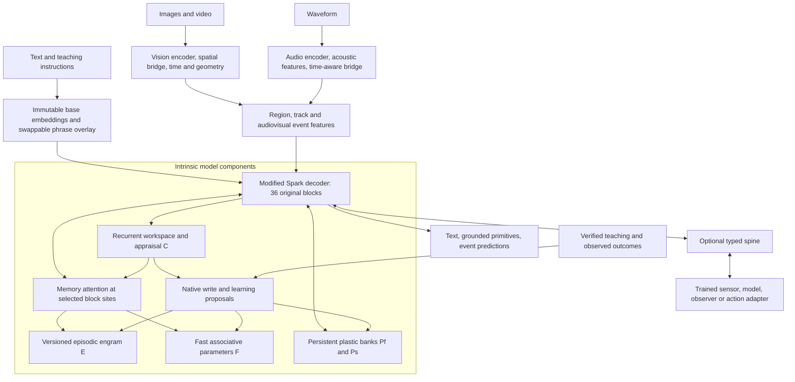

# SparkX 2.6 4B — unified final-product blueprint

**Version 5.0 · 26 October 2026 · Product design and engineering roadmap.**

**The target is a native multimodal learner:** a fully fine-tuned Spark language backbone with vision, audio, spatial/temporal reasoning, intrinsic experience memory, and bounded persistent learning. After release, the original backbone and perception machinery stay fixed. Designated native memory and plastic parameters can continue learning from observations and instruction.

This is the **single starting document for the finished product**. It consolidates the research through architecture revision 4.5 and the newer repository evidence. It includes the reference architecture, learning algorithms, runtime contracts, training/data program, resource account, and validation sequence. Numeric choices marked **candidate** are engineering hypotheses, not validated settings or claims from a paper.

Read the short tables first; return to the equations and implementation contracts later. The [machine-readable blueprint](../../configs/sparkx_2_6_4b_final_product_v5.json) and [review/evidence report](../../reports/sparkx_final_product_20261026/README.md) accompany this document.

## Navigation

| Topic | Sections |
|---|---|
| Product and evidence | [1. Product contract](#1-product-contract), [2. Evidence](#2-what-is-established-and-what-is-not), [3. Research decisions](#3-research-grounding-and-design-decisions) |
| Model architecture | [4. Whole model](#4-whole-model-architecture), [5. Backbone integration](#5-backbone-integration), [6. Vision](#6-vision-spatial-and-temporal-reasoning), [7. Audio](#7-native-audio-and-audiovisual-reasoning) |
| Experience and learning | [8. State](#8-state-ownership-and-experience-representation), [9. Dynamic engram](#9-dynamic-engram-and-memory-attention), [10. Nested learning](#10-native-nested-learning-algorithms), [11. Vocabulary](#11-swappable-dynamic-vocabulary) |
| Cognitive and external interfaces | [12. Semi-cognition](#12-semi-cognitive-core-appraisal-and-personality), [13. Spine](#13-unified-access-port-the-separate-neural-spine) |
| Software and persistence | [14. Execution](#14-runtime-execution-and-system-design), [15. Storage](#15-persistence-correction-and-release-migration), [16. Example](#16-worked-example-learning-an-audiovisual-convention) |
| Building the model | [17. Training](#17-offline-training-program), [18. Losses](#18-objectives-credit-assignment-and-optimizer-policy), [19. Data](#19-dataset-and-curriculum-plan) |
| Proving and shipping it | [20. MiniCPM](#20-minicpm5-first-validation-program), [21. Gates](#21-product-acceptance-and-long-run-validation), [22. Resources](#22-parameters-memory-and-compute), [23. Roadmap](#23-implementation-packages-and-dependencies) |
| Scope control | [24. Recursive improvement](#24-recursive-improvement-and-later-expansion), [25. Open decisions](#25-decisions-that-must-be-closed-before-release), [26. Deliverables](#26-final-release-package-and-document-authority) |

## 1. Product contract

### 1.1 Required final behavior

| Capability | What a user should be able to do | What must be demonstrated |
|---|---|---|
| See | Supply images, documents, image sequences and video | Ground answers in relevant pixels; handle absent or ambiguous evidence |
| Reason with vision | Ask about relations, trajectories, changes and event order | Use region/event representations that causally improve conclusions |
| Listen | Supply speech, environmental sound, music and mixed audio | Use acoustic evidence beyond a transcript, including timing and prosody |
| Connect modalities | Ask which visible event produced a sound, or compare synchronized changes | Use both modalities; preserve alignment and uncertainty |
| Remember experience | Revisit a fact or event after the source leaves the context | Retrieve scoped experience with provenance, correction and abstention |
| Learn from teaching | Teach a new name, relation, rule or acoustic/visual convention | Improve on new instances; retain the improvement after restart and interference |
| Evolve within a release | Accumulate reusable knowledge in designated dynamic parameters | Stable backbone hashes; measurable benefit from retained learned state |
| Operate for long periods | Continue across many observations and tasks | Bounded resident state, explicit retention/eviction, stable latency and recoverability |
| Attach native components | Add a trained sensor, observer, specialist model or action head | Typed tensor exchange through the spine without making memory a peripheral service |

**The approximately 4B count refers to the original language backbone.** Additional encoder, bridge, memory, controller and plastic parameters are allowed. Stored parameter count, active arithmetic, memory traffic and learning cost must be reported separately.

**Full offline fine-tuning establishes multimodal abilities.** Online learning uses already-trained seeing, listening, reasoning and learning machinery. It is not the mechanism for teaching an initially text-only release how to interpret images or sound.

### 1.2 Deployment boundary

The release freezes the original language weights, sensory encoders, ordinary projections, read/write machinery and initial qualified learning policy. Native dynamic state remains mutable. Later full fine-tuning creates a new release; it is unnecessary for every new fact.

“Native” means semantic representations, addressing, selection, memory use and adaptation operate within the model graph and its saved state. The host decodes media, schedules kernels, runs the declared optimizer, transports tensors and commits transactions. It does not choose the correct memory using gold answers or replace perception with an external captioning agent.

The first product emits text, structured visual/audio evidence and optional typed latent outputs. Speech synthesis, image generation, arbitrary device control and larger 35B/26B MoE ports are separate extensions. The latter can use LoRA research without changing the 4B full-fine-tuning plan.

### 1.3 Claims have separate evidence

Remembering an episode, learning a transferable rule, changing an update policy and consolidating a new backbone are different achievements. A deployment can improve through its native plastic bank while its original 4B weights remain fixed. This does not by itself demonstrate unlimited lifelong learning, autonomous architectural redesign or subjective emotion.

## 2. What is established and what is not

The [repository snapshot](../../reports/sparkx_final_product_20261026/repository_snapshot.json) pins the reviewed inputs. The workspace contains concurrent implementation work; unreviewed files are not evidence of qualified behavior. The following results are distinct populations and must not be merged into a single success rate.

| Area | Reviewed evidence | Consequence for this plan |
|---|---|---|
| Spark source topology | Pinned configuration/code and BF16 tensor headers; 4,112,079,360 unique original parameters | A concrete integration target exists; this is not a native execution result |
| Spark precision and reload | Official BF16 `bf16_06` and one dequantized FP8 derivative `derivative_02` completed load → export/reload with 0.0 logit difference and unchanged base; native FP8 was refused on MPS and never executed. Cross-arm logits differ (max 10.875), so output equivalence is not claimed | Loader/adapter and exact fresh-process reload are evidenced; no FP8 execution, training or capability claim |
| MiniCPM full-backbone update | Sustained fused-AdamW probe: 12 updates, 10 steady; all 381 original tensors / 2,516,756,480 parameters changed | Full updates are mechanically possible on the tested workload; convergence and robust resume are separate |
| MiniCPM throughput | 8.422 s/update at 440 processed positions/update; 40.13 GiB sampled peak in that probe | Useful local calibration only; not a Spark or CUDA throughput estimate |
| Latest reviewed memory acceptance | Acceptance v3 rejects `shared_mean/causal_query_refresh`: 21/384 accepted-correct facts, precision 21/138; coverage valid | Memory quality remains a blocking gate for a memory product claim |
| Same underlying memory run | Runtime report says `completed`, `inconclusive`, fresh-process parity true, zero optimizer updates | Preserve its runtime disposition separately from the later acceptance verdict |
| Vision alignment diagnostic | `train04`: projector-only training, train fit 3/14, development fit 2/18; semantic/following scores zero | No qualified visual reasoning or multimodal learning claim |
| NL0 state/math contracts | 28 focused tests; selected-expert transactions, recurrence, persistence and numerical comparisons | Software contracts are implemented; native learned utility remains unproven |
| Audio, combined AV learner, learned spine | Research/design in reviewed evidence | Must be built and qualified |
| Personality | User description pending | Define the interface and neutral path; do not invent content |

Sources: [memory acceptance v3](../../reports/memory_acceptance_20261026/causal_fresh_restart02_acceptance_v3.json), [memory run](../../runs/memory_causal_fresh_20261026/restart02/run_report.json), [vision diagnostic](../experiments/20261026_Vision_Balanced_Alignment.md), [NL0](../experiments/20261026_Nested_Learning_NL0.md), [sustained optimizer probe](../experiments/20261026_Fused_AdamW_Integration_and_Sustained_Performance.md), [Spark precision/provisioning](../experiments/20261026_Spark_Precision_and_Provisioning.md), [selected precision runs](../../reports/spark_qualification_20261026/selected_runs.json).

**Decision:** continue modality training research and intrinsic learning development as separable workstreams. Combine them only after each has a useful independent signal. Passing a source hash, transaction test or parameter-change check cannot substitute for held-out capability.

## 3. Research grounding and design decisions

The combination below is **our proposed synthesis**. No reviewed paper validates the whole Spark system. The [evidence manifest](../../reports/sparkx_final_product_20261026/evidence.json) records source versions, retrieval hashes and reviewed sections.

| Research | Supported connection | Decision and limit |
|---|---|---|
| [Nested Learning / HOPE, §§3,7–9](https://arxiv.org/html/2512.24695v1) | Distinct context flows and optimization timescales; CMS and self-referential learning | Give each learning level a loss, clock and credit path. Our initial linear fast memory and first-order plastic learner are not a faithful HOPE implementation |
| [Titans](https://arxiv.org/html/2501.00663v1), [TTT](https://arxiv.org/html/2407.04620v4) | Associative memories can update during sequence processing | Use a bounded recurrence control before nonlinear/self-referential variants; do not equate every recurrent state with lifelong learning |
| [MemT-1.0 v2, §§2–4](https://arxiv.org/html/2610.26825v2) | Native memory retrofit, backbone-specific integration and trained memory use | Supports intrinsic placement. Its Gated DeltaNet-2/Mixture-of-Storage recipe is not our sparse expert bank or a drop-in Spark adapter |
| [Engram v2](https://arxiv.org/html/2601.07372v2) | Conditional static n-gram lookup can complement neural computation | Retain a static lookup control; a writable multimodal engram needs new representations, learning rules and tests |
| [End-to-End TTT](https://arxiv.org/html/2512.23675v2), [ANML](https://arxiv.org/pdf/2002.09571v2) | Training for post-adaptation performance; selective plasticity | Train future-use objectives. Frozen-backbone backward and approximate meta-gradients still have costs and limitations |
| [Thinking with Visual Primitives, report mirror](https://www.k-a.in/Thinking_with_Visual_Primitives.pdf) | Points/boxes can become supervised visual references during reasoning | Adopt the grounding question. Original-source provenance remains unresolved; the inspected architecture is a much larger MoE, not a demonstrated 4B recipe |
| [Thinking with Visual Grounding](https://arxiv.org/html/2606.16122v1) | Controlled point/box reasoning on a 4B model; grounding-aware supervision | Stronger size-relevant support for explicit grounding. Spark transfer and temporal reasoning remain experiments |
| [CoVT](https://arxiv.org/html/2511.19418v1), [Latent Visual Reasoning](https://arxiv.org/html/2509.24251v1) | Continuous visual representations can participate in reasoning | Add a small latent reasoning candidate after explicit grounding works; compare against equal-compute alternatives |
| [Molmo2, §3](https://arxiv.org/html/2601.10611v1) | Full-parameter visual training, video pointing and tracking data | Supports the offline curriculum; not evidence for our continual learner |
| [video-SALMONN S](https://arxiv.org/html/2510.11129v2) | Streaming visual memory within an audiovisual model | Useful temporal-memory control. Its audio bypasses the fast visual-memory path; paired acoustic memory here is an extension |
| [SPEAR](https://arxiv.org/html/2510.25955v2), [SALMONN-2](https://arxiv.org/html/2607.17079v1), [MOSS-Audio](https://arxiv.org/html/2606.01802v1) | General acoustic representations, feature-layer fusion and time-aware audio modeling | Train listening from sound features. Larger teacher architectures do not establish the compact encoder's quality |
| [VoxEmo](https://arxiv.org/html/2603.08936v1) | Emotion labels are ambiguous and listener-dependent | Predict distributions and calibrate them; keep perceived affect separate from factual truth and internal appraisal |
| [DVAGen, §3](https://aclanthology.org/2025.emnlp-demos.26.pdf) | Runtime phrase representations can extend input/output vocabulary | Use a bounded overlay with stable concept identity. Slot reuse, memory integration and compact encoding require our own tests |
| [Learning Rate Matters](https://arxiv.org/html/2602.04998v2) | Tuned LoRA can close gaps to several newer variants in tested settings | Tune fair baselines before adopting more complex adapters; LoRA is not the main 4B learning substrate |

Three non-transferable claims are especially important. MemT's storage mixture does not establish top-k sparse execution. DeepSeek's reported visual KV compression depends on its own attention architecture. HOPE's results do not establish that attaching several memories to Spark will automatically produce nested learning.

## 4. Whole-model architecture



Arrows span ordered phases. They do not permit a later decoder state to influence an earlier layer in the same forward pass. Memory is inside the model even when the spine has no attached module.

### 4.1 Reference profile

| Component | Candidate reference | Role |
|---|---|---|
| Language backbone | Spark 36 blocks, width 2560, original 4.112B parameters | Stable language, reasoning and learned use of extensions |
| Vision frontend | SigLIP2 base patch16-224, width 768 | Patch features; full offline co-adaptation |
| Audio frontend | SPEAR base speech/audio v2, width 512 | General acoustic and speech features; full offline co-adaptation |
| Modality projectors | Vision 768→1024→2560; audio 512→1024→2560 | Entry into the decoder's representation space |
| Intrinsic memory sites | Zero-based blocks 3,7,11,15,19,23,27,31,35 | Nine memory readers; compare 2/6/9/36-site designs |
| Memory reader width | 512 | Bounded record and fast-state attention |
| Workspace/event state | 8 workspace + 64 event slots, width 256; two shared recurrent iterations | Temporal integration, goals and control |
| Episodic bank `E` | 4096 records; 896 BF16 elements/record plus bounded metadata | Exact identity/provenance and compressed sensory/semantic evidence |
| Fast bank `F` | Three depth groups, eight stored experts/group, four 128-wide heads/expert | Associative experience state |
| Plastic bank `P` | Sixteen full-rank 256→1024→256 gated experts; eight fast/eight slow | Persistent reusable knowledge; two active experts/site |
| Address adaptation `A` | Three 128×128 matrices; **off in the first reference** | Later learned addressing experiment |
| Dynamic vocabulary | 256 active phrases; two-layer width-256 encoder | New names/phrases without permanent base-ID growth |
| Spine packet width | 512, with width-256 control features | Optional native component exchange |
| Active context | Start at 8192 computed positions | Bounded working context; separate from durable experience |

All widths above are explicit design choices. The complete final tensor inventory must be generated from the implemented graph; uncounted heads and resamplers cannot be assumed free.

## 5. Backbone integration

### 5.1 Preserve the original Spark computation

Pinned source: [configuration](https://huggingface.co/XHToken/Spark-X2.6-4B/blob/66e3ae7bee54e0a523d692cb8ef841f35409807b/config.json), [model implementation](https://huggingface.co/XHToken/Spark-X2.6-4B/blob/66e3ae7bee54e0a523d692cb8ef841f35409807b/modeling_spark.py). The custom class is `Spark2_5ForCausalLM`.

| Property | Verified value | Integration implication |
|---|---|---|
| Original blocks / hidden width / FFN width | 36 / 2560 / 10240 | Do not reuse MiniCPM tensor shapes |
| Attention heads | 16 query, 4 KV, head dimension 256 | Attention output concatenation is 4096-wide, not 2560 |
| QKV projection | 2560→6144 | Preserve fused layout and GQA semantics |
| Attention output projection | 4096→2560 | Pre-output memory injection needs a different geometry from a width-512 residual reader |
| Original MLP | `down(GELU(gate(x)) * up(x))` | Preserve the **GELU-gated** implementation; do not silently substitute SwiGLU |
| Original attention gate | Per-head sigmoid output gate | Extension gates must have distinct ownership |
| Attention pattern | Repeated sliding/sliding/sliding/full; local window 512 | 27 sliding and 9 full blocks; preserve masks |
| RoPE | Full attention uses partial rotary factor 0.25; local uses 1.0 | Preserve layer-specific positional behavior |
| Vocabulary/head | 131072 base IDs; tied input/output embedding | Count storage once; integrate the lexical overlay beside the actual tied `F.linear` path |

The source permits a much larger configured position range. That is not an initial product throughput or memory commitment. Long-running operation is built around bounded working context and qualified memory.

### 5.2 Reference intrinsic block

For a selected layer `l`, use the following **proposed** residual structure:

```text
u       = original_attention_norm(h)
a       = original_Spark_attention(u, original_mask, original_positions)
m       = MemoryRead_l(u, pinned_E, pinned_F, pinned_C)       # width 512
h_a     = h + a + gate_mem_l(u) * U_mem_l(m)
v       = original_mlp_norm(h_a)
p_in    = D_plastic_l(v) + depth_embedding_l                 # width 256
p       = weighted_sum(Pf_selected(p_in), Ps_selected(p_in))
h_next  = h_a + original_GELU_MLP(v) + gate_plastic_l(v) * U_plastic_l(p)
```

The original branches retain their operators and masks. New gates/norms are trained offline. Establish disabled-extension parity first, then open a live gradient path during alignment; zeroing every expert matrix and every output gate would create a dead learner.

The nine sites coincide with full-attention blocks as a starting engineering hypothesis. Shared banks avoid nine independent copies of every episode. Depth groups are sites `[3,7,11]`, `[15,19,23]`, `[27,31,35]`; they have distinct fast state and depth-aware queries.

**MiniCPM starts with its already-tested post-block interface at blocks 13/27.** Move to the internal residual placement only in a separate parity/gradient experiment. An existing post-block adapter does not qualify the new Spark block surgery.

### 5.3 Reader placement and density experiments

| Variant | Purpose | Required accounting |
|---|---|---|
| Two post-block readers | Integration and behavior control | Existing schedule and exact baseline |
| Six/nine internal readers | Test benefit of repeated native access | Reader parameters, projected-record cache, token-level calls |
| Every-layer readers | Test depth coverage when useful | All 36 costs; no assumed quality advantage |
| MemT-style pre-output branch | Test reuse of the original output projection | Spark's 4096-wide attention geometry, gate separation, complete source-specific retrofit |
| Event-only plastic execution | Reduce per-token work | Compare against token-level plastic use at matched task quality |

The reference uses a 512-wide reader with `Q:2560→512`, `K,V:512→512`, `O:512→2560`. Shared record encoding produces width-512 evidence before site-specific projections. This replaces older controls whose K/V projections began at backbone width. Their parameter counts are alternatives, not cumulative additions.

## 6. Vision, spatial and temporal reasoning

### 6.1 Perception pathway

Start from [SigLIP2 base patch16-224](https://huggingface.co/google/siglip2-base-patch16-224/tree/75de2d55ec2d0b4efc50b3e9ad70dba96a7b2fa2). Use the vision tower; the paired text tower is not an additional product encoder. The current declared vision count is 92,884,224 parameters and must be re-audited from the implemented package.

A 224×224 view yields a 14×14 patch grid: 196 visual positions before compression. Preserve that baseline for quality diagnosis. The compact candidate resamples a view to 64 features and uses selected additional crops for small details. Crop choice must come from observed pixels/native queries, not evaluation boxes.

Every feature carries source image/frame ID, original dimensions, crop/resize/rotation transform, patch extent, source timestamp and validity. Keep the inverse transform so output coordinates can return to the original image. Normalized coordinates without a named frame are insufficient.

### 6.2 Reasoning representation

Use three complementary representations:

1. **Patch/region evidence:** local appearance and fine detail, retaining coordinates.
2. **Entity/event slots:** stable local track IDs, attributes with uncertainty, time intervals and relations.
3. **Reasoning features:** a bounded sequence of continuous visual states and structured point/box references that can affect subsequent decoder computation.

The first release should learn points, boxes, entity relations and event intervals. Masks, depth and latent visual thoughts are staged additions. Monocular inferred depth is relative unless metric calibration or a depth sensor supplies scale.

A visual reference has typed fields such as `{source_id, entity_uid, frame_id, xyxy_or_point, coordinate_frame, interval, confidence}`. A generated reference is a prediction; it becomes evidence only when linked to actual source features. Emitting a plausible coordinate string alone is not visual reasoning.

### 6.3 Temporal pathway

The temporal bridge joins frame features using actual timestamps and candidate track associations. It updates 64 width-256 event slots with two shared recurrent steps. Slots hold objects, transitions and interval relations; they are not all assumed to correspond to unique physical objects. Occlusion, re-entry, split/merge and uncertain identity need explicit supervision.

Train before/after, overlap, duration, relative motion, state change and cross-view correspondence. Include reversed order, duplicate frames, missing intervals and variable sampling rate. A repeated appearance is not proof of continuous identity.

Frame sampling is part of the capability specification. A low-rate route can support coarse events while missing a brief action. A detail request may acquire denser frames/crops and charge their encoder/decoder cost. If the relevant interval was never sampled and raw media was discarded, the model must preserve uncertainty.

### 6.4 Grounded and latent reasoning training

Explicit primitives receive point matching, box overlap and answer supervision. Region relation heads receive labelled geometry/time relations. Continuous reasoning features can receive frozen teacher feature/depth/mask reconstruction losses, with teachers used offline only.

The compact latent candidate uses at most **16 additional decoder positions per decision**, a project choice rather than CoVT's recipe. Compare 0/4/8/16 positions and an equal-compute text or recurrent alternative. Distinguish positions within the decoder from width-256 side-state recurrence; both incur work.

Require improvement under pixel-based counterfactuals and degradation when relevant evidence is shuffled. Correct answers with decorative boxes are insufficient. Measure whether primitive supervision improves unseen spatial/temporal tasks beyond answer-only fine-tuning on the same examples.

The inspected DeepSeek report uses DeepSeek-V4-Flash and a separate visual-compression design. Its pixel-to-token and KV ratios do not transfer to Spark. Temporal reuse of primitives is our extension and is evaluated independently from still-image results.

## 7. Native audio and audiovisual reasoning

### 7.1 Compact audio reference

Use [SPEAR base speech/audio v2](https://huggingface.co/marcoyang/spear-base-speech-audio-v2/tree/7447901d44bf265b3c304cc4ccf25ca741527b6c) as the compact first candidate: approximately 93.3M parameters, 512-wide features at roughly 50 Hz from 16 kHz audio. Its training described on the card is primarily English speech plus general audio; Mandarin/multilingual performance is a required test, not an established property.

**The pinned configuration has `causal:false`.** The first product path accepts complete audio clips. A chunked path can process closed four-second windows, but those features are only available after the window ends plus encoder delay. Overlapping windows or a future causal encoder require explicit training and timing qualification.

The bridge uses both high-level content and selected lower/middle-layer acoustic information. This preserves a path for timbre, onset, pitch, rhythm, speaker/prosodic cues and environmental sound. The exact feature-fusion layer is an offline-trained component, included in the final tensor audit.

### 7.2 Temporal compression with a quality control

Retain the approximately 50 Hz representation inside the encoder/bridge. The initial compression experiment groups five feature frames into one model-facing token, approximately 10 tokens/s. Do not average blindly: learned pooling receives sub-frame position and can preserve a local acoustic descriptor.

Compare full-rate features, simple pooling and learned pooling. Evaluate onset timing, pitch distinctions, brief events, overlapping sources and long music structure separately. If the compact representation fails, retain higher rate for relevant intervals or enlarge the audio branch; the parameter allowance permits that tradeoff.

Whisper-small encoder is a speech control; MERT-95M is a music control. They are alternatives/teachers until evidence justifies simultaneous deployment. A transcript-only system is a necessary diagnostic baseline, not the target audio implementation.

### 7.3 Audiovisual binding

Represent event time on a shared monotonic media clock. Each audio/window and visual/frame has `start`, `end`, `available_at`, clock ID and uncertainty. Align event candidates using temporal overlap, content and learned correspondence while retaining distinct audio and visual evidence.

Train both positive and deliberately mismatched pairs. Tasks include locating a sound-producing object, matching rhythm to movement, distinguishing off-screen sound, resolving conflicting speech/visual cues, and applying a taught audiovisual convention to a new scene.

Co-occurrence is not sufficient evidence of causation. Include silent visible objects, dubbed audio, offset tracks, simultaneous unrelated events and unavailable modalities. The same model must work with audio-only and vision-only input through explicit missing-modality masks.

### 7.4 Perceived affect and multiple perspectives

Keep three channels separate: observable acoustics, listener-perceived affect distributions, and the model's internal control/appraisal state. Explicit user preferences are a fourth, instructed source. A high-pitched voice or music genre is not a reliable emotional truth label.

Train soft listener labels and uncertainty where available. Evaluate speaker/language/corpus holdouts, disagreement and calibration. A prediction such as “this sounds tense to these annotators” must not become an unqualified record of someone's private feelings.

### 7.5 Example position budget

For a **16-second coarse AV experiment**, four 64-token frames + two 64-token detail crops + 160 audio tokens + 64 event positions + 32 timing/control positions = **640 decoder positions**. This excludes text, generated answers and optional latent thoughts. It also excludes internal encoder work.

The four-frame choice is an accounting example, not a validated coverage rule. Fine motion and fine acoustic timing can require more input. If an implementation keeps event state entirely in a side branch, it must remove those 64 decoder positions and account for the side-branch work instead; it must not count both architectures as the same execution.

## 8. State ownership and experience representation

### 8.1 Separate stable competence from changing experience

| Symbol | Contents | Changes during deployment | Normal persistence |
|---|---|---|---|
| `Theta` | Original backbone, encoders, bridges, readers/writers, routers, controller and initialization templates | None within a release | Immutable release package |
| `I` | Approved identity/personality snapshot and reader identity | Explicit source revision only | Separate versioned identity package |
| `C` | Workspace, current tracks/events, goal and appraisal | Native recurrence per decision | Task/stream only; clear on independent tasks |
| `E` | Episodic sensory/semantic records, provenance and correction lineage | Append, supersede, evict at observation barriers | Scoped durable record journal |
| `F` | Fast associative matrices | Bounded observation update | Session by default; explicit persistent-scope arm |
| `Pf` | Faster plastic knowledge experts | Verified teaching updates | Across sessions within the learning scope |
| `Ps` | Slower plastic experts | Periodic verified consolidation | Across sessions within the learning scope |
| `O` | Optimizer moments, step counts, eligible-event counters and pending-work phase | Atomically with corresponding updates | Required for continued-learning parity |
| `A` | Optional adaptive addressing transforms | Verified ranking updates between decisions | Versioned with representation and scope |
| `V` | Active phrase rows and slot mapping | Generation-boundary swap | Derived cache; lexical identity persists elsewhere |
| `K` | Native KV and projected-record caches | Derived from a pinned computation | Disposable; compatibility checks required |
| `Psi` | Later learning-policy parameters | Separately qualified revisions | Absent/frozen in the first learner |

These categories prevent a common ambiguity: `E` insertion, `C` recurrence, vocabulary remapping and KV caching are state changes, but not automatically optimization levels. `F/P/A` each need a specific objective and transition rule before they count as learning.

### 8.2 Canonical experience record

```text
ExperienceRecord
  identity: record_uid, concept_uids[], episode_uid, scope_id, branch_id
  provenance: source_hash, source_span, producer_hash, representation_version
  timing: observation_start, observation_end, available_at, clock_id
  geometry: source_view, coordinate_frame, crop_transform_ref, track_refs[]
  state: status, supersedes_uid, revision, confidence_kind, modality_mask
  features:
    address_key[128]
    semantic_value[256]
    visual_values[2,128]
    acoustic_values[2,128]
  bounded_metadata: <= 512 bytes in the analytical resident profile
  payload_refs: canonical literal/source payload and optional replay artifact
```

The feature payload contains **896 BF16 elements**. Metadata stores compact IDs and references; it cannot conceal unlimited captions, waveforms or JSON. Variable-size source text, literal bytes, masks and media require separate bounded storage and byte accounting.

Missing modalities are masked. A zero audio vector is not evidence of silence. Silence is a real observed acoustic condition with a valid interval. Separate visual and acoustic values prevent the semantic summary from becoming the only retained evidence.

### 8.3 Exact evidence and compressed experience

The canonical record preserves identity and provenance exactly. Its neural feature values are compressed and may lose information. Accurate reconstruction of an arbitrary string, number or sound is not guaranteed by a 256-wide semantic vector.

For exact taught literals, retain canonical bytes in the lexical/evidence payload and expose them through a trained, bounded native record/lexical codec. The model selects the record and output; the host only resolves the already-selected stable reference. Any direct-copy output is reported as episodic/literal recall, not parameter-only skill acquisition.

Long evidence is divided into bounded records with source-span identity. Raw media retention is optional and separately budgeted. If it is absent, re-encoding or exact source removal may be impossible; the system must report that limitation rather than fabricate reconstruction.

## 9. Dynamic engram and memory attention

### 9.1 Meaning of “dynamic engram” in this product

The product uses a learned, writable association system: records `E`, fast associative matrices `F`, persistent plastic knowledge `P`, and their native readers/writers. This is broader than the static n-gram lookup in the Engram paper. The term names our design, not a reproduced paper implementation.

Keep an optional static phrase/n-gram lookup as an efficiency control. It uses canonical base-token expansion or stable concept keys, never recycled dynamic-token slot numbers. Its table is trained offline and frozen unless a distinct update mechanism is declared.

### 9.2 Two-stage native access

1. A causal sensing pass produces query/task/event features.
2. Two width-128 bank queries select a **union of at most 16 eligible records** from the shared bank. Scope, source status and availability masks apply before ranking.
3. Selected records are encoded into width-512 evidence packets. Each active decoder site performs its own small attention over those packets plus workspace/fast-memory evidence.
4. A confidence/abstention head predicts whether eligible evidence is sufficient. Ranking score alone is not a calibrated truth score.

This avoids scanning all 4096 records at every token and every layer. Projected selected-record K/V may be cached for a pinned revision. The two bank queries, selection, encoding and cache misses are part of latency.

The reference shared record codec produces **four width-512 packets per selected record**: semantic, visual, acoustic and joint-event. It uses the retained modality-specific values and typed time/geometry features, with explicit validity masks. Thus 16 records yield at most 64 record packets; at most eight projected workspace packets are additional. These are native cross-attention inputs, not an automatically appended text prompt.

At a Spark site, split the 512-wide fast-memory query into four 128-wide heads, read the selected group's `F` expert, concatenate the results, and combine that vector with the episodic/workspace read through trained gates. Record codec, workspace projection, fusion and gates belong to the unsealed extension inventory. Per-site cached K/V for 64 record packets alone adds 128 KiB BF16, or 1.125 MiB across nine sites, before workspace packets and other caches.

The reference admits two global queries, not two per site. Any adaptive scheme that issues additional searches must expose its query count. A cheaper query encoder or causal single-pass route can replace the extra sensing pass only after a quality/cost comparison.

### 9.3 Write/read alignment

Train a writer to encode observed source features and a reader to use them on later questions. Positive record IDs can supervise relevance during training; at inference the model receives only current observations, queries and eligible state. Never route using a gold ID, future answer or hidden task family.

Use three diagnostic interventions: exact-address access, native learned addressing, and wrong/shuffled addressing. An exact-address control can reveal whether the writer/readout is useful even when retrieval fails. Its accuracy is an upper-bound diagnostic and cannot be blended into native retrieval quality.

Corrections explicitly supersede a record. Teach both the revised relation and discrimination from the obsolete relation. Query reformulation, recency heuristics or a source hash must not silently select the correct fact for the model.

### 9.4 Adaptive memory attention

Initial query, key and routing machinery is trained offline and frozen at deployment. The optional `A` arm applies bounded 128×128 query transforms to a fixed representation/index, with separate depth-group transforms for local reranking. It does not introduce additional full-bank scans by default.

Verified positive/negative relevance feedback can train `A` using a ranking loss between decisions. Store its moments and revision. Compare fixed addressing, learned-but-frozen addressing and online `A` at equal record/query budgets. A changing address map can destabilize access even when the knowledge itself remains intact.

### 9.5 Capacity and forgetting policy

Keep pinned task-critical records, a recent slice and a diversity/utility-retained slice under the declared capacity. Begin with a deterministic eviction baseline. A learned retention score is an offline-trained candidate evaluated against recency, random and age-balanced policies.

Eviction removes active availability; it does not automatically erase learned effects from `F/P`. Consolidation is an explicit learning operation, not a claim that evicted records have been safely preserved. Test performance as record counts and interference exceed capacity.

## 10. Native nested-learning algorithms

### 10.1 Learning clocks

| Level | Context flow | Candidate transition frequency | Objective |
|---|---|---|---|
| Working state `C` | Available features and task state | Two recurrent iterations/decision | Grounded task performance; this is recurrence, not a separate optimizer |
| Fast association `F` | Sealed observation features | Once per eligible observation chunk | Reconstruct causal feature associations, with future-use outer supervision |
| Faster plastic pool `Pf` | Verified current teaching + replay | Every eligible teaching transaction; ≤2 steps | Acquire new knowledge while protecting recent skills |
| Slower plastic pool `Ps` | Recent verified teaching + age-balanced replay | Every 16 eligible teaching transactions; ≤2 steps | Retain reusable regularities across interference |
| Stable release `Theta/P0` | Diverse chronological learning episodes | Offline training campaign | Improve future performance after adaptation and preserve general competence |
| Policy `Psi`, later | Independent learning episodes/outcomes | Explicit qualified revisions | Improve the learning procedure at equal total cost |

The slower clock counts **eligible verified teaching transactions**. Queries, retries, decoder tokens, wall time and activation-checkpoint recomputation do not advance it. Persist its phase and at most one deferred slow job. Do not accumulate an unlimited background queue.

### 10.2 Fast association control

For a normalized key `k` and bounded target feature `v`:

```text
L_assoc(F) = 0.5 * ||F k - v||²
F_new      = rho * F + eta * (v - F k) k^T
rho in [0.90, 1.00]; eta in [0, 1]                 # candidate bounds
```

For a chunk, aggregate at most 32 selected feature associations with normalized weights against the **same pre-chunk state**. Apply one resulting transition to each selected group state. Do not perform a second update because another layer reads the same event.

The Spark capacity candidate stores eight experts per depth group. Start with a one-expert/group behavior control. The sparse candidate chooses one expert/group per sealed chunk/decision from native features; inactive experts are unchanged. A dense learned-mixture control tests whether sparse routing loses relevant associations. These are new choices, not MemT's mixture algorithm.

Train key/value/query generation and bounded coefficients offline through up to four observation transitions. Older history is detached. This is a functional tensor recurrence, not an undeclared SGD/Muon optimizer. Nonlinear fast memories, long-window replay and self-referential updates are later independent arms.

### 10.3 Persistent plastic knowledge

Each `P` expert is a full-rank gated MLP with three bias-free matrices, width 256 and hidden width 1024. The reference uses a SiLU gate **inside this new branch only**; Spark's original GELU MLP remains unchanged.

Sixteen stored experts provide 12,582,912 mutable weights. Eight belong to `Pf`, eight to `Ps`. One expert from each pool is selected per decision and shared across active sites with depth identity. This bounds active work and makes one update per pool well-defined. Per-token or per-site expert changes are separate costed variants.

Offline dense-soft routing warmup can teach expert addresses and utilization. Transition to the actual top-one-per-pool route before qualification. Hard top-k selection supplies no gradient for an unselected expert's counterfactual usefulness; use declared auxiliary training objectives and routing controls rather than assuming it does.

An eligible teaching transaction updates at most one fast and one slow expert. Aggregate losses across their uses before stepping. Inactive experts have `grad=None`, no step, no moment allocation/decay. Persist selected weights, moments and per-expert counters atomically.

### 10.4 Bounded inner optimization

Reference optimizer: repository `NativeFusedAdamW`, FP32 plastic ownership, candidate learning rate `1e-4`, development choices `{1e-5, 3e-5, 1e-4}`, betas `(0.9,0.999)`, epsilon `1e-8`, weight decay `0`, global selected-gradient norm cap `1`.

```text
L_fast = L_verified_current + 0.25 * L_verified_replay
L_slow = 0.5 * L_recent_verified_16 + 0.5 * L_age_balanced_replay
```

These coefficients are preregistration candidates. Superseded or revoked targets are removed/replaced in replay. Repeated false targets cannot be made true by receiving a high model confidence score.

**Behavioral reference:** verified response loss plus already-qualified grounding losses through the frozen decoder; at most 256 computed positions per inner step, including replay. Short training windows and packing must preserve the task; long examples need a separately charged profile. Freezing backbone weights does not eliminate backward computation through them.

**Cheap local candidate:** at most 128 feature examples/step, optimizing `1 - cosine(P(x), z_verified)` plus verified replay. A pinned qualified producer, with dynamic branches disabled, creates targets from real teaching evidence. Target production adds forward work. This candidate is adopted only if its downstream learning is noninferior within a proposed 2 percentage points and its measured cost improves.

Both pools together permit at most four optimizer steps at an eligible boundary. A budget rejection returns “learning deferred/rejected”; the system must not acknowledge durable learning merely because it stored an observation.

### 10.5 Train the ability to learn

Offline episodes contain at least 32 eligible teaching events, exercising the slow clock twice. Interleave teaching, new-instance queries, corrections, interference and retention probes. Future queries are held out from inner updates. Distinct source/world families are reserved for final audit.

```text
P_T = bounded_inner_updates(P_0, teaching_support)
J   = future_query_loss(P_T)
    + retention_loss(P_T, older_skills)
    + grounding_retention_loss(P_T)
```

The initial outer estimator uses `gradient(P_T, J)` as a first-order estimate for the initialization `P0`, approximating the adaptation Jacobian by identity. It omits derivatives through inner gradients, Adam moments, step sizes and teaching-feature construction. Therefore the initial inner learning rate and eligibility policy remain fixed.

The `F` recurrence has its separately declared differentiable unroll. Read/controller parameters receive direct query-path gradients. During offline full training, original backbone and encoder gradients follow the declared stage; during deployed learning they remain frozen.

The fused optimizer is not an exact higher-order meta-optimizer. NL0 supplies a short exact AdamW mathematical comparator, but this does not qualify native full-model exact unrolls. Compare one/two/four-step numerical references before making an exact-gradient claim. More elaborate HOPE-like learning is contingent on these baselines.

### 10.6 Self-learning versus self-confirmation

Externally observed sensory outcomes can supply self-supervised targets after they become available. For example, predict a later event, score the prediction, then expose the actual observation at the next learning barrier. Model-generated explanations alone are not verified targets.

Instructed learning additionally receives a teacher's rule, correction or preference with source/scope. Unsupported hypotheses can remain tentative `E/C` state; they do not enter authoritative replay or permanent `P` updates as established knowledge. Train the model to seek discriminating evidence when ambiguity matters.

## 11. Swappable dynamic vocabulary

### 11.1 Stable meaning, recyclable active rows

Preserve all 131072 base token IDs and fallback behavior. Add 256 active phrase rows as a derived overlay, generated by a two-layer width-256 phrase encoder and projections from/to the 2560-wide base representation. The encoder and lexical integration train offline.

The same derived row is used for phrase scoring and atomic input feedback after the phrase is selected. Base logits remain available. A copy-output system that feeds ordinary base tokens back is a separate baseline: it does not have the same computation as an atomic phrase token.

The initial joint output distribution is `softmax(concat(W_base @ h, s_phrase * E_active @ h + b_phrase))`, with a shared phrase scale/bias calibrated offline and frozen in the release. Derived row norms must be trained/calibrated against the original embedding space. Row permutation must permute phrase logits and mappings together; it must not alter base logits before normalization.

Base-token and phrase paths can spell the same surface string. Train on declared mixed segmentations and score surface correctness, bits per byte where applicable, and total latency; raw token perplexities across different segmentations are not directly comparable. Exact lattice marginalization is a later objective, not an assumed property of the simple CE baseline.

```text
Persistent identity:
  concept_uid, lexeme_uid, canonical_bytes, language, lexical_encoder_version
Transient placement:
  stream_id, slot_id, slot_generation, mapping_hash, row_revision
```

Memories and optimizer state never use `slot_id` alone as identity. A concept can retain several names. A reused spelling can refer to different scoped concepts. Phrase eviction does not erase the corresponding experience or plastic knowledge.

### 11.2 Mapping and cache rules

Freeze the active mapping for each generation in the first implementation. Refresh only at a decision boundary, encoding at most 16 fresh phrases/refresh. Pin rows referenced by in-flight embeddings/backward/KV; use base-token fallback when no slot can be reused.

Exclude role delimiters, stop/control syntax and phrases crossing message boundaries. Use canonical bytes and a declared tokenizer/normalization version. Do not silently normalize distinct names into one identity.

Changing future output candidates alone need not invalidate unchanged prefix KV. Reinterpreting historical slot IDs, changing realized embeddings, changing positions or modifying relevant `F/P/A` does invalidate compatibility. Re-tokenizing the old surface string into base tokens is a valid restart fallback but not exact KV parity.

Atomic phrases change the number of positions and thus local-window/RoPE geometry. Measure long-context and temporal-task effects at matched surface boundaries. Coordinate/time types and acoustic codebooks remain separate namespaces; they are not lexical slots.

### 11.3 Learning and efficiency tests

Train with randomized slot assignments, novel spellings, distractors, overlap and candidate absence. Candidate discovery sees only the observed prefix and eligible memory; answer-derived phrase lists are an oracle diagnostic.

Test permutation equivariance, eviction/reactivation, batch isolation, restart, mid-transaction pinning and exact surface fallback. A proposed gate is reactivation accuracy within 2 percentage points of the same entries kept resident, while absolute lexical/grounding gates still pass.

The 256-row BF16 buffer is 1.25 MiB; double buffering is 2.5 MiB. Retaining the full base head adds about 0.195% head matrix work. Savings, if any, come from fewer useful decoding steps and reuse—not from these extra logits. An efficiency claim requires at least a proposed 5% amortized wall-time gain including selection, encoding and cache misses.

## 12. Semi-cognitive core, appraisal and personality

### 12.1 Functional core

Eight width-256 workspace slots integrate goal, current evidence, uncertainty, retrieved experience and pending action/learning needs. The temporal state supplies up to 64 event slots. Two shared recurrent iterations are the reference; compare zero/one/two iterations and a parameter/compute-matched feed-forward controller.

The final controller obtains semantic features natively. Existing host-computed task features remain a diagnostic control. Audit heads with detached inputs do not establish end-to-end credit assignment; a trainable path from task/future-use objectives is required.

The controller predicts bounded quantities: read relevance, missing-evidence likelihood, detail-request value, novelty, contradiction, expected learning utility and effort allocation. These influence gates, record proposals and learning priority within the fixed transaction/budget rules.

### 12.2 Appraisal and affect

Internal appraisal is a decaying control state, such as uncertainty, progress and salience. It may influence attention or replay selection. It does not determine factual truth, authority or whether a target was externally verified.

Compare fixed, learned and shuffled appraisal at equal observation/update counts. Include novel noise and emotionally salient but irrelevant inputs. A useful controller should avoid repeated expensive learning when new observations carry no task-relevant information.

Observed prosody, predicted listener affect and internal appraisal are separate tensors with separate supervision. This permits behavior responsive to music and emotion-related signals without claiming that the model experiences feelings.

### 12.3 Personality interface

Reserve a stable `I` input for the later personality description, with identity digest, schema version, declared behavioral fields and an exact neutral/disabled path. Train its reader offline only after the user supplies content and the desired behaviors can be evaluated.

Personality can shape expression and priorities. Learned experience cannot silently rewrite that snapshot. Factual corrections, uncertainty and source validity remain independent. Null-path parity and separation from answer-bearing memory are required controls.

## 13. Unified Access Port: the separate neural spine

The spine is a **project-defined tensor protocol**, not an existing universal standard. It provides native attachment for extra sensory devices, aligned models, passive observers and trained action heads. Core memory/learning operates without it.

| Channel | Native interface | First qualification |
|---|---|---|
| Sensory ingress | Modality adapter → typed feature packets | Missing/noisy/stale packets; downstream usefulness |
| Inter-model exchange | Learned queries read aligned feature packets | One-way causal exchange before bidirectional rounds |
| Observer egress | Bounded readout queries over named layers/state | Exact output/state parity with observer attached |
| Action egress | Learned head predicts typed continuous actions | Recorded replay/simulation with explicit device units and deadlines |

Reference tensors: features `[B,S,512]`, queries `[B,Q,512]`, optional controls `[B,*,256]`, validity `[B,S]`, causal availability `[B,Q,S]`.

```text
PortEnvelope
  interface_version, module_id, module_weight_hash, representation_id
  stream_id, sequence_id, observation_id, state_revision, causal_round
  start_time, end_time, available_at, clock_id
  coordinate_frame, units, uncertainty_schema, validity
  action_space_id, horizon, deadline, validity_interval       # action channel
```

An adapter learns alignment using paired observations/tasks and downstream losses. Equal hidden widths do not make representations interchangeable. Different tokenizers and rotary coordinate systems prohibit raw foreign KV reuse by default.

Bidirectional model exchange uses explicit finite rounds and pinned revisions. Each remote/local model pass, transport and synchronization is charged. A later response cannot feed an earlier layer in the same pass without another declared pass.

A passive observer exports bounded readouts, not unrestricted full activation dumps. Eight width-512 slots at nine sites are 72 KiB BF16/decision; a full 36-layer, 8192-position, width-2560 dump is 1.40625 GiB before metadata. Readouts are representations, not guaranteed explanations of private reasoning.

Action packets name units, coordinate frame, horizon, deadline and stale-command behavior. Device drivers perform mechanical bounds and actuation. New device competence requires training and validation; attaching a port does not confer it. No plugin receives direct write access to canonical `P`, moments or acceptance rules.

## 14. Runtime execution and system design

### 14.1 Logical components

| Component | Responsibility | Semantic work allowed |
|---|---|---|
| Media frontend | Decode, resample, timestamp and batch input | Mechanical transforms only; no hidden captioning/answer service |
| Native model module | Encoders, bridges, decoder extensions, core, writers and learning heads | Perception, reasoning, selection and update proposals |
| State coordinator | Scope/version pins, immutable views, exactly-once transactions | Validate authority and budgets; no oracle memory selection |
| Optimizer executor | Declared `F` recurrence and selected `P/A` updates | Numerical execution of model/learning objectives |
| Persistence store | Journal, snapshots, payload references, recovery | Byte integrity, versioning and atomic publication |
| Evaluation/telemetry | Independent scoring and phase costs | Qualification outside the candidate's write authority |
| Spine transport | Typed module packets and adapter dispatch | No bypass of native state rules |

This separation is an implementation boundary, not an external cognitive harness. All components can run in one process initially. A future service deployment may separate storage/transport without moving semantic memory decisions outside the model.

### 14.2 Proposed API

The following names are an interface sketch, **not claims that these methods already exist**. Map them to the repository's `RequestContext`, immutable `DecisionFrame` and per-port `InjectFrame` contracts.

```python
session = model.open_scope(release_id, scope_id, branch_id, identity_revision)
view = session.pin_decision(observation_cutoff, vocab_mapping_revision)
features = model.encode(observations, available_before=view.cutoff)
decision = model.infer(features, query, state=view, write_mode="disabled")

observation_batch = session.seal_observations(events, event_ids, available_at)
proposal = model.propose_learning(observation_batch, state=view)
candidate = model.adapt(proposal, verified_targets, declared_budget)
receipt = session.commit(candidate, expected_revision=view.revision)

session.checkpoint(include_optimizer=True)
session.close_task(clear_workspace=True)
```

An observation can legitimately be committed before a later query. For prediction tasks, the prediction is scored before the target is revealed. Teacher-forced answer tokens are loss targets and never writable observations within their own prediction pass.

### 14.3 Reference decision schedule

1. Pin release, identity, scope, source cutoff, vocabulary mapping and dynamic revision.
2. Decode/encode only available observations. Mark noncausal-window availability correctly.
3. Run the sensing pass with new injections disabled; derive native query and controller features.
4. Select eligible records and expert routes; perform bounded core recurrence; construct the immutable injection frame.
5. Run the answer/action pass with a fresh compatible native cache and pinned `E/F/P/C` view.
6. Return outputs and structured evidence. Record observations/feedback that became available after the pinned cutoff for the next barrier.
7. Propose and execute bounded updates, perform mechanical validation, then atomically publish the next revision.
8. Invalidate dependent caches and acknowledge separately whether evidence was stored, parameters updated, deferred or rejected.

The two-pass schedule is a correctness reference, not the final efficiency winner. Cached sensing, a compact native query encoder and causal single-pass late-layer reading are later alternatives. Their measurements must include misses, invalidation and extra prefills.

### 14.4 Transaction and concurrency rules

One writer per learning scope; multiple readers may hold immutable snapshots. Use compare-and-swap on the expected state revision. A stale candidate is recomputed or rejected, never silently merged with different moments or clocks.

The commit includes weights, moments, counters, dedup IDs, `E/F/A` revision, slow-clock phase and pending-work state. Persist an intent/checksum record, write the candidate snapshot, publish a commit marker, then advance the visible revision. Crash recovery exposes either the previous complete state or the new complete state.

Use content/event IDs for exactly-once observation ingestion. A retry, backward pass or checkpoint recomputation has no side effect. Training executes pure functional candidate states and publishes only at the declared boundary.

Pin a revision for the entire generation. A background learning job may prepare a candidate but publish only when dependent in-flight decisions release their pins. Bound the queue; backpressure or defer learning instead of accumulating unbounded stale work.

### 14.5 Failure and resource behavior

| Condition | Required behavior |
|---|---|
| No useful/eligible memory | Abstain or use stable prior knowledge with clear uncertainty |
| Missing modality | Use the explicit missing mask; no fabricated sensory evidence |
| Stale representation or wrong scope | Reject access and invalidate derivatives |
| Full record/vocab bank | Apply declared eviction/pinning; use base lexical fallback |
| Nonfinite update or exceeded budget | Roll back candidate weights, moments and counters together |
| OOM during learning | Preserve the last committed revision; return a learning failure/defer receipt |
| Encoder window incomplete | Wait for declared availability or answer from earlier evidence only |
| Unsupported device/model packet | Reject the packet before native consumption |

Record latency by encode/sense/select/core/answer/update/commit phases; record active/stored parameters, cache invalidations, queued work, bytes and update outcomes. Do not log only token-generation speed while hiding adaptation cost.

## 15. Persistence, correction and release migration

### 15.1 Two-part model artifact

```text
release/<release_id>/
  original_and_extension_weights.safetensors
  model_config.json, tokenizer/, encoder_preprocessors/
  state_schema.json, port_schema.json, training_lineage.json
  qualification_manifest.json, initialization_templates/

learning/<scope_id>/<branch_id>/
  manifest.json                    # release, representation, identity, revisions
  episodes/                       # bounded journal and payload references
  fast_state.safetensors
  plastic_weights.safetensors
  plastic_optimizer.safetensors
  address_state.safetensors        # only if admitted
  clocks_and_dedup.json
  lexical_identity.json
  commit_log/                     # bounded/compacted
```

The layout is a serialization design. Publish hashes, tensor dtypes/shapes and schema versions. Avoid arbitrary executable checkpoint payloads. The release includes initialization templates on disk; inference need not hold a second full plastic bank in memory unless rollback policy requires it.

### 15.2 Restart modes

| Mode | Restored state | Claim |
|---|---|---|
| Ordinary continued use | Stable release + scoped records/fast/plastic state + moments/clocks + declared task state | Same learned system, subject to compatible cache reconstruction |
| Weight-only evaluation | Retained `P`; other answer-bearing state cleared; no updates | Tests learned parameter contribution |
| Continued-learning parity | Retained `P` **and** optimizer moments/counters/clock phase | Tests the subsequent learning trajectory |
| Surface-history restart | Re-tokenized canonical history | Valid functional fallback; not exact KV/atomic-phrase parity |

Checkpointing weights without Adam state is not an equivalent continuation. Conversely, moments should not become an undeclared answer channel in a read-only parameter-learning test.

### 15.3 Corrections and source removal

Supersede erroneous episodic records and invalidate their derived read caches. Replay uses the revised target. Test correction of exact facts separately from correction of a general rule.

Compressed `F/P` state usually does not support exact subtraction of a source's influence. The concrete removal fallback is to restore a pre-source checkpoint and replay retained eligible evidence without that source. If the required lineage has been evicted, exact reconstruction is unavailable; reset the affected scope/bank and requalify as required.

Retention, deletion and replay storage therefore interact. A bounded resident model can use a larger bounded disk journal, but that disk cost and reconstruction latency remain part of the product. No unlimited-history claim follows from a fixed active bank.

### 15.4 New stable releases

A new encoder, tokenizer, bridge or backbone can change feature meaning even if tensor shapes stay equal. Default to re-encoding retained raw evidence and resetting incompatible compressed state. A trained migration map is a separate experiment with correction, retention and wrong-scope tests.

Record caches by the complete dependency tuple: release/code/precision, representation producer, scope/branch, relevant state revision, realized prefix/positions and lexical mapping history. Begin with conservative full invalidation after `P/F/A` changes; later selective reuse needs dependency proof and parity tests.

## 16. Worked example: learning an audiovisual convention

The teacher introduces a new device rule: a blue pulse followed by two short tones means “ready”; a red pulse followed by a long tone means “needs service.” The device name is a novel phrase. This is an example task, not an implemented result.

| Step | Native computation and state | What the test must rule out |
|---|---|---|
| Observe | Vision identifies pulse/region; audio retains duration/timbre; bridge aligns intervals | Solving from filenames, subtitles or preassigned event labels |
| Teach | Instruction binds the rule and name to scoped concept/event IDs | Gold routing hidden in the host |
| Store | `E` retains exact source/exception information; `F` binds recent associations | Calling storage alone transferable learning |
| Adapt | Verified teaching updates selected `Pf`; later consolidation updates `Ps` | Treating a self-generated label as verification |
| Query a new device | Changed appearance/performer, same relation; model uses learned features and `P` | Memorizing one image, waveform or caption |
| Swap name slots | Evict the phrase, reuse its slot, later reactivate it by stable lexeme ID | Meaning following a slot number |
| Restart | Restore declared scope; separately test `P` alone with `E/F/C` and source KV removed | Learning hidden in prompts, prototypes or caches |
| Correct | Teacher revises the convention for a named device subtype | Applying the correction to every device or retaining obsolete certainty |
| Interfere | Teach unrelated patterns, then revisit the convention | Only measuring immediate post-teaching accuracy |

For a true parameter-transfer claim, the audit removes source media, teaching text, literal-answer prototypes, episodic records, fast state, workspace and source KV. It retains only the declared plastic weights plus the stable release, then asks fresh instances through ordinary native routing. If performance collapses, the system may still have useful episodic memory, but the stronger learning claim has not passed.

## 17. Offline training program

### 17.1 Stages and trainable groups

| Stage | Main work | Trainable groups | Exit evidence |
|---|---|---|---|
| F0 — qualification | Source/backend parity, masks, positions, tied head, native interfaces, checkpoint/resume | None for baseline checks; explicitly scoped diagnostic updates | Correct graph and reproducible update/resume paths |
| F1 — extension alignment | Bridge/reader/writer initialization; make new residual paths useful | New projectors, heads, readers, core and initialization templates; original backbone/encoders initially fixed | Learnability on controlled examples; real gradients; zero/missing-input controls |
| F2 — full multimodal competence | Images, speech/sound/music, video relations, text retention | **All original backbone parameters, both encoders, and all included extension parameters** | Held-out modality necessity, grounding, audio and text-retention gates |
| F3 — native memory use | Write/read delayed observations; corrections, unknowns, temporal/AV experience | Full model and memory machinery; staged replay of F2 abilities | Native addressing/readout useful beyond diagnostic oracle routes |
| F4 — learn to learn | Chronological support/query episodes; one clock, then two clocks; vocabulary turnover | Offline `Theta/P0` and declared controller paths; inner updates restricted to `F/P` candidate state | New-instance transfer, retention and source-free parameter contribution |
| F5 — product behavior | Teaching/refusal-to-overclaim, multimodal instructions, bounded effort, optional personality | Full or explicitly scoped final co-adaptation, followed by renewed F2–F4 qualification | Stable integrated behavior; all release-critical regressions pass |
| F6 — serving qualification | Quantization, batching, cache behavior, long runs, packaging | No implicit training; any distillation is a new declared branch | Quality/cost/parity on the actual deployed artifact |

F1 warmup is an optimization stage, not a substitute for F2 full fine-tuning. The final multimodal release must demonstrate updates and competence across the full declared scope. Temporary encoder freezing for stabilization is compatible with this only if the later full stage actually trains them.

For F4, each offline episode starts from a declared initialization/scope state. Create candidate dynamic banks rather than contaminating a shared global bank across independent evaluation worlds. Preserve history within an episode and reset it between independent worlds unless the experiment explicitly tests cross-world carryover.

### 17.2 Sequence and curriculum progression

Start with short single-modality examples and uncompressed features. Then add multi-image relations, short clips, aligned AV events, memory delay and learning episodes. Increase context length and interference only after shorter tasks are learnable.

Use a text-retention stream throughout full multimodal training. One **planning mixture by charged positions** is 30% text, 20% image, 20% audio, 15% temporal AV and 15% memory/learning episodes. This is a starting scenario, not a selected final recipe. Resolve collisions by task labels and measure the actual processed mix.

The prior 10k-image/15-hour-audio pilot and small token caps are MiniCPM experiments. They are not estimates of sufficient product training. Select final volume using 1×/4×/16× scaling curves, source diversity, held-out gains and retention. Repeated examples increase processed positions without increasing unique evidence.

### 17.3 Offline teacher use

Teachers may generate draft captions, correspondences, visual features, acoustic descriptions and learning episodes. Keep teacher/version/prompt provenance and independently check labels. Teacher errors cannot be made ground truth by training another model to repeat them.

Use deterministic or human-grounded verification for owned geometry, time, device rules and musical controls where possible. For open-ended perceptual descriptions, audit sampled claims against actual media. Teacher-generated reasons are training signals, not proof of faithful reasoning.

Teachers remain offline. Product inference must pass with them absent. Distillation corpus permissions and model-generated-data terms are part of the training lineage.

## 18. Objectives, credit assignment and optimizer policy

### 18.1 Loss matrix

| Objective | Target/source | Required gradient path | Leakage/shortcut control |
|---|---|---|---|
| Response CE | Verified text/structured answers | Decoder and included modality branches during full training | Mask source/control tokens appropriately; do not write teacher-forced answers to memory |
| Point/box grounding | Human/verified geometry | Evidence heads, spatial bridge, encoder and decoder | No gold box used as inference crop/route |
| Track/event correspondence | Source-disjoint object identity and time labels | Temporal bridge and recurrent event state | Reverse order, distractors, appearance changes |
| Visual latent alignment | Frozen teacher features/depth/masks | Declared latent head and upstream graph | Teachers absent at deployment; counterfactual visual-use tests |
| Acoustic/event loss | Native audio labels, intervals and feature targets | Acoustic bridge/encoder and decoder | Transcript-only, shuffled waveform and timing controls |
| AV correspondence | Matched/mismatched events with offsets | Both modality paths and event fusion | Same-language/caption pairs with different true alignment |
| Episodic relevance/readout | Eligible record positives, exact targets and unknowns | Writer/reader and upstream source encoding | Oracle IDs only in loss/diagnostic arms |
| Fast association | Causal feature pairs | Functional `F` recurrence and declared short outer unroll | No future target available before its event boundary |
| Plastic future-use | Queries after teaching and interference | Declared first-order `P0` estimate plus direct query graph | Query set excluded from inner updates and candidate acceptance |
| Vocabulary consistency | Canonical phrase surface, semantics and randomized placement | Phrase encoder, selector and decoder | No future-answer candidate mining |
| Appraisal/calibration | Observed task outcomes, disagreement and resource benefit | Core/controller during offline training | Affect or confidence never becomes a truth verifier |
| Retention | Frozen evaluation families and training-only replay pool | All relevant trainable groups | Final benchmark/test data never enters replay |

Normalize each loss by eligible examples/positions and report its denominator. Use masks for missing modalities and unavailable annotations. Choose coefficients on development data and record them; adding many unnormalized losses can silently make long captions or dense masks dominate.

Begin with supervised objectives. Grounding-aware RL or preference optimization is a later branch after answer/grounding evaluators are trustworthy; charge rollouts, reward models, retries and reference models. It is not required to establish the first useful visual primitive pathway.

### 18.2 Optimizer and precision choices

The current repository contract selects **NativeFusedAdamW with FP32 parameter/state ownership** for new actual training. This document does not change that execution policy. The small deployed plastic bank also uses that optimizer in the reference.

The source precision identities must not be merged. The v5 backbone pin is the
official BF16 release `XHToken/Spark-X2.6-4B` at
`66e3ae7bee54e0a523d692cb8ef841f35409807b` (artifact
`ca66fc7f500f4b36a1d7a1274176d54b79332693604e70492a1a96855b90423d`), not
the official native FP8 release at `0318d6f6ab070c7b5b43052db571489b2508006c`.
Official native FP8 was refused on MPS and never executed. One separate
dequantized FP8 derivative (`c52c6cc5e6aababa94105cf4612a09013cffd841c71d53d16356e6dc49966882`)
completed export/reload, but it has BF16 storage and no per-token F8
quantization; it is neither official FP8 nor the official BF16 release. The
derivative's BF16/FP32 activation semantics are not evidence of native FP8
execution. These are loader/adapter and exact-reload results, not training or
capability evidence. See [precision and provisioning](../experiments/20261026_Spark_Precision_and_Provisioning.md).

For future CUDA full training, qualify BF16 compute/storage policies explicitly: weight dtype, gradient accumulation dtype, master weights, moments, attention kernel, clipping and resume. Autocast alone does not remove FP32 resident storage. Validate forward/backward and multi-step checkpoint parity before expanding a schedule.

The [newer hardware/optimizer review](../experiments/20261026_Mixed_Precision_Muon_and_Parallel_GPU_Budget_Review.md) studies low-precision Muon on original hidden matrices with auxiliary AdamW. It remains an alternative: original gates/norms/embeddings and all added modules retain AdamW. Whole-matrix sharded Muon, numerical behavior and cost need qualification. FSDP shardwise orthogonalization is not automatically the same optimizer.

### 18.3 Place of efficient LoRA

LoRA is useful for optional large-model ports, task adapters and experimental controls; it does not replace full multimodal fine-tuning of this product or the full-rank native `P` bank.

Use tuned ordinary LoRA/rsLoRA as controls, then test LoRA+ for factor learning rates, LoRA-FA for activation storage, and CARE-LoRA where its approximate A-gradient is acceptable. EVA or decomposition-based initialization is an offline preparation choice. Variable-rank and tiny-coefficient methods need task-specific benefit, not a universal efficiency assumption.

Compare equal tuning budgets, data and total memory/time. Include decomposition, calibration, backward, export and cache invalidation. The [detailed LoRA report](../research/vocabulary_lora_20261025/02_Efficient_LoRA_Research.md) retains primary sources and method-specific limitations. Do not create one adapter per fact or silently combine multiple incompatible update rules.

## 19. Dataset and curriculum plan

The existing [36-family catalog](../datasets/20261026_SparkX_Dataset_Catalog.json) and [dataset strategy](../datasets/20261026_SparkX_Dataset_Plan.md) remain the detailed source register. Pinned Hub metadata is not an audit of the eventual media bytes or annotations.

### 19.1 Preferred acquisition order

| Purpose | Starting sources | Inspection focus |
|---|---|---|
| Point/count/absence | [PixMo-Points](https://huggingface.co/datasets/allenai/pixmo-points), PixMo-Count | Source-image grouping; human versus detector-derived annotations |
| Image descriptions | [PixMo-Cap](https://huggingface.co/datasets/allenai/pixmo-cap) | Human description versus rewritten caption; claim correctness |
| Video identity and localization | [Molmo2-VideoPoint](https://huggingface.co/datasets/allenai/Molmo2-VideoPoint), [Molmo2-VideoTrack](https://huggingface.co/datasets/allenai/Molmo2-VideoTrack) | Full-source splits; track/time quality and media rights |
| Environmental sound | FSD50K, source-verified acoustic subsets | Per-clip rights, label ambiguity, temporal boundaries |
| Music/acoustic controls | NSynth; later source-safe music collections | Instrument/performer splits, pitch/timbre and task-appropriate invariances |
| Speech | LibriSpeech; separately qualified multilingual data | Speaker/source split; transcript alignment and language coverage |
| Perceived affect | CREMA-D original votes, later consented natural speech | Preserve annotator distributions and label provenance |
| AV event binding | Owned synchronized scenes; reviewed AVQA sources | Off-screen events, offsets, independent labels and source permissions |
| Persistent learning | Owned chronological world/rule families | Teaching/transfer separation, correction, interference and restart |
| New words | Fresh names for held-out sensory concepts | Slot permutation, spelling variation and no filename leakage |

Several prior audio/video sources have noncommercial, academic or unresolved underlying-media conditions. Keep restricted research lineage separate from the intended product lineage. Model or annotation licenses do not automatically settle every source recording's terms.

### 19.2 Unified sample format

```text
Sample = {
  sample_id, source_group_id, source_hashes, dataset_revision,
  license_provenance, split, language, task_family,
  observations: [typed media/text references with times and transforms],
  instruction, target, target_available_at, annotation_provenance,
  missing_modality_mask, uncertainty_labels, allowed_learning_role
}
Episode = {
  world_family, rule_family, subject_scope, seed,
  ordered_events: [observe, teach, query, correct, interfere, revoke, restart],
  support_partition, development_partition, sealed_audit_partition,
  state_retention_intervention, budget_profile
}
```

Source identity follows all derivatives: crops, captions, frame samples, audio mixtures, aliases and synthetic questions. Split at source recording/image/world/rule/performer level before creating derivatives. Different questions about the same video are not independent test examples.

### 19.3 Asset QA before scale

Audit roughly 100 source groups per proposed source, stratified by task, then choose the exact admitted subset. Check media availability, bytes/hashes, correct labels, modality necessity, duplicate provenance and permitted use. Keep the existing bounded acquisition plan; this blueprint does not start downloads.

Construct chronological experience episodes only after perception works. Begin with owned rules that have exact answers, then add natural imagery/audio with independently checked labels. A different random name on a familiar example is not sufficient evidence of an unseen concept.

### 19.4 Evaluation reserve

Reserve appropriate MathVista/MMMU, Molmo2 pointing/tracking evaluations, Video-MME/LongVideoBench, MMAU/MMAR and long-memory evaluations under their original protocols and terms. Preserve subtitle versus native-audio conditions. These benchmarks complement, rather than replace, controlled causal learning tests.

Build a provenance graph across AudioSet/YouTube derivatives, Freesound derivatives, PixMo derivatives and shared video sources. Check exact/source hashes first, then perceptual overlap. Audit contamination by unique source groups, not only question rows.

## 20. MiniCPM5-first validation program

### 20.1 Why MiniCPM is necessary but not sufficient

MiniCPM5 is the mechanism testbed. Its observed backbone contains 2,516,756,480 parameters; “2B” is the model family label. It has different decoder shapes, positions, attention and ports from Spark. Transfer successful mechanisms and data recipes, then repeat Spark-specific wiring and learning checks.

Do not transplant an entire MiniCPM checkpoint or assume an equal-width port. The first full-module MiniCPM budget is a declared projection, not the small augmented model already measured locally.

### 20.2 Sequential learning ladder

| Gate | Experiment | Pass demonstrates | What follows |
|---|---|---|---|
| NL0 | State/math, gradients, clocks, rollback and serialization | Correct software/numerical contracts; partly completed | Native integration |
| NL1 | One-clock text `P` with fixed routing, verified teaching and source-free queries | Basic new-instance parameter learning | Add harder interference/corrections |
| NL2 | Ordinary initialization versus outer preparation for future learning; declared first-order estimator | Learning-to-learn benefit beyond a trained adapter and ordinary support fitting | Test learning timescales |
| NL3 | Same sixteen-expert capacity, one clock versus `Pf/Ps` clocks; causal `F` held fixed across the comparison | Timing benefit beyond parameter count | Evaluate a cheaper inner objective |
| NL4 | Behavioral decoder-backward objective versus local feature objective | Downstream noninferiority and measured update-cost reduction | Select the qualified learning rule |
| NL5 | Qualified vision/audio grounding plus taught sensory rules | Learning using already-trained modalities | Joint system tests |
| NL6 | Joint `M × P × V` study below | Interaction of memory, parameter learning and vocab | Long-run audit |
| NL7 | Corrections, growth pressure, restart, scope and endurance | Bounded persistent capability on declared tasks | Spark mechanism transfer and requalification |

These NL identifiers retain their meanings from the [nested-learning validation plan](../research/sparkx_nested_learning_20261026/Validation_and_Open_Issues.md); individual preregistrations remain separate. The parallel memory track first establishes useful `E` write/read/addressing, then tests whether causal `F` adds value under reset/wrong-state controls. That track gates the `M` factor below; it does not rename NL2 or replace the outer-preparation experiment.

Perception training, data QA and Spark backend preparation can proceed independently. A weak memory writer is not a reason to skip controlled perception work, nor a reason to claim learning is solved.

For modality development, first reproduce small learnability and shuffled-input controls; then run source-disjoint supervised visual/audio training; then spatial/temporal/AV reasoning. The existing projector diagnostic has not passed those gates. Adding memory cannot repair an encoder that never distinguished the sensory patterns.

### 20.3 Joint memory, plastic learning and vocabulary factorial

Use a common **qualified multimodal parent** and controlled dynamic initialization. Define:

- `M`: native episodic + fast memory path; `A` remains fixed/off initially.
- `P`: eligible online plastic updates versus a frozen initialization control.
- `V`: swappable atomic phrases versus immutable base-token feedback.

`P` here is the factor called `L` in the earlier nested-learning experiment document; the meaning is unchanged. `M=1,P=0` can still update `F`, so it is not a globally frozen-learning control. Include an additional arm with all dynamic state frozen when testing whether any adaptation helps.

| Arm | M | P | V | Main question |
|---|---:|---:|---:|---|
| 000 | Off | Frozen | Base | Stable multimodal baseline |
| 100 | On | Frozen | Base | Episodic/fast-memory benefit |
| 010 | Off | Learns | Base | Parameter learning without episodic assistance |
| 001 | Off | Frozen | Swap | Lexical behavior and cost alone |
| 110 | On | Learns | Base | Memory assists learned transfer |
| 101 | On | Frozen | Swap | Name swaps preserve episodic concept access |
| 011 | Off | Learns | Swap | Learned concepts survive lexical turnover |
| 111 | On | Learns | Swap | Full combination and interference |

All arms receive identical eligible teaching observations and matched evaluation worlds. Reset state independently between arms; record the actual work each arm performs. Train the common parent to handle branch absence/dropout, and distinguish inference ablations from separately trained architecture controls.

Do not perform eight new full-backbone fine-tunes merely to toggle these factors. Reuse the common qualified parent; charge any branch-specific co-adaptation explicitly. If a conclusion depends on training interaction rather than inference use, add the appropriate separately trained control and state its cost.

Use at least three training/episode seeds and multiple balanced task orders in the eventual qualification study. Pair comparisons by world/source family. Start with a smaller smoke study, but reserve an independent audit with enough source groups for the chosen confidence bounds; example count is not the same as independent-world count.

### 20.4 Information-removal interventions

| Claim under test | Retain | Remove/reset |
|---|---|---|
| Episodic memory | `E` and eligible native reader | Original prompt, source KV; optionally raw source depending on the named arm |
| Fast-memory contribution | `F` and stable release | `E`, source text/media, workspace and answer-bearing caches |
| Plastic transfer | `P` weights and stable release | `E/F/A/C`, prompts, raw sources, prototypes, phrase rows, source KV and answer-bearing metadata |
| Continued-learning restart | `P/O`, eligible replay and clocks | Process-local caches; compare with uninterrupted execution |
| Vocab identity | Stable concept/lexeme state | Old slot placement; refill reused slots with unrelated phrases |
| Temporal reasoning | Correct scene evidence | Shuffle/reverse time, mask key intervals, perturb clock offsets |
| Native audio use | Waveform features | Transcript; separately shuffle waveform while retaining transcript |

The parameter-only test may still use ordinary new query input and the stable base tokenizer. It cannot retain a hidden “correct expert” label or per-world metadata that encodes the answer. Routing must remain native.

## 21. Product acceptance and long-run validation

### 21.1 Prospective release gates

These are **proposed targets**, to be preregistered with task definitions and sample sizes. They do not revise an already executed experiment's threshold retroactively.

| Dimension | Proposed gate |
|---|---|
| Software correctness | Zero wrong-scope, stale-identity, future-target or double-update failures in the defined stress suite |
| Controlled factual memory | Accepted-correct fact coverage ≥85%; accepted precision ≥90%; unknown false recall ≤10%; corrections and unaffected facts pass their declared subgates |
| Transfer learning | ≥10 percentage-point new-instance improvement over the strongest matched nonlearning control; paired 95% confidence interval excludes zero |
| Retention | General/text/multimodal retention drop ≤2 percentage points on designated score families; no catastrophic task-specific regressions hidden by an average |
| Vocab turnover | Zero identity corruption; reactivation within 2 percentage points of resident control; correct fallback |
| Grounded reasoning | Improvement over answer-only training at matched examples/compute; relevant pixel/time interventions change the appropriate prediction |
| Audio/AV | Improvement over transcript-only and single-modality controls on tasks requiring acoustic/joint evidence |
| Source-free parameter use | Gain survives the declared `P`-only intervention and disappears/reduces under reset/wrong-`P` controls |
| Restart | Read-only parity and subsequent-learning parity tested separately; complete state/clock restoration |
| Efficiency | All phase costs, including learning and rejected candidates, satisfy a measured target hardware profile |

Absolute public-benchmark targets are selected after measuring the unmodified and fully multimodal baselines. No universal benchmark score is invented here. Keep per-language, modality and difficulty slices; improvements on a synthetic rule set do not certify unrestricted real-world learning.

Use confidence intervals clustered by independent source/world. Predeclare primary comparisons and multiple-comparison handling. Sealed tests never select updates, early stopping, learning rates or acceptance of an individual candidate. Long-running adaptive testing needs separate feedback and audit streams.

### 21.2 Endurance program

1. Short deterministic transaction/restart tests with failures injected at every persistence phase.
2. A 1000-event stream with corrections, slot turnover and capacity pressure.
3. A 10,000-event stream with mixed text/AV teaching, task changes and repeated process restarts.
4. A 24-hour representative workload on the intended deployment hardware, followed by longer qualification if the product claim requires it.

These are workload milestones, not scheduled jobs. Measure peak/steady RSS or device allocation, disk growth, cache size, thermal/throughput drift, p50/p95 latency, cumulative update time, failed updates, retention and recovery. Include idle periods; a nonempty pending queue must not grow forever.

### 21.3 Efficiency admission

Establish a measured same-hardware multimodal baseline before choosing final SLOs. A useful development target is ≤25% steady answering overhead for intrinsic read/core branches, excluding explicitly requested teaching, and ≤10% amortized learning time on a preregistered sparse-teaching workload. These are targets, not current predictions; the two-pass reference may fail them.

When a target fails, profile whether extra prefill, encoder work, backward, sparse routing or disk publication dominates. Reduce redundant computation or select a different operating profile; do not hide costs by excluding teaching or comparing different quality levels.

## 22. Parameters, memory and compute

The [reconciled arithmetic ledger](../../reports/sparkx_final_product_20261026/analytical_costs.json) is a payload estimate, **not measured fit**. It removes alternatives that older inventories counted together and makes the phrase encoder's input projection explicit.

### 22.1 Partial parameter inventory

| Included component | Parameter elements | Evidence/category |
|---|---:|---|
| Original Spark | 4,112,079,360 | Sealed BF16 headers; tied head counted once |
| Vision encoder | 92,884,224 | Declared pinned encoder count; implementation audit pending |
| Audio encoder | 93,289,476 | Declared pinned encoder count; implementation audit pending |
| Vision projector | 3,411,456 | Two affine layers including biases |
| Audio projector | 3,149,312 | Two affine layers including biases |
| Nine width-512 readers | 28,311,552 | `9 * (2*2560*512 + 2*512*512)` |
| Nine plastic down/up projections | 11,796,480 | `9 * 2*2560*256` |
| Phrase encoder matrices and both projections | 2,883,584 | `2*12*256² + 2*2560*256` |
| **Stable partial subtotal** | **4,347,805,444** | Excludes unsealed smaller modules |
| Sixteen mutable plastic experts / offline templates | 12,582,912 | `16 * 3*256*1024` |
| **Combined partial inventory** | **4,360,388,356** | Not the final total |

Still to inventory: record encoder/fusion, resampling, temporal/core matrices, feature-fusion heads, norms/gates, router/writer/learning heads, positional features, structured output heads, identity reader and admitted spine adapters. Some may share weights; the implementation must establish that, not the prose.

The earlier 4.3208B inventory described a different two-reader profile. The earlier approximately 4.3630B projection retained a legacy query/output term and used a different phrase formula. Version 5 explicitly **replaces** those reader terms and counts both phrase projections. Historical receipts remain intact. **4.4B remains a rough planning placeholder, not a cap or a sealed final count.**

### 22.2 Dynamic-state payload

| Item | Spark reference |
|---|---:|
| `E`: 4096 records × (896 BF16 elements + 512 metadata bytes) | 9 MiB |
| `F`: 3×8×4×128×128 FP32 elements | 6 MiB |
| `C`: 72×256 BF16 elements | 0.0352 MiB |
| `P`: 12,582,912 FP32 elements | 48 MiB |
| Two resident Adam moments for `P` | 96 MiB |
| Optional `A` plus two moments | 0.5625 MiB |
| Live total including optional `A` | 159.60 MiB |
| Illustrated update staging/selected gradients added | Peak about 190.39 MiB |
| Separate replay payload allowance | 64 MiB |

Use a **256 MiB mutable-state research envelope plus a separate 64 MiB replay envelope**, subject to actual measurement. Optional raw evidence has a separate 256 MiB candidate allowance. Canonical literal/source payloads, expanded journals, snapshots, indexes and serving buffers must have explicit caps in the deployment profile; they are not included in the table by implication.

The listed staging includes selected two-expert candidate weights/moments/gradients and bounded `F/A/C/E` staging. Full-bank gradients, multiple simultaneous candidates or a second full snapshot increase the peak. Optimizer scalar metadata, activations and allocator overhead remain additional. The old 128 MiB resident-Adam profile does not fit this bank.

A 64-expert `P` bank uses 192 MiB of FP32 weights; 128 experts use 384 MiB, before moments. Sparse execution can hold active matrix work steady, but storage, routing and transfer still grow. Growth requires a different admitted profile.

### 22.3 KV and context

With BF16 keys/values, 4 KV heads and dimension 256, each cached token/layer requires `2*4*256*2 = 4096` bytes. At 8192 positions, an implementation that truly bounds all 27 sliding caches to 512 and keeps all 9 full-layer caches needs about **342 MiB** of KV payload per sequence.

If the backend retains all 8192 positions in all 36 layers, it needs **1.125 GiB** instead. Batch size, speculative branches, copies and cache implementation add costs. Verify the actual cache eviction behavior; a local attention mask alone does not guarantee a bounded allocation.

### 22.4 Full-training state

For a **4.4B planning model**, persistent tensor payload before activations is:

| Ownership layout | Bytes/parameter | Approximate GiB |
|---|---:|---:|
| FP32 weight + FP32 gradient + two FP32 Adam moments | 16 | 65.57 |
| BF16 weight/gradient + FP32 master + two FP32 moments | 16 | 65.57 |
| BF16 weight + FP32 gradient/master + two FP32 moments | 18 | 73.76 |
| BF16 weight/gradient + two FP32 moments, no master | 12 | 49.17 |

The last row is an unqualified numerical choice, not an instruction to remove masters. These are alternatives, not additive rows. Live encoders, logits, activation checkpoints, candidate banks, replay and optimizer temporaries must be profiled on the actual graph.

The current full Spark FP32-AdamW plan does not fit the local 50 GiB process guard. CPU offload on unified memory does not create physical RAM. A larger-memory GPU or a separately qualified sharded/offloaded training configuration is needed. Existing swap/free-memory guards are unchanged.

### 22.5 Compute planning

The [full-training estimate](../experiments/20261026_SparkX_Formal_Full_Finetuning_Compute_Estimate.md) and [newer precision/hardware review](../experiments/20261026_Mixed_Precision_Muon_and_Parallel_GPU_Budget_Review.md) are conditional forecasts. Their 100M/1B/5B scenarios count **all processed positions**, including repeated epochs, replay, extra sensing and inner/outer passes.

For orientation, the newer review places a **1B-position full-Spark schedule** at 118–429 H200 GPU-hours for its BF16/fused-AdamW sensitivity, or 138–501 with its candidate Muon/auxiliary-AdamW assumptions. These are not measured Spark CUDA rates or evidence that 1B positions are sufficient. Multiple training attempts and qualification add to a single schedule.

Two unlocked 3090 Ti cards are a separate hypothetical training configuration; the reviewed estimate is 627–2349 GPU-hours, approximately 313–1174 wall hours for one 1B-position full-Spark schedule. It assumes a qualified low-precision optimizer, useful kernels and memory management. Dense GEMM gains do not multiply the entire model speed, and two 24 GiB devices are not one contiguous 48 GiB allocation.

Prefer the simpler qualified optimizer where memory permits. Select hardware only after a short real-graph memory/throughput qualification. Training dollars and wall-clock commitments require current pricing and measured utilization; this document makes neither a purchase nor a convergence guarantee.

## 23. Implementation packages and dependencies

| Package | Concrete deliverable | Dependency / completion gate |
|---|---|---|
| P0 — source/graph seal | Pinned Spark adapter, exact operator/mask/head map, tensor inventory, disabled-extension parity | Spark backend qualification; keep MiniCPM and Spark interfaces distinct |
| P1 — native learning kernel | Integrate existing NL0 contracts into one-clock MiniCPM `P`; pure forward/update separation | Native gradients, restart, source-free learning result |
| P2 — episodic writer/reader | Correct native addressing and readout with unknown/correction behavior | Current memory rejection resolved on a new preregistered family |
| P3 — modality foundations | Full-trained visual and audio pathways, geometry/time schemas, source-disjoint tasks | Actual modality necessity and retention |
| P4 — grounded temporal model | Entity/event state, AV alignment and structured reasoning heads | Counterfactual spatial/temporal benefit |
| P5 — combined learner | `E/F/P` integration; two clocks; controlled replay and learning policy | Gain beyond one-clock/equal-capacity controls |
| P6 — lexical overlay | Swappable phrase encoder/head/feedback and stable identity lifecycle | Swap/restart/fallback parity and useful behavior |
| P7 — joint qualification | `M×P×V`, sensory teaching, interference and long runs | All integrated gates; measured resource profile |
| P8 — Spark full training | Transfer qualified mechanisms/data; full offline Spark curriculum | Repeat Spark-specific learning and retention gates |
| P9 — release engineering | Versioned state package, migration, telemetry, deployment precision | Actual artifact qualification and recovery |
| P10 — optional spine/personality | Trained external adapters; supplied personality content | Independent interface/behavior tests; native learner works unplugged |

P1/P2 and P3 can progress independently. P4 needs P3. P5 needs useful P1/P2 mechanisms; AV learning additionally needs P4. P6 can establish lexical correctness independently, then joins P7. Spark preparation proceeds early, but the expensive final campaign waits for useful MiniCPM mechanisms.

Current unreviewed native integration files may reduce implementation work after review. Their presence does not close these gates. Do not rewrite or remove ongoing work to match this document; reconcile its actual graph and results before revising a protocol.

## 24. Recursive improvement and later expansion

### 24.1 Three distinct improvement loops

| Loop | Mutable object | Evidence required |
|---|---|---|
| Experience learning | `E/F/P` within fixed competence/policy | New-instance learning, retention and bounded cost |
| Learning-policy improvement | `Psi`: selection, replay or update-allocation policy | Better future learning on independent families at equal total cost |
| Stable competence consolidation | New `Theta` release via offline training | Full multimodal/general/learning requalification and state migration |

Start with the first loop. A useful learner need not change its architecture or optimizer autonomously. Once it learns reliably, train a bounded policy candidate to improve which eligible examples receive scarce updates or replay.

For a recursive-improvement claim, require at least two successive qualified policy revisions evaluated on fresh families and retained old tasks. Charge candidate search, failed revisions and qualification. A policy cannot modify its verifier, data partitions, authority, resource ceilings or protected identity goals.

Self-generated curricula may propose questions and counterexamples. Ground them in externally observable outcomes or independent verifiers. A model grading its own generated answers and retaining only flattering results is not evidence of improvement.

### 24.2 Later architectural candidates

Consider nonlinear/self-referential fast memory, adaptive addressing, more reader sites, larger expert banks, richer visual latents, a stronger music/multilingual encoder, and finite-round inter-model exchange only when their bottleneck is measured. Use one changed mechanism per causal study before combining winners.

Exact HOPE reproduction is a distinct research branch with its own update equations and computational requirements. MemT-style integration is another source-specific branch. The product need not claim faithful reproduction of either to demonstrate useful native nested learning, but must state what it actually implements.

## 25. Decisions that must be closed before release

An honest final-product plan has explicit unresolved choices. They become experiments or release blockers, not vague promises.

| ID | Open issue | Resolution experiment / decision rule |
|---|---|---|
| O1 | Native memory currently fails quality gates | Separate writer/readout/address diagnosis; promote only a new accepted native result |
| O2 | Vision pilot is not useful yet | Small learnability and full modality training; inspect data/gradient path before adding memory |
| O3 | Compact audio covers English better than established multilingual use | Speaker/language/source-disjoint speech, sound and music study; enlarge/replace encoder if needed |
| O4 | Noncausal audio and coarse frame sampling limit responsiveness | Publish actual availability delay and temporal-resolution envelope; qualify streaming separately |
| O5 | Two-pass sensing may dominate runtime | Compare compact query/single-pass causal variants with identical tasks and full phase costs |
| O6 | Sparse `F/P` routing may miss relevant experience | Dense/fixed/prototype and equal-capacity controls; measure utilization and routing failures |
| O7 | First-order meta-learning may be insufficient | Compare plain supervised initialization, first-order future-use training and short exact references |
| O8 | Local plastic losses may not yield behavioral transfer | Downstream noninferiority and source-free tests before using them as an efficiency replacement |
| O9 | Low-rate media/latent compression may remove necessary information | Full-rate versus compressed controls by task and interval; retain detail routes when needed |
| O10 | Exact removal from learned state is generally unavailable | Bounded source lineage and rollback/replay policy; explicit reset fallback |
| O11 | Final parameter inventory and serving SLOs unsealed | Instantiate/audit every tensor; benchmark the intended hardware/precision artifact |
| O12 | Full offline training volume is unknown | Held-out scaling curves and learning saturation; no extrapolation from pilot token counts |
| O13 | Dataset/model provenance and product lineage incomplete | Asset-level audit and source terms before admission; isolate restricted research derivatives |
| O14 | Personality description absent | Keep neutral path and versioned schema; populate only when supplied |
| O15 | UAP cross-model alignment is not universal | Per-adapter native training and compatibility/removal/causality tests |
| O16 | Long-run learning may interfere or saturate | Capacity/interference curves and 10k-event/24-hour qualification; bounded growth or new release |

The DeepSeek report's unresolved original provenance is an evidence limitation, not a blocker to the independently supported grounding experiments. Keep its mirror attribution visible; do not let an unverified benchmark headline determine the product budget.

## 26. Final release package and document authority

### 26.1 Required release deliverables

1. Full-trained stable Spark multimodal checkpoint and exact code/tokenizer/preprocessing pins.
2. Audited tensor inventory separating original weights, extensions, initialization templates, mutable parameters and derived state.
3. Native learning runtime with scope, clocks, transactional updates, replay and restart contracts.
4. Versioned learning checkpoint format, correction/removal policy and release-migration behavior.
5. Data lineage, admitted source manifests, source-group splits and sealed evaluation manifests.
6. Qualification report covering each product capability, state-removal interventions and integrated long-run behavior.
7. Measured hardware profiles with phase latency, residency, disk growth, learning cost and precision limits.
8. Typed optional spine SDK, observer parity tests and any separately qualified adapters.
9. User-facing receipts distinguishing “observed,” “stored,” “learned,” “corrected” and “learning deferred.”

### 26.2 Authority and compatibility

This version 5 blueprint is the unified **product target**. [Document 21](21_SparkX_2_6_4B_Consolidated_Architecture_and_MiniCPM_Validation.md) preserves the revision history and companion research links. [Document 22](22_State_Mechanism_and_RSI_Contracts.md) remains the normative state/transaction/RSI contract; its current execution restrictions still apply. Existing experiment protocols and admission records determine what may actually run.

The v5 JSON is a declarative research specification, not a runtime configuration. New choices here—such as the reconciled reader/phrase inventory, explicit sparse routing profile and serving targets—must be implemented and preregistered before execution. They do not retroactively change earlier receipts.

The [review report](../../reports/sparkx_final_product_20261026/README.md) records fresh source checks, reconciliation, input hashes and document verification. It also lists what was not run. A complete plan closes the design connections and names the remaining experiments; it does not turn unmeasured capabilities into established product facts.
