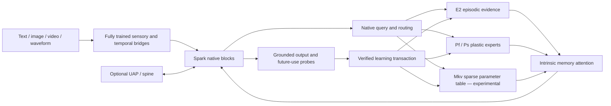

# SparkX 2.6 v5.1 — reviewed direction and expanded learning capacity

**27 October 2026 · Reviewed design, not an executed training protocol.**

The supplied v5.1 draft improves the direction. Adopt stronger visual detail, progressive full multimodal training, separate retrieval/readout diagnosis, richer experience records, and deferred knowledge consolidation. Expand native learning capacity beyond the original 16-expert bank. Treat optimizer resets, dense expert reads, projected updates and self-generated teaching as experiments with explicit failure conditions.

The [unified blueprint](23_SparkX_2_6_4B_Final_Product_Blueprint.md) remains the product entry point. This chapter owns the v5.1 corrections and capacity choices; the [MiniCPM companion](25_MiniCPM5_Direction_Correction_and_Learning_Capacity_Plan.md) owns their experimental sequence. [Review records](../../reports/sparkx_v5_1_review_20261027/README.md) preserve the supplied draft, prior documents, source versions and reproducible arithmetic. Existing executable protocols and failed receipts retain their meaning.

## 1. Decisions in one page

| Area | Updated direction | What remains to prove |
|---|---|---|
| Stable competence | Full offline fine-tuning of backbone, vision/audio interfaces, grounding, memory use and learning machinery | Useful perception and reasoning before online sensory learning |
| Visual detail | So400m NaFlex candidate; preserve the current base encoder as a diagnostic control | Quality/latency benefit, exact patch layout and native backend support |
| Immediate experience | Native `E2` records with semantic, spatial, temporal, acoustic and exact-literal channels | Learned selection, readout and abstention together |
| Persistent procedures | Expand `P16 → P32 → P64`; `P128` is a later capacity arm | Source-free new-instance learning and retention per unit of update cost |
| Persistent facts | Add an experimental sparse parameter table `Mkv`, integrated into native blocks | Better acquisition/retention than equal-cost expert capacity |
| Nested learning | Train initialization, addressing and update behavior on chronological support/future-query episodes | Gain over ordinary fine-tuning, one clock and equal-capacity controls |
| Fast memory | Optional `F` branch; keep its controlled recurrence and test gated/nonlinear alternatives | Incremental benefit after `E + P` works |
| Deployment schedule | Store eligible evidence immediately; consolidate verified teaching at a bounded later barrier | Latency, backlog, correction and exact restart behavior |
| External interfaces | Separate trained UAP/spine; memory remains intrinsic | Typed tensor alignment, ownership and causal device/model exchange |

The 4B name continues to describe the original **4,112,079,360-parameter Spark backbone**. It does not cap added modules. Expanded stored parameters are acceptable; active computation, memory bandwidth, learning work and checkpoint growth still need separate budgets.

## 2. What the repository currently establishes

These populations must remain separate.

| Result | Interpretation for v5.1 |
|---|---|
| Exact selected-record readout: held-out **148/152**, first-process **72/72**, restart **68/72** | A useful bounded literal-readout contract exists. Selection is explicit host `(entity, attribute)` lookup on a synthetic fixture, with zero optimizer updates. This does not qualify native learned retrieval, compressed memory or parameter learning. |
| Learned-memory acceptance v4: **21/384** accepted-correct facts; precision **21/138** | Preserve the rejection. Diagnose acceptance, record coverage and value readout separately; do not substitute the exact-bank result. |
| Development diagnosis: address accepted layers **62/62** correct, but only **4/256** complete fact groups; oracle complete groups **102/256** | Low coverage and value readout/abstention remain problems. A layer-level percentage cannot be reported as complete fact recall. |
| Plastic bank: response NLL **10.6891 → 5.6083**, teacher-forced exact **0/28**, greedy train-fit **0/28** | Gradients affect output, but useful learned recall has not been established. More storage alone is not a demonstrated repair. |
| Independent 16-expert continuation: uninterrupted/restarted states match exactly | Weight, optimizer and clock restoration works for this small-bank experiment. It does not prove learning quality or full-backbone continuation. |
| Vision: first update raises answer/caption NLL **10.7045/9.7734 → 11.7419/13.4482**; answers **0/14** | Address measured overshoot and trainability before a larger encoder campaign. Native wiring and finite gradients are insufficient. |

Sources: [exact-bank experiment](../experiments/20261026_Memory_Bank_Readout_Hypothesis.md), [27 October remediation](../experiments/20261027_Remediation_and_Next_Steps.md), [plastic response diagnostic](../experiments/20261026_Nested_Text_Response_Diagnostic_Budget02.md), [independent continuation](../experiments/20261026_Nested_Text_Independent_Continuation.md). No new model run was performed for this review.

## 3. Disposition of all sixteen supplied changes

| Draft ID | Disposition | Correction or acceptance condition |
|---|---|---|
| C1 — stronger vision | **Adopt direction; correct dimensions** | So400m NaFlex has width 1152. Its pinned processor defaults to 256 patches. A 1024-patch experiment needs an explicit override; 2×2 compression yields approximately 256 outputs only with the corresponding valid grid. |
| C2 — timestamps and AV interleaving | **Adopt with causal masks** | Carry numeric timestamps, availability and clock identity as well as text markers. Qwen3-VL retains interleaved MRoPE; explicit timestamps are not evidence that all spatial/temporal position encoding was removed. |
| C3 — progressive full training | **Adopt** | Image → video → audio → AV, with text retention. F2 establishes modalities; online memory optimization starts in F3/F4. No percentage is a paper-validated optimum for Spark. |
| C4 — grounded SFT then GRPO | **Stage** | Start with supervised points/boxes/intervals and causal interventions. Add verifiable-reward RL only after the grounding model and reward checks work. Charge rollout cost. |
| C5 — retrieval/readout controls | **Adopt** | Report R@16, oracle-selected readout, native accepted-correct coverage, precision and risk–coverage separately. Keep exact-context, long-context and self-KV controls. |
| C6 — hybrid retrieval | **Adopt as candidate** | Native dense keys + lexical hashes + entity anchors; no gold lookup in the product path. Distill a retriever offline, then qualify its own selections. |
| C7 — richer episodic records | **Adopt; recalculate** | Four address keys replace the old single key; do not add them to a payload that already includes it. Charge hot sensory packets, entity tables, literal payloads and projected caches. |
| C8 — single-pass access | **Target after parity** | A previous-chunk query cannot retrieve for an unseen current query. Specify a query-completion barrier and cold-start behavior; retain the two-pass control. |
| C9 — remove/replace F | **Make optional** | Existing bounded `rho/eta` recurrence is not ungated. Gated DeltaNet superiority over this complete system is unproven. Test `E+P`, `E+P+F` and alternative F with matched work. |
| C10 — reset Adam momentum | **Reject “P0 bug”; retain ablation** | Deep-RL reset evidence does not establish a universal LLM-learning defect. Existing continuation deliberately preserves moments. Reset variants require their own counters, serialization and comparison. |
| C11 — deferred self-distillation | **Adopt schedule; qualify teacher** | Store evidence first; defer parametric writes. Self-generated variants are derived data, not independent confirmation. Start with verified response supervision and compare conditioned-teacher distillation. |
| C12 — dense reads, sparse writes, projection | **Split into separate experiments** | Dense16 is a readout control. Sparse reads are the expansion target. AlphaEdit's preservation argument does not automatically apply to nonlinear expert gate/up updates. |
| C13 — meta-training | **Adopt; define credit path** | Match deployment updates in offline episodes. First-order initialization training does not automatically learn step sizes, hard routing or the write policy. |
| C14 — trust and rollback | **Adopt with provenance** | Authority comes from source/scope and explicit teaching, not repetition or a model's certainty. Candidate-generated checks cannot certify factual truth. |
| C15 — broader validation | **Adopt** | Free generation, retention, unknowns, modality interventions and long-run costs supplement public benchmarks. Three derived questions are development checks, not independent generalization evidence. |
| C16 — scalable ports | **Adopt interface invariants** | Width-512 evidence and width-256 plastic features are initial shared contracts, not proof of universal transfer. Repeat small native mechanism pilots on Spark before full training. |

## 4. Native architecture and the two kinds of parametric capacity

`E2` stores what happened, with scoped source provenance. `P` learns transformations, conventions and procedures that should transfer to fresh instances. `Mkv` is a **parameter table**, trained through the model's output loss, for learned associations. It is not an external document store or an exact factual database. `F` optionally retains short-timescale associations. All native reads enter backbone computation through trained interfaces; the host handles transport, budgets and atomic storage, not semantic answer selection.

Use `Mkv` rather than `K`: the existing blueprint already uses `K` for disposable KV caches. Parameter tables, optimizer state and caches must never share an ambiguous checkpoint namespace.

### 4.1 More experts, bounded active work

Each bias-free expert has gate/up/down matrices at width 256 and hidden width 1024:

`N_expert = 3 × 256 × 1024 = 786,432 parameters`.

At FP32, one expert occupies 3 MiB of weights plus 6 MiB for two resident Adam moments. Initial templates belong to the release; working copies belong to scoped dynamic state. Do not count shared templates twice as unique parameters, or assume a second resident snapshot is free.

| Profile | Experts / fast–slow split | Mutable P parameters | P weights + two moments | E2 compact / hot / entities | Mutable-state envelope; separate replay |
|---|---|---:|---:|---|---|
| P16 historical control | 16 / 8–8 | 12,582,912 | 144 MiB | Original v5 schema retained | Original receipt, unchanged |
| Mini capacity target | 32 / 16–16 | 25,165,824 | 288 MiB | 4096 / 256 / 4096 | 512 MiB; 128 MiB |
| Spark product candidate | 64 / 16–48 | 50,331,648 | 576 MiB | 16384 / 2048 / 16384 | 1024 MiB; 256 MiB |
| Stretch study | 128 / 32–96 | 100,663,296 | 1152 MiB | Same E2 capacity initially | 2048 MiB; 512 MiB |

These are **design envelopes, not admitted memory limits or measured fit**. Keep the current native process guards. The 16–48 split tests more slow retention capacity; a 32–32 split is the equal-total-capacity control. Compare one-clock and two-clock schedules at each selected size.

Start with one active expert per pool; test two per pool. Store 64 does not mean evaluate 64. At nine sites, the expert matrices alone cost approximately 14.16M MACs/position for two active experts, 28.31M for four, 113.25M for dense16, and 452.98M for dense64. Projections, routing, attention, bandwidth and all backward work are additional. No percentage latency saving follows directly from these MACs.

Capacity growth has three independent knobs: stored expert count, expert width, and active count. A useful matched-parameter comparison is **64 experts at 256→1024→256** versus **16 at 512→2048→512**: both contain 50,331,648 weights, but differ in representation bandwidth, routing and active compute. Resized native projections must be counted. Growth is a new offline-trained profile with an explicit migration; allocating untrained experts at runtime is not an established learning mechanism.

### 4.2 Sparse parameter table: Mkv-64k

The first separate candidate has 65,536 value rows of width 256: **16,777,216 mutable weights**, 64 MiB FP32 plus 128 MiB Adam moments. Product keys use two tables of 256×64 elements (32,768 fixed key parameters; 128 KiB FP32), representing 256² combinations. Query width is 128. Read top eight joint keys, with keys and query/output projections trained offline and frozen during the initial online experiment.

For additive product-key scores, retain top eight subkeys from each half, score their 64 pairs, then select eight joint entries. This recovers the joint top eight under that scoring rule with deterministic tie handling. The subkey comparisons use 32,768 MACs/query, excluding projections, sorting, value aggregation and memory traffic. Adding this table independently at every layer would multiply storage; the initial candidate **shares one table** and uses depth-conditioned queries at the selected ports.

The initial residual candidate shares P's backbone↔256 interface and adds a 256→128 query projection plus a separate output gate for Mkv. Nine site-specific query matrices add 294,912 fixed parameters; norms/gates remain in the implementation inventory. An Mkv-only control retains the required interfaces even when P experts are disabled. Separate output projections are a different costed design.

Rank update eligibility by current access frequency relative to a fixed **training-only background** access histogram. Only actually accessed rows may be updated. Use bounded smoothing and compare raw frequency, TF–IDF-style specificity and a separately declared KL-based score. Background statistics must not come from the sealed retention audit. Learning still comes from response/future-use loss; access specificity chooses where to write, not whether a statement is true.

The initial write budget is at most 256 unique value rows per transaction; compare 64/256/1024 only in declared capacity studies. At 256 rows, selected candidate weights, two moments and gradients occupy 1 MiB at FP32, provided the optimizer truly stages rows. This does not remove the fully resident table/moment account or justify assuming sparse backward allocation.

Begin with a 4096-row software/mechanism smoke profile, then 65,536 rows. Compare `P`, `Mkv`, and `P+Mkv` only after each independently works; match both total update work and stored capacity in separate comparisons. The Spark combined candidate adds 192 MiB of live parameter/Adam payload before row staging, indices and projections. It does not fit automatically merely because few rows are read.

Sparse updates need a real row-sparse optimizer contract. Zeroing a dense gradient does not stop old momentum or weight decay from changing an unselected row. Define per-row step clocks, inactive-row immutability, duplicate-index gradient aggregation, allocation and restart. Until qualified, full-table gradients/temporaries must be charged. A momentum-free SGD control is scientifically justified by sparse-memory literature, but requires a separately admitted protocol under the repository's current optimizer policy.

If the 64k table learns usefully and saturates, expand its **stored** capacity while initially retaining top8 reads and the 256-row write cap:

| Later Mkv profile | Value parameters | FP32 values + two moments | Subkeys per half / score MACs per query |
|---|---:|---:|---:|
| 64k reference | 16,777,216 | 192 MiB | 256 / 32,768 |
| 256k capacity arm | 67,108,864 | 768 MiB | 512 / 65,536 |
| 1M stretch arm | 268,435,456 | 3072 MiB | 1024 / 131,072 |

These larger arms exceed the original envelopes and require new resource qualification; they are not part of the default P64 profile. Row count is not a count of learnable facts. Measure correct retained facts/rules, interference and cost as teaching volume exceeds each bank's effective capacity. Product-key search grows with the square root of row count, and cache misses/bandwidth still matter even with fixed top8 reads.

Capacity migration preserves stable row/subkey identities and optimizer clocks. Changing the product-grid width changes flattened indices, and newly competing keys can alter retrieval before learning any new fact. Therefore, remap state explicitly and rerun retention/address tests; do not reinterpret old row IDs or automatically append untrained keys during use.

### 4.3 Expansion beyond the initial two clocks

Add complexity only when its benefit can be isolated:

1. **Fast nonlinear association:** compare the existing linear F with a two-layer 128→256→128 memory per head. Three groups × eight experts × four heads contain 6,291,456 mutable weights, or 24 MiB FP32; one same-size velocity adds another 24 MiB. Local functional-gradient updates, unroll activations and retained state are extra. This is an experimental Titans-inspired branch, not a faithful reproduction.
2. **Learned update strength:** begin with three offline-learned scalars per P expert, one per matrix, instead of a full parameterwise rate tensor. P64 then needs 192 rate scalars. Full parameterwise FP32 rates would add 192 MiB before training optimizer state. Freeze the learned policy during initial deployed learning.
3. **Adaptive addressing A:** qualify frozen routing first. A separately trained online query transform uses verified retrieval feedback, a bounded ranking objective and versioned state. Do not change keys silently while retaining an incompatible index.
4. **Learning-policy improvement Psi:** later compare revised update policies on independent learning episodes at equal total cost. The policy may propose writes or rates; it cannot modify its own verifier, source authority, evaluation labels or promotion criteria.

Additional clocks count as nested learning only when they have distinct objectives, causal context, transition rules and evidence of improved future learning. More banks and more timers alone are insufficient.

### 4.4 Residency inventory: measured, analytical and unsealed

The v5.1 inventory below replaces neither the current process guards nor a measured training profile. Every row is labeled by evidence class. `measured_native` means an executed load/reload or tensor-header observation; `analytical_estimate` is arithmetic over declared shapes and precisions; `unsealed`/`not_measured` means no number is asserted. No row is a measured fit, and every row keeps `full_training_qualified = false`.

| Component | Precision identity | Working payload | Evidence class | Qualification limit |
|---|---|---|---:|---|
| Retained vision tower, SigLIP2 So400m NaFlex candidate | BF16 candidate storage; width 1152, depth 27 | parameter count **unsealed** | unsealed | public aggregate includes a text tower; audit installed vision tensors before sealing |
| Base Spark backbone storage | official BF16 `bf16_06` | 4,112,079,360 × 2 B = **7,843.17 MiB** | measured | load/export/reload with zero logit difference; not a training result |
| Base FP32 training state | FP32 weights, gradients and two Adam moments | 15,686.34 + 15,686.34 + 31,372.68 MiB = **61.27 GiB** | analytical | exceeds the 50 GiB driver guard; sharded/offloaded training needs separate admission |
| Vision projector 1152→1024→2560 | FP32 weights + two moments | 3,804,672 parameters = **43.54 MiB** | analytical | shape only; no measured activation or fit |
| P16 historical control | FP32 weights + two moments | **144 MiB** | analytical | historical v5 receipt unchanged |
| P32 Mini capacity target | FP32 weights + two moments | **288 MiB** | analytical | requires useful small learner |
| P64 Spark product candidate | FP32 weights + two moments | **576 MiB** | analytical | requires P32 result at fixed active work |
| P128 stretch study | FP32 weights + two moments | **1152 MiB** | analytical | separate profile and migration |
| Mkv-4k smoke | FP32 values + two moments | **12 MiB** | analytical | mechanism/allocation qualification first |
| Mkv-64k candidate | FP32 values + two moments | **192 MiB** | analytical | after the 4k smoke and useful P learner |
| Mkv fixed product keys | FP32 frozen keys | 32,768 parameters = **0.125 MiB** | analytical | keys trained offline, frozen online |
| Mkv nine query projections | FP32 frozen projections | 294,912 parameters = **1.125 MiB** | analytical | depth-conditioned, shared table |
| E2 payload, Mini P32 / Spark P64 | BF16 compact/hot/entity | **24.5 / 130 MiB** | analytical | excludes variable text/media, indices, journals |
| Projected reader K/V | BF16 | **3.515625 MiB** (nine sites) / **2.734375 MiB** (seven deeper sites) | analytical | 200-packet bound; selection and fusion extra |
| Activations | mixed | **not measured** | not_measured | sequence, modality, replay and teacher passes dominate |
| Restart transient: selected updates | FP32 candidate weight/moment/gradient | **24 MiB** two experts / **1 MiB** 256 Mkv rows | analytical | full checkpoint copy is additional |
| Restart transient: full checkpoint | duplicate live state | **not measured** | not_measured | 16-expert continuation matched exactly; full-model restart unmeasured |

Native process guards, driver memory, sustained swap growth and host-free thresholds remain unchanged and are not derived from this table. A larger analytical account does not authorize execution. The machine-readable ledger is [analytical_capacity.json](../../reports/sparkx_v5_1_review_20261027/analytical_capacity.json); the declarative inputs are in the [v5.1 design configuration](../../configs/sparkx_2_6_v5_1_direction_design.json).

**Precision identities are not interchangeable.** The official BF16 release stores BF16 tensors and has executed load/export/reload evidence. The official FP8 release stores FP8 weights but native FP8 execution was refused on MPS and never ran. The dequantized `derivative_02` is a separate BF16-storage export with no per-token F8 quantization; it is neither the official BF16 checkpoint nor the official FP8 artifact, and cross-arm output equivalence is not claimed. Native FP8 execution has no result at all. New training uses `NativeFusedAdamW` with FP32 parameter and optimizer-state ownership; BF16 source/autocast is not BF16 residency, and FP8 inference is not FP8 training.

### 4.5 Staged admission and declared work

Capacity and sparse-table work is staged; a later stage is not runnable because it appears in this document.

| Stage | Precondition before any run |
|---|---|
| 1. Small useful learner (DC-P1) | A new protocol establishes post-teaching gains on fresh instances against reset/no-update controls at a small expert count. Exact train-answer fit alone is insufficient. |
| 2. P16 control → P32 → P64 | Stage 1 result; fixed active2/active4 controls; P64 requires a P32 learning/retention gain at fixed active work, or lower cost at matched quality. P128 remains a separate stretch profile. |
| 3. Mkv-4k smoke | Stage 1 result; native disabled parity; declared sparse optimizer contract; one shared table, frozen keys/projections. |
| 4. Mkv-64k | 4k mechanism pass; measured actual allocation/staging; 256-row write cap; explicit checkpoint/migration. |
| 5. P+Mkv | Independent P and Mkv signals; matched capacity and matched update-work comparisons. |

Before any sparse-table experiment, the protocol must preserve inactive rows under momentum and weight decay, preserve optimizer state for selected rows across restart, aggregate duplicate-index gradients deterministically, define per-row step clocks, and measure actual allocation rather than inferring sparsity from a zeroed dense gradient. Until a row-sparse optimizer is qualified, full-table gradients and temporaries are charged. Newly trainable keys or projections are a separate protocol.

Data lineage follows the source group: splits are by independent world, source document, entity family, audio clip/speaker and video scene. Derived examples inherit their source split, the audit is sealed before transaction selection, and an exposed audit is never recycled as development or training evidence. Development commit probes are not held-out proof.

Teacher competence, the declared gradient approximation (first-order identity Jacobian versus exact or truncated short unroll), and all teacher-forward, rollout, replay and evaluation work must be declared before the outer loop, multiple clocks, self-distillation or any RSI/policy-improvement loop. The ordering table in the design configuration is authoritative: useful inner learner → teacher competence and full work declaration → gradient-approximation declaration → outer loop → multiple clocks → self-distillation → RSI. Personality is specified and evaluated separately; it is not inferred from papers, affect labels or capability results.

## 5. E2: preserving enough evidence to learn from

| Resident field per compact record | Bytes |
|---|---:|
| Four 128-wide BF16 address keys | 1024 |
| Semantic 256 + two visual 128 + two acoustic 128 BF16 values | 1536 |
| Bounded identity/time/geometry/provenance metadata | 512 |
| Eight uint64 lexical hashes | 64 |
| Four 128-bit entity references | 64 |
| Thirty-two uint32 literal/base-token IDs | 128 |
| **Compact total** | **3328** |

Optional hot evidence retains sixteen 512-wide visual packets and sixteen 512-wide audio packets: **32 KiB/record** in BF16. A separate entity anchor stores three 128-wide BF16 modality keys and 128 metadata bytes: **896 bytes/entity**. Missing modalities have masks; zero is not an observation of silence.

The Mini target totals **24.5 MiB** for compact/hot/entity payloads; Spark totals **130 MiB**. These exclude variable canonical text/media, lexical indices, allocator overhead, journals and snapshots. The 32 literal IDs are a bounded window, not a substitute for complete canonical bytes when exact text is longer. Retain payload references with explicit quotas and report loss of re-encoding capability after raw media eviction.

At each decision, select at most sixteen records. Bound compact evidence to 64 packets, hot visual selection to 64 packets, hot audio selection to 64 packets, plus eight workspace packets: at most **200 width-512 reader packets**. Nine-site projected BF16 K/V alone would cost 3.515625 MiB. The proposed deeper-only E route uses seven Spark sites and 2.734375 MiB instead. Selected literal readout has a separate ≤512 base-position budget when used; it is not hidden inside the 200-packet count.

Entity links carry confidence, source and temporal validity. A visual track is not automatically a global identity. Consolidate complementary encounters only after resolving contradictions and clock/frame compatibility. Preserve distinct source evidence when identity is uncertain.

## 6. Ports, retrieval and causal scheduling

Retain Spark's original operator geometry and attention masks. P branches may use all nine existing sites. For a single-pass E candidate, obtain native queries around blocks 8–10 and inject retrieved evidence at blocks **11,15,19,23,27,31,35**. Blocks 3/7 may consume already-available workspace/F state, not a query computed later in that same token's graph. Mini uses its own 42-layer mapping; no Spark index is copied blindly.

Keep the qualified two-pass design as the control. A proposed single-pass deployment schedule is:

1. Process observed input chunks using only state/query information available before each chunk. Initial chunk has empty retrieved evidence unless a previously valid task query exists.
2. At completion of a user query, seal the query representation. Insert one explicitly trained internal read-barrier position before generating the answer. It is excluded from answer scoring but included in position/latency accounting.
3. Retrieve eligible E records using the completed query; deeper sites of the barrier/answer path can read them. Do not retroactively inject this selection into earlier query positions.
4. Freeze selected state revisions for generation. Commit observations and accepted learning only at the next transaction barrier; invalidate affected KV.

The barrier is a proposal, not a free hidden forward. Test its format, first-answer accuracy, position offsets and cold-start cost. During streaming, a completed audio window may arrive later than its nominal start time; availability masks take precedence over timestamps. Preserve the old route if single-pass quality is inferior.

Hybrid retrieval combines dense similarity, lexical/entity channels and a learned fusion score. Scores are relevance signals, not truth probabilities. Calibrate abstention on development data and measure accepted-correct coverage; high precision obtained by nearly always abstaining is not a capable memory system.

Admit at most two global dense queries per decision initially. Scoring four 128-wide keys for each of 16,384 records costs 16,777,216 dot-product MACs for those two queries before fusion, filtering, sorting and index access. Mini's 4096-record equivalent is 4,194,304. This is a boundary cost, not a per-token/per-layer charge; additional refreshes must be counted explicitly.

## 7. Learning transactions and nested objectives

### 7.1 Evidence admission and delayed consolidation

An observation can enter scoped E with tentative status immediately. Persistent parameter learning requires a declared teaching source or a verified outcome, task/scope identity and a supported target. Separate ordinary observations from instructions embedded inside media. Repeated assertions do not gain authority through repetition, and a model's confidence does not upgrade source provenance.

A teaching transaction identifies source revisions, typed claims, expected invariances, selected plastic rows/experts, replay policy, optimizer recipe, work budget and idempotency key. It may remain queued, commit, reject or become obsolete after correction. Keep at most one bounded pending slow job and coalesce duplicates. Acknowledgments distinguish “stored,” “queued for learning” and “learned under the declared test.”

### 7.2 First useful learner before self-distillation

Start with verified response/grounding loss through a frozen decoder, plus retention replay. Freeze original backbone and sensory weights during deployment, but include downstream backward cost. Keep a local feature-loss alternative only if it predicts actual source-free output gains.

Then compare a conditioned-teacher arm. Let `q` be a detached snapshot of the same release and pre-update dynamic state conditioned on valid teaching evidence; let `p` be the student without that evidence. Sample student prefixes and minimize per-token **forward KL, `KL(q || p)`**, on those prefixes. The paper's reverse-KL formulation is a separate arm; the authors' revised implementation description and pinned repository identify forward KL for reported experiments. Forward-KL soft-target training is equivalent to teacher cross-entropy up to a target-only entropy term. Do not describe it as categorically unrelated to next-token prediction.

The frozen original backbone can be shared between the two logical views. Dynamic teacher snapshots, two sets of activations/logits, student generation and all teacher forwards still cost resources. EMA of dynamic parameters is a separate candidate with explicitly charged state. This deployment teacher is a frozen internal computation, distinct from an external offline teacher used for modality training.

Before using self-distillation, show that the evidence-conditioned teacher can answer the task. Its consistency or entailment score is not independent verification of a new fact. Teacher mistakes can be distilled. Start with source-verifiable templates/labels; compare 0/4/8 derived examples and only increase to 16 when additional measured benefit pays for generation and checking. Crop/time reversal/pitch transformations are allowed only when the target remains true; inverse relations require actual logical support.

### 7.3 Inner update and optimizer alternatives

The existing one-clock protocol remains **one step/event**; its rejected two-step attempt remains rejected. New work declares its own bounded step count before execution. Use 1/2/4 steps as distinct development candidates; eight steps requires another cost/quality justification. The selected recipe must be used inside offline meta-training and deployment qualification.

| Optimizer arm | State contract |
|---|---|
| Carry Adam m/v | Historical control; restore weights, both moments and per-expert clocks exactly |
| Reset both moments per teaching event | Event-local counters; preserve mid-event state if resuming inside the event |
| Reset m, carry v | Separate first- and second-moment bias-correction clocks; a stock single Adam step counter is not an equivalent definition |
| Freeze v / decay v / SGD | Different algorithms, each declared and compared separately; no silent policy replacement |

The draft's 0.1/0.19 coefficients describe raw first-moment contributions for beta1=0.9, not the fraction of a normalized Adam parameter step attributable to the new event. Prior moment magnitude, second moments, bias correction and whether an expert was previously touched all matter.

Sparse-write and projection variants follow useful unconstrained P learning. Freezing `down` while editing selected gate/up rows changes representational freedom; compare it against three-matrix updates at equal budgets. If projection is used, project the **final proposed parameter update**, not merely a gradient subsequently altered by momentum, adaptive scaling or clipping. Measure protected activation/output drift. A finite anchor subspace is not a proof of global non-forgetting, and AlphaEdit/MEMIT formulas cannot be relabeled as equivalent nonlinear-MLP updates.

### 7.4 Outer learning and consolidation

Chronological episodes separate teaching support from future queries and prior-skill retention. Exercise at least two slow-clock boundaries. The proposed objective is:

`J = L_future(P_after, Mkv_after) + λ_old L_retention + λ_ground L_grounding + λ_cost C_actual`.

An initial first-order estimate trains P initialization and direct query/read paths while omitting derivatives through the inner optimizer. It cannot learn the omitted step-size path. A later functional one/two-step comparator explicitly differentiates through the chosen update; a truncated last-two-step arm detaches earlier history and states that bias. Hard top-k addressing remains nondifferentiable without a declared estimator or auxiliary supervision.

Use E dropout and source-free outer queries to prevent the learner from solving everything by lookup. Compare 0/25/50% source-free episodes and select using development retention/learning, rather than treating the draft's 30–50% as established. Keep normal E-assisted service quality as a separate endpoint.

Slow Ps consolidates verified recent and age-balanced experience after sixteen eligible teaching events initially; compare 8/16/64 only in a new clock study. Copying Pf weights or shrinking Pf by 0.5 is not automatically consolidation. Validate Ps source-free transfer before any reset/decay of Pf; preserve a reversible prior state and remove obsolete targets from replay.

## 8. Multimodal direction corrections

Pin the So400m NaFlex candidate to [revision cc24074f717b612951c2dead130904ab9b65a81e](https://huggingface.co/google/siglip2-so400m-patch16-naflex/tree/cc24074f717b612951c2dead130904ab9b65a81e). Width is 1152, depth 27, FFN width 4304. The public model total includes a text tower; it is **not** the retained vision-only parameter count. Audit the installed vision tensors before claiming the final product total.

Use a 1152→1024→backbone-width projector initially. Keep 256 uncompressed patch features as a control. Test an explicit ≤1024-patch view with valid 2D grid/padding and 2×2 learned reduction, approximately 256 outputs where geometry allows. For comparison, a fixed 384/14 image gives a 27×27 grid; padding to 28×28 then reducing 2×2 yields 196, not 256. Tiling is an additional position budget, not a free resolution upgrade.

For audio, preserve native ~50 Hz internal SPEAR features and compare 10/12.5/25 model-facing tokens/s. Four-to-one grouping gives approximately 12.5 Hz; it is our candidate, not a measured quality guarantee. Speech, sound, music, prosody and listener-perceived affect require separate evaluations. Noncausal encoding waits for its closed window. Emotional appraisal controls attention and uncertainty; it must not become factual authority or a claim of subjective feeling.

Use progressive **full offline** modality training with continued text rehearsal: image grounding, short video and temporal relations, native audio, then synchronized AV. F2 has zero online-memory updates and no learning episodes in its mixture. F3 trains memory use with frozen-state and absence controls; F4 trains the learner itself using chronological episodes. Modality retention continues during F3/F4. The initial 4.4B/65.57-GiB full-training scenario is historical and understates the changed encoder/capacity inventory; recalculate the final graph before provisioning.

An explicit 16-second **coarse** budget example is four 256-position frames + 200 audio positions at 12.5 Hz + 64 event positions + 32 timing/control positions = **1320 positions**, excluding text/answers and internal encoder work. Two extra 256-position detail crops make 1832. Neither four frames nor the timing-token count is a validated task-coverage rule. Fine temporal events require denser sampling and a larger charged budget.

Train visual primitives and continuous features together, then test whether the primitive changes downstream decisions under image/time counterfactuals. Grounded RL is optional after supervised competence. Base Spark RoPE/masks remain intact initially; media clocks and spatial features enter trained bridges. Bidirectional attention within a completed media span is a separate mask/training arm, never permission to expose future streaming observations.

## 9. Vocab, provenance and native experience reuse

Preserve base IDs, concept/lexeme identities and generation-boundary slot swaps. E keys and Mkv/P routing cannot use a transient slot number as concept identity. A memory may be recalled using a new name, a new view or a sound; the association must survive removing the original phrase row and remapping its slot to an unrelated concept.

Test the complete cycle: teach a novel audiovisual convention → store scoped evidence → consolidate eligible parameters → evict lexical rows → restart → reintroduce a new surface name → query a new scene. Report E-assisted recall and parameter-only transfer separately. The latter removes E/F/C, raw sources, answer-bearing prototypes, old vocabulary rows and source KV, retaining only the declared learned parameter bank(s), stable model and a normal fresh query. Keep native routing; no hidden oracle expert label.

Corrections update source lineage first and mark derived parameter effects as requiring repair. Exact parameter unlearning is not assumed. Keep contribution metadata and reversible transactions; if an affected dependency cannot be isolated, reset/relearn the scoped bank or report the limitation. Storage growth and source deletion policies remain explicit.

## 10. Evidence basis and limits

The review inspected decision-critical sections and code/configuration, not every citation in the supplied bibliography. Primary-source versions, hashes and reviewed sections are in the [source manifest](../../reports/sparkx_v5_1_review_20261027/evidence.json).

Document lineage is explicit. The [migration manifest](../../reports/sparkx_v5_1_review_20261027/migration_manifest.json) records every changed existing document, added identity, retained historical control, arithmetic change and unversioned local artifact reference with old/new hashes and a reason. [repository_snapshot.json](../../reports/sparkx_v5_1_review_20261027/repository_snapshot.json) preserves the input bytes; it is source material, not an execution instruction. Untracked references are either this review's declared additions or pinned local-only run receipts that a clean checkout is not required to contain. The portable verifier checks links, references, arithmetic and migration integrity only. Native measurements and their unresolved gates are listed in [native_gates.json](../../reports/sparkx_v5_1_review_20261027/native_gates.json) and are not converted into passed design checks.

| Primary source | What it supports / limit for our design |
|---|---|
| [Memory Layers at Scale](https://arxiv.org/html/2412.09764v2), §§2–4; [Product Keys](https://arxiv.org/abs/1907.05242) | Sparse native parameter lookup can separate stored capacity from dense computation. Bandwidth and kernels remain significant; large-scale pretraining is not instant online-learning evidence. |
| [Sparse Memory Finetuning](https://arxiv.org/html/2510.15103v1), §§3–6 | Selective value updates based on background access statistics improve a factual learning/forgetting tradeoff in its setting. The study uses memory-layer models, substantial augmentation and optimizer-specific choices; our small residual retrofit and multimodal transfer are new experiments. |
| [Improving Sparse Memory Finetuning](https://arxiv.org/html/2604.05248v1), §§3–5 | A small-model retrofit is relevant exploratory evidence. It replaces FFNs, needs recovery, and has inconsistent 20k/10k recovery-data descriptions; KL selection does not dominate on every task. It does not justify replacing Spark FFNs by default. |
| [SDFT v2](https://arxiv.org/html/2601.19897v2), §3 and appendix; [pinned authors' code](https://github.com/idanshen/Self-Distillation/tree/d77573212fa0a3ae2eeb64b9b44db1c251f75e3e) | Demonstration-conditioned self-distillation is useful evidence. Revised practical discussion and code use forward KL despite reverse-KL theory. Teacher competence, rollout cost and 2B/4B transfer need tests. |
| [Cartridges](https://arxiv.org/html/2506.06266v2), method | Self-study distillation into a trained cache motivates a compression control. Cache training is not evidence that a handful of P updates learns arbitrary new facts. |
| [Adam reset](https://arxiv.org/pdf/2306.17833) | Sequential value-learning experiments motivate an optimizer-state ablation. They do not establish carried momentum as a universal continual-LLM bug. |
| [AlphaEdit](https://arxiv.org/html/2410.02355v3), method; [Meta-SGD](https://arxiv.org/abs/1707.09835), method | Projection and learned update strengths are legitimate research directions. Their mathematical conditions and differentiation paths must be re-established for our nonlinear sparse branches. |
| [Nested Learning / HOPE](https://arxiv.org/html/2512.24695v1); [Titans](https://arxiv.org/abs/2501.00663); [MemT-1.0](https://arxiv.org/html/2610.26825v2) | Motivate timescales, adaptive memory and backbone integration. This proposal is a synthesis with explicit deviations, not a reproduction of any complete method. |
| [SigLIP2](https://arxiv.org/html/2502.14786v1); [Qwen3-VL](https://arxiv.org/html/2511.21631v1), §2; [Ola](https://arxiv.org/html/2502.04328v3), §3.3 | Support richer visual features, explicit timing and progressive multimodal training. Their data, architecture and results do not set Spark's optimal token rate or curriculum. |

## 11. Handoff and product decision

The next implementation decision is a **new, bounded MiniCPM hypothesis**, not an unqualified full-model training launch. Resolve response learning and vision overshoot, qualify learned E2 retrieval/readout, then compare P32/P64 and Mkv with explicit capacity/compute controls. Carry the winning mechanisms to a small Spark pilot before the final multimodal/learning campaign.

Ship the expanded learner only when source-free acquisition, correction, old-skill retention, native modality use, exact restart and measured efficiency pass together. If only E recall passes, ship and name that capability accurately while continuing parameter-learning research. The personality description remains pending; preserve the neutral conditioning path.
