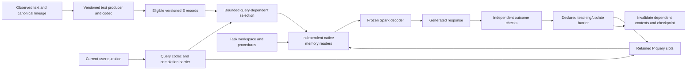

# Spark text memory with the internal spine — active milestone

**Version 1 · 28 October 2026 · Sealed control and implemented contracts.**
The active prospective roadmap is now
[chapter 28](28_Spark_Persistent_Learner_and_Tiered_Memory.md). Its expanded
profiles and tiers do not modify this version's executable budgets.
The executable budgets and bindings are in
[`configs/spark_text_memory_protocol_v1.json`](../../configs/spark_text_memory_protocol_v1.json).
This chapter reconciles the active roadmap; dated MiniCPM, vision and DC protocols
remain historical evidence rather than competing priorities.

**Implementation status:** commit 9b1a02d. The recorded affected suite passes
177 tests and final-product tests pass 16. The preserved CPU fixture completes
fit/development/restart with exact parity, but all nine arms score 0/12 on new
instances. The fixture is randomly initialized and has pointwise decoder blocks
without attention; this negative result is not a Spark full-context diagnosis.
Useful native learning remains unestablished. The
[new review](../../reports/spark_persistent_learner_review_20261028/README.md)
records six clean-snapshot protocol failures caused by ignored source assets.
The next native comparison must establish real full-context competence and
readout; larger storage can be engineered independently. See the
[milestone handoff](../experiments/20261028_Spark_Text_Memory_Milestone.md).

## 1. Active source and scope

The active source baseline is `XHToken/Spark-X2.6-4B-FP8` at revision
`0318d6f6ab070c7b5b43052db571489b2508006c`. The official BF16 release and the
FP8-derived BF16 artifact are independent controls. Official FP8 storage,
official native-FP8 execution, official BF16 execution and dequantized BF16
execution must be recorded separately for every result. A dequantized artifact
is never a silent substitute for official FP8, and FP8 inference does not prove
FP8 training support.

The internal spine is present from the first text-memory interface, not added
after a separate retrieval product. It remains intrinsic when no external sensor,
specialist model or actor is attached. Native vision/audio training and physical
actor/sensor work are deferred. MiniCPM results remain mechanism controls only;
no MiniCPM vision or learning milestone gates this Spark text branch.

The sealed v1 sequence is (chapter 28 now owns subsequent work):

1. Reconcile readout, model-identity, publication and retired-runner repairs.
2. Repair query access, bounded reads, ownership, invalidation and update evidence.
3. Connect text observations through a versioned codec to native memory reads and
   supervised responses; prove tiny CPU gradients and updates.
4. Compare matched chronological baselines for knowledge, procedure reuse,
   correction, retention and cost.
5. Commit the complete implementation and versioned protocol, then run preflight.
   Execute one guarded native pilot only with exact external authorization for
   official FP8 and the actual execution backend.
6. Use broader independent-source, multi-seed qualification only after the small
   pilot demonstrates useful behavior. Do not respond to failure by enlarging P,
   Mkv, read budgets or the mechanism set.

## 2. Repaired memory contracts

### Query-driven P-only reads

E records and P parameters are different state. P-only evaluation removes E,
source text/KV, answer-bearing caches and task-derived teaching state, but retains
an ordinary current question and the stable model. A query codec derives bounded
slots from that current question/native hidden state; retained P transforms those
slots before the independent memory port. Empty E therefore cannot force a zero
P read. Reset or wrong-P controls must remove the claimed effect.

### Storage is not a read budget

Active-record capacity, retained lineage and the per-query codec slot cap are
separate quotas. More than eight eligible records cannot be passed silently to an
eight-slot codec. The initial query-dependent selector scores only eligible
records using current query features and declared producer keys, chooses at most
eight, and reports selected/omitted identities and provenance. Host eligibility
checks never supply answer-aware IDs. A future compression mechanism needs its
own version and quality evaluation; it is not silently inferred from truncation.

### Ownership, versions and invalidation

Admitted packets and decision snapshots have owner-controlled storage and immutable
metadata. Callers cannot mutate another owner's payload or decision revision.
Differentiable training inputs remain connected through the intended graph;
inference checkpoints detach explicitly. Representation or codec mismatches are
rejected unless a separately qualified conversion exists.

Correction, revocation, restore, parameter changes and producer/representation
changes invalidate all dependent contexts and derived caches. Public mutations
must route through the same invalidation path. Deleting E does not unlearn P:
teaching records identify the evidence versions used for updates. Affected P is
repaired by an explicit reset/replay or evaluated unlearning policy, not by
pretending that record deletion subtracts a nonlinear update.

### Bounded durable state

Active records, retained history, snapshot caches, metadata, replay, journals and
checkpoint transients have independent quotas. Canonical text or durable source
references remain sufficient for declared rebuild/re-encoding. Eviction that
loses rebuild capability is reported. A fresh-process rebuild starts with derived
caches absent and preserves source/producer/representation lineage.

Execution completion, actual optimizer steps, changed tensor names, train fit,
transfer, retention, useful learning and measured cost are separate evidence
fields. Zero-LR or otherwise unchanged parameters cannot claim learning. A retry
reports zero new work.

## 3. Connected text-memory-response path

The query representation is complete before any injection site that consumes it.
Additional sensing passes are explicit work, not free context. Teacher-forced
answers and future outcomes never enter the query or memory construction.

Response cross-entropy flows through the frozen decoder and can produce
gradients in both spine modules and selected P parameters. In the current
implementation, the response optimizer updates only extension.spine parameters;
P gradients from that loss are not applied by that optimizer. P is updated
separately by its owner against a projected verified-answer vector. The
backbone remains in the autograd graph despite frozen weights, and backward
work is charged. Gradient presence, actual parameter change and useful future
answers are separate checks. Chapter 28 specifies a new direct-CE P reference
and a distinct learned local-write experiment; neither is already implemented.

## 4. State that must remain distinct

| State | Required content and authority |
|---|---|
| Exact evidence | Versioned observations, canonical text/source references, scope, time and correction lineage |
| Procedures | Compact reusable methods, applicability, prerequisites, exceptions, independently checked outcomes and verified failure lessons |
| Task workspace | Goals, subgoals, current branch and independently observed completion; not a hidden answer cache |
| Plastic P | Selected parameters plus optimizer moments, clocks, dedup and evidence-version lineage |
| Generated explanations | Candidate interpretations only; never upgraded to facts by confidence or fluent text |

## 5. Two success criteria and strong baselines

Knowledge acquisition is judged by actual generated answers on fresh paraphrases
and new instances after restart and source removal, with correction, unknown and
older-rule retention probes. Train fit is diagnostic only. No-update, reset-P,
wrong-P and shuffled/inapplicable-memory controls test attribution.

Reasoning reuse is judged separately against the strongest appropriate
full-eligible-context baseline. A small quality noninferiority margin is
predeclared; near-ceiling controls do not require an impossible accuracy gain.
Total-cost comparisons include ingestion, retrieval, sensing, prefill, generated
reasoning/output, teachers, verification, backward, updates, replay,
consolidation, checkpointing and reload. Break-even is reported only when measured.

The full eligible-context and oracle-selected exact/procedure arms are explicitly
reference or upper-bound controls. E-only, source-free P-only, E+P and the
nonlearning/reset/shuffled controls use declared causal information, not hidden
answer IDs. Uncached training/reference checks remain separate from cached
deployment claims.

## 6. Version-1 learning scope and deferred mechanisms

The pilot uses chronological fit/development streams split by independent world
and rule family. It includes new information and procedures, similar-looking
tasks requiring different methods, corrections, exceptions, revocations,
unknowns, delayed recall, interference, restart and capacity pressure. Development
feedback selects no sealed-final rows. Multi-seed qualification follows only a
useful small pilot and uses balanced orders and source-clustered uncertainty.

One clock is the initial learning schedule. Nested outer objectives require useful
inner learning, teacher competence, complete cost accounting and an explicit
exact/truncated/first-order gradient declaration. Multiple clocks require a
matched single-clock control. Self-distillation and RSI remain gated. Personality
is separately versioned and cannot change evidence truth. Dynamic Engram, Mkv
and runtime compilation are later independently measured mechanisms.

## 7. Native admission and resource accounting

Native execution uses one exclusive MPS worker with fallback disabled, the
50 GiB sampled driver limit, 512 MiB sustained swap-growth limit and 15% minimum
host-free rule. Full-backbone FP32 AdamW training is not admitted under that
budget. Only the declared extension/query/codec/port/P groups use
NativeFusedAdamW with FP32 parameter and optimizer-state ownership.

The protocol binds checkpoint, source and execution precision, backend,
tokenizer/chat template, thinking level, greedy decoding, context/generation
limits, trainable membership, update counts, task lineage, controls and stop
conditions. Authorization for one execution format does not authorize another.
Checkpoints are extension/dynamic-state only and reference the sealed source; no
duplicate base checkpoint is saved.

Cold-start, steady-state and amortized costs are reported separately. Cached
deployment requires equivalence and invalidation evidence before any speed claim.
A small pilot establishes engineering and, at most, the behavior measured on its
declared worlds; it cannot establish lifelong learning, improved reasoning,
speedup or RSI.
