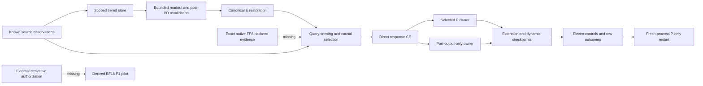

# Spark persistent learner, tiered memory and Replica integration

## Current implementation — official BF16 diagnostic v5
Read the [current v5 report](../experiments/20261029_Spark_Memory_BF16_Diagnostic_V5.md),
[runbook](../../reports/intrinsic_memory_successor_v5/README.md) and
[evidence summary](../../reports/intrinsic_memory_successor_v5/verification_summary.json).
Implementation `771e9586` follows review `017f7d71`. The user's selected source is
existing official `XHToken/Spark-X2.6-4B` BF16, revision
`66e3ae7bee54e0a523d692cb8ef841f35409807b`. All 18 source files were rehashed;
no download, base copy or native model execution occurred. Keep official BF16,
FP8-derived BF16 and native official FP8 identities distinct.

V5 implements cutoff-aware reads, persistent bounded cold-read tickets and immutable
producer-release rebuilds; eight-slot masking; complete-EOS fitting and generation
probes; and a dedicated 2/9/36 producer/store/reader runner. Live tensors preserve
producer gradients, and one NativeFusedAdamW owns each intended parameter. The
complete checkpoint binds source, objective and execution identity. The whole attempt
has an outer wall supervisor and pre-reserved stage work, including failed work,
source validation, probes, artifacts and fresh-process continuation. Sealed v3/v4
execution files and historical results remain unchanged.

Clean code snapshot `771e9586` passes 393 affected tests in 64.60 s. Its 2/9/36 CPU
workflow passes exact fresh-process logits and one real continuation update per arm
in 14.605376 s, peak RSS 624,705,536 bytes. A separate unchanged-Spark-code probe uses
36 tiny random CPU BF16 layers and passes parity, two updates and producer gradients;
it loads no original checkpoint weights. These are engineering results, not useful
memory. The historical attempt03 passed S0 8/8 and failed S1 (contextual 0/8,
selected exact text 8/8). Do not tune on its development worlds.

The next executable experiment is the fully bound
[two-site v5 packet](../../reports/intrinsic_memory_successor_v5/native_packet_two_v5.json).
All three earlier approvals are consumed; a new exact approval is absent. The
packet requires 8/8 complete-context competence, then 32 complete-EOS readout updates,
a fitting-only memory-dependence gate before fresh development, and one restart update.
It permits zero P updates, 957 forwards, 856 generated tokens, two sequential model
loads, 7,200 seconds, 160 MiB artifacts and zero retries. Keep the exclusive worker,
50 GiB driver / 512 MiB sustained swap / 15% host-free guards. Nine/all-layer packets
have independent budgets/approvals and require useful current two-site evidence.

The intrinsic memory layer participates in Spark computation; the external spine
continues to connect specialists, sensors and actors. Keep block-input queries and
post-block residuals explicit. Useful recall must precede completed-interaction
formation, within-reasoning commits and source-free P learning. Keep P1; nested
adaptation, RSI and promotion remain closed. Preserve E/S/P/phi/C/I/K ownership,
approved identity outside reward and the Replica/semi-cognitive-core contracts.
Hot/warm/cold placement is independent of learning clocks; bounded active identity
and task state need measured residency, with explicit archival recall. Native
multimodal work is deferred. Never read, import, edit or stage
src/replica_lab/runtime_pilot.py. Preserve unrelated dirty work.

## Preserved intrinsic-memory v3/v4 implementation and native control

**All-layer architecture target:** the separately versioned
[v4 access candidate](../experiments/20261029_Spark_Memory_Layer_Access.md) implements
independent 2/9/36-site readers over one shared snapshot, active-layer masks,
unique NativeFusedAdamW ownership and a strict reader-only checkpoint format.
The [combined v4 training integration](../experiments/20261029_Spark_Memory_Integrated_Access.md)
now connects the existing contextual producer and tiered store, with one shared
snapshot and a complete producer/reader/optimizer checkpoint. CPU tests prove
parity, all-site gradients and fresh continuation; native density remains unrun. The sealed
v3 3/7 native experiment remains the control. Compare 2, 9 and 36 directly after
numerical/resource and competence gates; 23/31 or six sites are optional diagnostics.
Current hooks query block input and add after the block; attention-before-MLP
fusion and shared/grouped fast banks are separate comparisons. There is no writer
in the reader forward. All-layer parameter arithmetic is not a native memory-fit
or learning result; use the successor's corrected cost ledger and evidence scope.

The completed fixed [Spark memory S0–S1 control](../experiments/20261029_Spark_Memory_S0_S1.md)
measured frozen-baseline competence, intrinsic recall and restart separately. The
[29 October ledger](../../reports/intrinsic_memory_v3/evidence_ledger_20261029.json)
is the current evidence/status source. S2 formation, S3 persistent learning,
S4 functional control, S5 nested adaptation and S6 learner improvement each need
separate controls and advancement evidence. They are not simultaneous active runs.
The [research cross-check](../research/spark_memory_20261029/Research_Crosscheck.md)
distinguishes paper mechanisms from our dimensions, sites, update counts and
acceptance margins, which remain project hypotheses until measured.

The [v3 runbook](../../reports/intrinsic_memory_v3/README.md) preserves the completed control. The user's
architecture correction restores separate `intrinsic_memory`, `plastic_knowledge`
and external `spine` responsibilities already specified in the intrinsic architecture.
The spine connects external specialist models, sensors and actors through typed,
trained endpoints; it does not own core memory. Memory owns formation, addressing,
recall, retention, correction and learning inside Spark, regardless of storage tier.

Code f471f54 installs `extension.intrinsic_memory`, its independent two-site/eight-slot
spec, a dedicated decoder context and v3 checkpoint namespace. The contextual path
uses `use_spine=False`, no dummy Packet and no external codec. Parameter objects
transfer out of the legacy memory branch; remaining external endpoints are preserved.
Historical full-extension models load before transfer; explicit v2-to-v3 readout
migration retains weights/moments and refuses silent reinterpretation. The actual
previous CPU artifact has exact migrated logits and exact optimizer continuation.
Empty-spine forward/backward, unique ownership and different memory/spine sites pass.

Canonical spans remain bounded to 256 UTF-8 bytes within 8,192-byte sources. Four
ordered FP32 width-256 contextual slots per span enter the intrinsic reader directly;
the admitted maximum is two spans/eight slots; attempt03 actually selected one
span/four slots. Scope/time, correction, producer/codec,
generation/revision and payload identities revalidate. Training preserves encoder
and reader gradients; durable state and inference detach. Exact fallback charges
text/tokens and prefill. Original attention, positions, gated attention, GELU and
tied output remain unchanged. Sites 3/7 are active; 23/31 is a later separate test.

The prior increment's executable-code manifest, latest-hot/cold-publication authority
separation and complete pre-fit competence gate remain active. Focused v3 tests pass
59. Calibration is still 0/8 on the random CPU fixture, so no learning labels open.
Numerical migration/parity/gradient/restart checks are engineering evidence only.
Source qualification, numerical qualification, competence, useful readout, durable
learning and promotion remain separate. See current packet and measured costs in
the runbook. The [attempt03 report](../experiments/20261029_Spark_Memory_Native_Readout03.md)
and [result receipt](../../reports/intrinsic_memory_v3/native_readout03/result.json)
record native S0 competence at 8/8 correct with zero false recall and no evidence
truncation on the existing FP8-derived BF16 artifact. Exactly 32 planned updates
completed. S1 fails: contextual/exact/wrong/shuffled/absent score 0/8, 8/8, 0/8,
0/8 and 1/8; respective false-recall counts are 1, 0, 1, 1 and 0. Fresh-process
reload reproduced exact logits and completed one actual continuation update.
Declared frozen-base ownership/version checks pass; these are not a new full
post-training byte hash. There were 33 total updates and zero P updates. Native
continued weights were not compared against an uninterrupted update. False recall
follows the declared scorer on expected unknown cases, including malformed repeated
unknowns. Neither competence nor optimizer execution establishes useful memory.
Formation, persistent learning and promotion remain closed.

Guard wall time was 2,246.088 s; peak sampled driver memory was 39,990,558,720 bytes
(37.244 GiB), swap growth zero and minimum host free 31%. Final native output was
48,141,905 bytes. The report distinguishes sampled driver/RSS from physical totals,
actual four-slot occupancy, unsynchronized producer timing and missing separate
cost categories. Native correction/revocation cases were source-text statements;
dynamic store invalidation and tier movement remain CPU engineering evidence.

The first two attempts failed before any calibration answer because their launch
selected the wrong Transformers environment and then left the backbone on CPU
while inputs were on MPS. Preserve these execution failures separately from
attempt03's measured competence/readout. All three single-attempt authorizations
are consumed; there is no automatic retry. Official FP8 remains blocked on MPS.
The earlier combined-v4 268-test/13.329595-second receipt is recorded evidence,
not rerun during attempt03. Newly run future-only wall supervision and explicit
EOS-completion repairs pass 67 clean CPU tests in 5.36 s; neither ran in attempt03. The historical
answer-word objective's missing EOS is a candidate diagnosis, not a demonstrated
sole cause. A new native repair must bind its own protocol, runner/checkpoint
identity, data roles, budget and exact authorization without changing this result.

Recall currently queries fixed episodic slots from evolving decoder hidden states.
The P-only one-slot question-conditioned path remains an explicitly labelled control;
its single-slot softmax cannot address P differently at each reasoning step. After
useful recall, first test completed-interaction storage for the next interaction.
Separately test provisional C/F writes within reasoning: read chunk-start state,
accumulate, commit once and expose only to later chunks. Bind sequence positions,
revisions, retries and checkpoint recomputation. Growing-prefix replay must not write old
tokens again. Generated hypotheses may be provisional working state, not verified
E/S facts. Then compare hidden-state-conditioned plastic experts/associative reads
against the fixed control. Native P learning still requires the eleven matched
controls, distinct future queries, chronological correction/revocation and retention.
Capacity, learned writers, nested clocks and RSI stay evidence-gated.

The [formation and Replica successor specification](../experiments/20261029_Spark_Memory_Formation_and_Replica_Successors.md)
connects this work to the existing CognitiveCore, TaskRuntime and approved identity
contracts. It defines exactly-once schedules and tests hot/warm/cold validity
independently of learning clocks. Useful recall must precede those capability claims.

The receipts below describe historical implementations or future design requirements;
they do not supersede this ownership boundary or establish current learned capability.

**29 October 2026 · implemented v2 engineering runtime; native execution and useful learning remain unqualified.**
This chapter owns the current direction after the Spark architecture audit and
the user's persistent-learner feedback. Spark intrinsic memory is the priority; the external spine
remains a separate connection interface. Expand storage engineering and parameter profiles now; select
larger trained banks only after a small learner demonstrates useful behavior.
Native multimodal training remains deferred. Specialist models may later send
typed observations through the same spine.

Read the [review and independent checks](../../reports/spark_persistent_learner_review_20261028/README.md),
[expanded design configuration](../../configs/spark_persistent_learner_tiered_design_v1.json),
[capacity arithmetic](../../reports/spark_persistent_learner_review_20261028/capacity_arithmetic.json)
and [worker instructions](16_Loop_Agent_Instructions.md).
The sealed [v1 protocol](../../configs/spark_text_memory_protocol_v1.json) and its
negative fixture results remain unchanged. V2 adds a separately versioned P1
runtime and durable tiered store; P4 and larger profiles remain lazy and no
expanded bank is allocated. V1 limits and evidence are not rewritten.

## 1. Evidence and the corrected starting point

The earlier review at 07f64ab2 found substantial spine/text-memory interfaces but
no useful native learning. V2 now adds a separately versioned implementation:

- `persistent_learner_runner.py` runs direct response CE through selected P,
  with a dedicated NativeFusedAdamW owner for final port outputs only. Initial
  null parity and later nonzero influence are checked. Non-port spine and local
  MSE updates are not hidden in this arm.
- `tiered_memory.py` owns scoped immutable cluster generations, separate
  retrieval keys/readable values, canonical fallback, tier accounting, cold
  recall tickets, correction quarantine, authenticated reset, recovery and
  resumable task journals. The runner uses it for evidence, procedures, tasks
  and raw P weights/moments/clocks around neural boundaries.
- The contextual CPU fixture has real causal attention and a tied output path.
  It is not the native checkpoint. Its generated-answer result remains 0/12 per
  arm, so useful readout is inconclusive rather than established.
- Portable protocol tests use tracked source/Git metadata mocks; production
  source authentication is unchanged. Official FP8, official BF16 and
  FP8-derived BF16 remain different execution identities.

The active SparkX2.6 source has 36 layers, so sites 3/7 and 23/31 are valid
candidates. Native FP8 forward/backward/single-update evidence is still absent;
late-site behavior and native full-context competence are unmeasured. No native
model, download, precision substitution, promotion or learned-capability claim
is established by this engineering work.

### 1.1 Integrated readout, recovery and control receipt

The current implementation adds `tiered_readout.py` between the scoped store and
the existing neural query builder. Scope, time and verification filters run
before semantic key reads; failed-check and quarantined records are excluded.
Selection is semantic and bounded to two records for ordinary arms. The untouched
baseline instead uses an explicit `all_eligible` mode with at most 16 records/64
value slots and refuses truncation or incomplete authority.

Restoration accepts only a current-record provenance object whose ID and text
digest match the store row. Source epoch, validity, lineage,
producer/representation/codec versions and correction links must match the neural
producer and any active mirror. Corrections retain an explicit predecessor and
current provenance; ancestor metadata never substitutes for them. When the
neural parent is already inactive, an explicit reconciliation path admits the
authorized correction without reviving it. Missing authority is refused.

Cold tickets bind the complete scope, including `as_of`, and revalidate scope,
time, verification, status, generation, representation and payload digests after
I/O. Multiple pending tickets are completed before one coherent final selection;
all attempt metrics are aggregated and any earlier boundary blocks generation.
Exact accounting includes candidate keys, admitted text/values and payload reads
later rejected by validation. The in-process LRU is not physical residency and
does not remove internal selection I/O.

Eleven arms separate untouched full context, exact/procedure reference,
pre-reader and frozen-trained-reader E access, source-free P, E+P, reset/no-update,
shuffled, inapplicable and replay-without-update conditions. Reader and P state
are restored per arm; shuffling preserves correction links. `integrated09`
matches protocol `91c45fbf75fed46ad383a1c385b77775b1f69e6f16f8aca0079e1eefe6183ec5`
and passes engineering acceptance over 132 cases. Every baseline contains all
11 eligible records without truncation; every arm remains 0/12, so useful
learned readout is not established. Two additional fresh-process restart cycles
preserve exact token parity and P state under `integrated08/restart/`.

The independent pressure probe `readout_pressure05.json` observes two cache hits,
one eviction, a real cold wait, five rejected cold payload reads/4,114 bytes and
a successful corrected cold read with current provenance. Conservative ceilings
are 296 selection attempts, 66,304 total file reads, 23,680 payload/cold reads,
2,368 cold tickets/resumes and 7,104 revalidations; they are not measurements.

Implementation commit: `83c7214bcf12877e4c7b9d0c367825905a16cf55`; final
evidence/lineage commit: `7f0ac21f`. Native official-FP8 execution remains
blocked by exact backend evidence and external authorization. The separate
[derived-BF16 packet](../../reports/spark_persistent_learner_v2/derivative_bf16_packet.json)
is prepared, with only external derivative authorization missing from preflight;
its experiment-scope parity, gradient, update, frozen-base, reload and matched
site checks remain required after authorization. See the
[backend plan](../../reports/spark_persistent_learner_v2/native_backend_plan.md).

## 2. State ownership and the external spine

| State | Content and authority | Persistence and updates |
|---|---|---|
| E | Exact, attributable observations and changing facts | Canonical records, validity intervals, corrections and tombstones |
| S | Reusable procedures, applicability, prerequisites, exceptions and verified outcomes | Versioned skills; failed practice remains distinguishable from successful skills |
| P | Small learned transformations that make later tasks easier | Selected expert weights, optimizer moments, clocks and teaching lineage |
| φ | Codecs, readers, router and learned write-target machinery | Offline training and separately evaluated releases |
| C | Current task, hypotheses, observed actions and unresolved checks | Ephemeral by default; explicit resumable task snapshots |
| I | Approved identity/personality core and attributable personal history | Versioned authority separate from reward and task success |
| K | Measured capabilities, uncertainty and cost estimates | Empirical records indexed by model, mode, task family and budget |

Intrinsic memory and plastic knowledge are model-owned computation and work with
all external spine connections removed. The spine mediates typed external
observations, feedback and actions, with separately trained endpoints. Future sensor/actor or specialist-model interfaces must preserve
source, modality, time, confidence and scope. A generated description from a
specialist is an observation with provenance, not unqualified ground truth.

Do not collapse E, S, P, I and C into one vector store. Do not confuse the
hardware tiers below with learning timescales: slow-updating identity may be hot,
while frequently updated archival records can be cold.

## 3. Readable memory and native integration

Keep Spark's pretrained native attention, positional behavior, gated attention,
GELU MLP and tied output path. The [architecture audit](27_Spark_X2_6_4B_Architecture_Research_Review.md)
records 36 layers, width 2560, 16 query heads, four KV heads and head dimension
256. Width divided by head count is not this checkpoint's head dimension.

Separate retrieval keys from readable values. The current 512-dimensional
signed unigram/bigram hash is a deterministic key/control, not evidence that
arbitrary content has been encoded into usable neural memory. The separately versioned v2
contextual encoder produces four ordered width-256 slots per bounded source
span, with source order, span boundaries, producer version and eligibility.
A future expansion may select at most eight records, giving at most 32 evidence-value slots; v2 currently admits only two spans/eight slots. P queries,
identity and task workspace retain separate quotas. This is a new protocol
budget, not a reinterpretation of v1's eight-slot path.

Retain canonical text and an exact-span fallback for names, numbers, code,
exceptions and corrections. Count its retrieval and prefill cost. Compare
learned values against matched selected exact text; a host that reconstructs
the answer is an explicit reference, not source-free P learning.

Start at existing zero-based sites 3/7; compare a late pair 23/31 separately, initially with
all original weights frozen. These are candidate sites, not established optima.
Require disabled-extension parity, correct/wrong/shuffled/absent memory controls,
causal query construction and fresh-cache equivalence. Late injection can reduce
the backward suffix only if no earlier trainable producer or injection requires
those activations. The full native forward still costs; declare every detach
and excluded gradient.

For scale, two bias-free Q/K/V/O readers at native width 2560 and memory width 256
contain 2,883,584 parameters, or 11 MiB of FP32 weights. This excludes all other
spine branches, codecs, routers, gates and activations; it is not the complete
extension budget.

## 4. Expanded neural capacity with bounded active work

The current runner hardcodes two width-256, hidden-64 experts: 98,304 P
parameters. Keep that exact shape as the historical v1 control. Add explicit
configurable profiles in a new runtime version rather than changing constants
under the sealed protocol.

For a bias-free expert P(z) = D(SiLU(Uz) multiplied by Gz), the full parameter
count is 3 × experts × width × hidden width.

| Profile | Experts / hidden width | Full P parameters | FP32 weights | All-bank FP32 weights + gradients + Adam moments |
|---|---:|---:|---:|---:|
| v1 control | 2 / 64 | 98,304 | 0.375 MiB | 1.5 MiB |
| P1 learnability | 1 / 512 | 393,216 | 1.5 MiB | 6 MiB |
| P4 | 4 / 512 | 1,572,864 | 6 MiB | 24 MiB |
| P16 | 16 / 1024 | 12,582,912 | 48 MiB | 192 MiB |
| P32 | 32 / 1024 | 25,165,824 | 96 MiB | 384 MiB |
| P64 main design target | 64 / 1024 | 50,331,648 | 192 MiB | 768 MiB |
| P128 stretch | 128 / 1024 | 100,663,296 | 384 MiB | 1,536 MiB |

P64 provides 512 times the current P parameter capacity. This is a storage and
parameter proposal, not a 512-fold knowledge or accuracy prediction. The
calculator binds these numbers to the design JSON without allocating a bank.

Begin with one active expert. Compare larger stored banks at the same active
count; at most two active experts is a later declared ablation. The two-active
hidden-1024 full-update working set is 24 MiB for expert weights, gradients and
Adam moments alone. Inactive weights and moments still occupy a tier and cannot
disappear from total accounting. The existing bank constructor materializes all
experts; genuine paging requires a new owner/shard implementation.

A second family freezes learned U/G after offline training and updates only D.
At P64 this means 16,777,216 online parameters. All-bank D gradients/moments plus
all FP32 weights total 384 MiB; a two-active-expert working set, including its
fixed U/G, is 12 MiB. These bounds exclude the decoder and all nonexpert state.
This family has different learning capacity and must not inherit full-expert
results.

Widening hidden dimensions needs an explicit new schema/initialization and
qualification. Growing expert count must preserve old IDs, weights, clocks and
moments, initialize new routes safely and test old behavior. No silent shape
reinterpretation or duplicated expert that is counted as learned capacity.

## 5. Hot, warm and cold memory

On Apple silicon, CPU and GPU use the same physical memory pool. “VRAM” here
means GPU-addressable tensors kept available by the runtime; it is not an
additional bank to add to system RAM. CPU/MPS conversions can still create
separate allocations. See [Apple's memory architecture explanation](https://developer.apple.com/videos/play/wwdc2021/10153/).

Proposed memory-subsystem ceilings are:

| Tier | Ceiling | Contents |
|---|---:|---|
| Hot / GPU-accessible | 2 GiB | Approved identity summary, active P experts and state, current C, selected values, router and bounded projected caches |
| Warm / CPU-accessible | 8 GiB | Cluster directory, recent canonical records, reusable values, inactive expert shards, retrieval index and replay |
| Cold / disk | 64 GiB | Canonical history, skill versions, cold expert state, indices, journals and checkpoint generations |

The hot ceiling reserves 8 MiB for identity representation and metadata, included
in the 2 GiB. Reserve only the compact approved core and essential constraints,
not an entire biography. Warm replay has a 256 MiB sub-cap. Disk includes
temporary publication overlap and all retained generations; base-model files
are separate, and still count against volume free space. Allocate lazily and
retain at least 25 GiB volume free space under this proposed policy.

These ceilings do not authorize 60 GiB of resident memory. Preserve the global
50 GiB sampled driver guard, 512 MiB sustained swap-growth limit and 15% minimum
host-free rule. Measure host capacity before selecting a native profile.
Shared backing is counted once; separate tensors, staging copies, mmap/page
cache pressure and driver allocations are reported honestly. Do not sum RSS
and driver counters as if all bytes were distinct or assume mmap is free.

With four width-256 BF16 slots and a 512-wide BF16 key, compact payload is
3,072 bytes per record. 65,536 records require 192 MiB and 1,048,576 records
require 3 GiB for this payload alone. Text, metadata, indices, journals and
copies increase these totals. These are target sizes, not admitted records.

Logical pinning means the runtime does not evict approved I or active state
during an admitted operation. It cannot guarantee physical OS residency. Under
pressure, trim eligible caches and reduce batch/read concurrency before a new
operation; stop if the required core cannot fit within guards.

Cold recall may take longer. Expose explicit recall-in-progress and bounded
wait/resume behavior; do not add artificial delay to mimic human recall.
Measure hot, warm and cold p50/p95, misses, I/O bytes, latency to first answer,
and complete task latency separately. Include explicit deep-recall requests
with larger declared budgets rather than silently abandoning rare memories.
MemGPT motivates managed tiers, while DiskANN provides an SSD-search reference;
neither is proof of Spark neural learning or a latency guarantee on this Mac.
See [MemGPT](https://arxiv.org/abs/2310.08560) and [DiskANN](https://www.microsoft.com/en-us/research/publication/diskann-fast-accurate-billion-point-nearest-neighbor-search-on-a-single-node/).

## 6. Clusters, durability and correction across tiers

Apply Replica identity, owner, mode, scope and validity filters before semantic
routing. A cluster has a stable ID and immutable generation manifest containing
source epochs, canonical digests, representation versions, record/skill/expert
references, time intervals, verification state, byte sizes and tier locations.
Clusters can share explicit links; semantic overlap does not imply shared
authority. A cluster is not automatically one P expert.

Keep a compact hot directory and warm summaries with cold immutable shards.
Priority combines observed utility, reuse, recency, retrieval cost and a reserved
critical-item class. Importance is not truth. Retrieval count is not measured
benefit. Avoid a frequency-only cache that permanently loses rare but important
identity, exceptions or corrections. Compare a simple bounded baseline before
adding a learned cache policy or large ANN dependency.

Use one writer per mutable P owner and pin a generation for each answer.
Durably publish dirty P weights together with optimizer moments, clock, source
lineage and encoder identity before eviction. Atomic manifests, checksums,
write-ahead recovery and crash testing cover interrupted publication, compaction
and tier migration. Limit journals, backups, temporary copies and generations
under the same disk cap.

Cold fetches must recheck scope, version and revocation after I/O. If new evidence
changes an in-flight answer, create a new decision boundary and charge any
re-prefill; never combine half of two generations. Corrections invalidate
selected values, projected caches, skill applicability and dependent P teaching
lineage across every tier. A tombstone alone cannot erase knowledge from P:
quarantine affected experts and use an authenticated reset/replay strategy, with
old-knowledge retention tests. Claim exact unlearning only if independently
demonstrated. Re-encoding uses canonical sources and a new producer version.

Preserve reports and runtime logs. Future checkpoints belong in bounded ignored
artifact storage with digest manifests. The current fixture tracks four large
extension archives named “state”; guards must inspect file size/type rather
than filename extension alone. Do not delete those historical artifacts as part
of this documentation review.

## 7. Learning rule: reference first, then a learned writer

First train a minimal read/write path on independently verified answers using
response cross-entropy through the actual frozen Spark suffix. Let the selected
P owner apply the declared CE gradients once, preserving one clock, optimizer
membership and recovery state. Audit actual parameter deltas: a nonzero gradient
or optimizer call is insufficient. Keep current detached-target learning as a
separate control. NativeFusedAdamW remains the default; do not return to Muon.

Next compare the D-only local writer. Offline φ proposes a target from causal
training experience; a functional one-step update produces D-prime; a distinct
future training query measures CE through the readout using D-prime. Optimize φ
against future-task loss, old-skill/replay retention and measured update cost.
Do not reuse sealed evaluation as the outer-training query set.

Declare exact versus first-order/truncated derivatives. Imperative
NativeFusedAdamW does not automatically support a differentiable inner loop.
A functional SGD/delta step is an explicitly separate research arm with its
own equation, derivative checks and cost comparison. Deploy the same update
semantics learned offline. Teacher competence, verifier reliability and
causal availability must be measured before claiming self-learning.

This interpretation follows the update-through-future-loss principle in
[uTTT](https://arxiv.org/html/2610.05484v1) and [Meta-SGD](https://arxiv.org/abs/1707.09835).
uTTT's sequence-local state and training regime do not establish durable
cross-session lifelong memory. Our persistence and correction layer is an
additional engineering and evaluation obligation.

## 8. Identity, self-review and bounded improvement

Follow [Replica protocol modes](../05_Replica_Protocol.md). Keep historical
human evidence, current approved preferences, parallel-agent experiences and
assistant behavior distinguishable. The approved I core is hot and versioned;
larger history can be warm/cold. Begin with a bounded exact identity-conditioning
reference; a trained identity-slot reader must demonstrate equivalent adherence
before replacing it. Hot storage alone does not guarantee that the decoder
uses identity correctly. Do not invent personal memories, infer
endorsement from repetition or let reward rewrite identity. User-approved
corrections can replace an I version and invalidate every derived representation.

K records demonstrated competence and uncertainty; C records current goals,
observed actions, candidate explanations and pending tests. A bounded controller
may answer, retrieve, check a procedure, call a verifier, practice or stop.
Generated reasoning is a candidate for verification, not automatic evidence.
Persist compact reusable methods, applicability, exceptions and outcomes rather
than trusting a raw reasoning transcript. These observable mechanisms support
self-review without making claims about consciousness.

Begin with one learning clock. Add replay/consolidation or another timescale only
against the matched single-clock control. HOPE motivates explicit multi-level
optimization; hardware tiers alone do not implement it. RSI follows when a
candidate changes the learning/selection policy and outperforms a fixed policy
on future, independently scored tasks at matched total cost, while retaining
old skills and identity boundaries. Ordinary fine-tuning and saving successful
examples are not that result. See [Nested Learning / HOPE](https://arxiv.org/abs/2512.24695).

## 9. Research cross-check and limits

| Source | Useful design implication | Unsupported inference to avoid |
|---|---|---|
| [Titans](https://arxiv.org/abs/2501.00663) | Separate neural memory and learned access/update behavior | Plugging random extra matrices into a frozen model establishes useful memory |
| [Titan-Llama](https://arxiv.org/html/2610.19210v1) | Retrofit study retains substantial attention and trains the memory path | Its 17.23M added parameters, 1B-token training and SFT can be replaced by a tiny untrained fixture |
| [uTTT](https://arxiv.org/html/2610.05484v1) | Shared fast state and task gradients through writes; compare equal active work | Shared state automatically gives persistent identity or cross-session retention |
| [HOPE](https://arxiv.org/abs/2512.24695) | Explicit nested objectives and different update timescales | Multiple storage tiers or timers alone reproduce the method |
| [MemT](https://arxiv.org/html/2610.26825v2) | Experience encoding and its ingestion cost must be evaluated | Its larger-model results demonstrate autonomous continual learning in this 4B retrofit |
| [Engram](https://arxiv.org/abs/2601.07372) | Conditional lookup and predictable prefetch can complement computation | Static trained n-gram tables are already a dynamic episodic memory system |
| [ReasoningBank](https://arxiv.org/html/2509.25140v1) | Evaluate reusable experience and failure lessons on later tasks | Storing an explanation establishes neural learning or correctness |

This table describes adaptation hypotheses, not reproduced mechanisms.
MemT's current repository carries a
[PolyForm Noncommercial license](https://raw.githubusercontent.com/MemTensor/MemT-1.0/main/LICENSE);
review reuse terms independently before adopting its code or assets. Paper
inspiration does not require copying that implementation.

## 10. Data, evaluations and execution order

Use the existing [data curriculum](../08_Dataset_Acquisition_and_Curriculum.md)
with explicit source/license/version/dedup/lineage manifests. This review
downloads or admits no dataset. Candidate evaluation sources include
[LongMemEval](https://github.com/xiaowu0162/LongMemEval) and
[LoCoMo](https://github.com/snap-research/locomo); reserve their evaluation data
from writer training. Pin the cleaned LongMemEval release and distinguish it
from LongMemEval-V2; do not silently combine versions or their scorers. Build independent training worlds for facts, rules,
procedures, exceptions, corrections and delayed application. Split by source
and rule family, not merely paraphrased rows. Use synthetic identity fixtures
until the user supplies approved Replica records.

Compare full eligible context, selected exact context, E-only, source-free
P-only, E+P, reset/wrong/shuffled memories, nonlearning state and matched replay.
Preserve generated-answer correctness, calibration and unknown abstention.
Report reuse on new instances, chronological acquisition, old-task retention,
correction after delay/restart, cross-scope isolation and rare-critical recall
under tier pressure. Separate read success, learned transfer and latency. Keep non-target identity
conditioning identical across comparison arms. If I or C contains the tested
answer, remove or explicitly account for that channel before calling the result
source-free P recall. Benchmark answer/session annotations never enter routing.

Order the work as follows:

1. Repair portable protocol tests and label the tiny CPU runner as an engineering
   fixture. Establish the real source/backend binding and competent native
   full-context baseline before interpreting a native memory result.
2. Implement bounded tier storage, durable clusters and configurable profiles in
   parallel with readout engineering. These do not need to wait for a learning
   result. Test pressure, crash/rebuild, revocation and identity preservation on CPU.
3. Qualify contextual values, exact fallback and the P1 response-CE reference.
   The [contextual producer/consumer protocol](../../configs/contextual_value_producer_protocol_v1.json)
   remains the unchanged design basis; v2 now implements its producer/reader. Native qualification still requires distinct write/future queries,
   source-free isolation, chronological retention cycles and measured transfer.
   Preserve the pretrained baseline and compare early/late readers.
4. Only after useful readout, evaluate the exact one-step learned local writer
   with distinct future training queries. Keep a direct-CE reference.
5. Scale through P4/P16/P32/P64 at matched active work and profile-specific
   memory/cost receipts. P128 is a stretch candidate. Large E/S storage does
   not wait for all neural profiles to succeed.
6. Run independent chronological streams before two-clock learning or bounded
   RSI. Expand only on measured future benefit, retention and feasible cost.

Native execution still needs an executable, reviewed resource/precision binding.
A protocol that requires an unavailable native-FP8 training backend must be
revised openly, not bypassed. Prepare a concrete control run and its exact
source/execution identity before requesting any remaining native authorization.
A trained lifelong-learning or RSI claim remains unestablished.

## 11. v2 implementation receipt

The flow is implemented and exercised on CPU. The tiered store is used by the
runner, not merely tested in isolation. Direct CE, port ownership, correction
reset, durable task state and restart are engineering-complete; the learned
writer remains a separate offline study. That historical run predates the v2
contextual producer/consumer described above. Its full suite passed 3,424 tests with 9 skips and
21 subtests; 69 final derivative/lineage tests and both bundle profiles pass.
See the [v2 implementation and evidence
runbook](../../reports/spark_persistent_learner_v2/README.md) for exact commands,
measured costs, raw failures and artifact receipts.

Implemented is not native-qualified or learned. Official-FP8 blockers are exact
forward/backward/single-update evidence and external authorization. The
derived-BF16 pilot additionally requires its own external authorization before
the guarded experiment-scope checks. Current generated-answer quality is
inconclusive; no calibration, promotion or multi-clock/RSI transition follows
from the CPU result.
