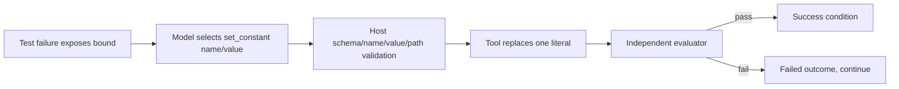

# E3 narrower repair interface: `set_constant`

23 October 2026 UTC. Branch `codex/d2-capacity-runtime-pilot`. Protocol and
fresh task family committed at `420f1ff` **before** native execution. Accepted
run: attempt 3.

**Result: tool and task-family engineering pass; held-out task completion is
negative (0/7).** The model learned the teacher-forced `set_constant` JSON
syntax (teacher loss 11.835 → 0.015 recurrent) but never selected the repair at
evaluation: the full and feed-forward arms repeated `read` seven times, and the
core-disabled/extra-inference arms produced malformed proposals. This is the
same action-selection failure class as the earlier `write_file` arm, not a tool
or parser defect.

## 1. What changed

`set_constant` is a bounded repair tool: it replaces exactly one numeric
module-level assignment, preserves every other line, and rejects unknown names,
non-numeric values, duplicate assignments, paths outside `workspace/`, and
values that are not finite and bounded. The fresh family has four train, one
dev, three held-out and one interrupted case in disjoint source groups. The
action space is `read_file`, `set_constant`, `run_test`; `write_file` is absent.
This makes the repair a short argument prediction rather than a full-file copy.

The host does not choose the constant. The teacher labels contain the chosen
name/value for train cases; evaluation actions come only from MiniCPM.

## 2. Engineering checks (all pass)

Initial native parity, validated E2 migration, parent regression, independent
workspace/memory reader influence, recurrent and feed-forward gradient paths,
stale-workspace rejection, extension-only export, unchanged original, and no
base copy all pass. The task-family validator confirms every case starts failing
and the fresh tool repair makes the independent evaluator pass.

- Alignment: 16 updates × 4 examples per arm, seed 20261023, Muon 8-bit/AdamW.
- Recurrent loss: 11.835 → 0.015; feed-forward: 11.835 → 0.112.
- Extension: 37,588,831 bytes (`replica.minicpm5.extensions.v2`), base not saved.
- Peak sampled driver: **15.72 GiB**; profiled wall time 332 s; zero observed
  swap growth; no downloads.

## 3. Held-out execution

| Case | Arm | Result |
|---|---|---|
| dev `set_dev_retry_05` | full | `read` ×7 |
| heldout timeout | full | `read` ×7 |
| heldout backoff | full | `read` ×7 |
| heldout poll | full | `read` ×7 |
| dev | core_disabled | 7 malformed proposals, 0 tools |
| dev | ff_core | `read` ×7 |
| dev | extra_inference | 7 malformed proposals, 0 tools |

Totals: **49 decisions, 20 tool calls, 14 malformed actions, 0 false success
claims, 0 completions**, 22,138 prompt tokens, 714 generated tokens and 149.5 s
of episode time. The success head was not trained: seven actual labels, all
negative.

The full-arm prompt at decision 2 was byte-identical to the teacher prompt for
the same step, yet the model chose `read` instead of `run_test`. Training used a
zero previous workspace; evaluation also disabled workspace history. The
remaining difference is the task-feature/workspace representation and the model's
action policy, not prompt formatting or tool schema. The controls do not show a
core-specific benefit; feed-forward behaves the same and core-disabled produces
syntax errors.

## 4. Failure classification and decision

| Candidate cause | Evidence |
|---|---|
| Eligibility/retrieval | Not implicated: `read` is authorized and returns the file; no missing source. |
| Tool schema/parser | Not implicated: `set_constant` parses and executes correctly in software and teacher trajectories. |
| Argument construction | Not reached at evaluation; the model never emits `set_constant`. |
| Action selection | **Primary**: teacher-forced loss is low, but the model repeats the first action at inference. |
| Representation/conditioning | **Contributing**: identical prompt differs from teacher behavior; core/FF both fail, core-disabled degrades. |
| Capacity/budget | Not implicated: 15.72 GiB peak, budgets not exhausted by tool calls. |

The previous `write_file` arm and this narrower arm share the repeated-read
failure. Per the construction rule, do not run another near-identical action
arm. The next independent package should target the action-policy/representation
gap (for example, explicit next-action supervision with a separate policy head,
or a fresh decision-state representation) or advance E4 temporal memory. The
set_constant tool remains implemented for a later arm; it is not promoted.

## 5. Status

- **Implemented/qualified:** bounded tool, fresh fixtures, protocol, controls,
  restart path (not executed for this family), extension serialization.
- **Trained:** 32 modules-only alignment updates this run.
- **Evaluated:** 0/7; all failures preserved.
- **Pending:** interrupted `set_interrupted_retry_09` run; success head
  calibration; action-policy improvement; E4/E5.

## Evidence

- [Accepted report](../../reports/e3_set_attempt03_20261023/run_report.json)
  and [guard](../../reports/e3_set_attempt03_20261023/guard.json)
- [Attempt 1](../../reports/e3_set_attempt01_20261023/failure_report.json)
  (hard-coded probe case; fixed before training completed)
- [Attempt 2](../../reports/e3_set_attempt02_20261023/failure_report.json)
  (completed episodes, crashed on a missing summary key; preserved)
- [Protocol](../../configs/e3_set_constant_v1.json),
  [tool validator](../../scripts/verify_e3_set_fixtures.py)
