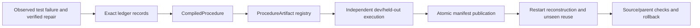

# M1 — verified procedure compilation and publication

24 October 2026 UTC. Code/protocol commit: `8ca6a8b`.

**Decision: accept the thin compilation boundary.** A real observed failure and
verified repair are admitted to the exact ledger, compiled into a typed
`ProcedureArtifact`, independently evaluated on new fixtures, published through
`ManifestRegistry`, reconstructed after restart, and revoked/rolled back under
source and parent controls. This is a procedure artifact, not a neural update or
general learning result.

## Connected path



Implementation:

- `src/replica_lab/runtime/compilation.py` binds source record IDs/hashes, owner,
  purpose, cutoff, evidence epoch, base/identity versions, parent manifest,
  producer versions, steps, tests and artifact digest.
- `src/replica_lab/runtime/artifacts.py` now indexes `source_event_ids` as well
  as `source_ids`, so procedure sources actually invalidate dependents.
- `src/replica_lab/runtime/tools.py` preserves both ends of long evaluator
  excerpts; long paths no longer hide the numeric failure bound from the parser.
- `scripts/run_m1_compilation.py` writes the ledger, source receipts, artifact
  catalog, active/ancestor manifests and raw report.
- `tests/test_compilation.py` covers execution, restart, source changes, stale
  parents, interrupted publication, rollback and descendant invalidation.

## Results

| Check | Evidence |
|---|---|
| Dev and held-out evaluation | Both independent executions succeeded |
| Publication | Accepted artifact published with parent/source/digest binding |
| Restart | Fresh registry reconstruction succeeded on unseen `m0a_heldout_heartbeat` |
| Source change before publication | `StaleSourceError`; no active candidate |
| Stale active parent | Rejected before publication |
| Interrupted publication | Active state preserved; retry succeeded |
| Source invalidation | Accepted procedure and accepted descendant revoked |
| Rollback | Baseline parent restored and compiled artifact revoked |
| Cost | 0.440 s CPU; 0 model loads, 0 optimizer updates, 0 base copies, 0 downloads |

Raw report: `runs/m1_compilation_attempt01/report.json`; catalog:
`runs/m1_compilation_attempt01/artifact_catalog.json`; manifest directory:
`runs/m1_compilation_attempt01/manifests`; validation:
`reports/validation_m1_procedure_compilation_20261024.json`.

Focused verification:

```bash
.venv/bin/python -m pytest -q \
  tests/test_compilation.py tests/test_runtime_artifacts.py tests/test_e3_set_tools.py
```

Result: **14 passed**.

## Limit and next dependency

Only the procedure path is qualified. `ContextPack`, `RecordLatent`,
`BranchMemoryImage` and `NeuralCandidate` still need real payload/consumer paths;
there is no learned memory or RSI benefit. M2 is next: one residual adaptive
memory block with distinct head writes and delayed-use evaluation.
