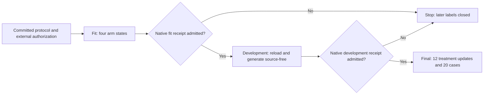

# DC-P1 v2 native response protocol and CPU qualification

**28 October 2026. Status: implemented and CPU-qualified; native execution is
unauthorized and unrun.** Protocol/implementation commit:
`792c878f62d454ab702887680ef66b914698d79a`. This package establishes no learned
benefit, no calibrated capability estimate and no held-out native result.
MiniCPM5 bytes were not downloaded, duplicated or modified.

## 1. Implemented contract

DC-P1 v2 trains only `expert_0.gate/up/down` with the declared fused AdamW
policy. The original MiniCPM5 backbone and fixed plastic read path remain
frozen. Teaching uses source plus prompt; scored generation uses a read-only
P-only reader with the prompt alone, no source context, no source KV, no
optimizer moments and no teaching rows. Generation is greedy, at most 16 tokens,
with full no-cache forwards and terminal-stop IDs excluded from answer content.

The fixture binds every teaching row to an event ordinal, source group, event
position and before/after checkpoint identity. Ordinary current queries resolve
at their query epoch; historical queries explicitly name the historical event.
The treatment and matched-trained control differ only in
`answer_span_ce_weight` (0.5 versus 0.0). No-update and reset-P controls remain
separate. Because answer tokens plus terminal EOS make the answer-span and
full-response masks coincide, the treatment is declared a global CE rescale,
not evidence of span-specific learning.



Recovery writes one checkpoint per teaching event. The last per-event checkpoint
is the retained arm artifact; reset-P adds one write after restoring the exact
parent. A resume validates the event prefix, event IDs/digests, checkpoint
identity and reset-parent state. Completed arms are not retrained. Ambiguous
in-flight work blocks resume; expected publication interruption can resume
without replaying optimizer work. Stage completion is persisted only after
artifact inventory, live-peak recording, cap enforcement and backbone
verification.

Production launch requires the external receipt, exact committed implementation
bytes, matching HEAD and a clean tracked worktree. Untracked run outputs and the
protected runtime draft are not inputs. The production CLI has no head-check
bypass and no CPU fallback.

## 2. Derived native ceilings

The sealed tokenizer artifact measures maxima of 35 evaluation-prompt tokens
and 95 teaching-sequence tokens. Measured lengths may reduce positions but not
raise the declared caps.

| Work or resource | Declared ceiling / schedule |
|---|---:|
| Optimizer steps, training forwards, backward calls | 120 each |
| Development / final updates | 108 / 12 |
| Generation requests | 416 |
| Autoregressive forwards | 6,656 |
| Total forward calls, including parity and one recovery | 6,780 |
| Per-event checkpoint writes | 120 |
| Reset-parent artifact writes | 1 |
| Total checkpoint writes | 121 |
| Retained arm checkpoints | 4 |
| Model loads / tokenizer loads, including recovery and scoring | 4 / 7 |
| Recovery training forwards / backwards / optimizer steps | 1 / 1 / 0 |
| Processed-text positions, declared / token-measured | 385,040 / 294,480 |
| Wall-time ceiling | 6,961 s |
| Temporary-storage ceiling | 1,615,233,024 B |
| Live artifact cap | 67,108,864 B |

The earlier 124-write derivation is preserved in `review_attempt01.json`; it
incorrectly budgeted duplicate final writes for every arm. The current 121-write
schedule matches the actual runner. All three parity probes occur in fit: two
before teaching and one after reset-P.

Native execution must use one exclusive MPS worker and the unchanged 50 GiB
sampled driver, 512 MiB sustained swap-growth and 15% host-free guards. CPU work
is limited to host services, fixtures, scoring and software tests.

## 3. CPU fixture evidence

The fresh-process fixture completed fit, development and final, then interrupted
fit after two updates and resumed it. Every stage report says
`evidence_class=cpu_fixture`, `native_execution_admissible=false` and
`admitted=false`. These are orchestration results, not native learning results.

| Check | Observed result |
|---|---:|
| Fit / cumulative final optimizer steps | 108 / 120 |
| Cumulative final generation requests | 416 |
| Cumulative final autoregressive forwards | 3,904 |
| Cumulative final forward calls | 4,027 |
| Cumulative final checkpoint writes / retained artifacts | 121 / 4 |
| Recovery resumes / recovery reloads | 1 / 1 |
| Recovery ordinary backward calls / restart backward calls | 108 / 1 |
| Restart optimizer steps / ambiguous work rows | 0 / 0 |
| Live-storage observations after publication | 99 |
| Peak live bytes, including a temporary prediction file | 985,890 B |
| Measured bytes before the final artifact-budget report | 966,466 B |

Raw evidence:

- `reports/dc_p1_native_response_v2_20261028/cpu_orchestration_attempt03/summary.json`
- `reports/dc_p1_native_response_v2_20261028/cpu_orchestration_attempt03/main/`
- `reports/dc_p1_native_response_v2_20261028/cpu_orchestration_attempt03/recovery/`
- `reports/dc_p1_native_response_v2_20261028/cpu_orchestration_attempt03/recovery_interrupted_journal.json`

Attempts 01 and 02 are preserved beside them. They stopped because the
host-retained eval kernel held older publication/scoring modules; attempt 03
used a fresh Python process and a fresh output directory. Those failures are not
native attempts or model-quality evidence.

## 4. Verification and review

The focused protocol, runner, objective, staged-evaluation, DC-R1, preserved-v1
and capacity-guard suites passed **136/136**:

```bash
PYTHONDONTWRITEBYTECODE=1 .venv/bin/python -m pytest -q -p no:cacheprovider \
  tests/test_dc_p1_native_response_v2_20261027.py \
  tests/test_dc_p1_native_runner_v2.py \
  tests/test_dc_response_objective.py \
  tests/test_dc_staged_evaluation_v2.py \
  tests/test_dc_r1_native_value_v2_20261027.py \
  tests/test_dc_p1_native_response_20261027.py \
  tests/test_capacity_guard.py
```

Coverage includes current/historical resolution, matched-control behavior,
objective-mask narrowing, tampered implementation refusal, exact reset-parent
hashes, partial-checkpoint resume, non-repeating optimizer work, ambiguous-work
refusal, final-publication interruption, source-free scoring and live temporary
storage observation.

Review-only preflight passed without labels, tokenizer, model or native work:

```bash
PYTHONDONTWRITEBYTECODE=1 .venv/bin/python \
  scripts/preflight_dc_p1_native_response_v2_20261027.py \
  --review \
  --receipt reports/dc_p1_native_response_v2_20261028/review_attempt02.json
```

The receipt records config SHA-256
`67d9060ec2b69e1eb49e11010d16a55b25b06d71d3074ee8c3f306d907e5f304`
and prepared-manifest SHA-256
`e8668aa72d77a1cc64d8662eeea0dc9f7eca94f60d6bcd2702fd431117bb02be`.
A launch request without the external receipt returned exit 2 with
`authorization: a separate externally issued authorization receipt is required
before native work`. A separate production smoke check refused tracked worktree
changes before authorization or model loading.

## 5. Remaining gate

`reports/dc_p1_native_response_v2_20261027/authorization.json` is absent. Do not
create it from the test fixture or describe the CPU traces as native evidence.
A real run requires an externally issued receipt bound to the exact current
commit, a clean tracked checkout, fresh `native01` output, and the guarded fit
command emitted by `preflight --launch`. Development and final remain closed
until their preceding native receipts admit them. If the bounded native result
fails, preserve it; do not tune against the sealed final set.
