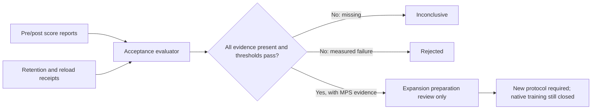

# Vision acceptance and expansion readiness — 28 October 2026

**Status: CPU implementation and report validation complete; native execution remains unauthorized and unrun.** The relevant implementation commits are `6bccb8373a407e9054f1f5a6ed7bc37da06891b1` (smaller-step launch binding) and `97866da0bc4d599d3c23ba58d7e6a3c4a50efb6c` (acceptance, expansion and isolation gates). No native model was loaded, no MPS job was started, no native optimizer step ran, and no authorization receipt was created.

## 1. Smaller-step launch binding

`scripts/vision_smaller_step_v2.py` now binds review/native execution to the committed config and all 13 entries in `IMPLEMENTATION_RELATIVES`, including the runner, capacity guard, forward accounting, optimizer, loader and vision dependencies. The emitted command is shared by the review function and deterministic packet builder and routes through `scripts/run_capacity_preflight.py` with `--device mps`.

The committed verification loaded no model and passed:

```text
commit: 6bccb8373a407e9054f1f5a6ed7bc37da06891b1
implementation_files_verified: 13
native_execution: false
```

The v2 packet is deterministic. Its canonical SHA-256 is `820790baadce4a32d95f711264d0b347bf4ffc25e1dea09a68c7d0a4abf7a4c2`; its file SHA-256 is `7886be304c0860a082cf4fe5ed4874007d95ce2f33cb66f720c1a53da87d5efa`. The readiness report remains `readiness_current_launch_refused`, with zero model loads and these refusals: missing authorization receipt, unbound protocol commit, unverified implementation binding, and no native authorization.

The exact command recorded in the packet, **not executed**, is:

```bash
python scripts/run_capacity_preflight.py \
  --entry-point vision_smaller_step_v2.py \
  --report reports/vision_smaller_step_lr3e5_v2_20261027/guard_smaller_step01.json \
  -- \
  run --config configs/vision_smaller_step_lr3e5_v2.json \
  --output runs/vision_smaller_step_lr3e5_v2_20261027 \
  --model-path checkpoints/minicpm5_source \
  --model-lock configs/minicpm5_sealed_lock.local.json \
  --authorization reports/vision_smaller_step_lr3e5_v2_20261027/authorization.json \
  --device mps
```

The actual review command was run and refused before model load because the receipt is absent:

```bash
PYTHONDONTWRITEBYTECODE=1 .venv/bin/python scripts/vision_smaller_step_v2.py \
  review-launch --config configs/vision_smaller_step_lr3e5_v2.json \
  --authorization reports/vision_smaller_step_lr3e5_v2_20261027/authorization.json
```

Prerequisites for any future attempt are an external receipt binding the exact config and a full compatible protocol commit, a fresh output directory, and the existing exclusive-worker/capacity guard. The receipt is not synthesized by this package.

## 2. Fail-closed diagnostic acceptance

New files:

- `src/replica_lab/vision_acceptance.py`: standard-library evaluator with separate learned and engineering evidence.
- `scripts/validate_vision_acceptance.py`: read-only JSON report CLI; binds the candidate report digest to the reload receipt and records candidate device/fallback evidence.
- `configs/vision_diagnostic_acceptance_v1.json`: predeclared thresholds and required comparisons.

The gate requires a matched pre/post answer-accuracy gain of at least 0.05, correct-versus-wrong/sibling, shuffled and no-image margins of at least 0.05, explicit control provenance, paired text-only retention with decline no worse than 0.02, and a zero-update, extension-only, base-unchanged fresh-process reload with raw-output/gate comparisons. Missing evidence is `inconclusive`; measured threshold failures are `rejected`. Neither status permits promotion, development or retry.



The real CLI was smoke-run with a complete synthetic evidence bundle and returned `accepted`, `native_execution=false`, `model_loads=0`, and `promotion=false`. This is a validator smoke, not a model result. Nine acceptance tests cover improvement, control margins and provenance, matched cases, retention decline, fresh/bound reload, empty evidence and CLI behavior.

No accepted MPS diagnostic exists at `reports/vision_diagnostic_acceptance_v1_20261028/assessment.json`; therefore no current vision learning benefit is claimed.

## 3. Expansion readiness and partition preservation

`scripts/check_vision_expansion_readiness.py` and `configs/vision_expansion_readiness_v1.json` gate later caption/VQA/OCR/spatial preparation on an accepted MPS diagnostic. The checker independently replays the assessment from its referenced artifacts and rejects stale hashes or CPU evidence. It does not create rows, contact sources or open labels.

The current report is `reports/vision_expansion_readiness_20261028/readiness.json` (SHA-256 `bc714b10d5d02389b996f90efd5074a349fcc05ad70c18815ee29394b8ed4e4e`). It passes all partition/source checks and has exactly one refusal: `positive_diagnostic_missing`.

| Partition | Required | Observed | Source-group count |
|---|---:|---:|---:|
| Reviewed admitted training rows | 9 | 9 | 9 |
| Exclusion ledger rows | 21 | 21 | 21 |
| Quarantined exposed rows | 8 | 8 | 8 |
| Sealed synthetic diagnostic scenes | 24 | 24 | n/a |

Admitted rows are source-split `train`, research-only, unquarantined and disjoint from exclusions/exposed groups. The eight exposed groups are intentionally also present in the exclusion ledger; the validator checks containment rather than incorrectly requiring those two ledgers to be disjoint. The initial overly strict assessment is preserved as `readiness_attempt01.json`; its failure was a validator-schema error, not a model result.

Four expansion tests cover the current blocked state, a synthetic MPS positive path, CPU rejection and partition tampering. A positive result would permit only a new bounded preparation protocol; `training_authorized`, `native_execution`, `development_authorized`, `heldout_authorized`, `promotion` and `retry_authorized` remain false.

## 4. Co-adaptation isolation and prerequisites

The co-adaptation review now records explicit isolation: exactly the six projector tensors plus encoder block 11 and post-layernorm (24 tensors total), zero memory trainables, zero personality trainables, zero memory optimizer groups and no personality components in the protocol. Existing eligibility remains unchanged: a preserved failed smaller-step report, a frozen-feature diagnosis excluding competing causes, a separate receipt and fresh output are required.

The actual co-adaptation review refused with `smaller_step_report_missing`, `frozen_feature_diagnosis_missing` and `authorization_receipt_missing`; `model_loads=0`. Five scope/prerequisite tests pass. No encoder update or memory/personality work occurred.

## 5. Verification and cost boundaries

| Check | Result | Scope |
|---|---:|---|
| Affected vision/caption/guard suite | 339 passed | Includes new acceptance/expansion, smaller-step, co-adaptation, lineage and guard tests |
| Conditional memory/restart suite | 99 passed | Existing contracts; no native run |
| Spark/backend suite | 135 passed | Separate backend and precision tracks; no native run |
| RSI/provenance/clock/compilation suite | 134 passed | Existing preservation contracts |
| Spark/visual-boundary suite | 81 passed | Existing preparation and visual-memory boundaries |
| Smaller-step/guard focused suite | 27 passed | Earlier focused check; included in the 339-test run |
| Acceptance + expansion suite | 13 passed | Included in the 339-test run |

The 339-test run took 127.50 seconds; the memory, Spark and RSI runs took 69.88, 71.46 and 27.33 seconds respectively. These are CPU test wall times, not model latency. No new MPS memory, native runtime, energy or artifact-storage measurement exists. New readiness artifacts are small JSON reports (3,104 bytes current and 3,152 bytes preserved attempt01); source/config sizes are tracked in Git, not native checkpoints.

## 6. Current blockers and next eligible action

1. **Smaller-step native diagnostic:** external authorization and a fresh output are missing. The guarded command above is the only prepared native action; it was not run.
2. **Co-adaptation:** remains behind the failed smaller-step report, frozen-feature diagnosis and its own authorization.
3. **Vision acceptance/expansion:** requires a real pre/post MPS evidence bundle with generated-answer improvement, causal controls, text retention and fresh reload. No such positive assessment exists. Expansion then requires a new predeclared protocol.
4. **Later memory, Spark, RSI and personality work:** preservation tests pass, but useful learning, native capability, calibration, promotion and personality adaptation remain unqualified and unexecuted.

Historical failures, raw outputs, sealed sources and the protected untracked `src/replica_lab/runtime_pilot.py` are preserved. No duplicate base checkpoint, download, historical-report rewrite or native retry was introduced.
