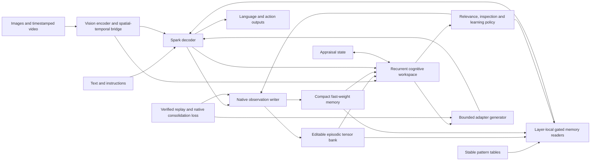

# Proposed native Dynamic Engram architecture

This document specifies an original integration proposal. Its component sizes, placement and learning schedules are hypotheses to test. It is neither a claim of paper equivalence nor an implemented model.

## One model, explicit state

Build `SparkCognitiveForConditionalGeneration` with registered perception, memory, workspace and learning modules. A MiniCPM adapter should implement the same contracts first. The model must compute its memory representations, relevance decisions, readouts, update proposals and action logits. Do not make an external LLM summarize the conversation, choose a store and paste retrieved text into the prompt to supply the target capability.

The host still supplies observations, executes numerical kernels, stores snapshots and evaluates candidates. A neural network cannot retain information across process termination without storage or improve its weights without a learning operation. These services do not need to make semantic decisions on the model's behalf. Keep the authoritative state explicit and request-owned, rather than mutable global attributes shared by all users.



“Native” is a testable property: after loading a model checkpoint and its state bundle, a direct model call must reproduce the relevant behavior using tensor memory and the supplied observation. The null-harness evaluation supplies I/O and scope only. It performs no semantic retrieval, no instruction rewriting and no hand-written choice of the answer's memory path. Full-context and externally retrieved-text arms remain labelled controls.

## Separate kinds of adaptation

| State or parameter group | What changes | Intended lifetime | Evidence of success |
|---|---|---|---|
| Backbone weights | Initially frozen | Accepted model version | Base ability and native parity |
| Static pattern tables | Offline/slow learned embeddings | Accepted model version | Pattern-dependent held-out utility |
| Episodic bank `E` | Typed keys, values, validity and source links | Session or explicitly owned persistent scope | New information and corrections remain usable |
| Fast state `M` | Small associative matrices or experimental MLP weights | Episode or owned persistent scope | Useful delayed readout beyond the original context |
| Working state `C` | Workspace, attention priorities and hypotheses | Current task | Better decisions at equal compute |
| Appraisal state `a` | Bounded control variables | Short event-based horizon | Better inspection/learning choices |
| Generated adapter `A` | Small context-dependent weight delta | Current declared adaptation scope | Relevant improvement without unrelated interference |
| Consolidated adapters and memory procedures `phi` | Gradient-trained shared weights | Accepted model version | Gains survive removal/reset of episodic state |

Saving a fast state is persistent memory. Training `phi` so the next unseen task is learned better is improvement of the learning mechanism. These need different evaluations. Merely switching between prelearned skills also differs from acquiring a new skill.

## Backbone integration and placement

Retain the existing Spark topology and positional rules. The first attachment uses a native residual memory reader after zero-based full-attention block **11**, with **23** as the second placement experiment. A static pattern reader may use block **3**. A final observer at **35** can help the core, but is not an excuse for an extra full decoder pass on every generated token. These placements extend the [previous architecture plan](../sparkx_2_6_4b_20261024/02_Integrated_Architecture.md).

A native memory branch inside the attention fusion point is a later comparator. Spark's attention output has width 4,096 before its output projection, while the residual stream has width 2,560. Reusing an attention projection requires matching its actual shapes, head gate, normalization and scale; it cannot be transplanted from a model with the same nominal parameter count. Start with the already understood complete-block residual interface, then compare fusion points under equal parameter and training budgets.

For block output `u_l`, the conceptual residual is:

```text
z_l = norm(u_l)
h_l = u_l
    + g_static(z_l, C) * O_static(pattern_read(token_ids))
    + g_episode(z_l, C) * O_episode(episode_read(z_l, selected_E))
    + g_fast(z_l, C) * O_fast(fast_read(z_l, M))
    + g_core(z_l) * O_core(workspace_read(z_l, C))
```

Each path has an independent gate and an exact disabled mode. All-empty memory returns an exact zero residual. Initialize final output projections at zero, with live nonzero internal representations and gates, then verify that gradients reach writers once the output opens. Zeroing every factor creates a dead branch. Test neutral parity before training and branch usefulness after training; neutral parity alone is not a quality result.

## Stable pattern memory

Keep a dedicated pattern pathway for reusable lexical/domain regularities. The compact proposal has two n-gram orders, four hash heads per order, 16,384 rows and width 32: 4,194,304 table parameters. The larger diagnostic uses 65,536 rows and width 64, matching the current table-size family. Train this pathway on source language modeling plus relevant downstream examples and unrelated-query preservation.

Pin tokenizer normalization, hash seeds, special-token boundaries and table identity. Treat unknown or weakly trained rows with learned confidence and a null path. Do not require every hash in a long question to have been trained before any pattern can help. Measure local activation coverage, direct utility and collision effects separately. Keep volatile facts and newly corrected personal bindings out of this slow table until consolidation is independently qualified.

Adding a nonlinear or data-dependent read does not make a static table an online learner. Conversely, editing selected table rows online changes its lifetime and interference properties. That is a separate experiment with row-level replay, ownership and rollback, not the default implementation.

## Editable episodic tensor bank

This is the principal proposed “dynamic Engram” addition. The memory bank is a bounded collection of typed latent records inside model state. The observation writer produces candidate keys, values and record attributes from text/visual activations. The query encoder and router are trained model modules.

Use a **4,096-slot capacity envelope**, beginning training with smaller 64/256-slot exercises. A record contains:

- A learned 128-dimensional retrieval key and a 256-dimensional value.
- A type: binding, object, spatial relation, event, procedure example or correction.
- Entity/track and relation identifiers, observation sequence and event-time fields.
- Validity, confidence, producer version and provenance indices.
- Optional exact observed token payload for names, strings and numbers that cannot reliably be reconstructed from a small latent vector.

The numerical budget allows 16 int32 payload tokens per slot. Longer values require linked continuation slots or an explicitly larger configuration. Do not silently truncate an identifier and then claim exact arbitrary-value recall. Payload tokens must come from observed spans; target answers are never secretly inserted by the evaluator. Copying these stored tokens through a native copy head remains a model computation, provided the model selects them and no host retrieval supplies the right answer.

For the first implementation, search the eligible bank with model-produced query keys once at a question or inspection boundary. Select up to 16 records, including a learned null option, and use tensor cross-attention over the shortlist during decoding. A dense 4,096-by-128 search is small enough to measure before building an index. It is **linear in bank size**, not an O(1) lookup. An indexed/product-key variant is justified only by a measured scaling bottleneck.

Train retrieval with source-derived support labels and hard distractors: the same entity with a different attribute, similar names, an old correction, a visually similar object and the right event at the wrong time. Use a soft differentiable read on small training banks or supervised candidate routing; moving to hard top-k introduces a gradient discontinuity that must be handled explicitly. Do not assume loss gradients teach an unselected record without an auxiliary signal or a declared estimator.

### Correction and interference

Use an upsert/version relation for a confirmed replacement of the same binding, and preserve historical views when requested. A newer timestamp alone does not establish truth. Conflicting observations require a conflict representation and uncertainty, not an automatic last-write-wins rule. Eligibility masks derive from caller-owned scope and the observation cutoff; relevance among eligible records is learned by the model.

A hash may locate candidate records, but hash equality cannot establish semantic identity. Check a full stored identity or disambiguate through the trained matcher. Never overwrite an unrelated record because of a collision. A record's access count must not become evidence that its content is true.

Capacity is bounded. Initially compare reservoir sampling, age/utility eviction and a learned eviction score. An evicted or consolidated record becomes unavailable at that fidelity. If exact lifetime archives are retained for training/rebuild, report their separate storage. The deployed memory-only test must not consult that archive. Fixed-size state cannot guarantee lossless recall of unlimited independent facts.

## Compact fast-weight memory

Reuse the current functional SGDN-2 primitive as a baseline before inventing another optimizer. In column-vector notation, for one head:

```text
k = L2_normalize(key_projection(observation))
u = sqrt(beta) * k
D = diag(decay)
M_next = (I - u u^T) D M + u (write_gate * value)^T
read(q) = L2_normalize(q)^T M
```

This is the form implemented in the [current recurrence](../../../src/replica_lab/neural.py). If `||u|| <= 1` and decay is at most one, the erase/decay part is non-expansive. That does not by itself bound the accumulated input term. Bound value norms and update gates; a strict contraction bound plus bounded writes gives a stronger state bound. Record norms, saturation, rare-token behavior and long noisy sequences. The pilot should keep FP32 state accumulation even when shared weights and activations use lower precision.

Start with four 64-by-64 heads, 64 KiB of FP32 state. The optional four-expert shared pool is 256 KiB, before momentum, snapshots or gradients. Read and write experts may have different relevance gates. With so few experts, dense execution may beat sparse dispatch; benchmark it. A top-k mask gives no speed benefit if the implementation still computes every expert. The proposed sparse pool is not MemT's dense MoS reproduction.

Use shared state across the two ports only after mapping their features into a compatible learned coordinate system. Each port reads the same start state. Combine writes once at the observation boundary. Initially retain the project's declared convex-mean reducer as a control; an aggregated-gradient TTT branch is a different update rule. Match private controls for **total bytes and active computation**, since copying the same-sized bank to each layer doubles capacity.

A nonlinear Titans-style candidate can replace the linear map with a tiny MLP. Its inner loss must optimize fast parameters, while delayed task loss trains the writer and update coefficients. Unroll a bounded two-to-eight observation horizon during outer training. Prevent representation collapse with future-query supervision, diverse values and a target representation with a declared stop-gradient or supervised target. Reconstruction error alone is insufficient evidence of useful memory.

## Generated parameters and consolidation

Use generated adapters for a learned rule or procedure only when the native state paths work. The first comparator is a small coefficient vector applied to fixed low-rank bases. This is cheap conditional adaptation, with limited expressivity. A second candidate generates rank-8 factors at two memory ports, with 81,920 mutable scalars across both ports. These are generated state, not 81,920 newly trained shared parameters on every interaction.

The generator consumes observed demonstrations and selected memory, before withheld test questions. The first design emits one bounded adapter for the declared scope. It does not grow rank indefinitely by concatenating every experience. A shared generator with a 2–8M-parameter design allowance is a **new capacity hypothesis**, much smaller than the published D2L generator; success cannot be assumed.

Do not store a full backbone-width adapter for every episodic slot in the compact design. Keep latent values and compile only the active adaptation. Per-atom adapter storage is an optional, separately budgeted comparator.

When explicitly composing adapters, a weighted combination of their effects is

```text
Delta_W = sum_i weight_i * B_i @ A_i
```

It is generally different from `(sum_i weight_i * B_i) @ (sum_i weight_i * A_i)`, which adds cross terms. A trained factor-mixture may intentionally use those interactions; it must not be described as a simple sum of preserved edits. Fixed-rank recompression is lossy and requires renewed quality checks. This is our design analysis, prompted by the [Doc-to-Atom composition equation](https://arxiv.org/html/2606.12400v1).

Over slower cycles, replay verified examples into a small persistent adapter or the memory writer/reader parameters. Include earlier data and unaffected tasks, and test against both the parent and a fixed campaign baseline. Updating the learning policy should improve acquisition on later unseen tasks. It must not merely make the model better at explaining its previous errors.

## Semi-cognitive core and simulated affect

Retain the small recurrent core as a shared workspace, but expand its source contract to typed text, region, object, event, episodic, fast-memory and task tokens. Test 16 slots at width 256 and two recurrent steps against the eight-slot reference and a compute-matched feed-forward control. Run deliberation at observation/decision boundaries, with a bounded extra inspection step when predicted value exceeds cost. Do not run a new full cognitive loop for every output token by default.

Add differentiable policy/value heads for memory relevance, missing evidence, inspection, uncertainty and expected learning benefit. Keep detached monitoring heads separately if needed for evaluation. Core training needs a loss path through the decisions that affect later success, not only an accuracy predictor trained on detached states.

An initial appraisal vector can contain eight bounded coordinates:

| Coordinate | Operational meaning | Permitted influence |
|---|---|---|
| Surprise | Calibrated prediction residual | Candidate write priority |
| Relevance | Expected effect on the instructed goal | Attention allocation |
| Uncertainty | Calibrated lack of evidence | Inspect/abstain preference |
| Progress | Change in predicted verified task outcome | Persistence versus strategy change |
| Controllability | Estimated effect of available actions | Choice of useful intervention |
| Conflict | Inconsistency between eligible observations | Preserve competing hypotheses |
| Resource pressure | Remaining explicit compute/state budget | Deliberation and learning allocation |
| Valence | Bounded summary of better/worse-than-expected outcomes | Optional presentation and learning modulation |

Compute `a_next = (1-rho) a + rho * tanh(Appraise(features, outcome))`, with a declared event-based decay and reset. Use small bounded effects on gates or update rates. Scope masks, evidence eligibility and external resource limits remain hard constraints. The vector cannot increase factual confidence merely because its valence is positive.

These variables implement **emotion simulation as functional control**. They do not assert feelings, consciousness or biological equivalence. Named emotions can be a later readout conditioned by the user's personality specification; they are not the primary learning reward. Keep uncertainty about another person's emotion distinct from the model's own simulated appraisal.

Test noisy distractors, repeated false alarms, unsuccessful strategies and subsequent recovery. High surprise from irreducible noise must not monopolize memory. Compare a neutral vector, shuffled appraisal, fixed heuristics and a parameter-matched unlabelled latent controller. If interpretable appraisal does not improve outcomes, retain it only if explanation quality justifies its cost, or remove it.

## Vision and temporal reasoning

Use the already proposed separately trained vision tower/bridge. Feed region features and event tokens directly to the memory writer and core. A caption alone loses details needed for later unseen questions. Each visual record should bind a scene, track/object identity, region coordinates, original-to-crop transform, frame timestamp, visibility and uncertainty. Preserve a small global representation alongside local evidence.

Separate event time, observation time and internal recurrent step. Store “object moved at time t” separately from “model learned about that movement at time u.” Train object continuity across crops/views and occlusion, spatial relation changes, before/after questions, and visual-text links. Unknown metric depth remains uncertain unless supported by calibration or sufficient geometry.

A compact temporal module predicts future latent relations and action consequences. Its imagined outputs remain hypotheses in working memory. Verified new observations can update persistent state; imagined scenes cannot silently become observed facts. For streaming tasks, future frames must never enter earlier states. Clip reasoning with the whole clip available is a different evaluation condition.

Example target episode: observe two objects from different views, learn a new name for one, observe it move behind the other, then remove all original frames from context. The model must identify the named object, answer its current and earlier spatial relations, accept a later correction, and generalize an instructed handling rule to a new visual example. Reversing frame order or swapping the objects should change the appropriate answers. This combines memory and reasoning without rewarding captions that ignore time.

## Execution contract

```text
model.observe(observation, state, scope)
    -> proposed_state, write_diagnostics
model.decide(query, state, budget)
    -> answer_or_inspection, read_diagnostics
model.learning_loss(verified_episode, replay, state)
    -> losses, allowed_parameter_groups
model.export_state(state)
    -> versioned tensor bundle and compatibility manifest
```

These are proposed APIs. `observe` is query-independent in the binding tests. `decide` reads a pinned snapshot; asking another question cannot overwrite facts. Inspection may introduce a new observation and therefore a new state generation. On any change to relevant memory, adapters or conditioning, invalidate affected decoder caches. Cache identity includes the state generation and model/component versions.

Training may keep the observation-to-query graph for the bounded credit horizon. Deployment detaches state at a successful commit. Checkpoint recomputation must not commit twice. Batching must isolate all state and eligibility masks by owner. Version source records, visual encoders, tokenizers and generated adapters together so a tensor from one producer is not interpreted under another.

This model-native boundary permits autonomous use of learned memory while preserving a reproducible distinction between observed evidence, inferred hypotheses and accepted parameter changes.
