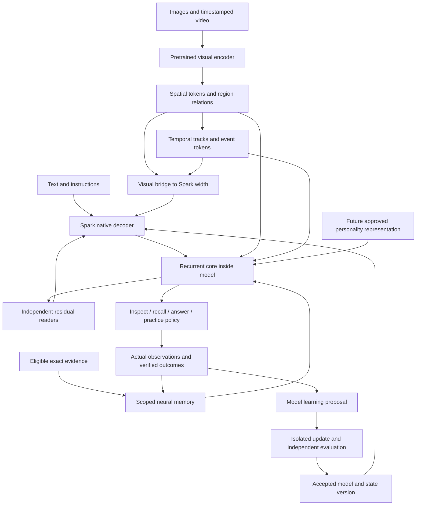

# Integrated Spark architecture proposal

All dimensions, placements, budgets and equations labeled “proposal” below are engineering hypotheses for this project. They are not measured Spark results or claims that this repository reproduces a cited paper. Read the [audit](01_Repository_Audit.md) first and the [training plan](03_Training_and_Execution_Plan.md) before implementation.

## One model with explicit adaptive state

Implement a new `SparkCognitiveForConditionalGeneration` model with registered neural submodules and a versioned `CognitiveState` input/output. Vision, memory reads, workspace updates, answer generation and learning proposals belong to this model. Avoid a design whose only new “cognition” is host-written reflection text appended to a prompt.

The runtime supplies sensor bytes, storage, execution and optimizer resources. It independently checks whether proposed changes helped. These are necessary execution services, just as a tokenizer and GPU runtime are; they should not supply hidden answer labels or a handcrafted solution to the task. A deployment can operate with local weights and local evaluation without a mandatory remote teacher. Teachers are optional training aids, with their cost and contribution disclosed.



Proposed public operations:

```text
encode_observation(multimodal_batch, observation_scope) -> ObservationFeatures
observe(features, prior_state, update_policy) -> next_state, write_audit
decide(text, features, prior_state, task_features, personality) -> DecisionFrame
generate(decision_frame, decoding_budget) -> answer_or_action
propose_learning(eligible_experience, target_skill, budget) -> LearningProposal
```

`observe` is query-independent for general episodic storage: it cannot see a future test question or its answer. A separate query-conditioned retrieval path may select relevant records later and must be labeled retrieval. During training, `observe` can return differentiable fast state across a bounded episode; deployment commits detached state exactly once per accepted event. Activation-checkpoint recomputation cannot perform a second write.

Export a complete model bundle: Spark source/revision, visual encoder and processor pin, all new modules, slow adapter weights, tokenizer/template, geometry and update schemas. Session state contains owned fast weights/momentum, workspace, event positions and evidence lineage. These are different artifacts: copying a session should not silently fork shared global model weights, and updating an encoder invalidates feature caches and dependent memory producers.

## Backbone modifications

Keep the 36 original decoder blocks intact for the first prototype. Use a new adapter preserving the [pinned Spark implementation](https://huggingface.co/XHToken/Spark-X2.6-4B/blob/66e3ae7bee54e0a523d692cb8ef841f35409807b/modeling_spark.py). The first experiment attaches memory/workspace readers after zero-based full-attention block **11**; a second placement adds block **23**. Use **35** as a candidate final observer in a separate known-input pass. These positions follow Spark's topology and are proposed starting points, not optimal placements.

For each chosen layer, the proposal is:

```text
h = native_spark_block(h)
h = h + g_visual * visual_read(h, visual_bank)
h = h + g_record * record_read(h, selected_records)
h = h + g_fast   * fast_read(h, fast_state)
h = h + g_core   * workspace_read(h, workspace)
```

Each branch has its own normalization, gate and output projection. Initialize the final output projection to zero while keeping a nonzero gate so the branch opens under training. Do not initialize both the gate and output in a way that blocks every gradient. Verify exact bypass behavior, then that second-step gradients reach upstream projections. For width 2,560 and bank width 256, the existing bias-free reader design needs **1,447,425 parameters including its two LayerNorms and scalar gate**. Count every separate port and branch; “small adapter” is not a parameter count.

Establish prefix-only image fusion first. Add visual residual readers at blocks 3/11/23 only if prefix visibility, fine detail or long histories justify them in an ablation. Multi-level visual features can use separately learned projections. This is inspired by [Qwen3-VL's feature integration](https://arxiv.org/abs/2511.21631), but copying its pretrained bridges into Spark would not preserve alignment.

Do not initially replace all attention with Titans or every MLP with CMS. That changes the pretrained computation and creates a continued-pretraining problem. A later explicit “native replacement” branch can replace a small declared subset, distill parent activations/logits, continue pretraining and recover language/tool skills. Label it separately from additive module tuning.

Preserve native text RoPE. Encode image geometry and time inside the new visual bridge/temporal module first. Retrofitting multidimensional RoPE across Spark's two rotary regimes is a separate high-risk experiment. Likewise, optimize attention kernels only after parity; the inspected eager path is not evidence of million-token local feasibility.

Initially retain the repository's understandable two-pass schedule: known-input sense, core update, immutable decision, then generation with fresh cache. Share/copy frozen visual features where permitted. A later same-pass schedule must define causality and costs. When memory, workspace, crops or model weights change, invalidate affected decoder KV caches; a cached prefix computed under old residual state cannot be assumed valid. Reads stay fixed throughout one answer/action generation, and writes happen at the next observation boundary.

## Memory: storage, adaptation and consolidation

Use complementary representations with separately measured contributions:

| Representation | Contents and purpose | Update and lifetime |
|---|---|---|
| Current context | Text, current image regions, recent frames | Attention/cache; one decision or clip |
| Recurrent workspace | Goals, active hypotheses, evidence pointers and action state | Core ticks; task-owned |
| Exact episodic evidence | Original permitted observations, crops/intervals, corrections, tool results | Append/supersede; persistent source ledger |
| Learned episodic slots | Source-linked object/event/statement features | Learned encoding; retrievable, versioned |
| Fast associative parameters | Reusable associations and recent task adaptation | Observation-time inner updates; scoped state |
| Slow skill/semantic adapters | Verified generalized knowledge and procedures | Candidate optimization plus replay; versioned model |
| Personality representation | Approved conditional priorities and preferences | Explicit source-driven revision, separate from factual evidence |

Exact sources are the audit/reconstruction substrate. Neural representations are what the model learns to use efficiently. Compare compressed-state-only recall with source retrieval honestly; fetching an original image at answer time cannot count as recalling it from bounded state. Long-lived user facts should not depend exclusively on a small lossy matrix.

### Fast-memory experiment family

Start with existing linear and SGDN-2 controls. Add a nonlinear adaptive memory only after the storage/read separation diagnostic can localize failure. [TTT](https://arxiv.org/abs/2407.04620v4) motivates treating a small predictor's parameters as state. [Titans](https://arxiv.org/html/2501.00663v1) motivates deep associative memory with momentum and adaptive forgetting. Neither establishes a plug-in upgrade for a frozen Spark model.

Project-specific prototype, with observation feature `x`, key `k`, value `v`, and fast parameters `phi`:

```text
k, v, eta, beta, alpha = learned_observation_writer(x)
loss_assoc = mean(||memory_phi(k) - stop_gradient(v)||^2)
gradient = grad_phi(loss_assoc)
momentum_next = beta * momentum - eta * clip(gradient)
phi_next = (1 - alpha) * phi + momentum_next
read = memory_phi(query_projection(h))
```

Differentiate with respect to **memory parameters**. The value stop-gradient is our initial stabilizing choice; compare it with a documented alternative during outer training. Learned keys/values can collapse into an uninformative code, so associative loss alone is insufficient: delayed-answer loss, cross-episode discrimination and representation-variance monitoring must show that state preserves useful information. Surprise is an optimization signal, not evidence that an observation is true.

An initial nonlinear state could use four independent heads, each a bias-free 64→128→64 MLP. That is 65,536 fast parameters, or 256 KiB in FP32 per bank, plus equally sized FP32 momentum. Compare against the existing 4×64×64 linear state (64 KiB) both at equal width and at approximately equal state bytes. Include writer/readers, temporary gradients and retained training history in total memory/cost, not only fast weights. These sizes are proposed diagnostics, not a capacity claim.

Read the chunk-start snapshot, accumulate eligible observation writes and commit once. For a shared-depth arm, all participating ports read the same snapshot; normalize the combined update so adding ports does not silently multiply the learning rate. For a private arm, each port owns independent state. [uTTT](https://arxiv.org/abs/2610.05484v1) motivates testing sharing across depth; this requires genuine historical gradient paths during training, not just pointing multiple readers at one tensor.

Keep deployment graphs bounded. During training, unroll 2–8 observation chunks initially and supervise multiple later queries with neither answer leakage nor query-specific rewriting. Carry state across longer episodes with declared truncation boundaries and measure the cost of second-order gradients. A first-order approximation is a different arm. `torch.no_grad()` can cover frozen feature extraction, but the inner fast-memory update needs a local gradient-enabled scope. Blanket `inference_mode()` around adaptive updates is incompatible with this design.

Writes are scoped by user/session/task and observation time. A shared learned initialization is allowed; mutable fast weights are not globally shared between unrelated sessions. Persist momentum, counters, scope and source lineage with weights. Corrections to one source invalidate derived writes; rebuild from the valid chronology initially. Deleting a ledger record is not proven erasure from consolidated model weights.

### HOPE-inspired multi-timescale adaptation

The user confirmed **HOPE / Nested Learning** as the intended direction on 25 October 2026. [Nested Learning](https://arxiv.org/html/2512.24695v1) distinguishes optimization levels and context flows; HOPE combines self-referential learning with a continuum memory system. The reported pretrained Llama adaptation used 15B continued-pretraining tokens. A scheduler that occasionally runs LoRA is therefore a useful baseline, not a faithful HOPE reproduction.

The affordable proposed sequence is:

| Level | Owned variables | Context and objective | Initial update trigger |
|---|---|---|---|
| L0 | Workspace activations and recent visual tracks | Task-conditioned inference | Each bounded core tick; no optimizer |
| L1 | Fast `phi` and momentum | Observed feature associations; delayed utility trained in outer loop | Eligible observation chunk |
| L2 | Small skill adapters / concept prototypes | Verified demonstrations and local failures; replay + task loss | A complete isolated candidate episode |
| L3 | Slow semantic modules / selected MLP deltas | Diverse accumulated experiences; transfer and retention | Offline consolidation campaign |
| L4 | Writer/update/controller parameters | Later-task improvement after adaptation, minus cost/forgetting | Outer training on disjoint episode streams |

Each optimizing level needs its own buffers, losses, parameter membership, optimizer state and commit rule. Replay/L2 and consolidation/L3 must not consume the same evidence twice without accounting. No timer alone makes a level useful. After L1/L2 work, test two extra residual CMS-like feed-forward branches updated at predeclared relative rates, for example every 8 and 64 eligible chunks; compare with a single-rate, equal-update/equal-compute model. Those frequencies are pilot choices to tune on development streams.

A more faithful self-referential research branch lets bounded learned modules produce keys, values and update coefficients, and adapts some of those modules themselves. Meta-train on later outcomes with explicit gradient paths, clipping and isolated candidate state. Do not give an untrained network arbitrary authority to change all Spark weights. Promote only if it improves acquisition/retention over fixed learned coefficients and simple replay. Multi-timescale memory does not itself demonstrate recursive improvement of the learning algorithm.

## Vision that supports spatial reasoning

Start from a pretrained image encoder and train the Spark bridge separately, then co-adapt selected modules. For the first measured arm, use a **SigLIP 2 Base or Large** vision tower; choose the exact checkpoint/processor after capacity and feature probes. The family provides pretrained visual-language and dense features, with aspect-preserving variants available. [SigLIP 2](https://arxiv.org/abs/2502.14786). Use the vision tower only when counting deployed parameters; its separate text tower is not automatically needed.

Maintain three resolutions of information:

1. Global image tokens preserve scene layout and a view of the whole image.
2. Patch/region tokens preserve local appearance, OCR evidence and object identity.
3. Relation tokens represent candidate spatial links between regions, with uncertainty and source pointers.

Initially use deterministic spatial pooling plus an MLP bridge as a strong simple baseline; compare a learned resampler when token compression hurts measured detail. Avoid introducing object slots, two encoders and a world model simultaneously. An optional DINOv3 dense-feature teacher or second tower is a later ablation for correspondence, tracking and geometry. [DINOv3](https://ai.meta.com/research/publications/dinov3/). It brings new alignment and license/compute considerations, so it is not a free improvement.

Every region token needs an image ID, original image size, crop transform, location/extent, scale level and validity mask. Preserve both original-pixel coordinates and normalized coordinates: they serve different purposes. A crop token's coordinates must map back to the original image. Bounding-box overlap does not prove identity, and an occluded object should have a belief/confidence state rather than a fabricated observation.

Train grounding and relationships directly: left/right under a specified reference frame, containment, overlap, relative depth, counting, correspondence between views, small-text reading and diagram connectivity. Include transformations that change the answer and transformations that should preserve it. Horizontal flips require corresponding label changes; arbitrary augmentations can invalidate an instruction. Attention heatmaps alone are not faithful evidence attribution.

For metric distance or physical scale, require calibration, depth, known sizes or explicit uncertainty. A monocular uncalibrated image does not uniquely determine meters. Multi-view geometry and camera pose can be future inputs, but 2D region embeddings do not establish a 3D world model. Use synthetic scenes with known geometry to test the reasoning algorithm, then independent real scenes to test transfer.

The visual bridge produces width-2,560 embeddings for Spark and width-256 features for the core. These projections are distinct. A useful pilot token budget is 64 global plus 64 regional tokens per image, with one requested crop adding at most 64; retain a 256–576-token image arm to measure compression loss. This is a latency/accuracy tradeoff to test, not a guarantee that 128 tokens retain small text.

`MultimodalBatch` must define image/video boundaries, source identifiers, masks, positions and response-only loss labels. Visual embedding positions receive ignored language labels. Text and image order must not expose future observations. Include missing/corrupt images and no-image text requests as explicit cases. The null visual branch must reproduce text-only behavior.

## Temporal reasoning and a limited predictive world representation

Video adds a second learning problem: maintaining identity and understanding change. Frame-by-frame descriptions cannot reliably answer what moved behind an obstacle, which event happened first, or how two observations belong to the same trajectory.

Use a small temporal transformer/recurrent module over spatial features. Its proposed inputs include object/region features, correspondence scores, camera-motion cues when available, clip time in seconds, time differences and source timestamps. Its outputs include track hypotheses, event intervals, state-change tokens and uncertainties. Keep **physical event time**, **observation/arrival time** and **core reasoning tick** separate. They answer different questions. Handle out-of-order observations through the ledger rather than pretending they arrived chronologically.

A short-clip pilot can sample eight frames, retain 32 spatial tokens per frame, then produce 64–128 event/track tokens. Compare the compressed route with the uncompressed 256-token frame route under the same observation budget. Also compare uniform sampling with change-sensitive sampling at equal decoded-frame count. Fast events missed by sampling cannot be recovered by adding more language reasoning.

For long video, construct event summaries hierarchically: frame → track segment → event → episode. Store links to the exact original time interval. Allow the core to request a finer temporal window when uncertain. Streaming evaluation may only use the observed prefix; offline full-clip QA is a distinct mode. Never train online prediction using bidirectional access to future frames.

[Qwen2.5-VL](https://arxiv.org/abs/2502.13923) demonstrates the relevance of variable resolution and temporal encoding. [Qwen3-VL](https://arxiv.org/abs/2511.21631) further explores feature integration and explicit timestamp alignment. For Spark, test a learned numeric time embedding plus explicit timestamp text in the new bridge; compare each alone. Preserve native decoder positional semantics until a measured reason justifies replacement.

Temporal training must include event order, duration/speed under varied frame rates, object permanence, identity after occlusion, cross-view correspondence and causal/counterfactual questions where the ground truth supports them. Reversing or shuffling frames is a useful intervention only on examples whose correct answer is known to change. A bag-of-frames model should fail that subset. Assess streaming latency and event-detection delay separately from offline accuracy.

An optional predictive auxiliary objective is:

```text
z_future_hat = predictor(z_observed, time_delta, optional_action)
loss_predict = distance(z_future_hat, stop_gradient(target_encoder(observed_future)))
```

Use an EMA/frozen target, bounded horizon and measures against representational collapse. Future observations provide training targets only. [V-JEPA 2](https://arxiv.org/abs/2506.09985) and the newer [V-JEPA 2.1](https://arxiv.org/abs/2603.14482) motivate latent prediction and dense spatiotemporal supervision. Start with cached teacher features or a small temporal student; do not assume a large extra video encoder fits local hardware.

A predictor of plausible future features is not automatically a causal simulator. Action-conditioned counterfactuals need interventions or environment transitions, not only passive video correlations. Predicted events remain hypotheses until observed. For the initial release, target spatial/temporal understanding and calibrated short-horizon prediction; defer open-world physics simulation and robotic control.

## Semi-cognitive core redesign

Keep the existing width-256/eight-slot/two-step core as the reference arm. Its role is to coordinate evidence, hypotheses, goals and actions. It should have direct attention to separate banks rather than receiving all visual information through a pooled text summary.

Proposed bank types are text senses, spatial regions, tracks/events, episodic records, fast-memory reads, task features and optional personality slots. Supply bank identity, source/time metadata and valid masks. Start with 16 workspace slots at width 256 and 2–4 tied steps as the experimental alternative; compare against the original eight-slot core. Do not reserve semantic slot roles and assume they emerge without supervision. Typed read heads and auxiliary labels can encourage specialization, but measurements must establish it.

One proposed update is:

```text
W_next = Core(W, text_bank, spatial_bank, event_bank,
              episodic_bank, fast_read, exact_task_features, personality_bank)
action = PolicyHead(W_next, action_budget)
```

The learned action vocabulary includes answer, attend-region, inspect-crop, sample-time-window, retrieve-episode, verify, ask-for-information, abstain and propose-learning. Some operations are differentiable attention over available features; acquiring a new crop or frame is a discrete operation with a real cost. Begin with supervised trajectories from synthetic environments and reviewed demonstrations; later test reward-based selection only after verifying the reward. A host executor performs requested acquisition but does not pick the answer region for the model in the unprivileged arm.

Add a **differentiable policy/value training path** with explicit losses to train the core and its input projections. Preserve the existing detached monitor as an independent diagnostic. Audit gradients per objective and per parameter group. A core trained only through detached action heads would remain unchanged; a core trained only by answer tokens may learn to ignore expensive sensing. Supervise successful information gathering, evidence selection, unresolved alternatives and task completion with cost-sensitive examples.

Adaptive halting is a separate learning objective. Begin with a fixed tick budget, then compare a halt head against fixed 1/2/4/8-step arms. Include extra-decoder-token and wider-feed-forward controls with similar latency/compute. Longer thought text or more recurrence does not itself mean better reasoning. [CTM](https://pub.sakana.ai/ctm/) and [TRM](https://arxiv.org/abs/2510.04871) motivate alternatives, but neither is reproduced by the existing slot loop and neither establishes general-purpose visual self-learning for Spark.

Train capability estimates from actual held-out outcomes: probability that the current answer is correct, probability that another observation will resolve uncertainty, and expected improvement per acquisition cost. Measure Brier score and risk-versus-coverage, then recalibrate after updates. A scalar confidence head cannot certify its own factual claims. Workspace persistence needs a learned or bounded reset/decay at task transitions and producer changes; blindly adding every previous workspace risks carrying stale bindings forward.

## Coupling vision, memory and learning in one episode

Use this concrete acceptance scenario as the first integrated target:

1. The model sees several unfamiliar objects and watches one move between containers. It stores source-linked observations and scoped fast state before any later query is revealed.
2. Original image/video tokens leave the context. A later query requires identifying the same object and its latest observed location; the model uses temporal relations and memory.
3. A user supplies a correction or a new visual label. The model records its provenance and scope, distinguishes a changed world state from a mistaken earlier observation, and updates derived memory.
4. An instruction such as “learn to distinguish this connector from that one” becomes an explicit learning objective with demonstrations, counterexamples and a budget.
5. The model proposes appropriate practice, obtains independent labels or executable checks, and trains an isolated visual/skill adapter. Future held-out examples measure whether the concept generalizes beyond the original pixels.
6. After restart, it recalls valid observations, applies the learned distinction, preserves unrelated skills and can explain which observations support its answer.

This episode separates immediate factual correction, fast adaptation and durable skill learning. No single accuracy number should collapse them. It also provides a useful end-to-end test of model-native integration: ablate visual tokens, temporal order, memory and core policy independently and observe the predicted failures.

## Instructed learning, self-directed learning and recursive improvement

**Instructed learning** starts with an explicit task/skill target, examples, scope, acceptance criterion and persistence preference. Route “remember that the cable is in drawer B” to episodic state; route “learn this connector family from these demonstrations” to representation/skill adaptation. A transient instruction is not automatically an enduring preference or a training example. Resolve contradictions by scope and dates. The upcoming personality file can specify how to prioritize learning, but cannot replace factual supervision.

**Self-directed learning** begins with a model-diagnosed weakness on eligible experience. The model proposes a bounded dataset, update target and expected gain. A fixed catalog selector remains the baseline. [SEAL](https://arxiv.org/abs/2506.10943) supports studying generated adaptation directives coupled to real updates; [STaR](https://arxiv.org/abs/2203.14465) supports correctness-filtered practice. Neither makes generated rationales reliable labels. Verify visual relations against annotations, executable scenes, direct corrections or independent measurements.

**Recursive improvement** requires showing that improved components subsequently make learning more effective. Evaluate learning-to-learn: after a sequence of accepted updates, can the system acquire a new disjoint skill with fewer labels or less compute than its original version? Ordinary repeated SFT may improve task accuracy without improving the learner. Hold the evaluator, exposure and total compute comparable, and include generation/teacher/verification/rejected-candidate costs.

The improvement policy can reside inside the model as a head/decoder objective, and its proposal can choose among audited update recipes. Initially train this policy from candidate outcomes with supervised/ranking losses. Later use meta-gradients or policy optimization over downstream benefit. Permit only declared trainable groups per candidate. Evaluate a whole adaptation episode, not merely the loss on data the model just generated.

The initial continual-learning baseline is SFT plus source-balanced replay and a parent-distribution retention term. Compare [SDFT](https://arxiv.org/abs/2601.19897) as a separate arm when Spark can reliably use demonstrations. The recent [SynthSelf study](https://arxiv.org/abs/2610.13113) specifically challenges assuming SDFT works at small scales; therefore teacher-free self-distillation must be earned by an instruction-following/ICL preflight. Optional teacher-generated examples can be distilled into the deployed model, with provenance and independent checks.

Model proposals to change code or architecture are a later experiment, distinct from weight learning. [Darwin Gödel Machine](https://arxiv.org/abs/2505.22954) studies evaluated software evolution. Our core requirement is improved model computation and learning; a better external script alone does not satisfy that claim. A future architecture candidate needs export compatibility, resource tests, retraining/distillation and independent task/retention evaluation before replacement.

## Personality-core interface reserved for the supplied file

Prepare the interface now and keep its contents null. Proposed fields are conditional priorities, interaction preferences, learning goals, exceptions, uncertainty, persistence scope, approved examples/counterexamples, source/date and revision. Distinguish a **designed agent personality** from a **replica of a real person's documented behavior**; the latter needs authentic source evidence and a different fidelity evaluation.

Encode approved material into a small `PersonalityState`/adapter or latent bank. Train it on conditional decisions and preference comparisons, not just lexical style. It can condition core attention priorities, exploration budgets and response presentation through independently gated paths. Facts about the world, visual observations and outcome verification retain separate provenance.

Compare null identity, an approved text-summary baseline, source retrieval and learned conditioning with equal information. Test consistent decisions under paraphrase, correct exceptions, conflicting priorities, correction of preferences, visual scenarios and absence of spurious changes to factual answers. Keep authentic human history, agent experiences and generated practice as separate data classes. If personality weights or consolidated facts must be revoked, require lineage-based rollback/retraining; cache deletion is insufficient.

The missing file blocks final personality content and training labels, not backbone, perception, memory or interface work.

## Parameter and scope summary

| Deployment component | Initial planning envelope, not measured fit |
|---|---|
| Spark language backbone | 4.112B unique parameters, pinned |
| Vision tower | Approximately 86M or 303M for the proposed SigLIP 2 size families; verify exact selected tower count |
| Projector/resampler, temporal module | Rough allowance 10–60M combined, to be replaced by instantiated counts |
| Core, inter-layer memory readers/writers, policy heads | Rough allowance 10–40M, depending on ports and bank count |
| Slow adapters / inter-layer self-learning / experimental CMS | Rough allowance 5–40M initially; exact membership required, without double-counting shared tensors |
| Fast state | Count mutable weights/momentum per active session separately from shared parameter count |

The user confirmed that **4B applies to the Spark language backbone**, with vision, memory and inter-layer memory/self-learning components added to it. The resulting initial model is roughly **4.2–4.6B total shared parameters**, depending on choices. This envelope is an initial engineering estimate, not a total-model cap. Count each added module explicitly, count tied/shared tensors once, and report mutable fast weights and optimizer state per active session separately. Start with one image tower and a small temporal module. Final dimensions depend on the actual task distribution, measured hardware capacity and accuracy/cost comparisons.
