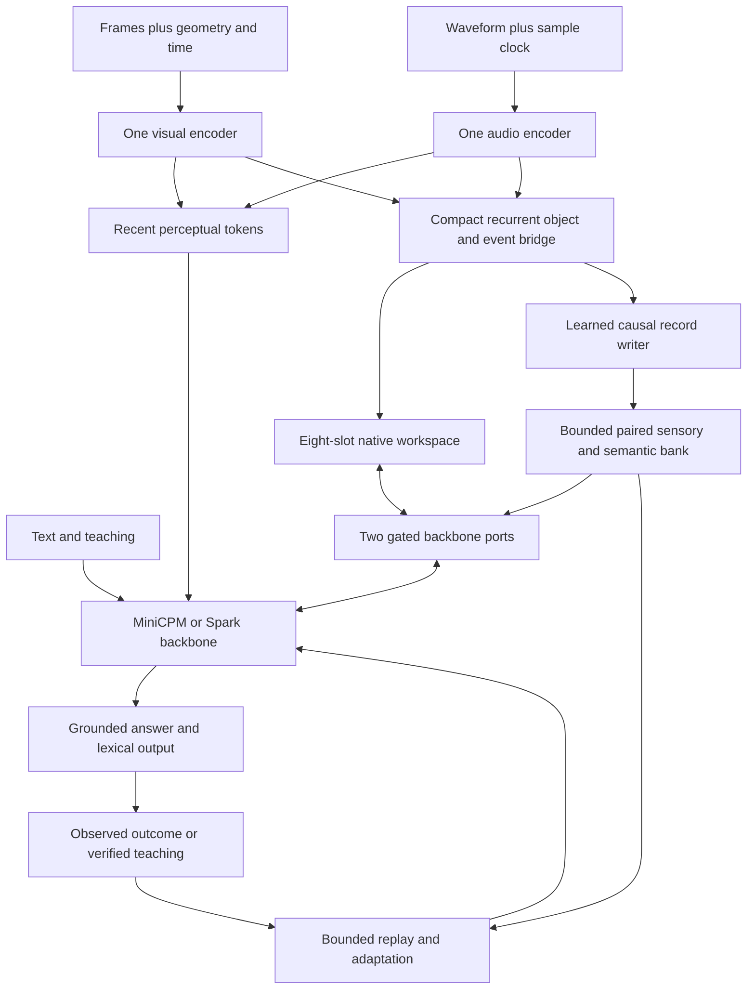

# Proposed native audiovisual experience architecture

**26 October 2026 · Proposed design, not implemented or qualified.** The [research review](Research_Review.md) supplies precedents and their limits. All dimensions, interfaces, objectives and schedules below are our engineering hypotheses. The final target remains the fully fine-tuned SparkX 2.6 4B language backbone, with additional compact modules; MiniCPM5-2B is the validation platform.

## 1. Design around reusable evidence

An experience should support questions that were not known when it was observed. Consider a user demonstrating a new device: a light flashes twice, a low tone follows, and a switch changes state. The model is taught that this sequence means “ready,” with a new name for the device. Later it should recognize a different example, distinguish reversed event order, use the name correctly, and incorporate a correction. A transcript, isolated frame or ungrounded verbal summary cannot reliably preserve every part of that task.

The architecture therefore maintains four distinct forms of information:

| Form | What it preserves | What it does not establish |
|---|---|---|
| Recent perceptual window | Fine current visual/acoustic evidence | Durable retention |
| Recurrent object/event state | Identity, changes, temporal relations, uncertainty | Unlimited history or learned skills |
| Persistent experience records | Selected sensory and semantic evidence with lineage | Correct generalization to new instances |
| Adapted parameters | Transferable changes learned from eligible evidence | Exact source-level deletion or automatic improvement |

Store observed evidence before interpreting it as a rule. Keep predictions and competing explanations in workspace state until new evidence confirms them. A stored prediction must never silently become an observation.

## 2. One model package with a compact state path

A host decodes media, allocates buffers, enforces quotas, applies the requested optimizer and saves state. Native tensors and learned modules determine objects, events, relevance, writes, reads and adaptation proposals. A captioning agent, answer-aware retriever or external reasoning loop is not part of the product path.

Retain the existing SigLIP2-base visual candidate and compare SPEAR-base with Whisper-small encoder-only for audio. Only one audio encoder should remain resident in the initial product. Use both high-level content and selected lower-level acoustic features from that encoder. Keep the same source/version/normalization pins as the canonical plan until a separately qualified replacement is selected.

### Compact recurrence before expensive language passes

Introduce a width-256 recurrent bridge that consumes sensory features at declared observation boundaries. Its learned queries maintain object tracks and sound events without invoking the full language backbone for every frame or 20 ms acoustic feature. The language goal can be a cached projection of the latest backbone state. This is a proposed cost reduction; encoder and bridge costs still count.

Use the existing **64 event slots as a shared cap**, initially partitioned 32 visual tracks, 16 acoustic events and 16 transitions. This allocation is tunable; it is not 64 new slots per modality. Preserve the eight width-256 semi-cognitive slots separately. The model can request a bounded high-rate observation burst; if the input schedule missed a short event, the correct behavior may be uncertainty rather than interpolation.

Track representations include observation and track UIDs, modality masks, sample-clock intervals, image/crop transforms, relative geometry and confidence. Assign new identities and correspondence using learned scores, trained with explicit no-match and occlusion cases. Mechanical UID allocation may be host-side; semantic matching must be native. Any depth/camera estimate has its own reliability flag. Two-dimensional coordinates do not imply measured three-dimensional position.

Use soft matching during early training if needed, but qualify the eventual hard allocation/eviction path. Save important transitions separately: merging two similar-looking states can erase the event that matters. Contradictory observations create revisions or alternatives with validity intervals rather than an averaged fact.

## 3. Paired experience records and bounded storage

The v3 key-128/value-256 bank remains the minimal control. Add a **paired sensory/semantic bank candidate**:

| Tensor field per record | Width/count | Purpose |
|---|---:|---|
| Associative key | 128 | Native retrieval |
| Semantic value | 256 | Cross-modal concept, relation or event |
| Visual evidence | 2 ×128 | Small region/transition views |
| Acoustic evidence | 2 ×128 | Small content/prosodic/event views |
| Total | 896 BF16 elements | 1792 bytes per populated record |

Two vectors per modality are a capacity hypothesis, not a claim of lossless perception. Compare semantic-only, paired vectors and a richer retained-evidence ceiling. Missing modalities carry explicit validity masks; unused vectors must not be interpreted as observed silence or an empty image.

At 4096 Spark records, tensor payload is **7 MiB**, versus the v3 control's 3 MiB. At 1024 MiniCPM records it is **1.75 MiB**. Reserve at most 512 additional bytes per record for fixed metadata, including up to four bounded relationship references. Variable text, canonical lexical bytes, provenance and auxiliary indices must also fit the existing **32 MiB combined resident-state cap**. Keep replay at 64 MiB and optional retained source media at 256 MiB. These are logical payload limits; allocator overhead, live copies, checkpoints and temporary device tensors must be measured separately.

Records bind `record_uid`, `track_or_event_uid`, `scope`, observation time, validity interval, source references, confidence, modality mask, correction/revocation status and representation version. They may reference a stable `lexeme_uid`; they must never use a recyclable vocabulary slot as identity. Prototypes and learned-rule records consume the same record quota. No unbounded side log, discarded-token pool, relation graph or provenance list may sit outside the accounting.

The initial writer is **independent of future questions**. During training, later questions provide loss targets, but their content and labels cannot enter the earlier write policy. At a query boundary the reader may naturally use the current question. This separates useful query-conditioned retrieval from noncausal query-conditioned storage.

### Reading at the backbone ports

Retain zero-indexed Spark ports 11 and 23; MiniCPM ports 13 and 27. Learn query projection, modality/time-aware selection, sensory-to-semantic fusion and a gated residual:

`h_next = h + gate * W_out(concat(memory_read_256, workspace_256))`

Initialize the residual to zero effect while retaining a usable gradient path: for example, a zero gate with a nonzero output matrix. Do not zero every multiplicative factor. Extension-disabled forward parity is required before training.

At the last query-prefill position, each port selects up to eight records using its native hidden state. The first port uses its selection immediately; after the second port, cache their union of at most **16 unique records** for subsequent decoding. Both ports then read that immutable set with different learned weights. This requires at most two full-bank scans at that boundary and no separate planning pass. Train the same prefill/decode order. A later refresh is an explicit event charged to the latency budget; it cannot run a hidden unbounded search every token. Score the full bank during selection training, with a supervised/contrastive selection loss, and train the final hard top-k path. Oracle record IDs are diagnostic only.

The two Spark query/output projections alone contain `2 × (2560×128 + 512×2560) = 3,276,800` weights, or **6.25 MiB in BF16**. This excludes biases, gates, writer, bridge, sensory fusion, encoders, activations and optimizer state. A single 4096×128 dot-product scan is 524,288 MACs; two scans are 1,048,576 MACs, before normalization, selection and readout. Neither number is a wall-clock estimate. Output projections still execute where the ports are used.

## 4. Experience, fast state and durable learning

An explicit record bank is the primary storage candidate. The latest repository diagnostic improves causal recall but still rejects it and fails a fresh-process parity attempt. No evidence presently supports replacing a correct, auditable bank with one repeatedly overwritten matrix.

For a later optional comparison, use **one visual and one audio 256×128 FP32 fast matrix**, shared across both ports: 0.25 MiB total state. Compare bank-only, fast-only and bank-plus-fast at equal bytes and measured update cost. A small nonlinear alternative needs its own parameter, optimizer and activation accounting. This is not an implementation of full Titans/HOPE merely because it changes weights at inference.

Start with bounded associative reconstruction and an old-anchor replay control. Compare literal long-span reconstruction against replay of each older value under its own key, rather than assuming today's key should retrieve an unrelated old event. Train update gates, decay and projections through later-query objectives over the declared short unroll. Truncate between independent worlds, not between every write and its training query. Audio fast-state updates are a new hypothesis and must beat an acoustic record-bank control.

Keep three adaptation levels explicit:

1. **Experience writes:** updating records, recurrent slots or explicitly declared fast state; no global backbone optimizer.
2. **Bounded online learning:** updates to a small adapter or selected bridge parameters using observed targets or verified teaching, replay and retention checks. Begin with the existing rank-8, two-port, four-step, 256-position cap. Compare fixed and learned update selection later.
3. **Offline consolidation:** full-backbone Spark training with eligible replay and mixed old/new capabilities. Run independent evaluations before replacing the deployed checkpoint.

The 256-position online cap includes inserted modality positions and replay. Use smaller clips or bounded native record reads; a 640-position media window cannot enter that microbatch unchanged. For a durable-parameter learning test, retain only the allowed updated model/adapter parameters: reset fast weights, recurrent/event slots and read caches, remove teaching-derived records/prototypes and lexical candidates, clear source KV, and disable further updates during evaluation. Otherwise transient state could masquerade as parameter learning.

Raw experience does not automatically supply a correct answer label. Causal observation can supervise later sensory prediction after the target arrives; it cannot independently validate an invented explanation. Instructed learning can use user-supplied rules and corrections with provenance. Self-generated proposals are candidates, not verification.

### Stable representations, restart and correction

During an online release, freeze the experience representation producer initially, even while an allowed adapter learns. The native writer may use context/selection signals, but stored key/value/evidence vectors must be computed by versioned, stable producers. If adaptive representations are stored instead, treat each producer change as a migration event rather than silently mixing incompatible vectors.

Offline full FT may update every original backbone parameter and permitted producers. It then requires a new state version: re-encode retained sources, validate an explicit migration, or invalidate incompatible records. Keeping a producer fixed within an online release does not mean freezing original backbone parameters during full offline training.

Save selected-record snapshots, clock/overlap state, recurrent state, fast weights, producer versions, adapters, lexical generations, optimizer ownership and random state at a transaction boundary. Forward/recomputation returns proposed state; commit it once. Repeated checkpointed forwards, rejected steps and resumed partial batches must not duplicate experience.

Removing a bank record is not exact unlearning from consolidated parameters. Corrections should tombstone superseded evidence and exclude it from future replay. For affected learned updates, use bounded rollback/retraining from a suitable checkpoint and evaluate the correction. If the necessary lineage or source is gone, explicitly mark the resulting uncertainty; do not promise exact deletion from arbitrary trained weights.

## 5. Learning useful visual and acoustic representations

Use a modular loss ledger, with coefficients selected on development data and frozen before confirmation:

`L = L_answer + a L_grounding + b L_temporal + c L_AV + d L_delayed_read + e L_selection + f L_retention`

This schematic does not imply that all terms are active on every example. Normalize by supervised units, log each term and its gradient path, and mask absent modalities.

| Objective | Supervision and anti-shortcut control |
|---|---|
| Spatial grounding | Points/boxes/relations tied to real features; wrong-region and coordinate-preserving content swaps |
| Temporal continuity | Same-object matching, changes, intervals and event order; reversed, duplicated and missing frames |
| Audiovisual alignment | Native acoustic/visual features with actual interval overlap; time-shifted and contradictory modalities |
| Latent prediction | Small predictors toward frozen/EMA targets; stop-gradient target branch and collapse monitoring |
| Delayed memory use | Ask after source tokens/KV are cleared; balanced distractors, correction, unknown queries and no oracle retrieval |
| Rule transfer | Teach then test different instances, viewpoints, speakers and lexical surfaces |
| Retention | Held-out text, visual, speech and nonverbal tasks alongside new learning |

Cross-modal prediction should align high-level events without forcing every audio feature to correspond to a visual patch. Keep lower-level sensory views separate. In offline masked learning, bidirectional context is acceptable when labeled as such; online prediction and latency evaluation require causal masks and declared lookahead. Teacher models provide training targets and can run serially offline; they are not resident product dependencies.

## 6. Semi-cognitive core, affect and vocabulary

The existing core can coordinate uncertainty, novelty, task progress and expected learning value across modalities. Replace host-derived semantic task features with native goal/evidence projections in the product arm. Preserve detached audit heads while adding answer, memory and future-query losses that actually backpropagate through the core. Compare zero, one and two recurrent iterations with parameter- and compute-matched feed-forward controls.

Perceived vocal affect is a distribution over uncertain interpretations, not a fact about someone's internal state. Store acoustic evidence separately from its interpretation. Appraisal may influence which evidence is revisited or rehearsed, but high salience or emotional intensity cannot establish truth, override an explicit correction, or monopolize the bank. Test whether appraisal improves recall/learning at a fixed quota against simple recency/novelty schedules. Personality content remains pending and is distinct from factual memory.

Swappable vocabulary uses stable lexeme identities to connect a new word with visual appearance, pronunciation and learned meaning. The 256 active phrase rows, immutable base IDs, generation-pinned mappings and atomic feedback experiment remain unchanged. Geometric/control symbols never become recyclable lexical slots. A successful name-recall test is separate from recognizing a new example of the named concept.

## 7. Full fine-tuning sequence

| Step | Work and exit criterion |
|---|---|
| A. Primitive alignment | Establish image/audio dependence, geometry and temporal labels with richer evidence controls before compression |
| B. Recurrent bridge | Learn tracks/events and recent-state updates; demonstrate causal benefit beyond a matched nonrecurrent bridge |
| C. Delayed experience | Train native writes/reads on unknown-future-query episodes after source removal; pass correction and restart |
| D. Full co-adaptation | Update all original Spark backbone parameters plus native modules, using text retention and mixed modalities; sensory freezing is declared |
| E. Verified adaptation | Teach new audiovisual rules, apply capped updates, test transfer and retention; only then optimize the learning policy |
| F. Consolidation and release | Full offline replay/consolidation, version migration, final held-out tests and long-session resource qualification |

These steps refine canonical F1–F5; they do not replace backend F0 or RSI F6. Connector warmup is preparation for full FT, not the final product recipe. Optional point/box specialist traces can be generated serially and consolidated into one checkpoint if they beat direct joint training. Do not require several resident teachers.

Use simple hard-label training as a control, then test modest label smoothing and replay separately. A better loss on seen examples is insufficient. The primary result is useful spatial/temporal/audio transfer after learning, with retained prior abilities and bounded end-to-end cost.
