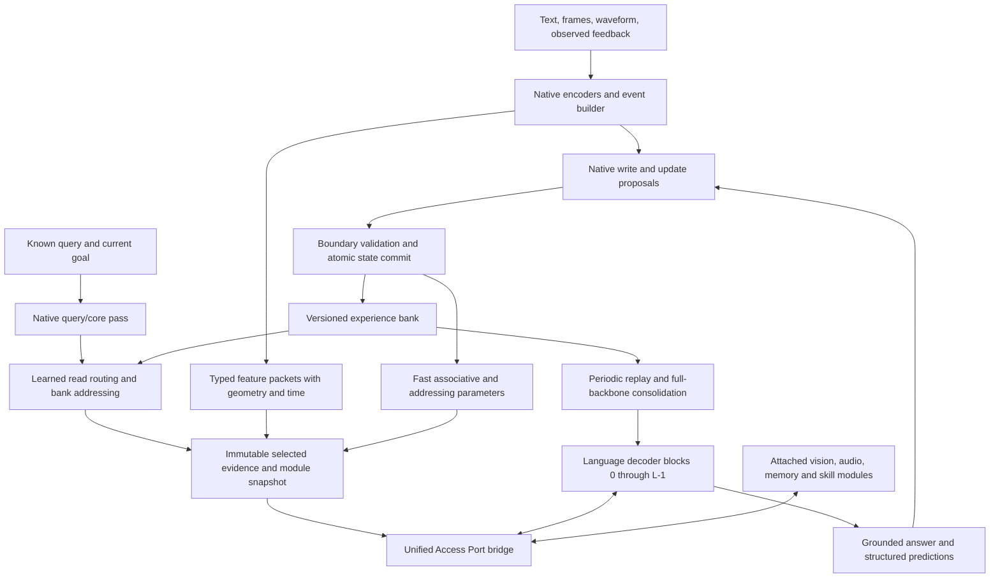

# SparkX 2.6: dynamic memory and Unified Access Port v1

26 October 2026. Proposed native architecture. **UAP is our proposed interface, not an existing industry standard.** None of this document asserts that a compatible runtime or useful learned behavior has already been implemented.

## 1. Revised product decision

Expose a port after every native decoder block: 36 possible sites on Spark, 42 on MiniCPM5. A learned bridge connects those sites to registered neural modules. Begin controlled comparisons with two, six and nine active reader sites; include all-layer access as a candidate. Exposure, execution, bank retrieval and state updates are four independent settings.

Added parameter count is **not a product ceiling**. Larger memory controllers, expert collections and multimodal modules are admissible. Choose them by useful capacity at measured active compute, resident memory, ingestion cost and retention. Parameters that are inactive still occupy storage; paging them has latency. Dynamic parameters are not free parameters.

The final Spark language backbone still receives full offline fine-tuning. The existing small online LoRA arm remains a comparison from revision 4, but **LoRA is not the module interface and is not required for this design**. UAP modules can contain full-rank dense projections, recurrent networks, fast matrices, sparse parameter tables or specialist encoders.

## 2. Separate five kinds of changing state

| Class | What changes | Ownership and intended lifetime | Claim it can support |
|---|---|---|---|
| Episodic records `E` | Append/correct structured keys, sensory values and relations | Persistent task/user scope, explicit IDs and producer versions | Exact experience recall and revisable facts |
| Working state `C` | Event slots, current goal, attention/query context | One stream/task; explicitly cleared or checkpointed | Ongoing temporal integration and reasoning |
| Fast associative parameters `F` | Matrix/MLP weights updated from observed patterns | Scoped, serializable mutable state; reset separately from `E` | Adaptation and compressed associations while `F` survives |
| Fast addressing parameters `A` | Small full-rank query transform or routing state updated from feedback | Scoped, versioned; initially update only between decisions | Learning how to find relevant experience |
| Durable parameters `theta` | Backbone, bridge, controller and skill-module weights trained offline or consolidated | Versioned model/module checkpoints | Learning that survives clearing teaching-derived state |

There are also **conditional parameters**: modules or expert weights selected for an input. Selecting a fixed expert is conditional computation; it becomes learning only when the stored state or parameters change through a specified learning process. These distinctions prevent larger caches, sparse routing and weight learning from being counted as the same result.

A module package has persistent trained weights, a declared mutable-state schema and a learned interface connector. Each user/task gets separate mutable instances. Installing a module must not copy another user's accumulated `E/F/A/C` into the new instance.

## 3. Architecture and causal flow



This diagram represents ordered phases, not simultaneous cyclic evaluation. For the initial experiment, the known-query pass selects evidence before the answer pass. Answer-pass readers see an immutable snapshot. Observations can be committed before answering when already available; generated hypotheses do not become observed facts simply by passing through a write head. Feedback updates become visible only at the next declared boundary.

The host schedules and serializes tensor operations and enforces the admitted budgets. The neural model produces semantic addresses, routing choices, write scores and update proposals. A nearest-neighbor index or module loader is mechanical infrastructure; an external model choosing the answer-bearing record is a different architecture and must be labeled as a control.

The extra full query-sensing pass is a controlled reference, not a free production operation. It may fail the 10% text-overhead target on prefill-heavy workloads. Compare two later production candidates: a compact native query encoder trained against the reference selector, and single-pass selection at an available backbone layer with results accessible only to that and later sites. Earlier sites can read previously committed selection, never future selection. Each candidate needs matched training, causal tests and quality comparison; additional query-encoder parameters are acceptable if they reduce total measured cost.

## 4. Memory attention: two access stages, two learning timescales

### 4.1 Address the bank, then read selected evidence

Use an address head conditioned on the current native query, core goal, requested relation and available sensory/event features. A schematic query is:

```text
q0 = Q_address(native_query, core, relation_features)      # width 128
q  = normalize(q0 + A[scope, depth_group] @ q0)
eligible = availability_mask(time, scope, validity, representation_version)
candidate_ids = top_k(score(q, bank_keys), eligible)
read = attention(layer_query, selected_key_value_packets)
```

The first top-k operation chooses records; the second attention combines their content differently at each backbone layer. A high gate or attention weight is not proof that a memory helped. Counterfactual removal/replacement is required.

For MiniCPM's first 1,024-record study and Spark's 4,096-record baseline, use an exact scan as the reference. It is simple and often cheaper than maintaining a sophisticated index at this scale. Retain two bank queries, top eight per query and at most 16 unique selected records for the initial controlled arm. All readers share that set. An experimental second query may use the first retrieved evidence through the native core; its latency and dependency are explicit.

A later hierarchical variant routes to a small number of semantic shards before local search. Train it against exact-search recall and include correction, rare-event and cross-modal negatives. For 65,536 records, coarse routing can reduce scoring arithmetic substantially, but shard imbalance, missed neighbors, index updates and memory gathers can erase that benefit. It is approximate retrieval unless a separately verified algorithm guarantees otherwise. Product-key exactness applies only to its constrained learned key geometry.

### 4.2 Learn the addresses without corrupting old representations

Outer training optimizes the address head, module/expert addresses, reader and writer jointly on causal episodes. Give the selector its own contrastive/ranking supervision using training-only relevant record IDs. Answer loss alone may not provide gradients to records excluded by hard top-k. Start with soft selection on a small bank or a supervised exact candidate set, then compare the deployed hard selector; do not substitute oracle selection at evaluation.

The first online-address arm updates **only `A`**, a full-rank 128×128 transform per depth group, from explicit correction or verified outcome. Stored keys and their encoder remain fixed within that representation version. Contrast against a fixed address head using identical records and equal update costs. Constrain step size, norm and update count, replay unaffected queries, and evaluate on later unseen queries. More flexible query transforms can worsen old retrieval even if bank bytes remain unchanged.

Updating key producers, shared expert addresses or every projection online is a later arm. It requires re-encoding, a validated version translation, or invalidation of incompatible records and cached projected features. Normalization does not solve that problem. This restricted first step is an experimental isolation choice, not a permanent parameter limitation.

### 4.3 Add fast associative experts

A concrete candidate has three depth groups, with eight experts per group. Each expert contains four full-rank 128×128 FP32 fast matrices. Read queries and values have four heads; the concatenated result is width 512. Read and write routers share expert identity/address vectors but have different learned projections.

Start with dense routing as a faithful control for the routing idea. Compare top-two sparse execution after dense routing works. Sparse means inactive expert matrix operations are actually skipped, not evaluated and multiplied by zero. The eight-expert design has **6 MiB of matrix state across three groups**, independent of how many layers read it. Twenty-four experts per group use 18 MiB; 64 use 48 MiB. These exclude optimizer/replay buffers, snapshots and module weights.

A transparent per-head update control is:

```text
prediction = F @ normalized_key
F_next = decay * F + step * (observed_value - prediction) @ normalized_key.T
```

This equation specifies a baseline, not a claim to reproduce MemT's stabilized GDN-2 or HOPE. Compare single-event updates with a bounded recent-event objective inspired by ATLAS. The meta-training outer loss evaluates later retrieval, pattern transfer and retention after the update. Truncated unroll length, stop-gradient locations and optimizer buffers must be reported.

The read router can select pattern experts using current intent and evidence; the write router can distribute a new pattern differently. Routing probabilities and decay are distinct. Define decay by elapsed observations/time and advance it once per update boundary, not once per reader call. Sparse lazy decay must numerically match its declared dense/reference semantics. Duplicate audio windows and video crops share observation identities so they cannot silently multiply updates.

### 4.4 Keep records and fast parameters complementary

Retain the paired record bank from revision 4: semantic key/value plus visual/acoustic residuals, event relations, time and provenance. Its original 896 BF16 elements per record remain a control; project selected views into the width-512 bridge as needed. Do not relabel compressed fast weights as individually addressable records.

Records support exact identity, timestamps, contradictions and later rebuild. Fast weights support interpolation and repeated patterns. If a source is corrected or revoked, invalidate derived fast state or rebuild it from retained compatible evidence. Subtracting one write from a nonlinear, decayed update sequence is not a general undo operation. Durable skill modules require a separate correction/retraining policy.

## 5. Unified Access Port contract

### 5.1 One envelope, typed capabilities

The initial payload width is 512, with a width-256 control. Width is configurable through an explicit interface version. A common envelope does not require every module to implement every operation.

| Object | Required content |
|---|---|
| `ModuleManifest` | Stable module ID, weight hash, interface version, capability types, representation/anchor versions, input/output layouts, parameter/state inventories, device/dtype support, update/read schedules, tested compatibility |
| `PortRequest` | Request/stream/scope ID, backbone layer and site, causal frontier, query tensor, masks, required capability, relevant coordinate/time frame, admitted token/compute quota, immutable state handle |
| `FeaturePacket` | Semantic latent sequence, validity and per-query availability masks, modality/type, observation/event IDs, coordinates/transforms, time intervals, uncertainty, producer/version and optional modality residual views |
| `PortResponse` | Bounded output packet, evidence references, routing result, cost counters and optional proposed writes; never an untracked in-place state mutation |
| `UpdateProposal` | Parent state/version, observed sources or verified feedback, target state class, update rule/version, proposed tensors, scope, candidate hash and replay/reset requirements |
| `CommitReceipt` | Exact parent/candidate identities, resulting state revision, affected caches, update count and serialization/checkpoint identity |

Capability examples are `encode_visual`, `encode_audio`, `read_experience`, `read_fast_association`, `temporal_reasoning`, `spatial_reasoning`, `lexical_lookup` and `propose_update`. A sensory encoder receives its declared sensory tensors; a reasoning module receives query/evidence packets. Calling an arbitrary text service is not an interchangeable implementation of those capabilities.

The first tensor contract uses queries `[B,T,512]`, packet latents `[B,S,512]`, validity `[B,S]` and causal availability `[B,T,S]`, with explicit head/width transformations inside the bridge. The per-query availability mask is essential for teacher-forced sequences; the current read-only port's `[B,S]` validity mask alone does not describe this general case. An audio feature's availability is the latest sample used to produce it, including encoder lookahead, rather than its nominal center timestamp.

During outer training, a functional updater returns a new state and the graph needed by the declared unroll. Deployment reads detached immutable state and commits a candidate at a boundary. Do not mutate a state tensor that an earlier forward or checkpoint recomputation still references. State, lexical mappings and producer/module versions must be saved as one consistent revision.

The backbone port computes a normalized native query, calls or reads the selected module, then applies a trained output projection and residual gate. Initialize the output projection to zero with a live gate, as the current memory port does. Do not zero both the output and a multiplicative gate in a way that blocks every opening gradient.

Begin with **post-block residual** integration, matching the repository's explicit native execution. A MemT-style pre-output attention branch can be a separate versioned site: it needs native head geometry, gating and projection qualifications. Site declarations must prevent a module trained for post-block width 2,560 from being silently interpreted as a 4,096-wide concatenated attention-head tensor.

### 5.2 Compatibility has several levels

1. **Structural:** shapes, dtype, device, masks and state ownership are valid.
2. **Representational:** outputs satisfy the learned semantic/geometry/time interface. A trained module-specific connector, shared pretraining or validated anchor mapping establishes this.
3. **Behavioral:** adding/swapping the module improves its target tasks and preserves required capabilities on unseen examples.
4. **Adaptive:** after module/state updates, those properties and old-memory accessibility still hold.

Passing level 1 cannot imply the others. A new encoder normally needs alignment training even if it emits 512-dimensional vectors. A module trained independently against a fixed interface may be swappable without retraining the backbone; that is a testable goal. Retrofitting an arbitrary pretrained network is an alignment project.

Use a continuous semantic payload plus structured geometry/time and optional grounded categorical anchors. Categorical anchors have stable global identities. Learned side channels must preserve uncertainty and sensory detail, not force all experience through captions. A small frozen conformance dataset can measure interface drift; it does not prove quality on every downstream task.

### 5.3 Attachment and execution schedules

Attach/detach packages at a declared decision or segment boundary. Reset or migrate their owned state, invalidate affected projected features and discard/recompute downstream KV if dependencies changed. Never mutate a live training/recomputation graph's module, vocabulary mapping or state snapshot.

Provide three execution modes:

- **Observation mode:** encode new image/audio/event data once and cache compatible packets. Charge media decoding, encoder work and packet construction.
- **Query mode:** perform a bounded module computation when the question/core requests it. Cache by module weights, state revision, input identity and query identity.
- **Token mode:** execute each generated token only for modules whose demonstrated benefit requires it. Charge the complete attached model and its KV/state, not merely connector weights.

In the first study, request-level sparse module routing chooses at most two active modules and remains fixed for the answer pass. Per-token routing is a later experiment because it complicates batching, caches and compute prediction. Read/write scheduling remains independent of the number of available port sites.

Within a pass, requests form an ordered dependency graph: a layer can consume available packets or compute from its current/past hidden states. It cannot read a result that a deeper layer has not produced. Sharing a module across sites shares its weights and owned state; query-dependent results are reusable only when the query and all other dependencies match.

## 6. Vision, audio, semi-cognition and vocabulary together

Visual packets retain regions, patch coordinates, crop transforms and object identities. Audio packets retain acoustic features, event intervals and uncertain perceived affect. Shared semantic addresses can relate an acoustic motif to a visible object, but modality-specific values preserve information that a global embedding loses. The event module learns correspondence and temporal relations using aligned and deliberately shifted/reversed examples.

The recurrent core receives current evidence, retrieved experience, task state and calibrated uncertainty. It produces query/refinement vectors and bounded memory/update priorities. Its existing width-256 state can use a learned projection into the bridge; a larger core is an explicit candidate. Host-derived task features remain a baseline until a native task representation is qualified.

Functional appraisal may prioritize surprising events, uncertainty, perceived urgency and repeated failure. These signals must not redefine factual truth or become the sole write/learning reward. Evaluate perceived-affect calibration and downstream utility separately. This is simulated appraisal and response modulation; it does not claim subjective emotion. The personality-description file remains pending, with a versioned preference/identity module interface reserved for it.

Swappable lexical slots use `{lexeme_uid, canonical_bytes, representation_version}`. Port packets and stored memories reference these identities, never a temporary slot number alone. A module may recommend a new lexical entry; the native lexical head decides activation and the mechanical mapper allocates a permitted slot. A slot swap does not change the meanings of old records. Cross-tokenizer model attachment requires token/byte alignment or a latent interface, not reuse of integer IDs.

**Illustrative learning episode:** a user teaches that a particular acoustic pattern followed by a lamp flash marks a machine state, and gives it a new name. The model stores the sound, region and interval relation, associates the name with a stable lexeme ID, and can later recognize an unseen instance. Reusing a stored teaching episode demonstrates experience-assisted transfer. Correct application after removing teaching records, lexical teaching cues and fast state requires durable learning. The [validation plan](MiniCPM_Validation.md) makes those conditions separate.

## 7. Training and consolidation

| Stage | Trained parts and evidence required |
|---|---|
| Interface calibration | Module connectors/readers and explicit alignment losses; freeze backbone initially to isolate the interface |
| Episodic memory training | Writer, address head and readers; relevance/correction supervision, unknown queries and temporally valid writes |
| Fast adaptation training | Meta-train `F` initialization/updater on causal episodes; then isolate `A` feedback adaptation; test dense and sparse routing separately |
| Integrated full fine-tuning | All original Spark backbone parameters plus admitted modules/bridge/core; mixed text, sensory, memory and compatibility retention data |
| Module independence training | Vary seeds/modules, remove modules, hold out combinations, swap qualified connectors; preserve a versioned interface target |
| Verified consolidation | Replay independently supported experience into durable parameters or a new full-rank skill module; measure learning with teaching-derived state cleared |
| Learning-policy research | Optimize update/selection policy for future held-out benefit at matched cumulative compute; only then compare successive policy revisions |

A representative outer objective combines answer loss, grounded spatial/temporal prediction, masked sensory prediction, retrieval relevance, modality correspondence, module compatibility and retention. Weights are chosen on development data and frozen before the sealed comparison. Modality alignment alone does not substitute for task/temporal supervision. A true positive audiovisual pair must be an observed correspondence; an imagined future is a prediction target with a different evidence type.

During full fine-tuning, a frozen interface teacher or retained anchor set can resist representation drift. It cannot guarantee interoperability. Check old modules and records after training; translate/re-encode or invalidate incompatible versions. Keep mixed text retention and replay controls even when testing gradient-protection methods.

Begin expansion with preallocated dormant expert/module slots and learned selection. Creating a new trained skill module is an occasional consolidation operation with a new manifest and compatibility evaluation. Automatically growing arbitrary architectures during every interaction is not required for native self-learning and is not established by these papers.

## 8. Cost choices and practical recommendation

The [analytical ledger](../../../reports/sparkx_dynamic_memory_bridge_20261026/analytical_costs.json) accounts for alternatives rather than enforcing a small parameter ceiling. Representative Spark port matrices at width 512 require 3,145,728 weights per site before norms/gates. Nine such reader sites store 54 MiB of BF16 matrix weights; all 36 store 216 MiB. These are reader weights, not the total bridge/module system. Every site can read shared state without duplicating the history bank, although each executed read still costs computation.

A larger nine-layer, 16-head, 256×256 per-head fast-memory option has 36 MiB FP32 matrix state. Separate full Q/K/V/O projections for that option would add 377,487,360 matrix weights, 720 MiB BF16, before gating and norms. Sharing the native output projection changes that count and requires the different attention-site qualification. This is a legitimate quality/capacity arm under the revised parameter policy, not an automatic default.

Prefer this sequence: explicit bank and calibrated addressing → useful shared fast associations → qualified module swaps → full-backbone integration → sparse/expanded capacity → consolidation and learning-policy improvement. The experimental order isolates causes; it does not impose a permanent small-model architecture. Existing local 50 GiB admission and failed-quality gates continue to govern actual experiments until a separate execution protocol changes them.
