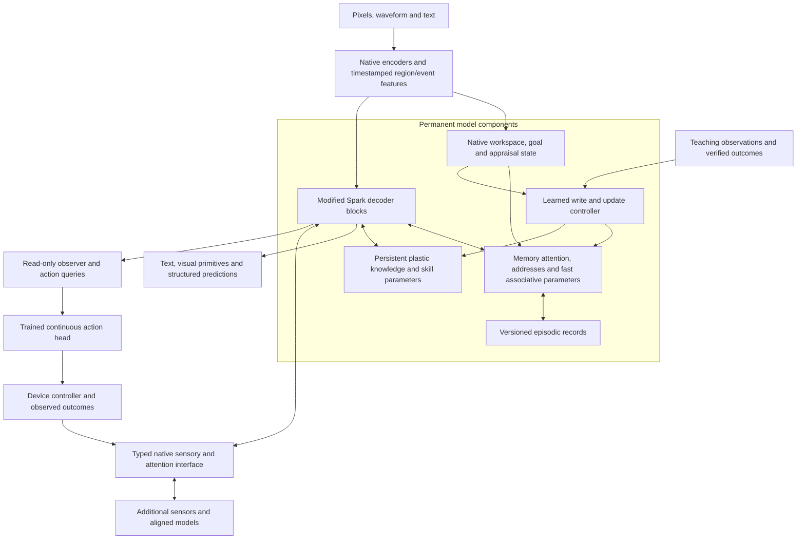

# Intrinsic memory architecture and a separate neural spine

**Revision 4.5 refinement:** [the nested-learning contract](../sparkx_nested_learning_20261026/Nested_Learning_Contract.md) supersedes this companion's initial SGD recipe and 128 MiB illustration. It specifies two plastic clocks, native fused AdamW, an explicit first-order meta-gradient and a 256 MiB mutable-state research envelope. Earlier numerical receipts remain historical.

26 October 2026 · proposed revision 4.3 design. [Research basis](Research_Review.md), [teaching/validation](Teaching_and_Validation.md), [configuration](../../../configs/sparkx_2_6_4b_intrinsic_learning_spine_v1.json).

## 1. Product boundary

SparkX2.6 comprises the original 4,112,079,360-parameter language backbone, native vision/audio frontends, spatial/temporal representations, a recurrent cognitive workspace, and intrinsic read/write/learning components woven into decoder computation. The original parameter count is not a cap on the complete model.

Initial product training performs full offline fine-tuning of the entire language backbone and native multimodal components after extension warmup, including vision/audio encoders and spatial/temporal bridges in the joint stage. It teaches perception, reasoning, addressing, writing and adaptation. **Online self-learning does not establish multimodal behavior. It acquires knowledge and experience through modality capabilities already trained and qualified offline.** During normal deployment, freeze those stable weights and the qualified learning machinery; let explicitly designated dynamic parameters and experience state change. A model checkpoint then has a stable release plus a personal/task learning checkpoint. Optional later full fine-tuning creates a new release; it is not required for every newly learned concept.

**Memory is an intrinsic part of the model even when no external device or model is connected.** Ablation switches can disable it for experiments; they do not make it a peripheral service. Vision and audio are also core product paths. The spine permits additional modalities, instruments, action heads or specialist models beyond those paths.



Edges describe permitted information flow across ordered phases. They do not imply an instantaneous cycle between a decoder and an attached model.

## 2. Specify the changing substrate

| Symbol | State/parameters | Deployment behavior | Learning claim to test |
|---|---|---|---|
| `Theta` | Original backbone, fixed encoders/connectors, read/write controller and meta-learned initializations | Frozen within a release | Supplies stable prior knowledge and the learned procedure for using/updating memory |
| `C` | Workspace, event/track state and appraisal | Updates within a stream; normally cleared for a new independent task | Temporal integration and reasoning |
| `E` | Explicit paired sensory/semantic records with stable IDs | Append, revise, evict and checkpoint | Episodic recall, explicit facts and provenance |
| `F` | Intrinsic associative matrices or small nonlinear memories | Causal learned writes; scoped persistence is explicit | Compressed associations; persistent learning if transfer/retention tests pass |
| `A` | Native addressing/plasticity transform | Feedback updates between decisions; initial fixed-address control | Better selection of relevant stored knowledge |
| `P` | Slower native knowledge/skill parameter bank | Small verified updates and replay; persists across sessions | Reusable concept/rule learning with `Theta` frozen |
| `Psi` | Optional later plastic learning-policy parameters | Separate research phase after `P` learning succeeds | Improvement in how the model learns, at matched cumulative cost |

“Fast” identifies an update mechanism, not a mandatory expiry time. `F` can persist. `P` separates slower consolidation and protection from recent high-turnover associations; its usefulness must beat a matched `F`-only control. No class is inherently “real learning” just because it is called a parameter. Conversely, source-free retained skill in `F` or `P` is not disqualified because the stable backbone did not change.

The default release freezes `Psi` as part of the learned controller. Native cognitive state and storage are owned by the model instance. The host supplies tensor execution, serialization, data/device transport and independent feedback; it does not choose the semantically correct memory or synthesize the perception result at runtime.

Dynamic parameters can change in value and, in a later capacity-growth experiment, in number. Start with a fixed bank to isolate learning. Then compare 16, 64 and 128 `P` experts with two actually active experts. A new expert receives a stable ID, a meta-trained initialization template, an address and a versioned checkpoint entry. Train allocation/routing on episodes that exercise fresh slots; an unused slot is not automatically a useful expert. Growth is admitted against an explicit storage/residency budget. Paging cold experts saves resident bytes only at a measured transfer cost. Expanding a tensor after each difficult example without learning to route or protecting old knowledge is not a validated growth mechanism.

## 3. Put the machinery inside decoder blocks

Use distinct namespaces such as `intrinsic_memory`, `plastic_knowledge` and `spine`, with separately owned state. Intrinsic memory is initialized and restored with the model, not discovered from a peripheral registry. Require an empty-spine configuration to pass every core learning task.

For a decoder block with pre-norm attention and MLP, a schematic primary candidate is:

```text
u        = norm_attention(h)
a        = original_attention(u, causal_KV)
m        = native_memory_read(u, E, F, A, C)       # width 512
h_attn   = h + a + gate_m(u) * U_memory(m)
v        = norm_mlp(h_attn)
p        = plastic_experts(D_knowledge(v); P)      # width 256
h_next   = h_attn + original_MLP(v) + gate_p(v) * U_knowledge(p)
```

This preserves the original attention/MLP and adds permanent memory and plastic-knowledge branches. It is our proposal, not a reproduction of MemT's exact pre-output insertion. Keep the current post-block residual path as a simpler control. A closer MemT candidate injects into attention before the existing output projection; Spark's 4096-wide attention concatenation and 2560-wide residual stream require a separately checked projection contract. Do not substitute a Llama implementation by name.

Expose potential sites in all 36 Spark blocks, but qualify two, six, nine and all-layer execution separately. The nine-site candidate is `[3,7,11,15,19,23,27,31,35]`, following full-attention blocks. Compare a late-only plastic-MLP placement motivated by TTT-E2E against distributed `P` reads. Do not simultaneously change density, state size, update frequency and training data and attribute the result to depth.

The old two-site MiniCPM control remains `[13,27]`. Its current executor only supports the established post-block insertion. Pre-MLP/pre-output integration, native audio and persistent `P` are planned implementation work. Zero-effect output initialization and extension-disabled parity precede learning. Keep a live gradient path: do not zero both a multiplying gate and its output branch in a way that prevents either from learning.

### Memory attention and learning where to look

Use two distinct operations: native addressing selects a bounded evidence set from `E` or expert addresses; decoder queries then attend to the selected evidence/associative outputs. Query-dependent gates combine recent context, exact records, `F` and `P` without requiring a text memory prompt. The first addressing baseline uses stable keys and a learned query; later adapt a small full-rank query transform `A` from supplied feedback. Altering keys requires a migration/re-indexing design.

Sparse routing is an optional computation optimization. MemT's MoS is not evidence for top-two sparse execution. Train a dense control, measure load balance and missed relevant experts, and verify that inactive branches actually skip computation. More reader sites must not apply the same write or decay multiple times.

## 4. Learning schedule and causal semantics

1. **Observe.** Native encoders produce time/geometry-aware features. Update bounded event state from available observations, without a future query or answer.
2. **Write recent experience.** Compute keys, values, novelty and overwrite/retention gates inside the model. Apply learned associative updates and propose explicit record revisions. Preserve observed evidence separately from inferred interpretation.
3. **Reason/read.** Use one consistent memory/knowledge revision throughout a decision. A query can select relevant evidence; it cannot select a write using a future evaluation label.
4. **Learn from teaching or outcomes.** Update nominated `P` experts and, in separate arms, `A`. Start with fixed, bounded native fused AdamW and replay; qualify policy learning later. Behavioral end-to-end adaptation is the learning reference; local objectives must demonstrate comparable behavioral transfer at lower total cost.
5. **Commit/checkpoint.** Commit once at a declared boundary, including versions and update provenance. Subsequent decisions see the new state. Save stable release identity separately from the dynamic state.

A simple delta-rule `F` baseline and the existing SGDN-2 implementation remain different algorithms. A nonlinear memory must specify its objective, normalization, optimizer state, truncation horizon and projection parameters. Native mechanisms can use autograd; they need not modify the original 4B tensors.

For `P`, use verified teaching pairs to learn a response/evidence representation, or predict an observed successor event from preceding events. Cache detached upstream features for a local update. Joint offline training must make that local objective useful for future decoder behavior. Stop-gradient targets and contrastive negatives can prevent trivial copying/collapse; they do not establish truth. Predictive targets come from observations, not the model's own unverified claim.

If an inner objective is answer loss through an early `P` branch, gradients still traverse the later frozen decoder. Count that backward pass, its activations and any repeated prefill. Freezing `Theta` removes its weight optimizer state; it does not remove all backbone update-time computation. A fixed “four steps” budget is insufficient without timing the complete teaching event.

By default, clear dependent KV/read caches when `F/A/P` revisions change. A later versioned mixed-epoch KV design needs its own training and parity tests. Activation checkpointing, retries and rejected candidate updates cannot produce duplicate writes. Store persistent state before its derived caches, and validate a fresh-process reload without re-encoding old observations.

## 5. Vision, audio and experience formation

Keep visual patch coordinates, crop transforms, object identity and interval timestamps. The [visual-primitives and temporal plan](../sparkx_av_experience_20261026/Native_Experience_Design.md) remains: grounded point/box predictions, track/event recurrence and cross-frame relations, trained with full-backbone fine-tuning. Test novel instances, occlusion, viewpoint changes and order reversals. A visual token is useful for reasoning only if intervening on its evidence changes the relevant conclusion.

Audio must preserve more than words. Maintain representations for phonetic/semantic content, acoustic events, timbre/pitch/rhythm, and prosodic/perceived-affect cues. These can be different heads or feature scales of one encoder; four complete permanent encoders are not prescribed. Compare the existing SPEAR candidate with a music-specialist control such as MERT-95M, and evaluate a unified encoder with music-aware offline training/distillation. Added encoder capacity is allowed when measured quality justifies it.

Use actual sample/interval times to join modalities. A beat, a motion transition and a spoken reference can become related event slots while retaining distinct evidence. Music has multiple timescales: brief onsets, motifs, phrases and longer structure. Uniform pooling to ten tokens/second is a hypothesis, not a settled resolution; assess pitch/onset and long-structure losses separately. Retain high-rate local features inside the encoder/bridge when low-rate semantic packets would discard necessary information. Higher-rate processing is charged even if fewer tokens reach the decoder.

For example, teach an arbitrary device convention through synchronized lights and tones, then ask about a different device with the same convention after the teaching clips are gone. Test novel appearance, reordered events and a changed tone pattern. Separately, teach a musical motif category and test new performances; preserve absolute pitch when the task depends on it, and use transposition invariance only when the label permits it. These tasks test experience abstraction more directly than remembering a caption.

Store listener-perceived emotion, explicit personal preference and internal appraisal separately. Use uncertainty distributions and named viewpoints where supplied. A private listener preference must come from instruction/feedback, not an acoustic stereotype. Appraisal can control attention or learning effort; it cannot certify a memory. Personality integration remains an interface pending the user's description.

## 6. Semi-cognitive core as a learned controller

Retain the eight width-256 recurrent slots and initially two recurrence steps. Add native representations of goal, observed prediction error, uncertainty, retrieved evidence and time. The current `TaskStateEncoder` receives host-computed task features; those must cease to be the semantic source of the final product's learning decisions. Keep the exact-feature pathway as a diagnostic control.

Train useful controller outputs: what to attend to, whether additional sensory detail is needed, which memory scope to query, whether to retain/revise an observation, and whether a verified update is worth its cost. The current audit heads detach core input; a separate end-to-end training path is needed for these objectives. Compare recurrent, one-step and parameter-matched feed-forward controls before claiming that recurrence is useful.

Functional appraisal is a bounded state with decay, not a claim of subjective feeling. An ANML-inspired plasticity gate is a research candidate: compare learned gating against fixed/sparse/random gating under equal update budgets. A learned confidence signal needs independent calibration; confidence alone cannot turn self-generated hypotheses into knowledge.

## 7. Unified Access Port v2: the neural spine

UAP is a project interface proposal. It is not an established universal neural standard. Its purpose is native tensor exchange with external components, independently of intrinsic memory membership.

| Channel | Operation | Initial information-flow rule |
|---|---|---|
| Sensory ingress | A trained adapter maps tactile, depth, additional audio/image, proprioceptive or other device features into packets | Valid observed packets may enter designated encoder/decoder sites |
| Model exchange | Trained queries read an aligned model's feature packets | Start with one-way, cached causal evidence; two-way exchange uses explicit rounds |
| Observer egress | Trained readout queries inspect selected layers/events | Read-only; cannot modify source hidden state or memory |
| Action egress | An action head consumes readout/context features and predicts typed continuous actions | Separate action-head and device-control clocks; feedback returns as new observations |

Packet envelope: `{interface_version, module_id, weight_hash, representation_id, stream_id, sequence_id, observation_id, start_time, end_time, available_at, clock_id, coordinate_frame, units, validity, uncertainty, causal_round, state_revision}` plus feature tensors and masks. Start with features `[B,S,512]`, queries `[B,Q,512]`, optional control features width 256, validity `[B,S]` and query-specific availability `[B,Q,S]`. Dimension conversion is trainable and explicit. Declaring `uncertainty` does not mean it is calibrated.

An observation covering `[t0,t1]` is available no earlier than `t1` plus encoder delay. Noncausal audio/video windows cannot be advertised as available at their start. Enforce causal masks during teacher forcing as well as generation. A deeper decoder state cannot return to an earlier layer in the same pass without an explicitly budgeted second pass. Two-way model exchange uses a finite round count and versioned snapshots; it cannot form an unscheduled feedback cycle.

Different tokenizers, rotary positions and hidden coordinate systems prevent raw KV interchange by default. Train model-specific codecs into the packet space using paired observations/tasks, causal correspondence and downstream losses. Validate unseen data, independently trained adapter seeds, module removal and representation-version mismatch. Matching widths is only the first test.

For devices, add action-space identity, units, coordinate frame, horizon, execution timestamps, deadline and validity interval. The trained head emits continuous controls; the device driver implements calibrated execution bounds and a defined behavior for stale/missing commands. This is necessary interface behavior, not an external reasoning agent. No action capability is implied merely by attaching a sensor. Validate in replay/simulation before embodiment-specific deployment.

Native inspection exports selected layer vectors, attention summaries, memory-address scores or predicted structured state under a declared readout schema. These are model representations, not direct access to private subjective thoughts or a guaranteed faithful explanation. Read-only observers should leave outputs bitwise unchanged under deterministic settings. Keep arbitrary weight/state mutation out of the observer channel; teaching uses the model's update path.

## 8. A costed starting point, with no added-parameter ceiling

The [reproducible cost ledger](../../../reports/sparkx_intrinsic_learning_spine_20261026/analytical_costs.json) is arithmetic, not a latency benchmark. An illustrative Spark candidate uses nine width-512 memory readers, three groups of eight four-head 128×128 `F` experts, three 128×128 address transforms, and a global bank of sixteen width-256/hidden-1024 gated `P` experts. Two `P` experts execute per active site; all sixteen remain stored. Shared experts receive depth identity, and a grouped-bank control tests interference.

- Memory-reader matrices: 28,311,552 fixed parameters, 54 MiB in BF16; separate `P` input/output projections add 11,796,480 parameters, 22.5 MiB. Norms, gates, update controllers, encoders and the original backbone are additional.
- `F`: 6 MiB FP32; `A`: 0.1875 MiB; `P`: 12,582,912 mutable parameters, 48 MiB FP32. `P` is full-rank, not LoRA. The current native fused AdamW candidate adds 96 MiB of resident moments; the original moment-free estimate is historical.
- Spark's 4096 paired records occupy 7 MiB of tensors plus a proposed 2 MiB metadata cap. Workspace/events add 0.03515625 MiB in BF16. Together with `F/A/P`, this is 63.22265625 MiB before staging, gradients, replay and caches.
- A boundary update with a second `F` snapshot, `A` staging and gradient, and two active `P` experts' snapshots and gradients reaches an illustrative 81.59765625 MiB. A separate 64 MiB replay budget makes 145.59765625 MiB before activations, indexes, lexical payloads, scratch and serialization. This is a historical moment-free illustration. It does not fit the current resident-Adam candidate under 128 MiB; use the revision 4.5 ledger and measured peaks before admission.
- Two active `P` experts require 1,572,864 matrix MACs per processed vector. Nine token-level reads cost 14,155,776 MACs per decoder position before routing, projections and memory reads. Event-only execution is a cheaper alternative to test, not an equivalent capability assumed in advance.

For capacity growth, 64 or 128 `P` experts use 192 or 384 MiB FP32 respectively, before gradients, snapshots and any optimizer state. The two-expert matrix work remains the same only if routing and execution are truly sparse; address search, resident storage and loading costs still grow. These variants require their own resource profiles and are not admitted under the illustrated 128 MiB mutable-state profile.

Reading every full hidden vector from 36 layers over 8192 positions at width 2560/BF16 would export 1.40625 GiB per sequence. Eight width-512 readout slots at nine sites export 72 KiB per decision instead. The readout still costs computation; bounded observability is more practical than an unrestricted activation dump.

Encoder work, full prefills, KV invalidation, backward propagation, disk writes and rejected updates all belong in the measurement. An extra query-sensing pass can dominate small-module arithmetic. Start with the causal two-pass reference, then qualify compact query encoding or single-pass addressing accessible only at the current and later layers. No claimed speedup follows from parameter counts alone.

The initial full multimodal fine-tuning budget must include encoder and extension gradients/optimizer state. The current SigLIP2/SPEAR pair adds 186,173,700 parameters before bridges; with FP32 weights, gradients and two Adam moments, those encoders alone add about 2.77 GiB before activations. The existing backbone-only 61.27 GiB floor is therefore not a full integrated-training estimate. Resource difficulty does not change the training contract into online self-learning; use a suitable training configuration or larger-memory environment while retaining the intended deployment model.
