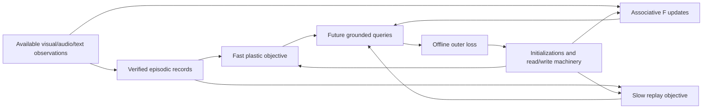

# Native nested learner: algorithm and integration contract

**Active Spark text-memory override — 29 October 2026.**
[Spark memory S0–S1](../../experiments/20261029_Spark_Memory_S0_S1.md) is the
current sequence: competent frozen-original text baseline, then intrinsic recall.
Full multimodal qualification is not a prerequisite for text episodes. The bank
sizes, two-clock schedules and MiniCPM-first references below are preserved design
history, not current allocations or authorization. Keep P1 and the direct-CE
reference; later levels require useful readout and repeated retention/correction.
Current implementation status is in the [dated ledger](../../../reports/intrinsic_memory_v3/evidence_ledger_20261029.json).

**26 October 2026 · Proposed reference, unimplemented and unqualified.** This specifies the missing learning connections in revision 4.5. It complements [document 22](../../architecture/22_State_Mechanism_and_RSI_Contracts.md), which owns state authority, transactions, compiled-path admission and bounded RSI. Numeric schedules below are preregistration candidates, not paper-derived optimal settings or run authorization.

## 1. Product invariants

1. The original Spark language backbone is approximately 4B parameters. Added perception, memory and learning machinery is separately counted; it is not forced inside that count.
2. Full offline fine-tuning establishes vision, audio, spatial/temporal reasoning and use of the intrinsic branches. Online teaching adds knowledge and experience through these capabilities; it does not train the initial modalities.
3. A deployed release freezes original backbone weights, encoders, ordinary projections and the initial qualified controller. Only explicitly declared dynamic state/parameters change.
4. Memory and learning execute inside model computation. The host supplies observations, feedback, serialization and mechanical transaction checks; it does not supply oracle addresses or perform reasoning for the model.
5. The optional spine can be unplugged while the native learner continues to work. An observer cannot mutate the state it observes.
6. Every claim names the retained state, removed information, update rule, objective, cost and held-out outcome. “Memory improved” alone is not a result.

Let `Theta` denote the stable release, including original weights, encoders, memory machinery and initialization templates. Let `S=(C,E,F,A,Pf,Ps,O)` denote scoped dynamic state, where `O` includes all optimizer moments and counters. `Pf` and `Ps` partition the existing `P` bank; they do not rename ordinary decoder FFNs as mutable parameters.

## 2. Optimization levels and non-optimization state

| Level/state | Context and objective | Transition and clock | Persistence/reset |
|---|---|---|---|
| `C`: working/event state | Available sensory evidence, query and current task; trained for grounded decisions | Two recurrent iterations per decision in the baseline; a state recurrence, not a standalone optimizer | Clear for independent tasks; restore only within declared task lineage |
| `E`: episodic records | Observed events, exact facts, evidence and corrections | Native write proposal, then append/supersede at an observation boundary; no gradient | Scoped journal; bounded eviction, revocation and lineage |
| `F`: fast associative parameters | Causal feature associations; squared reconstruction objective, with later-query outer supervision | One functional delta update per sealed observation chunk, never one update per reader site | Scoped persistent state only in the named persistent arm; otherwise session reset |
| `Pf`: faster plastic knowledge | Verified current teaching, plus bounded past examples | One selected expert; up to two optimizer steps per eligible teaching transaction | Persist weights, moments and per-expert step counters across sessions of the same scope |
| `Ps`: slower plastic knowledge | Recent verified teaching and age-balanced retained knowledge | One selected expert; up to two steps every 16 eligible teaching transactions | Same scoped persistence; no periodic reset merely because a session ends |
| `A`: adaptive addressing, optional | Verified record relevance, ranked positives/negatives | Between decisions; separate experimental arm, initially fixed | Persist with key/representation version; reset to fixed transform for interventions |
| `Theta` and `P0` templates | Future queries after adaptation, retention and grounding | Offline release training, including episodic preparation | Versioned release; never changed by ordinary deployed teaching |
| `Psi`: optional learning-policy parameters | Future learning efficiency on independent episodes | Later bounded policy revision, after fixed-policy learning passes | Separate policy revision and rollback; initially frozen/absent |

`E` transactions, `C` recurrence, cache construction and vocab remapping are not automatically optimization levels. They can supply context to a level. For each real optimizer, persist its moments/counters or explicitly declare a reset ablation. Restoring weights without moments is a different learning trajectory.

### Reference plastic bank

Keep sixteen full-rank gated MLP experts, each width 256, hidden width 1024, with three bias-free matrices. Assign eight to `Pf` and eight to `Ps`. A read activates at most one expert from each pool, retaining two active experts per site. A teaching transaction updates at most one expert per pool, even if its examples visit several sites. Combine their eligible losses before a step; do not issue a step for every site. Shared routing initially uses frozen, offline-trained addresses; inference must not receive task IDs or gold relevant-expert labels.

This uses the previous 12,582,912 plastic weights. Compare against a sixteen-expert, one-clock bank with matched active work. If the partition reduces useful capacity, that comparison should reveal it. A larger bank is allowed later, but cannot be used to attribute a capacity gain to nested timing.

**Router training is explicit.** Use query/address similarity within each pool. An offline dense-soft-routing warmup can train addresses and read gates from the verified task/future-query loss, with a preregistered utilization penalty; count all sixteen evaluated experts during that warmup. Transition to the actual top-one-per-pool route before qualification. Hard selection does not supply gradients for an unselected expert's counterfactual usefulness. Keep fixed/prototype-routing controls, measure utilization and test missed-expert failures. For record selection, a contrastive relevance loss may use annotated positive IDs as supervision, never as inference features. Freeze the router in the first deployed learner; adaptive addressing remains separate.

**Zero-effect initialization must not create a dead learner.** An initially closed residual gate can establish absent-extension parity, but the offline alignment phase must open a live path before adaptation training. Do not zero every nonlinear expert matrix and then assume gradients will train it. Verify useful gradients reach selected experts and the read interface, while inactive experts and original deployment weights remain unchanged.

The slower clock counts **eligible verified teaching transactions**, not wall-clock seconds, decoder tokens, or successful query answers. Attempted/committed updates, deferred consolidation and observation counts have separate monotonic counters. A deferred slow update runs at a later admitted boundary, with a maximum of one pending job; it cannot create an unbounded backlog. Clock phases and pending work are checkpointed.

## 3. Fast associative update

For each selected head/expert, normalize keys, bound values and use:

```text
Lassoc(F; k,v) = 0.5 * ||F k - v||²
F_candidate = rho * F + eta * (v - F k) kᵀ
```

This is the explicit linear control, with the error evaluated at the pre-update state. It is not SGDN-2, full Titans, ATLAS or HOPE's self-referential update. `rho` and `eta` are bounded outputs of offline-trained machinery; candidate ranges are `rho ∈ [0.90,1]`, `eta ∈ [0,1]`. Key normalization, vector clipping and finite-state checks are part of the rule. Wider/nonlinear memories require their own declaration.

The writer processes at most 32 selected observation feature vectors per chunk in the reference. Selection and pooling preserve timestamps and source identity; pooling is not permission to average away event order. All participating ports read the same pre-chunk revision. Their contributions are reduced once, with explicitly normalized loss/weights, before the next chunk. A layer-count change must not silently multiply the write magnitude.

The online transition is an explicit tensor recurrence; it does not instantiate SGD or Muon. Offline weights that generate keys, values, queries and coefficients train using the admitted outer optimizer. Retain gradients through up to four observation transitions in the first `F` training arm. Longer historical paths are truncated and identified as such. Compare one/four-transition credit at matched examples and report the extra training cost.

Replay of recent observations is a separate candidate inspired by ATLAS. Fix its window and bytes, and avoid counting replay as fresh evidence. Only past available observations can enter that window. There is no assumption of unlimited exact recall in a fixed matrix.

## 4. Plastic learning objectives and optimizer

### Behavioral reference

The first MiniCPM learning reference updates only selected `P` experts through the frozen decoder using verified answer/grounding losses. Decoder weights have no gradients stored for optimization, but the computation downstream of a plastic branch remains differentiable with respect to that branch. **Frozen decoder weights do not eliminate that backward pass.**

Candidate normalized objectives are:

```text
Lfast = mean(Lverified_current) + 0.25 * mean(Lverified_replay)
Lslow = 0.5 * mean(Lverified_recent_window)
      + 0.5 * mean(Lverified_age_balanced_replay)
```

`Lverified` begins with response-token cross-entropy for the text mechanism test. Multimodal tests add the already-qualified grounding/event target losses, each normalized over valid targets. Loss scales are fixed on development data before the final comparison. The recent window covers up to the previous sixteen eligible transactions. Replay is sampled within scope, across ages and concept families. Empty replay terms contribute zero; their absence is logged.

No loss on self-generated prose can certify a new fact. A measured transition can supervise prediction; subjective audio judgments use listener distributions and viewpoint labels. Distillation may preserve a previously verified behavior but does not turn an uncertain teacher answer into a verified target. Corrections remove superseded targets from the eligible replay set.

Actual parameter steps use `NativeFusedAdamW`, FP32 ownership and finite-gradient/resume checks. Candidate settings are learning rate `1e-4`, betas `(0.9,0.999)`, epsilon `1e-8`, zero weight decay and gradient-norm cap 1.0. The zero-decay control separates retention failures from automatic shrinkage. Development may choose among `1e-5,3e-5,1e-4`; this is not an invitation to retune on final tests.

The hard transaction cap is **four total inner steps**, with at most two for `Pf` and two for `Ps`. The end-to-end control caps processed model positions at 256 per step, including replay positions. Experts not selected have `grad=None`, no optimizer step and no moment decay; multiplying a dense gradient by zero is insufficient. Represent experts separately if needed to make that property true.

### Cheaper local-learning candidate

A local objective is an efficiency experiment, not the assumed product winner. Fix a stable, release-versioned feature producer: the qualified decoder/encoder path with dynamic memory, plastic branches and phrase rows disabled. Extract input vectors from the pre-port query/evidence path; extract target vectors from verified response/evidence positions using fixed projections. Targets and input extraction are stopped for inner optimization. The target answer is permitted in target construction, never in the query feature.

The candidate loss is normalized feature prediction, `1 - cosine(P(x), z_verified)`, plus the same verified replay structure. It processes at most 128 feature vectors per step, replay included. Offline alignment must train the live query/read interface to use these learned features. Initially hold the feature producer fixed during this candidate's meta-training; otherwise cached target spaces silently drift. Do not compare it to an arm that also receives an unreported full-backbone meta-training advantage.

Feature extraction still costs encoder/decoder forwards. Store `feature_producer_hash`, projection version, source span, target type and scope with each replay record. A release update invalidates these vectors. A historical replay vector is a training example, not a reusable inference KV cache. This candidate adds no second permanent language model; the frozen backbone is reused with branches disabled, and the extra pass is charged.

Reject local learning if lower local loss fails to improve fresh behavioral queries. Promote it over the behavioral reference only if it retains the required quality while reducing **total** learning cost. Otherwise keep the more expensive reference as an honest result and revisit the representation or objective.

## 5. Offline training and cross-level credit

For the active Spark text-memory sequence, qualify frozen-original text competence
and useful intrinsic recall before chronological text-learning episodes. Native
multimodal work is deferred and does not block that sequence. The present S1
objective is one source encoding and response CE, not a nested objective. A later
writer/P protocol must connect teaching to distinct future queries and retention,
and declare which derivatives pass through earlier updates. See the first-order
limitation below: omitted Adam/moment/learning-rate derivatives cannot train the
inner learning rate through that path.

**Historical multimodal/two-clock proposal, not an active text-memory gate:**
The full multimodal phase updates the original backbone, encoders, bridges and relevant intrinsic components. Only after perception and reasoning gates pass, construct chronological episodes of at least 32 eligible teaching transactions for the initial two-clock study. This ensures slower boundaries are exercised. Include corrections, domain recurrence, interference and session restarts. Independent worlds reset to initialization; sessions within a world carry declared state. Train both regimes so deployment persistence is not an unseen reset policy.

For teaching data `Dteach` and separately held-out future queries `Q`:

```text
S_T = U_Theta(S_0, Dteach)
J = L_future(Q; Theta, S_T)
  + lambda_ret * L_old(Q_old; Theta, S_T)
  + lambda_ground * L_grounding_retention
```

Use measured cost as a separate constrained model-selection criterion initially. Wall-clock cost is not a differentiable scalar merely because it appears in an equation. A later differentiable surrogate must be calibrated against measured cost. Log examples, positions, feature vectors, teacher requests, forwards, backward work and replay separately.

The intended transfer graph is:



The `E→P` edges transfer supervised experience, not arbitrary copied weights. `Pf` and `Ps` jointly affect later answers; slow consolidation must use independently established targets rather than silently accepting fast predictions. A direct fast-to-slow distillation arm is separate and uses a qualified teacher. The initial design does not claim all possible cross-level edges.

### First-order reference that respects the optimizer policy

The installed-version source rejects differentiable fused Adam steps. For `P`, use ordinary native inner steps and compute a future-query gradient at adapted parameters. Map that gradient back to the corresponding initialization template, approximating the adaptation Jacobian by identity:

```text
P_T = AdamW_inner(P_0, teaching)                 # actual bounded updates
g_P0 ≈ gradient_P_T J(P_T)                     # first-order estimate
Theta/read-controller gradient = direct query path + declared F-unroll path
```

This omits derivatives of `P` gradients, Adam moments, learning rates and teaching-feature construction through the `P` updates. It therefore **does not learn the inner learning rate by this path**. Keep that rate and the write-eligibility policy fixed in the initial candidate. Read gates and `F` coefficients can still learn through their declared paths. The outer optimizer is also native fused AdamW.

An exact short-unroll reference would differentiate the full AdamW recurrence, including moments and bias correction, through one/two/four steps. A functional mathematical comparator is specified for gradient/parity verification; actual model training through it requires an implementation and protocol qualification. Do not silently switch the production optimizer or describe first-order results as exact HOPE/TTT gradients. The first-order route can still be evaluated on the desired future-learning objective, with its limitation explicit.

For slower clocks, schedule outer queries immediately before and after a slow update as well as at episode end. A four-observation `F` truncation window is not a sixteen-teaching-event consolidation horizon. Log both. Carry older state with detached history where required; that bounds compute but truncates credit.

## 6. Causal transaction sequence

1. Pin the stable release, scope, vocab mapping and dynamic revision at a decision boundary. Read available observations only; waveform/window encoders expose their actual availability delay.
2. Predict or answer using that immutable snapshot. A future-event prediction is scored before revealing the event. Answer tokens under teacher forcing are loss targets, not writable observations.
3. Seal newly available external observations/feedback with event identity, source span, time and scope. If the current input itself is an observed fact, it may be incorporated at an explicit observation boundary before a later query; this is not permission to reveal a prediction target early.
4. Propose `E/F` updates, and advance eligible teaching counters. A query, retry, generated explanation, checkpoint recomputation or backward pass cannot create a second teaching event.
5. Build the bounded `Pf/Ps/A` candidate and candidate optimizer state. Relevance labels supervise training losses only; they cannot choose the inference record or expert.
6. Check finite tensors, declared write set, budgets and lineage. Any development acceptance test uses a designated teaching/development partition. Sealed final tests cannot select, approve or reject individual updates.
7. Atomically publish weights, moments, counters, clock phase and dependent record revision. A failed candidate restores the prior state without partial optimizer changes. Persist event deduplication keys.
8. Invalidate dependent KV, read projections, phrase vectors and derived artifacts. Start the next decision using a consistent revision. Background updates publish only between decisions; they never race with an in-flight answer.

The host enforces mechanical invariants; the native model still supplies semantic addresses, representations and update proposals. Host transactions do not make memory an external reasoning service.

## 7. Connect vision, audio, vocabulary and functional appraisal

**Common event identity, separate evidence.** Keep timestamps, coordinate frames, entity tracks, modality masks and source spans alongside semantic and modality-specific values. Alignment is a learned connection, not proof that a caption preserves a sound or image. A visual change, acoustic motif and verbal instruction may refer to one event without collapsing into one lossy text summary.

**Persistent knowledge.** Teach a relation using several observations, then test different objects, performers, viewpoints or time patterns. `P` should carry reusable behavior; `E` carries exact evidence and exceptions. A learned acoustic pattern is not an STT transcript. Fine timing, pitch and spatial scale stay available at the appropriate representation resolution, with compression separately tested.

**Stable vocabulary semantics.** Store `concept_uid`, stable lexeme identity and canonical bytes independently of active slot index/generation. Apply phrase substitutions before static n-gram hashing through canonical base-token expansion, or use a separately versioned concept index; do not hash recyclable slot IDs. Persist no optimizer state under a lexical slot alone. Time/coordinate tokens and acoustic codebooks are separate types.

**Appraisal/controller.** Novelty, uncertainty, relevance and estimated learning value may allocate read/write effort. Perceived emotion is a distribution over listener judgments; internal appraisal is a control variable. Neither is a truth label. Compare fixed, learned and shuffled appraisal at the same update count. Novel noise should not force repeated expensive updates. Personality conditioning remains pending user input and stable/versioned; learned experience cannot quietly rewrite it.

**UAP/spine.** Optional adapters train offline against a pinned tensor contract. Extra sensors or models may supply causally available features; they do not get direct write access to `P`, moments or the verifier. Each mutable attached module would need its own learning/representation contract and cost account. One-way exchange precedes finite-round bidirectional experiments.

## 8. Persistence, correction, migration and growth

Scope all states by release, subject/world and branch. Cross-session persistence is permitted within that scope; cross-user transfer requires a separate explicit policy. Wrong-scope reads and replay must fail closed. Rehydrating a checkpoint includes optimizer moments/counters, router versions and clock phases, not just plastic weight files.

For a correction, supersede the episodic fact immediately and train on the revised, scoped target. This does not prove that compressed parameters have erased every influence of the old source. Exact deletion from `P/F` is generally not available from a source ID. The concrete fallback is restoring a checkpoint preceding the source and replaying eligible retained evidence without it. If necessary lineage/evidence has been evicted, exact reconstruction is unavailable; record that limitation, reset the affected bank/scope where required, and requalify behavior.

A new stable release changes representation compatibility even if tensor shapes match. Default to invalidation/re-encoding and resetting incompatible compressed state. A learned migration is a separate candidate tested for retained meaning, corrections and scope isolation. Never silently transform an old memory by matching dimensions.

Extra expert capacity is allowed after saturation evidence, but expert growth is bounded and versioned. New weights, moments, router calibration, eviction and snapshots all cost storage. Test fixed-capacity curves first. Adding parameters indefinitely is not the promised low-cost long-running behavior.

## 9. Resource reference and release claim

With the proposed sixteen experts and resident FP32 Adam moments, live `E/F/P/C` is approximately **159.04 MiB**; optional adaptive `A` with moments raises this to **159.60 MiB**. Charged candidate weights/moments, active gradients, `F/A` staging and workspace staging bring the illustrated payload to about **190.39 MiB**, before replay and omitted backend buffers. The [reproducible ledger](../../../reports/sparkx_nested_learning_20261026/analytical_costs.json) lists every term.

Use a **256 MiB mutable-state research envelope plus a separate 64 MiB replay envelope**, subject to measured peaks and existing run guards. This is neither a universal model-size cap nor training admission. The prior 128 MiB profile remains a smaller experimental control, not a credible resident budget for this full Adam candidate. Loading moments on demand is another experiment with transfer latency charged.

Only after validation may the release claim: “This fixed-backbone model acquires specified new knowledge through its intrinsic dynamic parameters, retains it across declared sessions and interference, and transfers it to new instances within measured resource limits.” Broader claims of lifelong learning, exact erasure, autonomous architectural redesign or recursively improving intelligence require additional evidence.
