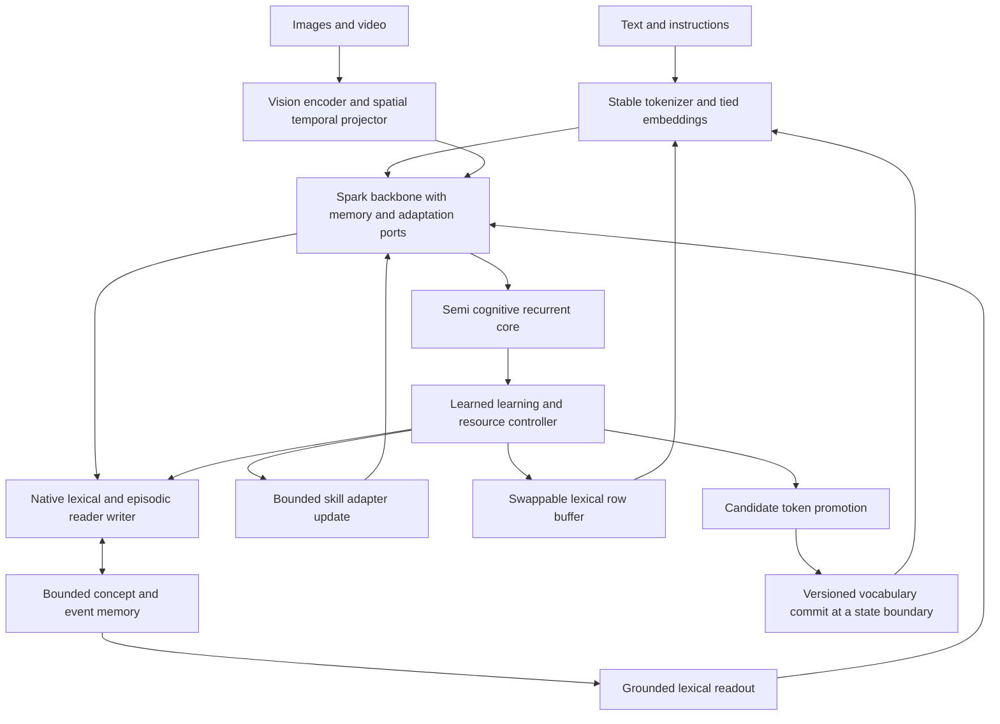

# Integrating vocabulary learning with native memory and vision

The proposed system separates immediate lexical learning from persistent skill changes. Both live within the model's architecture and state contract. The runtime provides tensor execution, resource limits and persistence; semantic selection belongs to learned readers, writers and controllers.

## Native data flow



The diagram describes the target architecture. Current caller-selected copy/pointer diagnostics do not fulfill the native selection path. The [earlier architecture plan](../dynamic_engram_20261025/02_Native_Architecture.md) supplies the episodic bank, compact fast weights, core state and vision/event representations. This extension reuses those resources rather than allocating a second large memory bank solely for words.

## Lexical memory before tokenizer growth

Use the existing proposed 4,096-slot episodic capacity as the initial shared budget. A lexical entry associates an original spelling, its base-token sequence, a concept/event reference, contextual features and provenance. It also carries owner/scope, confidence, timestamps and representation version. Store variable-length spelling payloads under the existing bounded payload budget. Additional metadata has a cost and must be measured; it is not included in the prior tensor-only state estimate.

The native writer receives token states and, where available, aligned region, track or event features. It proposes a binding. A native query selects relevant entries; a learned read gate decides whether to modify hidden states or assist exact spelling. The host may enforce scope and capacity masks, but must not supply the correct concept or answer as the selection algorithm.

For example, the instruction “Call the object with the striped handle a veltraxon” creates a provisional spelling-to-object binding. Later views test whether the model tracks the same object despite occlusion or a changed camera angle. An event can bind “the veltraxon was moved after the blue cup fell.” Knowing the word's characters, identifying its referent and reasoning about event order require separate evidence.

Begin with a token-level readout over existing vocabulary IDs. In a copy-only branch that retains the original input representation, returning a string does not update autoregressive state: its base tokens must be incorporated with correct positions and KV state, and those steps count toward inference cost. A separately trained atomic phrase representation can instead feed one vector into the next step. The [swappable-vocabulary design](05_Swappable_Dynamic_Vocabulary.md) distinguishes these modes and their cache contracts. Exact spelling success alone is insufficient evidence of conceptual learning.

## Bounded permanent vocabulary extension

Represent embeddings as a frozen base table `E0[V, d]` and a small trainable extension `Eplus[K, d]`. Input lookup selects the appropriate table. Output logits use the same rows:

```text
input(id) = E0[id]                 if id < V
input(id) = Eplus[id - V]         otherwise
logits(h) = concat(h E0^T, h Eplus^T)
```

This preserves tying without making the full base table trainable. Avoid materializing a concatenated 640 MiB embedding table on every call merely to replace a few rows. A gradient mask over a full trainable table is also insufficient: optimizer states can still cover all rows, and decoupled weight decay can modify rows with zero gradients. Verify unchanged base rows by hashes and numerical checks.

Initialize candidate rows using two controls: the mean base embedding, and an explicitly trained composition of the term's old pieces. Mean initialization bounds one source of initial output disturbance; composition may encode useful structure but needs evaluation. Neither supplies a novel term's definition by itself. Train input use, output use and grounded use with verified examples and replay. Keep a candidate hidden from normal generation until its activation criteria pass.

Even if old IDs remain fixed, appending unmasked rows changes softmax normalization. With K identical mean rows, no biases and an unchanged hidden state, Jensen's inequality gives the original-distribution bound

```text
KL(p_old || p_extended) <= log(1 + K / V).
```

Here `p_old` has zero mass on the added IDs. This follows because each new exponential logit is at most the mean of the old exponential logits. It applies only to this initialization and matched hidden state, not to trained rows or retokenized input. Masked inactive rows can preserve old logits/probabilities; active rows require behavioral retention checks. The [cost calculator](../../../reports/vocabulary_lora_research_20261025/estimate_costs.py) evaluates the bound alongside storage.

Commit extensions at a checkpoint/state boundary, starting with 256 rows. Atomically bind tokenizer revision, active-row count, embeddings, optimizer state, model configuration, adapter identity and state representation. A shape change invalidates relevant compiled graphs and caches. Existing raw observations can be re-encoded through an explicit migration; stored IDs cannot be silently reinterpreted. Keep old IDs and reserved controls immutable, including strings not marked special by tokenizer metadata.

A promotion's benefit is an amortization question:

```text
expected benefit = future eligible uses × measured cost saved per use
                   - row training - evaluation - migration - cache/compile cost
                   - persistent storage and wider-output cost.
```

Measure this over a declared workload and horizon. Frequency alone cannot settle it. Per-instance or scoped vocabularies must carry their identity through state and adapters; a global model vocabulary should not inadvertently inherit another instance's private lexical content.

## Learning reusable skills

Preserve the base model initially. Use bounded skill adapters for generalizable changes such as a newly instructed visual comparison procedure, a recurring reasoning rule, or improved memory use. Individual facts and object names normally remain in memory. A memorized association that succeeds only with its original entry is a memory result; successful transfer to unseen examples is evidence for a skill update.

The first comparison uses ordinary LoRA on two eligible backbone projections, alongside a control that trains only the new native residual ports. Follow with ranks 8/16, explicit scaling, a small learning-rate search and LoRA-FA. Expand to more backbone targets only if the narrower update cannot learn the task. Do not transfer MiniCPM adapter weights into differently shaped Spark projections; transfer contracts, datasets and experimental procedures.

The learning controller receives evidence quality, novelty, recurrence, error signals, uncertainty and available resource budget. Its actions are `ignore`, `write_or_correct_memory`, `schedule_skill_batch`, `propose_token`, and, later, `choose_adapter_rank`. These actions are learned model outputs over bounded choices. The model's learning API executes a declared numeric update rule against the eligible tensor state. A host-maintained rule engine that chooses meanings or rewrites answers would not satisfy the native target.

At first, use supervised controller targets and a fixed update rule so failures can be diagnosed. Later, learn bounded update magnitudes, replay selection and consolidation cadence. Gradients and optimizer arithmetic still need a runtime; that does not make the semantic memory external. However, a script that selects correct facts or evaluates candidate answers cannot be counted as an already learned native controller.

New observations are not automatically valid training targets. Explicit corrections, observable task outcomes and verified visual correspondence provide stronger signals than the model's own generated claims. Self-generated examples require independent checks and retention controls. The controller should also learn to defer an update when evidence is ambiguous.

## Multi-timescale learning and the semi cognitive core

| Timescale | Mutable component | Typical event | Proposed initial policy |
|---|---|---|---|
| Forward pass | Core state, bounded episodic state, compact fast weights | New observation, retrieval, contradiction | Native learned state update |
| Small batch | Skill adapter and selected new rows | Several verified examples of a reusable rule | Bounded gradient update with replay |
| Consolidation | Stable adapter, lexical promotion set, learning-policy parameters | Repeated utility over several episodes | Evaluate, version and commit |
| Research campaign | Base checkpoint, tokenizer architecture or vision backbone | Sustained failure of the smaller mechanism | Separate training and qualification |

This develops the HOPE/Nested Learning direction already examined in the earlier report. Different update frequencies are an architectural design, not proof that the full published HOPE algorithm has been reproduced.

The recurrent core can hold uncertainty, goal progress, novelty and functional appraisal. Arousal-like state may prioritize a new event; familiarity may reduce repeated writes. Constrain these effects to explicit attention, replay and compute budgets. Factual confidence and affective salience remain separate quantities. Compare an appraisal controller with a neutral controller under identical data and compute. Any personality-specific preferences wait for the supplied personality description.

For recursive improvement, distinguish better accumulated knowledge from a better learning rule. After several cycles, compare the updated learning controller with a frozen controller given the same accumulated knowledge, observations, update count and compute. Evaluate on new tasks and lexical families. A gain caused by additional stored answers, longer context or more training is not evidence that learning itself improved.

## Experiment sequence

| Stage | Work | Dependency and decision |
|---|---|---|
| VL0 | Tokenizer/weight/gradient inventory; representative fragmentation and timing profile | Uses current source admission; establishes the cost and compatibility baseline |
| VL1 | Native lexical selection, spelling readout, correction and restart | Requires the earlier dynamic-memory diagnostic separation and useful recall gate |
| VL1S | Swappable lexical rows and trained atomic phrase feedback | Depends on VL1; compare with permanent rows before expanding the permanent vocabulary |
| VL2 | Narrow LoRA baseline, tuned scaling/LR and LoRA-FA | Depends on a qualified backward path; compare against direct training of new ports |
| VL3 | 256-row tied vocabulary pilot; optionally 1,024 | Requires VL0/VL1 and a measured recurring compression opportunity |
| VL4 | Joint text, visual naming, temporal use and instructed skill learning | Combines accepted VL1/VL2; vocabulary extension stays an optional ablation |
| VL5 | Input-only dynamic tokenization and a Spark-specific embedding generator | Optional after VL0; no dependency for delivering VL4 |
| VL6 | CARE-LoRA, MatryoshkaLoRA, EVA/DoRA and selected offline alternatives | Start after VL2; qualify each method independently |
| VL7 | Repeated learning cycles and learning-policy improvement | Requires accepted joint learning and retention; compare against frozen-policy control |

VL1 complements DE2 in the Dynamic Engram plan; VL2 develops DE6/DE7 adaptation; VL4 uses DE5 visual grounding; VL7 develops DE9. The earlier stages retain their original admission conditions.

## Evaluation and proposed acceptance criteria

Use at least three independent seeds/world splits, and hold out word families, object instances and task rules. A preliminary set should include 200 novel lexical bindings, 50 explicit corrections, 200 grounded naming/relation/event cases and at least 1,000 unrelated retention questions spanning language, code, numbers, reasoning and instruction format. These are proposed experiment sizes, not a dataset already assembled.

| Gate | Proposed criterion | Interpretation |
|---|---|---|
| Identity | All old ID mappings and controls preserved; disabled-path parity and reload checks pass | Structural prerequisite |
| Lexical learning | At least 90% exact spelling and at least 85% held-out referent/definition use | Both form and meaning must work |
| Correction | At least 90% corrected bindings; unrelated binding accuracy falls by at most 2 percentage points | Editing must preserve other knowledge |
| Vocabulary promotion | At least 10% fewer tokens on the predeclared eligible subset and at least 5% amortized wall-time benefit over the workload horizon | A storage-only change need not be promoted for efficiency |
| Retention | Overall accuracy degradation at most 2 points; report paired confidence intervals and each task family | Reject if uncertainty or a critical-family regression remains unresolved |
| Grounding | At least 85% held-out object identity and relation/event accuracy, with shuffled-vision and no-vision controls | Naming must depend on visual evidence |
| Gradient path | Finite, nonzero intended gradients and finite-difference/autograd agreement for exact methods | Approximate methods additionally report gradient error and downstream impact |
| Hardware | Within inherited device, free-memory and swap limits; no silent fallback | End-to-end profile includes training and validation |
| Learning policy | Across 10 cycles, a positive paired-confidence-interval improvement over the frozen-policy control at matched compute, with retention still passing | Evidence of improved adaptation on this protocol only |

VL1S adds slot identity/permutation, eviction/reactivation retention and amortized-cost gates, detailed in the [swappable-vocabulary experiment](05_Swappable_Dynamic_Vocabulary.md). Its temporary slot reuse does not permit reassigning permanent tokenizer IDs.

Report accuracy, correction success, false associations, abstention/calibration, restart parity, peak device memory, update joules when measurable, wall time, bytes/second and answers/second. Token perplexity is not directly comparable across changed tokenizations. Use bits per byte or appropriately aligned sequence likelihood; teacher KL requires compatible output spaces and prediction boundaries. Report both cold and warm caches.

Required controls are no learning, lexical memory only, rows only, adapter only, memory plus adapter, and the full accepted combination. Reset memory, reset adapters and restore the old tokenizer separately to identify where a gain lives. Use held-out validation for selection and a final untouched test set. A result that improves only spelling compression does not pass the skill or recursive-improvement gate.
