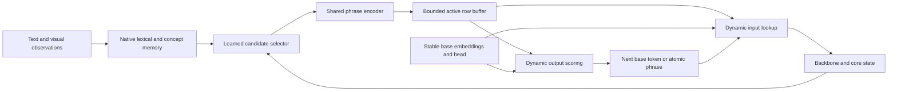

# Swappable dynamic vocabulary for Spark

**Swappable vocabulary is a promising intermediate design between lexical memory and permanent tokenizer expansion.** Keep Spark's base vocabulary stable, and expose a bounded, changing set of native lexical-memory entries as additional input/output units. The physical slots can be reused while the entries retain stable identities and learned representations.

This refines the earlier plan: its prohibition on reusing IDs applies to permanent tokenizer IDs. A temporary slot can change meaning if every use is bound to the correct entry and version. The recommended first prototype has **256 active slots**, a separate **1,024-slot capacity study**, and a shared phrase encoder. These are proposed settings, not an implemented model capability.

## What can be swapped

| Design | Swap unit | Suitability for Spark |
|---|---|---|
| Language or domain vocabulary pack | A trained tokenizer, embedding table and output head, with any required adapters | Useful for coarse task switches; compatibility and loading costs are substantial |
| Native lexical working set | A small set of generated phrase rows backed by persistent lexical entries | Recommended branch for continual learning |
| Restricted base output head | A selected subset of existing vocabulary rows | Separate inference optimization; omitted output words can reduce quality |

The working-set design retains the full base head as a fallback. It bounds the additional active vocabulary; it does not shrink the existing 640 MiB tied base table. Savings must come from useful phrase compression and reuse, or from avoiding a much larger permanent extension.

## Research that directly supports the direction

**Generation with Dynamic Vocabulary**, EMNLP 2024, learns a phrase encoder and uses its vectors as both input and output units. A selected phrase can feed the next step as one vector, avoiding expansion into all constituent tokens. The encoder needs training first. Its simulated online experiment gradually adds phrases; that is not a complete eviction, identity and continual-learning protocol. This is a more direct precedent for atomic phrase generation than input-only dynamic tokenization. [Paper v1](https://arxiv.org/html/2410.08481v1).

**DVAGen**, EMNLP 2025 demonstrations, extends this approach to modern small models and batched phrase masks. It supports frozen-backbone training, but the reported phrase encoder is itself a trainable Qwen3-0.6B model. Its retrieval pipeline uses external documents and a retriever. For Spark, the relevant mechanisms are phrase input/output representations and per-example masks; native Engram selection and a much smaller encoder remain our proposed changes. [Paper v1](https://arxiv.org/html/2510.17115v1).

**Hydra language models** in Trans-Tokenization demonstrate multiple input embedding tables and language-specific output vocabularies. Their experiments require adapted representations and training; they do not establish that an arbitrary head can be attached to an unchanged model. This is evidence for vocabulary packs, rather than continual replacement of individual learned concepts. [Paper v1](https://arxiv.org/html/2408.04303v1).

**VocabTailor**, revised April 2026, preserves full input tokenization and dynamically selects output rows using input tokens and a profiled task vocabulary. It includes preallocated buffers and tied-weight handling. Its reported vocabulary-component savings are larger than its whole-model savings, and its switching discussion assumes infrequent task changes. The profiling tolerance applies to profiling coverage; it cannot guarantee the same error bound on an arbitrary future distribution. [Paper v3](https://arxiv.org/html/2508.15229v3).

These works establish useful components. The combination with persistent native lexical learning, vision and versioned slot reuse is a research proposal. [Additional source manifest](../../../reports/vocabulary_lora_research_20261025/swappable_review.json).

## Proposed architecture



Each persistent lexical entry has a stable `lexeme_id`, exact surface bytes, base-token spelling, representation revision and concept links. The concept store carries facts, object identities and temporal relationships. One spelling can refer to several concepts depending on context; a new meaning does not automatically require a duplicate output row with the same spelling.

The native selector scores eligible entries from model state and the memory bank. Hard masks enforce capacity and the existing owner/scope contract. A shared encoder initially computes a row from the spelling's base-token embeddings. Conditioning it on a compact learned lexical state is a later ablation. Context affects selection and the concept reader first; keeping the spelling encoder context-independent makes caching easier to validate.

The active row is a derived tensor, not an independently optimized parameter tied to its physical slot. This is the key to inexpensive swapping: shared encoder parameters and persistent entry state carry learning; the slot only holds a current representation. When an entry leaves the active set, its persistent record remains subject to the separate Engram capacity policy. Swapping does not create unlimited memory.

Use a fixed maximum buffer shape, initially `S[256, 2560]`, with active-row masks. Compute input lookup and output scoring against the base and dynamic tables separately. This avoids rebuilding or copying the full base table. A proposed learned mixture gate can choose between the base-token and phrase distributions; compare it with a concatenated-softmax control. The gate needs calibration against changing candidate counts and distractors. Disabling the phrase branch preserves base behavior only when the preceding input/state is also unchanged.

## Stable identities and reusable slots

For example, physical slot 17 can hold the spelling “veltraxon” in one generation and a different identifier in the next. Persist the lexical identity, never the naked slot number:

```text
live reference = (stream_id, slot_index, slot_generation)
resolved entry = (lexeme_id, surface_revision, encoder_revision, lexical_state_revision)
```

A runtime can encode temporary IDs above the permanent vocabulary range, but they occupy a distinct, versioned namespace. If permanent rows also exist, start the temporary range above those rows. Token IDs alone are insufficient to reconstruct a dynamic sequence.

The first prototype freezes the slot map for one generation. It can swap the working set before the next generation without retraining the backbone. A later experiment permits bounded refresh at segment boundaries. Pin a sampled phrase until it has been consumed as the next input; also pin references required by active beams or a backward/recomputation graph. If every slot is pinned, use base tokens rather than violating the capacity bound.

Logs and saved histories retain exact text and stable lexical references. Repetition penalties, stop-string handling, batching, beam reordering and speculative decoding must operate on the appropriate stable identities or emitted surface text. A penalty keyed only by slot 17 would incorrectly transfer from the old occupant to the new one. A phrase spanning a stop marker or an instruction-role delimiter must be rejected or handled by an explicitly trained boundary rule; exclude these spans in the first prototype.

Optimizer state must follow persistent parameters or lexical identities. Reusing Adam moments from a physical slot for an unrelated word would transfer the old word's update history. Derived row buffers avoid that problem. During encoder training, recompute rows in the gradient graph rather than using detached inference-cache values.

## Generation and cache consistency

There are two different execution modes:

1. **Copy with base-token feedback.** Select a phrase, emit its text, and incorporate its constituent base tokens into autoregressive state. This is a useful compatibility control, but those backbone steps still cost compute.
2. **Atomic phrase feedback.** After training for this representation, emit the phrase and use its single learned vector as the next model input. This can reduce backbone steps. The model has learned a different representation of the history, so exact equality with base-token decoding is not expected.

For atomic mode, train and evaluate an explicit position rule. The first proposal gives each base token or atomic phrase one model position, and separately stores byte spans and event timestamps. RoPE distance then counts compressed units. This changes effective context geometry, including Spark's sliding windows; evaluate long-context and temporal ordering rather than assuming unchanged behavior.

Swapping candidate output rows does **not inherently require flushing every existing KV tensor**. If the realized prefix embeddings, positions, backbone parameters and relevant recurrent state are unchanged, its cached keys and values still describe that prefix. The future output choice can use a new candidate set. However, replaying old slot IDs against the new map would reconstruct a different prefix. Re-encoding with changed embeddings, encoder versions or backbone adapters requires a new compatible cache.

Exact restart needs compatible KV/state plus the referenced mapping/representation revisions, or sufficient information to reproduce the same atomic inputs. Rebuilding from raw text with the base tokenizer preserves surface history, but is a different computation and must not be reported as exact state parity. Retaining historical revisions also consumes storage. Start with simple generation-boundary swaps before attempting mid-stream reuse.

## Learning and vision integration

Train the encoder and native reader/selector on varied mixtures of base tokens and phrases, using held-out spellings and phrase families. Include prefix/suffix confusions, overlapping phrases, absent candidates and unrelated distractors. Preserve ordinary token-only training examples. Compare downstream predictions at matched surface-prefix boundaries; a phrase step and a base-token step do not generally represent the same position.

Crucially, randomize slot assignment in training. The same phrase should work in different slots, and the same slot should hold many unrelated phrases across examples. Reordering rows and their maps should reorder phrase logits without changing the decoded distribution beyond numerical tolerance. This tests whether meaning follows the supplied representation instead of a memorized slot index.

At inference, the candidate set must come from the observed prefix, existing eligible memory and the native selector. Future answer text must not be used to select evaluation candidates. A teacher can supervise selection during training, but an oracle candidate list is a diagnostic upper bound, not a native-learning result.

When a user teaches a name for a visual object, the concept binding lives in Engram. The spelling can be activated, evicted and later reactivated while retaining that binding. Test cross-view identity and temporal relationships after the swap. A phrase vector alone does not encode an entire scene or establish event order. The semi-cognitive core can modulate relevance and refresh budget; appraisal does not determine lexical truth.

Use LoRA to adapt shared phrase handling or memory use when needed. Do not allocate a new LoRA for every swapped term. First establish whether the frozen backbone plus trained encoder and native ports suffice; enable a narrow LoRA only if the measured learning gap justifies it.

## Capacity and compute

| Active slots | One tied BF16 row buffer | Two full buffers for an atomic swap | Added output-head arithmetic |
|---|---:|---:|---:|
| 256 | 1.25 MiB | 2.5 MiB | 0.1953125% |
| 512 | 2.5 MiB | 5 MiB | 0.390625% |
| 1,024 | 5 MiB | 10 MiB | 0.78125% |

These are row-buffer payloads per distinct active vocabulary, excluding encoder, base model, KV, metadata and allocator costs. Different per-stream vocabularies multiply the batch cost unless rows can be shared. Tying means each active row serves input and output. Separate input/output encoders would change the budget. Retaining the full base head means the percentages are additional head arithmetic, not savings.

An illustrative small encoder with two width-256 Transformer blocks, MLP ratio four, and down/up projections to Spark's width has **2,883,584 matrix parameters**: **5.5 MiB BF16 weights**, or **44 MiB** under the earlier FP32 weight/gradient/two-moment training scenario. An eight-base-token phrase costs approximately **18.55 million matrix MACs** under this architecture. Norms, biases, routing and other operations are excluded. Its quality is unestablished; this is a budget hypothesis to test against a larger encoder or teacher, not a replacement already shown equivalent to DVAGen's encoder.

Cache derived rows by lexical and encoder revisions. Cap fresh phrase encodings per refresh, initially at 16, and use base tokens when the budget is exhausted. Measure cold starts, cache hits, refresh frequency and eviction/reload cycles. A 4,096-entry bank with 256-wide BF16 values and 128-wide keys has 3 MiB of tensor payload before spelling and metadata; reuse existing Engram allocation where possible. [Reproducible estimates](../../../reports/vocabulary_lora_research_20261025/swappable_costs.json).

Vocabulary packs or reduced base heads can be revisited separately. A selected output head changes the probability distribution and may exclude a needed word; high confidence within that restricted head does not prove the omitted vocabulary is irrelevant. On unified memory, moving a table to CPU does not by itself remove it from physical RAM. These considerations make the full-base-plus-small-overlay design the cleaner first self-learning experiment.

## Experiment addition and decision

Add **VL1S after VL1**: fixed-per-generation slots, native candidate selection, shared phrase encoding, then atomic phrase feedback. Compare 0, 256, 512 and 1,024 slots; compare cache-only swapping, permanent rows and copy-with-base-feedback at matched data and quality. Keep permanent promotion optional until it beats this alternative.

In addition to existing lexical, grounding and retention gates, require:

- Slot permutation consistency and zero stale-identity failures in adversarial replacement, batching, restart and pending-input tests.
- Eviction/reactivation accuracy within two percentage points of the same entries held resident, with absolute lexical gates still passing.
- Correct fallback when candidates are absent, all slots are pinned or refresh capacity is exhausted.
- At least a proposed 5% amortized wall-time gain for an efficiency claim, including selection and fresh encoding, with retention passing. Memory functionality can still be useful without a speed claim.

**Recommendation:** test a swappable native lexical overlay before committing to substantial permanent vocabulary growth. It matches the goal of a small model whose usable vocabulary changes with experience, while keeping active tensor capacity bounded. The difficult part is learning useful representations and preserving identity across swaps; allocating the row buffer is the easy part.
